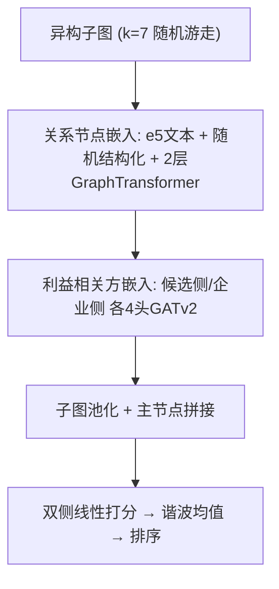
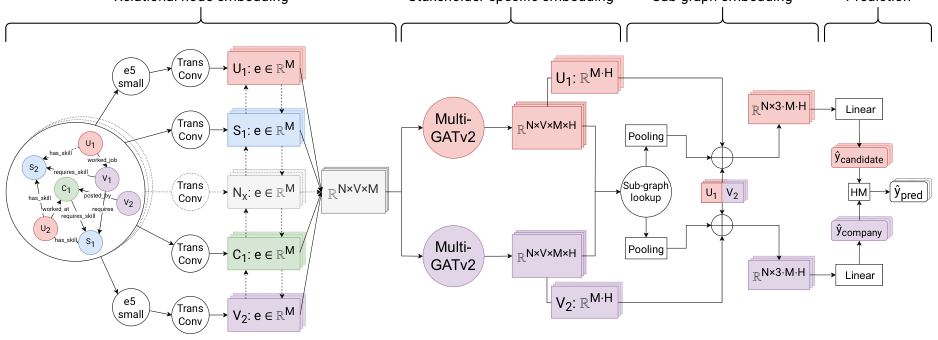

# OKRA: an Explainable, Heterogeneous, Multi-Stakeholder Job Recommender System (基于注意力的可解释异构多利益相关方职位推荐系统)

- **会议/期刊**: ECIR 2025
- **作者与机构**: Roan Schellingerhout, Francesco Barile, Nava Tintarev（马斯特里赫特大学）
- **推荐链路定位**: 重排（候选-职位子图级精排）
- **研究方向**: 去偏公平与工业架构 / 图神经网络与知识图谱推荐
- **论文原文**: [https://arxiv.org/abs/2504.07108v1](https://arxiv.org/abs/2504.07108v1)
- **开源代码**: [https://github.com/Roan-Schellingerhout/OKRA_ECIR](https://github.com/Roan-Schellingerhout/OKRA_ECIR)

## TL;DR (1分钟核心速览)

招聘推荐被欧盟立法列为"高风险"场景，要求可解释与公平，但现有 JRS 要么是黑盒、要么只用结构化或纯文本单侧数据、且只服务单一利益方。OKRA 将结构化字段与 CV/职位文本统一建为异构知识图谱，用多头 GATv2 分别生成求职者侧与企业侧嵌入，以谐波均值融合双侧打分，注意力权重天然充当解释。在专有数据集与 Zhaopin 上，nDCG@10 分别达 0.7690 / 0.8531，较最强基线相对提升 17.7% / 15.2%，同时量化了全模型共有的城乡地域偏差。

## Background & Motivation (背景与核心矛盾)

- **主流范式**: 当前 JRS 主流是纯文本双塔——用 BERT/e5 类 Transformer 编码 CV 与职位描述后算余弦相似度（conSultantBERT、e5-multilingual 为代表），少量工作引入结构化表格特征。
- **前人局限**: 其一，**数据割裂**——文本派丢弃技能、驾照、语言、工时等结构化字段，结构化派丢弃文本语义，预测力被系统性浪费；其二，**单边视角**——模型只优化"求职者看到好职位"，忽略企业侧"职位找到合适人"的诉求，而多利益方目标常相互冲突，缺乏可分别定制的解释。
- **核心洞察 (Key Insight)**: 知识图谱可同时容纳结构化三元组与文本节点，且 GNN 的节点/边注意力本身就是可读解释；若把同一子图的边反向，即可从职位视角重新"接地"推理，从而用一套参数产出双侧嵌入与双侧解释。
- **本文切入点**: 以 k-random walk 抽取候选-职位子图，用多头 GATv2 生成双侧嵌入并以谐波均值聚合，把"精度-可解释-公平"三者放进同一框架联合评估。

## Method (核心方法设计)

### 1. 整体框架 (Overall Architecture)

输入为每个 (候选, 职位) 对经 $k=7$随机游走抽取的异构子图（含技能、工作经历、教育、职位要求等边类型，由 kglab 依 ISCO 职业层级与 OWL 推理规则构建）。先做关系节点嵌入：文本节点用 e5-multilingual-small 取前 96 token 均值池化后过线性层得$T$ 维向量，结构化节点用随机初始化，全体节点再经两层 GraphTransformer 融合邻域。随后进入利益相关方特定嵌入层：候选-职位图与边反置的职位-候选图分别送入 4 头 GATv2，得到两套独立节点嵌入。子图嵌入层对每侧做池化并与两个"主节点"（候选、职位）全嵌入拼接，最后由两个独立线性层输出双侧分数并取谐波均值排序。

<figure class="paper-figure" markdown="span">
  <figcaption>图 1. OKRA 架构概览：关系节点嵌入层、利益相关者特定嵌入层、子图嵌入层和预测层。</figcaption>
</figure>

### 2. 关键设计拆解 (Key Designs)

1. **双侧解耦嵌入（Stakeholder-specific Embedding）**：单侧嵌入无法同时服务两类利益方。做法是将子图边反置得到对偶图，同一 GATv2 结构分别产出候选侧与企业侧节点嵌入 $\mathbf{H}^{c},\mathbf{H}^{p}\in\mathbb{R}^{N\times V\times M\times H}$，每节点每边因此拥有两套注意力权重。直觉上，反向图让模型从"职位挑人"的因果视角重新聚合邻居，注意力权重可直接导出正/负贡献解释，且两侧解释互不干扰。

2. **谐波均值融合打分（Harmonic-Mean Prediction）**：算术均值会让"候选极感兴趣但严重不匹配"的高分被另一侧拉平。模型输出双侧分数 $\hat{y}_{c},\hat{y}_{p}\in[-100,100]$，最终分为
$$\hat{y}=\frac{2\cdot\hat{y}_{c}\cdot\hat{y}_{p}}{\hat{y}_{c}+\hat{y}_{p}}$$
谐波均值对低值更敏感，任一侧极低即拖垮总分，契合"单方不满意则匹配无意义"的招聘语义。

3. **训练目标与推理开销**：采用 LambdaRank 损失直接优化 nDCG（排序导向而非点wise回归），ADAM 优化，贝叶斯调参（Optuna/TPE，32  trials）得 $T=128$、$M=32$、mean-pooling、3 epoch、学习率$5.283\times10^{-5}$。训练 35 分钟/全量（专有集），但推理可级联：先用 TF-IDF/BM25 粗筛候选职位，再抽子图重排，新候选全流程仅数秒，老候选近乎即时。

## Experimental Setup & Evaluation Protocol (实验设置与评估协议)

- **数据集与预处理**: 一个匿名化商业数据集（标签 -1~5，-1 为随机负采样拒绝、0 为人工拒绝、2~5 为试用至入职）与公开 Zhaopin 数据集（标签 0~3）。基线仅能用文本，OKRA 额外使用技能、驾照、语言、工时等结构化字段。

| 数据集 | 标签范围 | 正样本定义 | 特征/场景说明 |
| :--- | :---: | :---: | :--- |
| Proprietary | -1 ~ 5 | 2~5 为成功匹配 | 工作经历、CV 文本、驾照、语言、技能、职位结构化+文本 |
| Zhaopin | 0 ~ 3 | 1~3 为交互/申请/入职 | 技能列表、学历、地点/行业/薪资、职位描述 |

- **数据划分与防穿越 (Splitting Strategy)**: 按**候选者**划分 80%/10%/10%（同一候选的所有子图整体归入同一集合），且子图内节点按唯一 ID 存储，防止模型"记住"测试集实体。
- **排名评测协议 (Ranking Protocol)**: 子图级 **Full-Ranking**（对每个候选的全部候选职位子图排序），报告 nDCG@10/5/3；未采用采样负例排序。
- **公平性协议**: 用户侧用性能差 $\Delta P$（乡村 nDCG@10 减城市 nDCG@10，0 最优）；提供方用差异可见度$\Delta V$（推荐列表中乡村职位占比减全库占比 65.82%，0 最优）。Zhaopin 缺细粒度位置，无法算公平指标。
- **对比基线与超参**: Random、TF-IDF、Doc2Vec、e5-multilingual、conSultantBERT、GraphTransformer（1 层与 2 层，后者即 OKRA 消融）。所有可调基线同法调参。

## Key Experimental Results (实验关键数据)

### 1. 主实验对比 (Main Results)

| 模型 | Prop. nDCG@10 | Prop. nDCG@5 | Zhaopin nDCG@10 | Zhaopin nDCG@5 | $\Delta P$|$\Delta V$ | 训练时间 |
| :--- | :---: | :---: | :---: | :---: | :---: | :---: | :---: |
| Random | 0.1951 | 0.1395 | 0.4490 | 0.4280 | n/a | n/a | n/a |
| TF-IDF | 0.3895 | 0.3002 | 0.6052 | 0.6414 | -0.0006 | -0.1021 | 20s |
| Doc2Vec | 0.3449 | 0.2331 | 0.4886 | 0.4919 | -0.0857 | -0.0623 | 11m |
| e5-multi | 0.4066 | 0.2960 | 0.7408 | 0.7368 | -0.0668 | -0.0469 | 21m |
| conSultantBERT | 0.3933 | 0.2837 | 0.7265 | 0.6968 | +0.0173 | -0.0347 | 25m |
| GraphTransformer | 0.6531 | 0.6080 | 0.4349 | 0.3344 | -0.0459 | -0.0708 | 23m |
| OKRA-Ablation | 0.6810 | 0.6341 | 0.6442 | 0.5473 | -0.0423 | -0.0695 | 29m |
| **OKRA** | **0.7690** | **0.7274** | **0.8531** | **0.7970** | -0.0660 | -0.0598 | 35m |
| Improv. | +17.7% | +19.6% | +15.2% | +8.2% | — | — | — |

### 2. 消融实验 (Ablation Study)

| 配置 | Prop. nDCG@10 | Zhaopin nDCG@10 | 说明 |
| :--- | :---: | :---: | :--- |
| GraphTransformer (2 层) | 0.6531 | 0.4349 | 无双侧嵌入、无谐波融合 |
| OKRA-Ablation (仅首末层) | 0.6810 | 0.6442 | 去掉利益相关方特定嵌入层 |
| **OKRA 完整** | **0.7690** | **0.8531** | 双侧嵌入 + 谐波均值 |

### 3. 关键实验发现 (Key Findings)

1. **结构化+非结构化融合是主增益来源**：图模型在专有集上碾压文本模型（0.7690 vs. 最强文本 0.4066，近乎翻倍），说明技能/语言/工时等字段承载了文本无法表达的硬性匹配约束；而在文本更规整的 Zhaopin 上文本基线明显变强（e5 达 0.7408），印证增益来自"数据互补"而非单纯模型容量。
2. **双侧嵌入层贡献显著且数据集相关**：消融掉利益相关方特定层后，专有集仅降 0.088（0.7690→0.6810），Zhaopin 却骤降 0.209（0.8531→0.6442），表明当文本信号较弱时，双侧解耦对挖掘结构化互补信息更为关键。
3. **精度与公平并非此消彼长，但地域偏差普遍存在**：所有先进模型 $\Delta V$均为负（乡村职位曝光被压低 3.47%~10.21%），e5 的用户侧$\Delta P=-0.0668$（城市候选 nDCG 高约 15%）；OKRA 精度最高却$\Delta P=-0.0660$、$\Delta V=-0.0598$，与 GraphTransformer（-0.0459/-0.0708）互有胜负，故作者拒绝"公平与性能负相关"的 H3——偏差是数据分布问题而非模型容量问题。

## Highlights & Limitations (亮点、对比与审稿批判)

- **与代表作对比 (vs. Prior Work)**: 相较 conSultantBERT/e5 等纯文本双塔，OKRA 首次在同一模型中同时消费结构化与非结构化数据并输出双侧分数；相较 GraphTransformer，其增量在于利益相关方特定嵌入层与谐波均值聚合，而非图编码本身；相较 MEGAN 类多解释 GNN，本文将其扩展为双侧（候选/企业）解释生成。
- **可迁移亮点**: ①"边反置构造对偶图 + 共享 GAT 参数"是低成本实现多视角嵌入的通用技巧，可迁移至双边市场（如房东-租客、创作者-广告主）；②谐波均值替代算术均值作为多目标融合算子，适合"任一维度不达标即整体失败"的召回/重排场景。
- **审稿级局限批判**: ①**解释性未经用户验证**——注意力权重仅"原则上"可解释，作者自认尚缺三大利益方的大规模用户研究，可解释性主张目前是未兑现的承诺；②**公平性只诊断不干预**——全文仅报告 $\Delta P/\Delta V$，未提出任何去偏正则或重排约束，且专有集不可公开、Zhaopin 缺位置字段导致公平评估仅覆盖单数据集，结论外部效度有限；③训练 35 分钟/全量、依赖随机游走抽子图，超参（$k$、池化方式、头数）敏感度未做系统分析。

## Rating (四维评分)

- **方法创新性 (Novelty)**: ⭐⭐⭐ （双侧解耦嵌入与谐波均值聚合思路清晰但组件多为已有模块的组合式创新，理论支撑偏弱）
- **评估协议与实验扎实度 (Protocol & Experiments)**: ⭐⭐⭐ （双数据集+六基线+消融+双侧公平指标较完整，但缺显著性检验、公平评估仅单数据集、无用户研究）
- **写作与数学规范度 (Clarity & Rigor)**: ⭐⭐⭐⭐ （四层架构与张量维度交代清楚，公式简洁，公平指标定义明确）
- **工业落地与复现价值 (Industrial & Practical Value)**: ⭐⭐⭐⭐ （代码已开源、推理可级联至秒级，但训练成本与专有数据不可得限制了直接复现）

