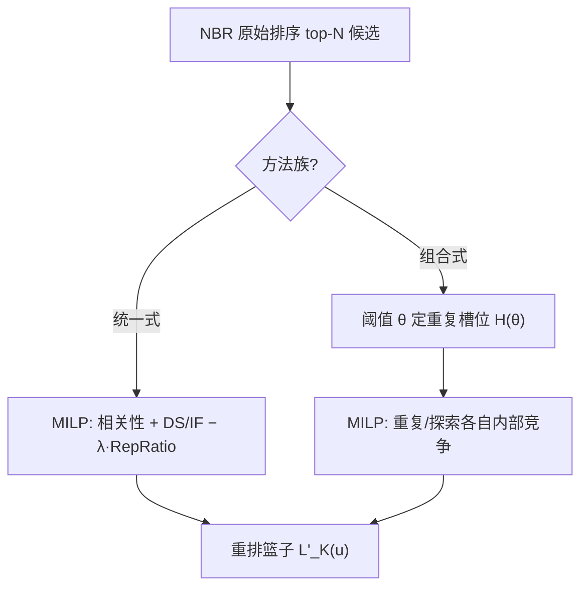

# Repeat-bias-aware Optimization of Beyond-accuracy Metrics for Next Basket Recommendation (面向下一篮推荐的重复偏差感知超准确性指标优化)

- **会议/期刊**: ECIR 2025 (Full Paper)
- **作者与机构**: Yuanna Liu, Ming Li, Mohammad Aliannejadi, Maarten de Rijke（阿姆斯特丹大学）
- **推荐链路定位**: 重排（对 NBR 方法输出的候选列表做后处理）
- **研究方向**: 去偏公平与工业架构 / 序列与会话推荐
- **论文原文**: [https://arxiv.org/abs/2501.06362v1](https://arxiv.org/abs/2501.06362v1)
- **开源代码**: [https://github.com/lynEcho/Repbias](https://github.com/lynEcho/Repbias)

## TL;DR (1分钟核心速览)

下一篮推荐（NBR）中 SOTA 方法为最大化效用而严重偏向重复物品（repeat bias），而现有超准确性（多样性、物品公平）优化往往**反而加剧**重复偏差。本文提出模型无关的 RADiv / RAIF 两个基于混合整数线性规划（MILP）的重排算法，把重复比例 `RepRatio_rec` 作为显式优化目标，与相关性、多样性（DS）或物品公平（logDP）联合优化，并针对统一式与组合式（TREx）两类 NBR 范式分别设计约束。在 Instacart、Dunnhumby、TaFeng 三个零售数据集上，以 10% Recall 损失容忍度为约束，DS 从 0.35 提升至 0.64、logDP 从 3.40 降至 2.18、RepBias 从 0.29 降至 0.18。

## Background & Motivation (背景与核心矛盾)

- **主流范式**: NBR 用 KNN（UP-CF@r、TIFUKNN）、RNN（Dream）、GNN（DNNTSP）或重复-探索两段式（TREx）预测下一篮，评价几乎只看 Recall。
- **前人局限**: 其一，重复物品贡献了绝大部分 Recall，模型天然偏向推荐已购物品，`RepRatio_rec` 远高于真值（Instacart 上 TIFUKNN 达 0.92 vs. 真值 0.60）；其二，现有重排只优化多样性或公平，**未约束重复比例**，实验显示 TIFUKNN、Dream 的重复偏差随公平权重增大而**继续恶化**。
- **核心洞察 (Key Insight)**: 效用高度集中于少量重复物品，超准确性指标的可优化空间被重复偏差挤压；因此必须把"重复比例向真值靠拢"作为独立目标显式建模，而非事后指标。
- **本文切入点**: 将重排形式化为 MILP，在目标函数中同时写入相关性、DS/IF 与 `RepRatio_rec`，并按 NBR 方法族（统一式 vs. 组合式）定制约束。

## Method (核心方法设计)

### 1. 整体框架 (Overall Architecture)

对每个用户取原始 NBR 排序的 top-$N$（$N=100$）作为候选，构造二值决策矩阵$\mathbf{W}\in\{0,1\}^{|U|\times N}$，在"每人恰好选$K=20$个"的约束下求解 MILP，输出重排后的篮子。统一式方法（UP-CF@r、TIFUKNN、Dream、DNNTSP）的重复/探索物品分数同源可比，直接对全候选求解；组合式方法（TREx）的重复与探索分数来自不同模型、不可比，改用阈值$\theta$先确定重复槽位数$H(\theta)$，再让重复与探索物品**各自内部竞争**。求解器为 Gurobi。

### 2. 关键设计拆解 (Key Designs)

1. **RADiv：多样性与重复比例的联合目标**：针对"只优化 DS 会推高重复比例"的问题，在相关性项后加入多样性得分并减去重复比例项：
$$\max \frac{1}{K}\sum_{u}\sum_{i=1}^{N} S_{ui}W_{ui} + \epsilon_1 \mathrm{DS}(C,\mathbf{W}) - \lambda\,\mathrm{RepRatio_{rec}}(I^{rep}_u,\mathbf{W}),\ \text{s.t.}\ \sum_i W_{ui}=K .$$
其中 $\mathrm{RepRatio_{rec}}=\frac{1}{K}\sum_u |L'_K(u)\cap I^{rep}_u|$。直觉是：$\epsilon_1$拉高类别覆盖，$-\lambda$把重复比例压回真值附近，二者在 MILP 中互相牵制，避免"多样性靠换更多重复物品"的伪优化。对**探索偏置**方法（如 Dream，`RepRatio_rec`=0.19 远低于真值）则把符号翻转为$+\lambda$，令算法主动**提高**重复比例。

2. **RAIF：物品公平与重复比例的联合目标**：以流行组 $I_1$（top 20% 热度）与非流行组$I_2$的平均曝光差$\mathrm{IF}=\mathrm{Exposure}(I_1)-\mathrm{Exposure}(I_2)$ 为公平项：
$$\max \sum_{u}\sum_{i} S_{ui}W_{ui} - \alpha_1\,\mathrm{IF}(I_1,I_2,\mathbf{W}) - \lambda\,\mathrm{RepRatio_{rec}} .$$
减去 IF 等价于给长尾物品更多曝光位，而 $-\lambda$ 防止公平化过程被重复物品"搭便车"。

3. **组合式方法的槽位解耦与训练/推理开销**：TREx 的重复与探索分数不可比，故用阈值 $\theta$统计分数超过$\theta$的重复物品数$H(\theta)=\min(H(\theta)_{aux},K)$，约束改为$\sum_i W^r_{ui}=H(\theta)$、$\sum_i W^e_{ui}=K-H(\theta)$，目标为$\max \frac{1}{K}\sum_u\sum_i (S^r_{ui}W^r_{ui}+S^e_{ui}W^e_{ui})+\epsilon_2 \mathrm{DS}$。$\theta$单调控制重复槽位，从而间接控制 `RepRatio_rec`。无训练阶段；推理时每用户求解一个$|U|\times N$的 MILP，超参在验证集上按"Recall 降幅 ≤10% 且 mDR 最大 / mFR 最小"网格搜索（$\omega=0.5$）。

## Experimental Setup & Evaluation Protocol (实验设置与评估协议)

- **数据集与预处理**: 剔除篮数 <3 的用户与购买次数 <5 的物品；Instacart 先随机采样 20,000 用户再过滤。

| 数据集 | #Users | #Items | #Baskets | 平均篮数/用户 | 平均篮长 | RepRatio_gt |
| :--- | :---: | :---: | :---: | :---: | :---: | :---: |
| Instacart | 19,210 | 29,399 | 305,582 | 15.91 | 10.06 | 0.60 |
| Dunnhumby | 2,482 | 37,162 | 107,152 | 43.17 | 10.07 | 0.43 |
| TaFeng | 10,182 | 15,024 | 82,387 | 8.09 | 6.14 | 0.21 |

- **数据划分与防穿越**: 每用户最后一个篮作测试，其余为训练（>50 篮者仅保留最近 50 篮）；末篮随机 50%/50% 划为验证/测试，属 `Leave-One-Basket-Out` 变体。
- **排名评测协议**: 在 top-$N$=100 候选内重排后取$K$=20，属 `Sampled Ranking`（候选由各基线自身打分产生，非全库 Full-Ranking）；指标为 Recall、DS、logDP、RepBias=RepRatio_rec−RepRatio_gt，及综合指标 mDR、mFR。
- **对比基线与超参**: 5 个 NBR 基线（UP-CF@r、TIFUKNN、Dream、DNNTSP、TREx），对比对象为各自原始结果（Ori.）及单目标消融（D/F/R）；$\epsilon_1,\epsilon_2\in[0,0.2]$，$\alpha_1,\alpha_2\in[0,200]$，$\lambda\in[0,1]$。

## Key Experimental Results (实验关键数据)

### 1. 主实验对比 (Main Results)

Instacart（RepRatio_gt=0.60），节选代表性行：

| 方法 | 类型 | Recall↑ | DS↑ | RepRatio | RepBias↓ | mDR↑ | logDP↓ | mFR↓ |
| :--- | :--- | :---: | :---: | :---: | :---: | :---: | :---: | :---: |
| TIFUKNN | Ori. | 0.4559 | 0.3615 | 0.9248 | 0.3248 | 0.0184 | 3.1252 | 1.7250 |
| TIFUKNN | RD / RF | 0.4245 | **0.5898** | 0.8874 | 0.2874 | **0.1512** | 2.3271 | **1.2995** |
| UP-CF@r | Ori. | 0.4405 | 0.3489 | 0.8905 | 0.2905 | 0.0292 | 3.3966 | 1.8436 |
| UP-CF@r | RD / RF | 0.3968 | **0.6375** | 0.7837 | 0.1837 | **0.2269** | **2.1810** | **1.1915** |
| DNNTSP | Ori. | 0.4347 | 0.3402 | 0.9133 | 0.3133 | 0.0135 | 3.2573 | 1.7853 |
| DNNTSP | RD / RF | 0.4059 | **0.6013** | 0.8623 | 0.2623 | **0.1695** | 2.9901 | **1.6369** |
| Dream | Ori. | 0.0977 | 0.1000 | 0.1923 | −0.4077 | −0.1539 | 7.3111 | 3.8594 |
| Dream | RD / RF | **0.1468** | **0.5654** | 0.4202 | −0.1798 | **0.1928** | 2.3893 | **1.3900** |
| TREx | Ori. | 0.4595 | 0.3533 | 0.9265 | 0.3265 | 0.0134 | 3.2182 | 1.7724 |
| TREx | RD / RF | 0.4195 | **0.5874** | 0.7973 | 0.1973 | **0.1951** | 2.6528 | **1.4008** |

### 2. 消融实验 (Ablation Study)

Instacart 上单目标优化 vs. 联合优化（以 TIFUKNN、UP-CF@r 为例）：

| 配置 | DS↑ | RepBias↓ | mDR↑ | logDP↓ | mFR↓ |
| :--- | :---: | :---: | :---: | :---: | :---: |
| TIFUKNN 仅 D | 0.5897 | 0.2984 | 0.1457 | — | — |
| TIFUKNN 仅 R | 0.3587 | 0.3100 | 0.0244 | 3.2760 | 1.7350 |
| TIFUKNN RD / RF | **0.5898** | **0.2874** | **0.1512** | **2.3271** | **1.2995** |
| UP-CF@r 仅 D | 0.6375 | 0.1896 | 0.2239 | — | — |
| UP-CF@r 仅 R | 0.3424 | 0.2812 | 0.0306 | 3.3997 | 1.8394 |
| UP-CF@r RD / RF | 0.6375 | **0.1837** | **0.2269** | **2.1810** | **1.1915** |

### 3. 关键实验发现 (Key Findings)

1. **单目标优化会反噬**：仅优化 DS 时 TIFUKNN 的 RepBias 从 0.3248 仅降到 0.2984，而仅优化 RepRatio 又使 DS 从 0.3615 跌至 0.3587；只有 RD 联合优化同时拿到 DS 0.5898 与 RepBias 0.2874，证明两项必须耦合。
2. **符号自适应是关键**：Dream 属探索偏置（RepRatio 0.19 ≪ 0.60），RADiv 用 $+\lambda$ 将其推至 0.4202，Recall 反而从 0.0977 升至 0.1468——说明"去偏"不等于"一味降重复"，而是向真值校准。
3. **公平与效用的可接受折中**：UP-CF@r 上 RAIF 以 Recall 0.4405→0.4052（约 8% 降幅，在 10% 容忍内）换取 logDP 3.3966→2.1810 与 RepBias 0.2905→0.2019，mFR 从 1.8436 降至 1.1915，验证了 MILP 在硬约束下求解折中最优解的能力。

## Highlights & Limitations (亮点、对比与审稿批判)

- **与代表作对比 (vs. Prior Work)**: 相比 CPFair 等只做公平/多样性重排的工作，本文首次把重复比例写入目标函数；相比 TREx 在**模型内部**做重复-探索融合，本文在**输出层**做模型无关后处理，可直接套用于任意 NBR 基线；相比 Li et al. 仅"定义并度量"重复偏差，本文首次对其**优化**。
- **可迁移亮点**: ① 对偏置方向自适应翻转符号（$-\lambda$/$+\lambda$）的思路可迁移到任何"向真值分布校准"的去偏任务；② 组合式方法的"阈值定槽位 + 组内竞争"技巧，可解决多路召回分数不可比时的融合重排问题。
- **审稿级局限批判**: ① 每用户求解一次 MILP，$|U|$ 达 2 万时在线延迟与 Gurobi 商用授权成本未量化，工业部署存疑；② 候选仅取 top-100 且由基线自身产生，若原始排序中探索物品极少，重排"无米下炊"（作者亦承认）；③ 重复比例目标用 `RepRatio_rec` 替代未知的 `RepRatio_gt`，仅靠符号方向引导，缺乏对真值分布的理论估计。

## Rating (四维评分)

- **方法创新性 (Novelty)**: ⭐⭐⭐⭐ （首次将重复偏差作为显式优化目标纳入 MILP 重排，符号自适应设计巧妙，但 MILP 重排框架本身较成熟）
- **评估协议与实验扎实度 (Protocol & Experiments)**: ⭐⭐⭐⭐ （三个特性迥异的零售数据集 + 5 个基线 + 单目标消融 + 权衡曲线完整，但仅 Sampled Ranking、缺显著性检验与线上验证）
- **写作与数学规范度 (Clarity & Rigor)**: ⭐⭐⭐⭐ （目标函数与约束定义清晰、符号表完备，组合式方法的 $\theta$与$H(\theta)$ 推导稍简）
- **工业落地与复现价值 (Industrial & Practical Value)**: ⭐⭐⭐ （代码与超参已开源、模型无关易插拔，但 Gurobi 求解的在线延迟与规模化成本是落地主要障碍）

