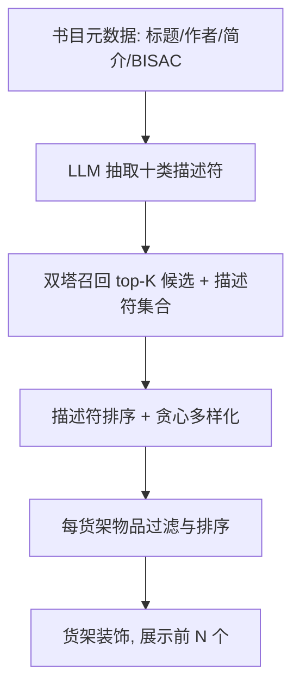
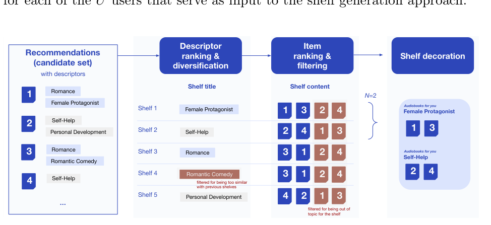

# Contextualizing Spotify's Audiobook List Recommendations with Descriptive Shelves (用描述性货架为 Spotify 有声书列表推荐提供上下文)

- **会议/期刊**: ECIR 2025
- **作者与机构**: Gustavo Penha, Alice Wang, Martin Achenbach, Kristen Sheets, Sahitya Mantravadi, Remi Galvez, Nico Guetta-Jeanrenaud, Divya Narayanan, Ofeliya Kalaydzhyan, Hugues Bouchard（Spotify）
- **推荐链路定位**: 重排 / 列表组织与解释（在召回候选集之上做货架级打包）
- **研究方向**: 大语言模型推荐 / 多任务学习与列表级重排
- **论文原文**: [https://arxiv.org/abs/2504.13572v1](https://arxiv.org/abs/2504.13572v1)
- **开源代码**: 暂未开源

## TL;DR (1分钟核心速览)

Spotify 有声书业务面临冷启动：既无用户评论、也无丰富 UGC 标签，传统基于评论/标签的内容解释方法失效。本文用 LLM 依据自建十类描述符分类体系，从标题、作者、简介、BISAC 体裁中抽取结构化描述符，再以「描述符排序 + 贪心多样化」生成个性化货架标题（如 "Uplifting Women's Fiction"），并对每个货架做物品排序与过滤。两轮线上 A/B 测试中，第二轮相对人工编辑货架将曝光点击率提升 35.25%、曝光播放率提升 86.96%，曝光与互动书目数分别提升 627.27% 与 804.56%。

## Background & Motivation (背景与核心矛盾)

- **主流范式**: 在线平台普遍以「横向滚动货架 + 标题」组织推荐，标题本身即为列表级解释，帮助用户决策；内容解释多依赖评论、用户标签或丰富元数据。
- **前人局限**: 其一，Spotify 有声书为新增业务，评论与 UGC 标签几乎为零，元数据稀疏，基于评论/标签的解释方法直接失效；其二，单条推荐解释无法覆盖「一次推荐一整个列表」的场景，列表级解释需要兼顾主题覆盖与多样性。
- **核心洞察 (Key Insight)**: 用户真实搜索意图（站内 query 与 Reddit r/booksuggestions 论坛求助帖）中大量出现「女性主角」「治愈」「敌变恋人」等细粒度描述，说明角色、情绪、桥段等维度比粗粒度体裁更能刻画有声书，也更适合作为货架标题。
- **本文切入点**: 不做逐用户的 LLM 在线调用（成本不可控），而是离线用 LLM 把每本书的元数据「翻译」成结构化描述符，线上仅做轻量的描述符排序、多样化与物品过滤，实现可扩展的列表级上下文包装。

## Method (核心方法设计)

### 1. 整体框架 (Overall Architecture)

离线阶段：以标题、作者、简介、BISAC 体裁为输入，用带分类体系指令与 in-context 示例的 LLM 提示，为每本有声书抽取十类描述符（体裁、主题、角色描述、情绪、背景设定、个人处境、故事桥段、目标受众、目标导向、命名实体），缺失则返回空列表；人工与自动评估均显示高准确率，且因全程 grounding 于元数据而显著抑制幻觉。线上阶段：双塔召回模型产出每用户 top-K 候选及其描述符集合，先对去重后的描述符（含手工模板组合，如 `<Mood>+<Genre>`）按用户亲和度排序，再用内容 embedding 相似度做贪心多样化，选出 N 个标题；随后为每个标题过滤掉不含匹配描述符的物品、按推荐分数排序填充，最后做货架装饰并展示前 N 个。

<figure class="paper-figure" markdown="span">
  <figcaption>图 1. 货架生成流程：从一组 top-K 推荐及其各自的描述符出发，我们根据用户亲和度对推荐中不同的描述符集合进行排序，将其用作货架标题，并通过移除彼此过于相似的描述符来使列表多样化。然后，我们为每个不同的描述符对候选物品集合进行排序和过滤，最后对货架进行装饰并向用户展示前 N 个。</figcaption>
</figure>

### 2. 关键设计拆解 (Key Designs)

1. **LLM 描述符抽取（解决冷启动元数据贫瘠）**：痛点是无评论无标签，传统解释无米下炊 $\to$以人工调研得出的十类 taxonomy 作为提示约束，逐类抽取并允许空返回，同时引入 in-context 示例$\to$输出为每物品的描述符集合$D_i=\{d_{i1},\dots,d_{im}\}$。有效性直觉：taxonomy 把开放域生成收敛为受控槽位填充，既保留 LLM 的语义泛化，又把幻觉风险压到可接受范围，且完全离线、可批量预计算。

2. **描述符排序与贪心多样化（解决标题相关性与同质化）**：痛点是候选描述符高度重叠（大量书共享 "Romance"），直接取 top-N 会得到一堆近义货架 $\to$先按用户亲和度排序得到$\pi$，再依次接纳与已选集合内容相似度低于阈值的描述符：$d^\* = \arg\max_{d \in \pi} \; s(u,d) \;\; \text{s.t.} \;\; \max_{d' \in \mathcal{S}} \cos(\boldsymbol{e}_d, \boldsymbol{e}_{d'}) < \tau$。有效性直觉：在相关性排序上叠加内容层面的硬约束，保证 N 个货架覆盖不同主题，直接服务于「发现性」目标。

3. **粒度与标题风格控制 + 训练/推理开销**：粗粒度（体裁）覆盖书目多但信息量低，细粒度（主题）易过度狭窄，故同时把模板组合（如 "Emotional Romance"）纳入候选，缓解单词描述符（如 "Powerful"）单独成标题时语义空洞的问题。全流程无监督训练，唯一模型调用是离线 LLM 批量抽取；线上仅需描述符排序、余弦相似度去重与按分数过滤，开销远低于逐用户 LLM 推理。

## Experimental Setup & Evaluation Protocol (实验设置与评估协议)

- **数据集与场景**: 本文为工业线上评测，未公开离线数据集统计。候选集来自 Spotify 双塔召回模型 [4] 的 top-K 输出；描述符覆盖全量有声书目录，第一轮测试产生约 2,500 个不同货架标题。
- **数据划分与防穿越**: 不适用离线划分，采用线上 A/B 测试；两轮实验的流量入口不同（主首页 vs. 有声书子 feed），对照组定义亦不同，需分别解读。
- **排名评测协议**: 非离线 Full-Ranking / Sampled Ranking，而是线上指标：曝光点击率 `i2c`、曝光播放率 `i2s`、曝光书目数 `# impressed`、互动书目数 `# interacted`。
- **对比基线与超参**: 第一轮对照为原 "Audiobooks for you" 通用货架（候选集完全相同，仅换包装）；第二轮对照为编辑人工策划的 17 类货架（如 self-help、sports、true crime）。货架展示数 $N=2$，多样化阈值$\tau$ 与描述符类型组合未在文中给出具体取值。

## Key Experimental Results (实验关键数据)

### 1. 主实验对比 (Main Results)

第一轮 A/B（主首页，同候选集替换包装）：

| 实验组 | 发现性指标 | 互动指标 | 结论 |
| :--- | :---: | :---: | :--- |
| 通用货架 "Audiobooks for you"（对照） | 基线 | 基线 | — |
| 描述性货架（约 2,500 标题） | **显著更高** | 低于对照 | 发现性↑、互动↓ |

第二轮 A/B（有声书子 feed，对照为编辑人工货架）：

| 指标 | 相对对照提升 |
| :--- | :---: |
| i2c（曝光点击率） | **+35.25%** |
| i2s（曝光播放率） | **+86.96%** |
| # impressed（曝光书目数） | **+627.27%** |
| # interacted（互动书目数） | **+804.56%** |

### 2. 消融实验 (Ablation Study)

本文为工业部署论文，未提供离线消融表；其「消融」以两轮 A/B 的界面与入口改动形式呈现：

| 配置变动 | 第一轮 | 第二轮 |
| :--- | :---: | :---: |
| 是否标注 "Audiobooks for you" 个性化后缀 | 否（字符受限） | 是（小字号叠加） |
| 展示货架数 | 1（单主题） | 多个（多主题可探索） |
| 流量入口 | 主首页（大量冷启动用户） | 有声书子 feed（高意图用户） |
| 对照组 | 通用货架 | 编辑人工货架 |
| 互动指标 | 低于对照 | **+35.25% / +86.96%** |

### 3. 关键实验发现 (Key Findings)

1. **包装而非候选集是增益来源**：两轮测试候选集均未改变，仅改变列表组织与标题，第二轮即取得 i2s +86.96%，说明列表级上下文本身对消费决策有实质影响，而非召回质量差异。
2. **冷启动用户是首轮失败的主因**：第一轮多数被试为有声书新用户，单一主题货架反而不如通用货架利于「拉新」；作者观察到描述性货架在消费历史更长、口味更窄的用户子集上表现更好，这直接促成了第二轮转向高意图子 feed。
3. **发现性与互动并非天然冲突**：曝光书目数 +627.27%、互动书目数 +804.56% 的量级远超点击率提升，说明多样化货架把长尾书目推到了用户面前且被真实消费，对内容创作者侧的曝光公平性亦有正向价值。

## Highlights & Limitations (亮点、对比与审稿批判)

- **与代表作对比 (vs. Prior Work)**: 相较依赖评论/标签的模板式或生成式单条解释 [1,3,16]，本文面向「列表级」解释且不依赖 UGC；相较逐用户调用 LLM 的生成式解释 [8,9,12]，本文把 LLM 全部开销前置到离线元数据增强，线上零 LLM 调用，工程可扩展性明显更优；与 Iferroudjene 等 [11] 的子群发现式 top-N 解释相比，本文的解释直接成为可交互的导航结构而非附属文本。
- **可迁移亮点**: 其一，「LLM 离线抽取受控 taxonomy 槽位 + 线上轻量排序多样化」这一范式可平移到任何冷启动内容域（播客、短视频、新品类电商）；其二，把描述符组合模板（`<Mood>+<Genre>`）作为候选标题，是低成本提升标题可读性的通用技巧。
- **审稿级局限批判**: 其一，评估完全依赖线上 A/B，缺少离线可复现的定量基准与消融，描述符类型选择、多样化阈值 $\tau$、$N$ 的取值均未给出敏感性分析，复现与归因困难；其二，两轮实验的入口、对照组、用户构成同时变化，第二轮的大幅提升无法干净地归因于「描述性」这一单一因素，且 LLM 抽取准确率仅有定性描述、无量化指标。

## Rating (四维评分)

- **方法创新性 (Novelty)**: ⭐⭐⭐ （列表级描述性货架的组织思路实用且少见，但技术组件（LLM 抽取 + 排序 + 贪心多样化）均为成熟模块的组合，缺少理论或算法层面的新贡献）
- **评估协议与实验扎实度 (Protocol & Experiments)**: ⭐⭐⭐ （两轮大规模线上 A/B 具工业说服力，但无离线基准、无消融、无显著性检验与超参敏感性分析，归因链条不干净）
- **写作与数学规范度 (Clarity & Rigor)**: ⭐⭐⭐⭐ （pipeline 描述清晰、图 1 与 taxonomy 定义完整，但全文几乎无形式化公式，排序与多样化仅以文字描述）
- **工业落地与复现价值 (Industrial & Practical Value)**: ⭐⭐⭐⭐ （线上零 LLM 调用、离线批量预计算的设计极具部署价值，但未开源且关键超参缺失，复现门槛较高）

