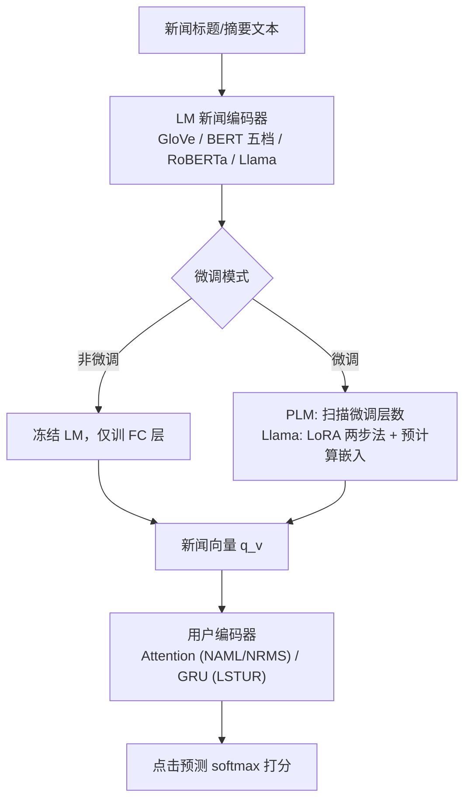

# Revisiting Language Models in Neural News Recommender Systems (重审神经新闻推荐系统中的语言模型)

- **会议/期刊**: ECIR 2025 (第 47 届欧洲信息检索会议)
- **作者与机构**: Yuyue Zhao, Jin Huang, David Vos, Maarten de Rijke (阿姆斯特丹大学 / 代尔夫特理工大学)
- **推荐链路定位**: 召回 (新闻编码器侧)
- **研究方向**: 大语言模型推荐 / 冷启动与长尾推荐
- **论文原文**: [论文原文链接](https://arxiv.org/abs/2501.11391v1)
- **开源代码**: [开源代码仓库链接](https://github.com/Go0day/LM4newsRec)

## TL;DR (1分钟核心速览)

针对"新闻推荐中 LM 越大越好"这一被广泛引用但存在反例的共识，本文在 MIND-small 上统一复现 NAML/NRMS/LSTUR 三种框架 × 8 种 LM（GloVe、BERT 五档、RoBERTa、Llama3.1-8B），系统对比微调与非微调两种模式。核心结论：更大 LM 并不必然带来更高 AUC（GloVe 甚至优于 BERT-tiny/mini/small），且需更严格的微调层数搜索与算力；但 Llama 在最短点击历史用户组（G1）上相对 GloVe 提升最显著，说明大模型的价值主要体现在缓解冷启动对交互历史的依赖。

## Background & Motivation (背景与核心矛盾)

- **主流范式**: 新闻推荐以内容为核心，LM 作为新闻编码器将标题/摘要编码为向量，再经用户编码器与点击预测模块打分；文献普遍报告 SLM(GloVe) $\to$PLM(BERT)$\to$ LLM(Llama) 的性能单调递增。
- **前人局限**: 矛盾证据并存——NewsRecLib 报告 NAML/LSTUR 换用 BERT 后反而劣于 GloVe；xMIND 上 NAML 用 PLM 嵌入甚至不如随机初始化嵌入。这些结论分散在不同代码库、不同预处理与超参下，缺乏可比性。
- **核心洞察 (Key Insight)**: 性能差异可能并非来自"模型规模"本身，而是来自**是否微调**以及**微调层数选择**；同时规模收益可能只在特定用户分群（冷启动）上显现，被全局平均指标掩盖。
- **本文切入点**: 在同一代码库、同一数据划分、同一超参搜索空间下统一复现并扩展对比，把"规模"与"微调策略""用户分群"解耦分析。

## Method (核心方法设计)

### 1. 整体框架 (Overall Architecture)

本文不提出新模型，而是构建一个**受控对比实验框架**：固定新闻推荐主干（NAML/NRMS/LSTUR 的新闻编码器—用户编码器—点击预测三段式），仅替换新闻编码器中的 LM 组件，并显式区分"非微调"（LM 参数冻结，仅训练 FC 层）与"微调"（LM 参数随推荐损失更新）两种模式。对 PLM 额外扫描微调层数（0 至全部 12 层），对 Llama 采用两步法：先用自然语言 prompt 格式的新闻推荐数据做 LoRA 微调，再冻结 LLM 预计算新闻嵌入供推荐阶段使用。最终在统一评测下回答三个 RQ：规模是否单调增益、微调的作用与代价、冷启动分群收益。

### 2. 关键设计拆解 (Key Designs)

1. **统一的三类 LM 编码接口（消除实现差异）**：SLM 走"词向量拼接 + FC"，PLM 取 `[CLS]` 表示 + FC，LLM 取末 $l=10$个 token 表示拼接 + FC，即$q_v=\mathrm{FC}([e_{t_{L-l}},\dots,e_{t_L}];\theta_{\mathrm{FC}})$。三类接口共享同一 FC 结构与同一推荐损失，保证"规模"是唯一变量，避免此前跨论文对比中编码头不一致带来的混淆。

2. **微调层数作为独立超参（而非默认全量微调）**：痛点在于全量微调 PLM 易过拟合新闻域小数据，作者将 BERT 的可训练 Transformer 层数 $k\in\{0,\dots,12\}$纳入网格搜索，与负采样数$|V^-|\in\{1,2,3,4\}$、dropout、学习率联合调优。直觉是：新闻文本短、语义集中，浅层微调即可对齐域分布，深层微调反而破坏预训练语义。

3. **训练目标、负采样与推理效率**：损失为带负采样的 softmax 交叉熵
$$\mathcal{L}=-\sum_{u\in\mathcal{U}}\sum_{i\in\mathcal{V}^+}\log\frac{\exp(\hat{y}_{u,i})}{\exp(\hat{y}_{u,i})+\sum_{j\in\mathcal{V}^-}\exp(\hat{y}_{u,j})},$$
负样本从曝光未点击中采样（$|V^-|$ 网格搜索）。推理侧，Llama 采用**离线预计算新闻嵌入**，在线仅做向量检索与用户编码，使 8B 模型的可训练参数被压缩到与 BERT-base 同量级，这是其工程可行性的关键。

## Experimental Setup & Evaluation Protocol (实验设置与评估协议)

- **数据集与预处理**: MIND-small（Microsoft News 日志），标题截断 20 token、摘要截断 50 token。

| 数据集 | #Users | #Items | #Interactions | 稀疏度/密度 | 特征/场景说明 |
| :--- | :---: | :---: | :---: | :---: | :--- |
| MIND-small | 94,057 | 65,238 | 347,727 正点击 + 8,236,715 负曝光 | 正样本占比约 4.1% | 英文新闻，标题均长 11.79 词、摘要 38.17 词；测试集约 32.9% 新闻未在训练集出现 |

- **数据划分与防穿越 (Splitting Strategy)**: 全局时间戳切分——11 月 9–14 日曝光作训练，11 月 15 日曝光作测试，严格避免未来信息泄漏。
- **排名评测协议 (Ranking Protocol)**: 基于曝光日志的 `Sampled Ranking`（每条曝光含 1 条正样本与若干条负曝光，非全库 Full-Ranking），指标为 AUC、MRR、nDCG@5、nDCG@10，三次运行取均值。
- **对比基线与超参设置**: 基线为 GloVe、BERT-tiny/mini/small/medium/base、RoBERTa-base、Llama3.1-8B 共 8 种编码器，分别插入 NAML、NRMS、LSTUR 三个主干；负采样数 $\{1,2,3,4\}$、dropout$\{0.1,\dots,0.5\}$、学习率$\{10^{-4},10^{-5}\}$ 网格搜索；未报告显著性检验。

## Key Experimental Results (实验关键数据)

### 1. 主实验对比 (Main Results)

MIND-small 上不同 LM 作为新闻编码器（微调后最优配置）的表现（%）：

| 主干 | 编码器 | AUC | MRR | N@5 | N@10 |
| :--- | :--- | :---: | :---: | :---: | :---: |
| NAML | GloVe | 66.29 | 31.61 | 34.93 | 41.22 |
| NAML | BERT-base | 67.30 | 32.62 | 36.04 | 42.19 |
| NAML | RoBERTa | 66.73 | 32.10 | 35.52 | 41.64 |
| NAML | **Llama3.1-8B** | **68.39** | **33.20** | **36.88** | **43.06** |
| NAML | BERT-tiny | 64.83 | 30.71 | 33.89 | 40.24 |
| NAML | BERT-small | 65.91 | 31.70 | 34.89 | 41.24 |
| NRMS | GloVe | 66.62 | 31.34 | 34.83 | 41.04 |
| NRMS | **BERT-base** | **68.05** | **31.80** | **35.30** | **41.72** |
| NRMS | Llama3.1-8B | 66.64 | 31.66 | 35.05 | 41.33 |
| LSTUR | GloVe | 60.43 | 26.26 | 28.62 | 35.11 |
| LSTUR | **RoBERTa** | **61.25** | **27.15** | **29.60** | **35.84** |
| LSTUR | Llama3.1-8B | 60.88 | 26.83 | 29.21 | 35.54 |

关键对比：Llama 在 NAML 上较 BERT-base 提升 AUC +1.09（+1.62%），但在 NRMS 上反而低于 BERT-base 1.41 AUC；GloVe 全面优于 BERT-tiny（+1.46 AUC on NAML）与 BERT-small（+0.38 AUC on NAML）。

### 2. 消融实验 (Ablation Study)

微调 vs. 非微调的 AUC 增益（Change 为微调相对非微调的 AUC 相对变化）：

| 主干 | 编码器 | 非微调 AUC | 微调 AUC | Change |
| :--- | :--- | :---: | :---: | :---: |
| NAML | GloVe | 65.98 | 66.29 | +0.46% |
| NAML | BERT-base | 66.42 | 67.30 | +1.32% |
| NAML | RoBERTa | 63.51 | 66.73 | +5.07% |
| NAML | Llama | 68.39 | 67.90 | **−0.72%** |
| NRMS | GloVe | 66.62 | 65.96 | **−0.99%** |
| NRMS | BERT-base | 65.70 | 68.05 | +3.58% |
| NRMS | RoBERTa | 61.61 | 67.22 | **+9.11%** |
| NRMS | Llama | 66.56 | 66.64 | +0.11% |
| LSTUR | BERT-base | 58.91 | 60.92 | +3.41% |
| LSTUR | RoBERTa | 57.74 | 61.25 | +6.09% |

### 3. 关键实验发现 (Key Findings)

1. **规模非单调**：非微调下 GloVe 在 NAML 上 AUC 65.98，高于 BERT-base 的 66.42 之外的多数 PLM 变体，且 BERT-small（29.1M）并未稳定超过 BERT-mini（11.3M），说明"参数量 $\to$ 性能"的映射在新闻域并不成立，预训练语料域匹配（GloVe 的 Common Crawl 更贴近新闻）比规模更关键。
2. **微调是规模收益的开关**：RoBERTa 在 NRMS 上微调带来 +9.11% AUC，是全部配置中最大增益，而其非微调版本（61.61）远低于 GloVe（66.62）；反之 Llama 在 NAML 上微调反而 −0.72%，作者归因于标题+摘要双文本在两步 LoRA 中引入冗余噪声。
3. **冷启动分群收益显著**：按点击历史长度五等分后，Llama 相对 GloVe 的 AUC 提升在 G1（均长 4.01 次点击）最大，随分组递增至 G5（48.58 次）而衰减；在 LSTUR 的 G5 组甚至转为负增益，说明大模型的价值在于以内容语义替代稀疏交互信号，而用户建模能力弱（GRU）的主干无法承接这一收益。

## Highlights & Limitations (亮点、对比与审稿批判)

- **与代表作对比 (vs. Prior Work)**: 相较 PLM-NR / MINER 等"提出新编码结构并报告 PLM 优于 SLM"的工作，本文不改结构、只控变量，直接证伪了规模单调性；相较 NewsRecLib / xMIND 等基准报告的"PLM 更差"现象，本文进一步定位到微调层数与域匹配两个混淆因子，给出了可操作的调和解释。
- **可迁移亮点**: (i) 将"微调层数"作为独立超参而非默认全量微调，在短文本域（新闻、商品标题）上可直接复用；(ii) LLM 离线预计算嵌入 + 在线轻量主干的部署范式，把 8B 模型的可训练参数压到 BERT-base 量级，适合新闻这类高频更新的静态内容场景。
- **审稿级局限批判**: (i) 仅用 MIND-small 单一英文数据集，且为 Sampled Ranking 而非 Full-Ranking，结论在 EB-NeRD、Adressa 等多语言/多站点数据上的外推性未验证；(ii) 未做显著性检验，多处 AUC 差距在 0.3–0.5 量级，可能落在随机波动范围内；(iii) 冷启动分析仅按点击历史长度分桶，未控制新闻曝光位置与流行度偏差，G1 组的提升可能部分来自内容新颖性而非模型能力。

## Rating (四维评分)

- **方法创新性 (Novelty)**: ⭐⭐ （无新模型，价值在于受控复现与证伪，方法层面增量有限）
- **评估协议与实验扎实度 (Protocol & Experiments)**: ⭐⭐⭐ （8 种 LM × 3 主干 × 微调/非微调 × 层数扫描覆盖充分，但单数据集、Sampled Ranking、缺显著性检验削弱说服力）
- **写作与数学规范度 (Clarity & Rigor)**: ⭐⭐⭐⭐ （三类 LM 编码接口与微调模式定义清晰，图表组织有条理，公式简洁无冗余）
- **工业落地与复现价值 (Industrial & Practical Value)**: ⭐⭐⭐⭐ （代码开源、Llama 预计算嵌入方案可直接落地，为"是否值得上大模型"提供了明确的成本-收益决策依据）

