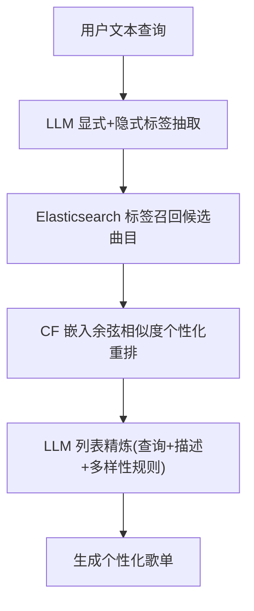
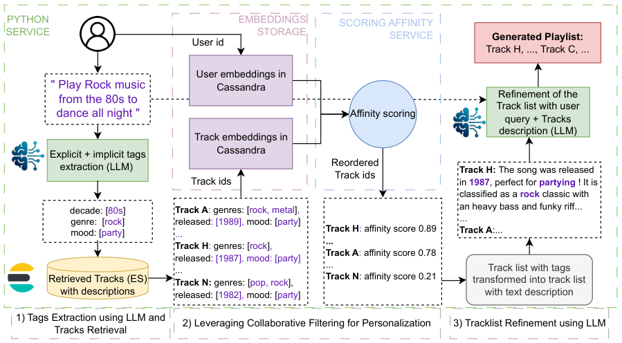

# Text2Playlist: Generating Personalized Playlists from Text on Deezer (从文本生成个性化歌单)

- **会议/期刊**: ECIR 2025 (Industry Talk)
- **作者与机构**: Mathieu Delcluze, Antoine Khoury, Clémence Vast, Valerio Arnaudo, Léa Briand, Walid Bendada, Thomas Bouabça — Deezer Research, Paris
- **推荐链路定位**: 端到端生成式（检索 → 个性化重排 → LLM 列表精炼）
- **研究方向**: 大语言模型推荐 (LLM4Rec) / 生成式推荐
- **论文原文**: [https://arxiv.org/abs/2501.05894v1](https://arxiv.org/abs/2501.05894v1)
- **开源代码**: [https://github.com/deezer/text2playlist-ecir2025](https://github.com/deezer/text2playlist-ecir2025)

## TL;DR (1分钟核心速览)

Deezer 的搜索栏为窄意图（导航型）查询而设计，占 20% 的宽意图查询（如"雨夜放松的氛围"）既难被检索满足，结果也无法直接转为可听歌单。本文提出 Text2Playlist：LLM 从自然语言中抽取显式与隐式标签 → Elasticsearch 按标签召回曲目 → 用 CF 用户/曲目嵌入余弦相似度做个性化重排 → LLM 结合原始查询与曲目文本描述做列表级精炼。系统以 Python + Kubernetes 独立服务上线，2024 年 7 月起 5% 灰度、10 月扩至 20% 高级用户；生成歌单后续被收听比例达 **45%**，显著高于人工歌单的 **27%**。

## Background & Motivation (背景与核心矛盾)

- **主流范式**: 流媒体平台以搜索 + 协同过滤推荐双轨支撑曲库探索；Deezer 搜索系统已用"搜索模式 + 历史点击"模型区分窄/宽意图查询。
- **前人局限**: ① 搜索栏 UI 与结果页为导航型窄查询优化，不鼓励长文本输入，宽查询（占 20%）体验差；② 搜索结果无法一键转为连续收听体验，用户需手工整理成歌单，成本高、流失大。
- **核心洞察 (Key Insight)**: 宽意图查询的价值不在"命中某个实体"，而在"表达一种收听情境"——其语义可被分解为 genre/decade/mood 等标签，而个性化应由平台已有的 CF 隐向量承担，二者职责可解耦。
- **本文切入点**: 不做端到端黑盒生成，而是把 LLM 当作"查询理解器 + 列表精炼器"，中间夹一层成熟的标签检索与 CF 打分，用 RAG 式三段流水线低成本落地。

## Method (核心方法设计)

### 1. 整体框架 (Overall Architecture)

系统为无状态 Python 服务，部署于 Kubernetes，在线请求走三段式流水线：先用 Gemini Flash 1.5 将用户文本解析为显式标签（用户明说的"80 年代""摇滚"）与隐式标签（从"工作"推断出"Focus"情绪）；标签经 Elasticsearch 在曲库元数据（专家标注 + 音频内容模型 + 用户歌单挖掘扩充）上召回候选曲目并附 JSON 描述；随后由 Golang + Faiss 服务计算用户 CF 嵌入与候选曲目嵌入的余弦相似度完成个性化重排；最后将曲目列表连同标签转为非结构化文本，交回 LLM 依据原始查询、艺术家多样性与整体质量规则做列表级重排输出。用户与曲目嵌入、情绪分等数据每日导出至 Cassandra 供在线读取。

<figure class="paper-figure" markdown="span">
  <figcaption>图2. 第3节中Text2Playlist框架概览，可在Deezer生产环境中用于在线请求。</figcaption>
</figure>

### 2. 关键设计拆解 (Key Designs)

1. **LLM 显隐式标签抽取（把自由文本压成可检索结构）**：宽查询的痛点是语义松散、无法直接匹配元数据。本文让 LLM 输出结构化标签集合 $\mathcal{T}(q)=\mathcal{T}_{\text{exp}}(q)\cup\mathcal{T}_{\text{imp}}(q)$，其中显式项直接来自字面（"90s"→decade），隐式项由情境推理补全（"work"→mood: Focus）。有效直觉是：把开放语义映射到平台已有标签词表，召回即可复用成熟的倒排检索，避免向量召回在长尾曲目上的覆盖不足。

2. **CF 亲和度重排（把"符合查询"升级为"符合这个人"）**：标签召回只保证语义相关，不保证用户爱听。对候选集 $\mathcal{C}$中每首曲目$i$，计算$\hat{s}_{ui}=\cos(\boldsymbol{e}_u,\boldsymbol{e}_i)$并降序排列，$\boldsymbol{e}_u,\boldsymbol{e}_i$ 为 Deezer 既有 CF 隐向量。该步零额外训练成本，直接复用线上推荐系统的表征资产，是"个性化"的唯一来源。

3. **LLM 列表精炼与工程取舍**：受两阶段推荐与 RAG 启发，将候选曲目转为含曲风、年份、情绪描述的文本，提示 LLM 在满足原始查询的同时兼顾艺术家多样性与歌单整体质量，输出最终顺序。选型 Gemini Flash 1.5 的核心考量是按 token 计费、无请求即无成本，契合灰度期低频调用；代价是每次请求需两次 LLM 调用，延迟与成本随使用量线性增长。

## Experimental Setup & Evaluation Protocol (实验设置与评估协议)

- **数据集与预处理**: 本文为工业部署论文，**未使用公开离线基准数据集**，无 5-core 过滤、无用户/物品统计表；评估完全基于 Deezer 生产流量。

| 评估对象 | 规模/范围 | 说明 |
| :--- | :---: | :--- |
| 曲库 | 1.2 亿+ 曲目 | 元数据含专家标注 + 音频模型 + 歌单挖掘标签 |
| 用户 | 1600 万（180 国） | 灰度：2024-07 起 5% 高级用户，2024-10 起 20% |
| 查询类型 | 窄意图 80% / 宽意图 20% | 宽意图为本系统目标场景 |

- **数据划分与防穿越 (Splitting Strategy)**: 不适用（无离线训练/测试划分）；采用线上分阶段灰度发布作为对照机制。
- **排名评测协议 (Ranking Protocol)**: 不适用 Full-Ranking / Sampled Ranking；采用线上行为指标——**生成歌单在随后数日内被收听的比例**，与人工创建歌单的同指标做横向对照。
- **对比基线与超参设置**: 无传统推荐基线对比；对照对象为平台人工歌单（27% 收听率）。LLM 固定为 Gemini Flash 1.5，未报告温度、提示模板细节与嵌入维度 $d$，亦无显著性检验。

## Key Experimental Results (实验关键数据)

### 1. 主实验对比 (Main Results)

原文仅报告一项核心线上指标，无离线主表。整理如下：

| 歌单来源 | 后续被收听比例 | 说明 |
| :--- | :---: | :--- |
| 人工创建歌单 | 27% | 平台既有基线 |
| **Text2Playlist 生成歌单** | **45%** | **Improv. +66.7% 相对提升** |

用户请求情绪标签分布（定性统计）："Chill" 与 "Party" 两类合计接近全部情绪请求的一半。

### 2. 消融实验 (Ablation Study)

原文**未提供消融实验**（无 `w/o LLM 标签抽取`、`w/o CF 重排`、`w/o LLM 精炼` 的对照），亦无各模块贡献的定量拆解。这是本文作为工业短文的显著空白。

### 3. 关键实验发现 (Key Findings)

1. **生成歌单的消费转化远高于人工歌单**：45% vs 27%，相对提升 66.7%，说明"文本意图 → 结构化标签 → 个性化排序"的链路确实产出了用户愿意消费的连续收听单元，而非一次性点击。
2. **灰度扩张本身构成弱证据**：从 5% 扩至 20% 高级用户且被描述为"with success"，暗示核心留存/使用指标未出现负向，但论文未给出任何分阶段指标数值，无法判断增益是否随人群扩大而衰减。
3. **宽意图查询的情绪分布高度集中**："Chill" 与 "Party" 占据近半情绪请求，提示标签词表的头部覆盖即可服务大部分流量，这解释了为何基于有限标签的倒排召回在本场景下足够有效，也暗示长尾情绪（如"melancholic""focus"细分）仍是未开发空间。

## Highlights & Limitations (亮点、对比与审稿批判)

- **与代表作对比 (vs. Prior Work)**: 与 TIGER 等语义 ID 端到端生成式检索不同，本文不做物品的离散码本生成，而是保留"标签倒排召回 + CF 打分"的经典两阶段骨架，仅用 LLM 承担查询理解与列表精炼；与典型 LLM4Rec 指令微调路线相比，本文完全不做模型训练，纯提示工程 + 复用既有 CF 嵌入，工程成本极低但上限受限于标签词表与既有表征质量。
- **可迁移亮点**: ① "LLM 只做语义解析与最终重排、个性化交给既有 CF 嵌入"的职责切分，可低成本迁移到任何已有成熟召回/表征体系的平台；② 按 token 计费、无请求零成本的 LLM 选型策略，适合灰度期低频新功能的成本控制。
- **审稿级局限批判**: ① **评估严重不足**——仅一个线上比例指标，无离线基准、无消融、无显著性检验，且 45% vs 27% 未控制歌单长度、曝光位置与用户自选偏差，因果性存疑；② **延迟与成本未量化**——每请求两次 LLM 调用 + ES 召回 + Faiss 打分，论文未报告 P99 延迟、token 消耗与单请求成本，也未讨论 LLM 输出不稳定（标签漏抽、精炼越界）的兜底策略。

## Rating (四维评分)

- **方法创新性 (Novelty)**: ⭐⭐ （三段式流水线为成熟组件的工程拼装，LLM 仅作解析器与重排器，无新算子或理论贡献）
- **评估协议与实验扎实度 (Protocol & Experiments)**: ⭐⭐ （仅单一线上比例指标，无离线基准、无消融、无显著性检验与偏差控制）
- **写作与数学规范度 (Clarity & Rigor)**: ⭐⭐⭐ （系统流程与部署栈描述清晰、图 2 信息完整，但全文无形式化定义与复杂度/成本分析）
- **工业落地与复现价值 (Industrial & Practical Value)**: ⭐⭐⭐⭐ （真实 20% 灰度上线、开源代码与 ECIR Industry Talk 资源齐备，架构可直接借鉴，唯 LLM 提示与超参细节缺失）

