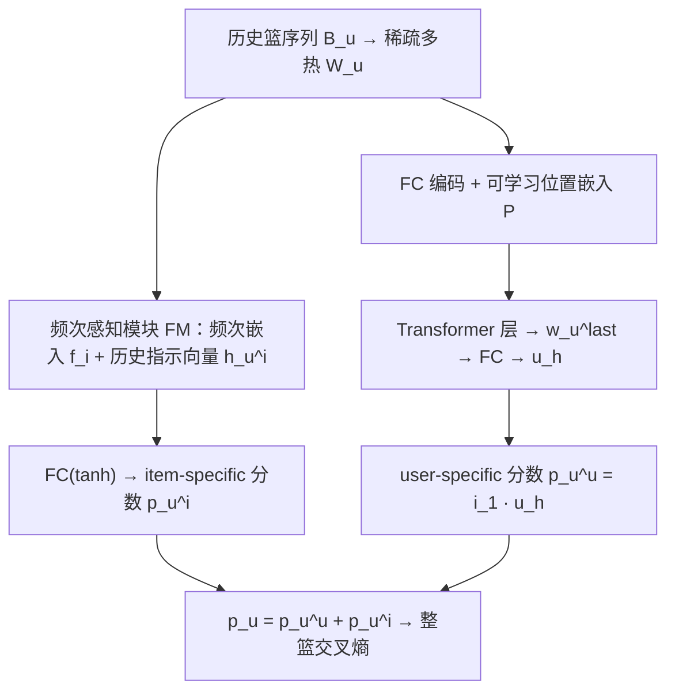
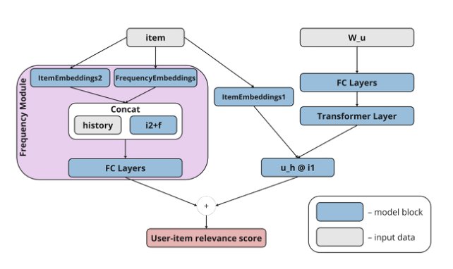

# SAFERec: Self-Attention and Frequency Enriched Model for Next Basket Recommendation (面向下一购物篮推荐的自注意力与频率增强模型)

- **会议/期刊**: ECIR 2025
- **作者与机构**: Oleg Lashinin, Denis Krasilnikov, Aleksandr Milogradskii, Marina Ananyeva（MIPT / T-Bank / HSE）
- **推荐链路定位**: 召回（下一篮候选生成）
- **研究方向**: 序列与会话推荐 / 协同过滤与双塔召回
- **论文原文**: [https://arxiv.org/abs/2412.14302v2](https://arxiv.org/abs/2412.14302v2)
- **开源代码**: [https://github.com/anon-ecir-nbr/SAFERec](https://github.com/anon-ecir-nbr/SAFERec)

## TL;DR (1分钟核心速览)

下一篮推荐（NBR）中重复购买占比极高，而 SASRec/BERT4Rec 这类为 NIR 设计的 Transformer 把整篮物品压缩进单个隐向量，难以表达"某物品在过去 L 篮中出现过几次"这类求和型信号，导致频率类方法 TIFU-KNN、UP-CF 长期反超深度模型。SAFERec 在 SASRec 主干之外并联一个频率感知模块（FM），用物品频次嵌入与历史指示向量直接产出 item-specific 分数，与用户隐向量内积分数相加。在 TaFeng / TaoBao / Dunnhumby 三数据集、Leave-One-Basket 全库排序协议下，Dunnhumby 上 Recall@10 相对最优基线提升 8%，UN@10 最高提升 50%。

## Background & Motivation (背景与核心矛盾)

- **主流范式**: NBR 两条路线并行——频率/近邻类（P-Pop、GP-Pop、TIFU-KNN、UP-CF）直接统计用户历史购买频次做 KNN 加权；深度类（DNNTSP、SASRec 改造版）用序列网络学隐表征。
- **前人局限**: 其一，TIFU-KNN 依赖 user-based KNN，大数据集上不可扩展，且无法接入图像/文本等异构特征；其二，SASRec 类模型把整篮多热向量经 FC 压成 $d$ 维隐向量，TIFU-KNN 原文已指出 RNN 难以准确拟合输入向量的"求和"，Transformer 同样存在该瓶颈，重复购买信号在隐空间中被稀释。
- **核心洞察 (Key Insight)**: 作者用去掉 FM 的 SASRec* 做对照，发现其 Recall 几乎退化到 P-Pop 水平（TaFeng Recall@10 仅 0.0711 vs P-Pop 0.0633），说明纯隐向量路径几乎无法主动"召回已购物品"；而一旦显式注入频次，性能立刻跃升——频次分量不是锦上添花，而是 NBR 的必要组件。
- **本文切入点**: 不做架构重设计，而是把"频次"作为一条与用户偏好并行的打分通路显式建模，让模型同时具备 user-specific 与 item-specific 两种打分能力。

## Method (核心方法设计)

### 1. 整体框架 (Overall Architecture)

用户历史篮 $B_u$先转为稀疏多热矩阵$W_u \in \mathbb{R}^{l_u \times |V|}$，截断/左填充到固定长度$L$；经 tanh 激活的 FC 层（沿用 Mult-VAE 的降维思路）编码为$W_{u,lat} \in \mathbb{R}^{L \times d}$，加上可学习位置嵌入$P$后送入 Transformer 层，取末位向量$w_u^{last}$再过 FC 得到用户表征$u_h$。与此同时，FM 分支对每个候选物品独立计算频次分数$p_u^i$。两路分数相加得到最终打分，用整篮多标签交叉熵训练。推理时对全库物品打分取 Top-K 组成下一篮。

<figure class="paper-figure" markdown="span">
  <figcaption>图1. SAFERec 架构概览。</figcaption>
</figure>

### 2. 关键设计拆解 (Key Designs)

1. **双嵌入矩阵解耦（$I_1$与$I_2$）**：痛点在于同一套物品嵌入既要服务"用户偏好内积"又要服务"频次打分"，两种语义互相拉扯。SAFERec 设$I_1, I_2 \in \mathbb{R}^{|V| \times d}$，$i_1$只参与$p_u^u = i_1 \cdot u_h$，$i_2$ 只进入 FM。这样频次通路可以自由学习"高频即高分"的单调性，而不被协同过滤信号污染，本质是把 NBR 中"重复购买"与"兴趣探索"两种行为在参数层面解耦。

2. **频次感知模块 FM（显式频次嵌入 + 历史指示向量）**：针对隐向量无法表达求和信号的缺陷，为每个用户-物品对构造历史指示向量 $h_u^i = (\mathbb{I}\{i \in b_k^u\})_{k=1}^{L}$，并为频次值$0 \sim F_{max}$学习嵌入表$F_E \in \mathbb{R}^{F_{max} \times d}$（超出截断）。拼接后经 FC(tanh) 得分数：

$$c_u^i = [\,i_2 + f_i;\ h_u^i\,], \qquad p_u^i = \mathrm{FC}(c_u^i)$$

   直觉上 $h_u^i$把"最近 L 篮中该物品出现的位置模式"原样喂给网络，$f_i$ 提供全局频次的稠密先验，二者拼接使模型能学到"周期性复购"与"一次性购买"的区分，而不必依赖隐向量去隐式记忆。

3. **训练目标与推理开销**：采用整篮多标签交叉熵（而非 SASRec 的单物品 softmax），一次前向即对全库打分，天然适配全库排序评估；负样本由 softmax 分母隐式提供（全库归一化，无显式负采样）。FM 分支对每个候选物品仅需一次拼接 + 数层 FC，复杂度 $O(|V| \cdot d^2)$ 量级，与主干同阶，mini-batch 训练保证在 TaoBao（14 万用户）上仍可扩展。

## Experimental Setup & Evaluation Protocol (实验设置与评估协议)

- **数据集与预处理**: 统一过滤交互数 $<5$ 的用户与物品，并剔除仅有一个篮的用户；TaoBao 因规模将阈值提高到 10。

| 数据集 | #Users | #Items | #Baskets | 平均篮数/用户 | 特征/场景说明 |
| :--- | :---: | :---: | :---: | :---: | :--- |
| Dunnhumby | 2,495 | 33,910 | 222,196 | 89.06 | 长历史 grocery 零售 |
| TaFeng | 19,112 | 14,713 | 104,257 | 5.46 | 短历史便利店交易 |
| TaoBao | 144,408 | 82,310 | 820,764 | 5.68 | 大规模电商，稀有物品占比高 |

- **数据划分与防穿越 (Splitting Strategy)**: `Leave-One-Basket`——每用户最后一篮按用户对半划分，一半用户末篮作验证、另一半作测试，其余全部用于训练。
- **排名评测协议 (Ranking Protocol)**: 无偏 `Full-Ranking`（对全库物品打分排序），指标为二值相关下的 Recall@K、NDCG@K，K 取 10/100；另报 UserNovelty@K（Top-K 中用户未购过物品的比例）。
- **对比基线与超参设置**: 基线含 P-Pop、GP-Pop、TIFU-KNN、UP-CF、DNNTSP，以及去掉 FM 的 SASRec*（本文自建对照）；隐维度统一为 $d$，Transformer 头数与层数在 SASRec 设定附近搜索，Optuna 每模型 50 次试验，早停 patience=5、上限 100 epoch；显著性用配对 t 检验 + Bonferroni 校正（$p<0.05$）。

## Key Experimental Results (实验关键数据)

### 1. 主实验对比 (Main Results)

| 数据集 | 指标 | P-Pop | GP-Pop | TIFU-KNN | UP-CF | DNNTSP | SASRec* | **SAFERec** | Improv. |
| :--- | :--- | :---: | :---: | :---: | :---: | :---: | :---: | :---: | :---: |
| TaFeng | R@10 | 0.0633 | 0.0999 | 0.0897 | 0.1214 | 0.1276† | 0.0711 | **0.1256** | −1% |
| TaFeng | R@100 | 0.1845 | 0.2708 | 0.1557 | 0.2701 | 0.2455 | 0.1947 | **0.2761** | +3% |
| TaFeng | N@100 | 0.2143 | 0.2642 | 0.2254 | 0.2854 | 0.2524 | 0.0995 | **0.2927** | +4% |
| TaoBao | R@10 | 0.0033 | 0.0637 | 0.0721† | 0.0648 | 0.0623 | 0.0046 | **0.0707** | −2% |
| TaoBao | N@100 | 0.0157 | 0.0835 | 0.0896 | 0.0922† | 0.0787 | 0.0159 | **0.0949** | +1% |
| Dunnhumby | R@10 | 0.0814 | 0.1415 | 0.1472 | 0.1503 | 0.1279 | 0.0840 | **0.1619** | **+8%** |
| Dunnhumby | R@100 | 0.1815 | 0.3312 | 0.3402 | 0.3395 | 0.3023 | 0.1921 | **0.3585** | +6% |
| Dunnhumby | N@10 | 0.2703 | 0.3805 | 0.3913 | 0.4026† | 0.3492 | 0.2655 | **0.4086** | +1% |
| Dunnhumby | UN@10 | 0.4771 | 0.0033 | 0.0033 | 0.0033 | 0.0108 | 0.4507 | **0.0147** | +36% |

（† 表示与 SAFERec 差异不显著；Improv. 为相对该数据集最优基线的变化。）

### 2. 消融实验 (Ablation Study)

| 配置 | TaFeng R@10 | TaFeng N@100 | Dunnhumby R@10 | Dunnhumby N@100 | 说明 |
| :--- | :---: | :---: | :---: | :---: | :--- |
| SASRec*（w/o FM） | 0.0711 | 0.0995 | 0.0840 | 0.2857 | 纯 Transformer 隐向量路径 |
| **SAFERec（full）** | **0.1256** | **0.2927** | **0.1619** | **0.4184** | 并联 FM 分支 |
| 相对增益 | +76.7% | +194% | +92.7% | +46.5% | — |

### 3. 关键实验发现 (Key Findings)

1. **FM 是性能跃迁的唯一主因，而非 Transformer 本身**：SASRec* 在 TaFeng 上 Recall@10 仅 0.0711，几乎与 P-Pop 的 0.0633 持平，说明隐向量路径几乎无法主动召回已购物品；接入 FM 后同数据集 Recall@10 升至 0.1256（+76.7%），NDCG@100 从 0.0995 升至 0.2927，验证了"求和型信号必须显式建模"这一核心论断。
2. **长历史数据集收益最大，短历史数据集收益受限**：Dunnhumby 平均 89 篮/用户，SAFERec 取得 +8% Recall@10 与 +6% Recall@100 的显著提升；而 TaFeng/TaoBao 平均仅 5.5 篮，Recall@10 反而略低于 DNNTSP 或 TIFU-KNN（−1%/−2%），说明频次统计在历史过短时先验不足，FM 的优势依赖足够长的复购观测窗口。
3. **精度与新颖性可兼得**：TaFeng 上 SAFERec 的 UN@10 达 0.2865，比 UP-CF 的 0.1805 高出约 59%（相对），同时 NDCG@100 仍优于 UP-CF（0.2927 vs 0.2854）；Dunnhumby 上 UN@10 相对最优基线提升 36%，表明频次通路并未把模型锁死在"只推老物品"的退化解，而是保留了探索空间。

## Highlights & Limitations (亮点、对比与审稿批判)

- **与代表作对比 (vs. Prior Work)**: 相比 TIFU-KNN / UP-CF，SAFERec 用可学习的频次嵌入替代 user-based KNN 加权，摆脱了近邻检索的 $O(|U||V|)$ 扩展性瓶颈，且天然支持接入异构特征；相比 SASRec / BERT4Rec，本文指出 NIR 架构直接迁移到 NBR 会因整篮组合爆炸与求和信号丢失而失效，并用 SASRec* 的退化结果给出了实证；相比 DNNTSP，本文不做篮内物品共现的复杂建模，而是以极轻量的并联分支换取更大增益。
- **可迁移亮点**: 其一，"双嵌入矩阵解耦 + 并联打分通路"的结构可低成本移植到任何需要同时建模重复消费与兴趣探索的场景（如复购型电商、订阅制内容）；其二，用历史指示向量 $h_u^i$ 作为显式特征喂入浅层 FC，是替代隐向量记忆求和信号的通用的轻量技巧。
- **审稿级局限批判**: 其一，FM 分支需对全库每个物品计算一次拼接 + FC，推理成本随 $|V|$ 线性增长，论文未给出与 SASRec 的实测延迟对比，工业部署时需依赖 ANN 或分桶近似；其二，评估仅限三个公开数据集与离线全库排序，缺少线上 A/B 与时间感知扩展（作者亦承认未纳入 TAIW 的时间间隔建模），且短历史数据集上的负向结果提示方法适用边界未被充分刻画。

## Rating (四维评分)

- **方法创新性 (Novelty)**: ⭐⭐⭐ （并联频次通路的思路朴素但切中 NBR 痛点，双嵌入解耦有一定设计感，缺乏理论分析支撑）
- **评估协议与实验扎实度 (Protocol & Experiments)**: ⭐⭐⭐⭐ （三数据集 + 全库排序 + 配对 t 检验与 Bonferroni 校正规范，但消融仅一组 w/o FM，缺少频次嵌入、指示向量等细粒度拆解）
- **写作与数学规范度 (Clarity & Rigor)**: ⭐⭐⭐⭐ （公式简洁、符号一致，FM 的拼接与打分定义清晰；复杂度分析缺失，部分超参搜索细节外链至仓库）
- **工业落地与复现价值 (Industrial & Practical Value)**: ⭐⭐⭐⭐ （代码已开源、mini-batch 训练可扩展至 14 万用户，但全库打分开销与短历史场景的退化需在落地前评估）

