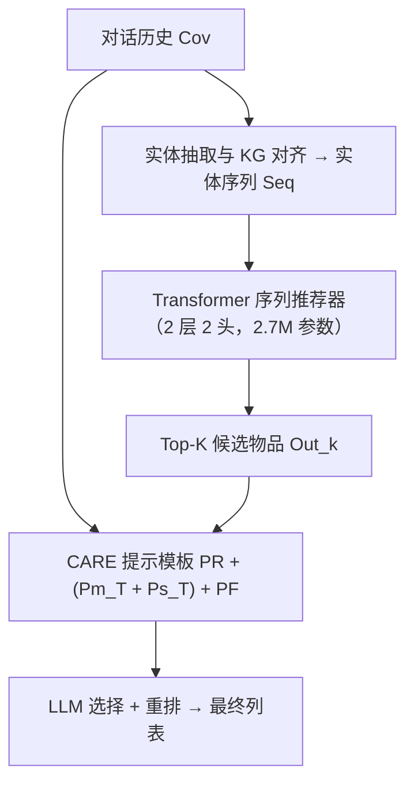
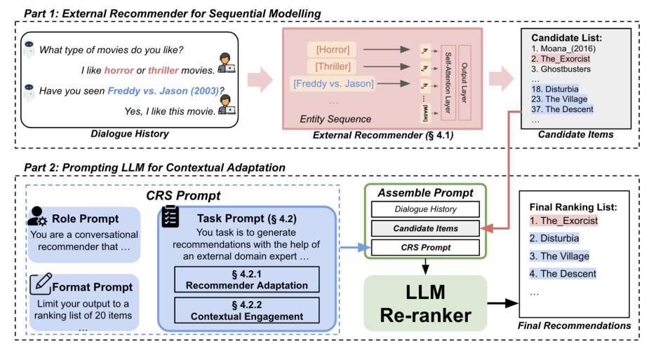

# Improving Conversational Recommendation with Contextual Adaptation of External Recommenders and LLM-based Reranking (外部推荐器上下文适配与 LLM 重排的对话推荐改进)

- **会议/期刊**: ECIR 2026 (LNCS vol. 16484)
- **作者与机构**: Chuang Li, Weida Liang, Hengchang Hu, See-Kiong Ng, Min-Yen Kan, Haizhou Li, Yang Deng（新加坡国立大学 / 新加坡管理大学 / 港中大深圳）
- **推荐链路定位**: 重排（候选由外部序列推荐器召回，LLM 选择+重排）
- **研究方向**: 对话推荐与智能体仿真 / 大语言模型推荐
- **论文原文**: [https://arxiv.org/abs/2508.13889v2](https://arxiv.org/abs/2508.13889v2)
- **开源代码**: 暂未开源

## TL;DR (1分钟核心速览)

LLM 直接零样本做对话推荐存在两大硬伤：**物品空间错位**（生成大量目标域外物品）与**物品信息忽视**（只吃对话上下文、丢掉实体序列中的协同信号）。本文提出 CARE 框架：先用一个仅 2.7M 参数的 Transformer 实体级序列推荐器充当"领域专家"产出候选集，再通过"推荐器描述 + 选择后重排"的提示策略让 LLM 结合对话上下文对候选做选择与重排。在 ReDial / INSPIRED 的 8:1:1 划分、HIT/MRR/NDCG@5/10 协议下，H@5 相对最优 LLM 基线平均提升 54% 与 25%，且开源 Llama3-8B 加持后反超 GPT-4o。

## Background & Motivation (背景与核心矛盾)

- **主流范式**: 当前 LLM-based CRS 以零样本/少样本提示直接让 LLM 从对话历史生成推荐列表（ZSCRS、MemoCRS 等），依赖模型内部知识与上下文语义匹配。
- **前人局限**: 其一，LLM 预训练物品空间与目标域不重合，大量推荐落在域外（图 2 红点），直接拉低准确率；其二，零样本设定下 LLM 无法获取物品侧协同信息，只能做基于内容/上下文的推荐，冷启动与长尾场景尤其吃亏。
- **核心洞察 (Key Insight)**: 作者用输入消融（图 3）证明——去掉物品实体的纯上下文输入几乎不掉点，而只给实体序列则显著掉点，说明 LLM 严重依赖上下文、系统性忽视实体级协同信号；而这恰是传统序列推荐器的强项。
- **本文切入点**: 让"实体级专家"负责域内候选生成，让 LLM 负责上下文语义裁决，二者以物品实体为中介做模块化拼接，而非端到端微调。

## Method (核心方法设计)

### 1. 整体框架 (Overall Architecture)

对话历史先经实体抽取脚本对齐知识图谱实体（物品/属性），得到实体序列 $Seq=[e_1,\dots,e_n]$；该序列送入轻量 Transformer 序列推荐器做实体级建模，输出 top-$K$ 候选物品并转为文本；随后将候选列表与原始对话历史共同填入 CARE 提示模板（角色提示 + 适配任务提示 + 策略任务提示 + 格式提示），由 LLM 完成选择与重排，输出最终推荐列表。整个流程 LLM 侧零微调（仅 API 推理），唯一训练量是外部推荐器，模块可插拔替换。

<figure class="paper-figure" markdown="span">
  <figcaption>图 4：CARE 框架：对话输入首先被传入外部推荐器进行实体级序列建模（§ 4.1）。候选物品输出与原始对话历史共同用于提示 LLM 进行上下文适配并生成对话式推荐（§ 4.2）。</figcaption>
</figure>

### 2. 关键设计拆解 (Key Designs)

1. **实体级序列专家（External Recommender）**：痛点在于 LLM 无协同信号。做法是把实体嵌入拆为图谱嵌入与位置嵌入之和 $h_i^0 = h^K + h^P$，经多头自注意力得序列表示$H=\mathrm{Self\text{-}Attention}(h_1^0,\dots,h_n^0,[\mathrm{MASK}])$，再由两层前馈投影回物品空间$\mathrm{out}_i=\mathrm{GELU}(HW_1^\top+b_1)W_2^\top+b_2$。直觉：把对话压缩成"用户看过/提过什么"的序列，用序列推荐范式补上协同过滤能力，同时天然把输出约束在域内物品空间。
2. **推荐器适配三法（Recommender Adaptation）**：痛点在于 LLM 不知道外部系统是什么、能干什么。作者对比三种任务提示写法——直接提示（仅说"有个专家"）、推荐器描述（说明其基于实体序列建模并输出排序列表）、自我反思（让 LLM 逐步阅读代码/论文/样例并迭代改写提示直至收敛）。实验表明"描述法"在物品空间约束、准确率与 token 效率三维上综合最优，自我反思虽准但 token 开销大。
3. **上下文参与策略与自由度控制（Contextual Engagement + Policy）**：给出两种策略——重排（候选数 = 输出数，仅调序）与选择后重排（给 $K>20$个候选，先选再排，默认最优$K=100$），并在提示中硬约束"不得生成候选之外的物品"。总目标即$\{i_1,\dots,i_n\}=\mathrm{LLM}(P^{CARE}, Cov, Out_k)$，其中$P^{CARE}=P_R+(P_T^m+P_T^s)+P_F$。该约束把 LLM 的自由生成转为受限重排，从机制上消除域外输出与流行度霸榜。

## Experimental Setup & Evaluation Protocol (实验设置与评估协议)

- **数据集与预处理**: 采用 CRSLab 预处理版本，实体经脚本与 KG 对齐：

| 数据集 | #Users | #Items | #Interactions(对话/轮次) | 平均实体数/对话 | 特征/场景说明 |
| :--- | :---: | :---: | :---: | :---: | :--- |
| ReDial | 764 | 6,281 | 11,348 / 139,557 | 7.24 | 电影域，物品实体为主 |
| INSPIRED | 999 | 1,967 | 999 / 35,686 | 12.88 | 电影域，属性实体更丰富 |

- **数据划分与防穿越 (Splitting Strategy)**: 沿用原始 **8:1:1 比例划分**，未做额外时间戳切分。
- **排名评测协议 (Ranking Protocol)**: 报告 HIT@K、MRR@K、NDCG@K（$K\in\{5,10\}$），未明确说明是否全库排序，从基线复现方式看属**候选/采样排序**口径；不评估回复生成质量。
- **对比基线与超参设置**: 基线含数据集自带 BMK（ReDial 自编码器、INSPIRED 微调 Transformer）、学习型 KBRD/KGSF/SASRec/UniCRS、LLM 型 ZSCRS/Llama3/MemoCRS(GPT-4)；外部推荐器 2 层 2 头、SGD、lr=5e-3、dropout=0.2；ChatGPT 温度设为 0；显著性 $p<0.05$。

## Key Experimental Results (实验关键数据)

### 1. 主实验对比 (Main Results)

| 模型 | ReDial H@5/H@10 | ReDial N@5/N@10 | INSPIRED H@5/H@10 | INSPIRED N@5/N@10 |
| :--- | :---: | :---: | :---: | :---: |
| UniCRS (学习型最优) | .101/.161 | .054/.073 | .091/.106 | .070/.074 |
| ZSCRS (LLM) | .111/.165 | .070/.087 | .109/.142 | .076/.086 |
| MemoCRS (GPT-4) | .136/.215 | .088/.113 | NA | NA |
| **CARE-CRS (GPT-3.5)** | **.194\*/.248\*** | **.148\*/.166\*** | **.144\*/.169\*** | **.103\*/.111\*** |
| Improv. (vs 最优 LLM) | +42.7%/+15.4% | +68.2%/+46.9% | +22.0%/+11.9% | +32.1%/+16.8% |

### 2. 消融实验 (Ablation Study)

| 配置 | 关键结论 |
| :--- | :--- |
| 直接提示 vs 描述法 vs 自我反思 | 描述法三维综合最优；自我反思准确率略高但 token 效率低 |
| 仅零样本 LLM / 仅外部推荐器 | 二者互有胜负：ReDial 上推荐器更强，INSPIRED 上 LLM 更强 |
| 重排 (ST1) vs 选择后重排 (ST2) | ST2 整体更优，最优候选数 $K=100$，$K$ 变化影响相对温和 |
| Llama3-8B + CARE | 由弱于 GPT-4o 反超为全面领先 |

### 3. 关键实验发现 (Key Findings)

1. **增益来源可归因于域外率下降**：零样本 LLM 输出大量域外物品，CARE 通过"候选集 + 禁止越界生成"策略把域外比例显著压低（图 8），与 H@5 提升方向一致；ReDial 增益（+42.7%）远大于 INSPIRED（+22.0%），因前者物品实体密集、更缺协同信号。
2. **流行度偏差被上下文裁决修正**：外部推荐器排名与物品流行度呈高均值低方差（图 9 左），CARE 后方差显著增大（图 9 右）；案例中推荐器把流行奇幻片 *Monna* 排第一，LLM 依据"用户想看恐怖片"将其剔除并把 *The Exorcist* 提至前列。
3. **小模型 + 好接口胜过强模型**：仅 2.7M 参数的外部推荐器（不足 UniCRS 的 1%）配合零样本 API 推理，即让 Llama3-8B 全面超过 GPT-4o 零样本，说明瓶颈在信息接口而非模型规模。

## Highlights & Limitations (亮点、对比与审稿批判)

- **与代表作对比 (vs. Prior Work)**: 相比 ZSCRS 纯提示生成，CARE 用外部推荐器把输出约束进域内物品空间；相比 MemoCRS 依赖用户画像记忆检索，CARE 走的是"实体序列协同建模"路线且无需构造记忆库；相比 UniCRS 全量微调 762M 语言模型，CARE 只训 2.7M 推荐器、LLM 零微调，训练成本低一个量级。
- **可迁移亮点**: ①"受限重排 + 禁止越界生成"的提示策略可直接迁移到电商/短视频的 LLM 重排链路；②用输入消融（全对话 / 仅实体 / 去实体上下文）诊断 LLM 信息偏食的做法，是评估 LLM4Rec 的有效诊断工具。
- **审稿级局限批判**: ①评测未明确全库排序口径，且依赖 Levenshtein 距离阈值 $\vartheta=2$做域外判定，指标对字符串匹配敏感；②选择后重排需将$K=100$候选塞入提示，token 成本与延迟随$K$ 线性增长，论文未给出线上时延数据；③仅两个电影域数据集，跨域（电商、音乐）泛化性未验证。

## Rating (四维评分)

- **方法创新性 (Novelty)**: ⭐⭐⭐ （模块化拼接思路朴素但问题定位精准，"实体专家 + 上下文裁决"分工有说服力，缺理论分析）
- **评估协议与实验扎实度 (Protocol & Experiments)**: ⭐⭐⭐ （双数据集 + 多类基线 + 显著性检验齐全，但排序口径与域外判定阈值不够严谨）
- **写作与数学规范度 (Clarity & Rigor)**: ⭐⭐⭐⭐ （问题—方法—验证链条清晰，公式简洁，提示模板全文给出便于复现）
- **工业落地与复现价值 (Industrial & Practical Value)**: ⭐⭐⭐⭐ （LLM 零微调、推荐器仅 2.7M 参数、模块可插拔，工程友好；但未开源且缺时延评估）
