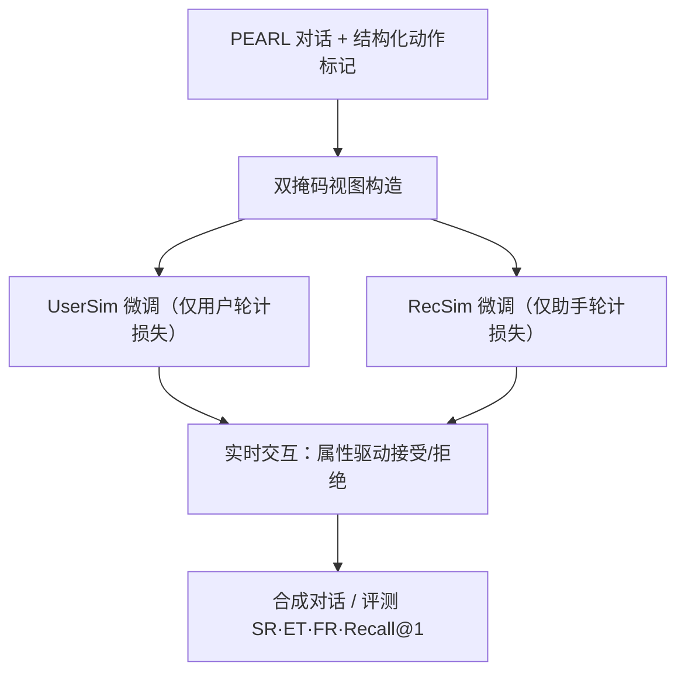
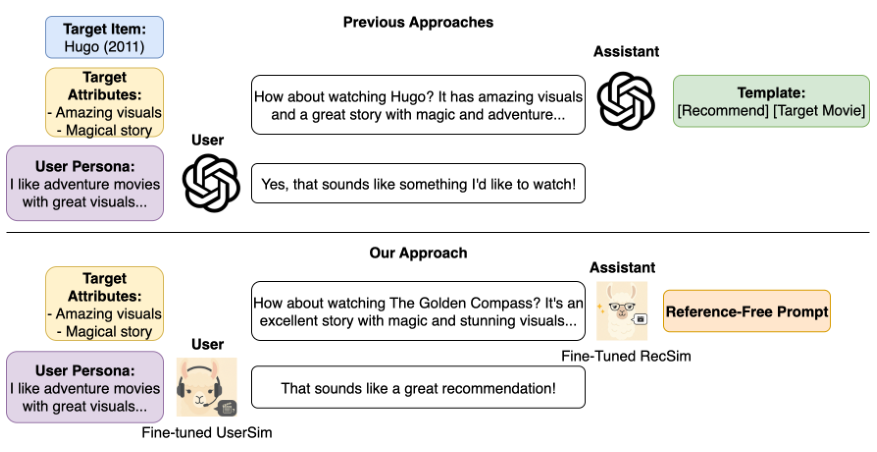

# Interplay: Training Independent Simulators for Reference-Free Conversational Recommendation (训练独立模拟器实现无参考对话推荐)

- **会议/期刊**: ECIR 2026
- **作者与机构**: Jerome Ramos, Feng Xia, Xi Wang, Shubham Chatterjee, Xiao Fu, Hossein A. Rahmani, Aldo Lipani (UCL / University of Sheffield / Missouri S&T)
- **推荐链路定位**: 数据合成与仿真（服务于 CRS 训练与评测）
- **研究方向**: 对话推荐与智能体仿真 / 大语言模型推荐
- **论文原文**: [https://arxiv.org/abs/2603.18573v1](https://arxiv.org/abs/2603.18573v1)
- **开源代码**: [https://github.com/jeromeramos70/interplay-sim](https://github.com/jeromeramos70/interplay-sim)

## TL;DR (1分钟核心速览)

现有 CRS 对话仿真普遍采用单一 LLM 扮演双方并**预先注入目标物品**，导致数据泄漏（模拟器"已知答案"）与对话僵化（探索受限、用户被迫拒绝合理推荐）。本文提出 Interplay：用同一批 PEARL 对话经**角色掩码**分别微调两个独立 8B 模拟器（UserSim / RecSim），用户侧仅见"目标属性"而非目标电影，推荐侧无任何 oracle 知识，二者实时交互。在 PEARL 过滤测试集（2,069 段对话）上，UserSim 成功率 93–95%（Llama3.1-70B 仅 36%），RecSim-Qwen8B 的 Recall@1 达 0.0217，约为 Qwen3-32B（0.0014）的 15 倍，Match Score 0.9333 vs 0.4745。

## Background & Motivation (背景与核心矛盾)

- **主流范式**: 人工标注 CRS 对话昂贵且质量差（泛化话术、缺上下文、缺领域知识），因此转向 LLM 合成对话；近期工作（如 PEARL）用 GPT-3.5/4o 生成整段对话。
- **前人局限**: ① **Reference-dependent 泄漏**——目标物品提前喂给模拟器，用户模拟器会因"不匹配预设片名"而拒绝优质推荐，推荐器则被引导向既定答案，探索被扼杀；② **单模型双角色**——通用 LLM 被设计为"乐于助人的助手"，无法模拟真实用户的不一致偏好与不确定性，角色行为同质化。
- **核心洞察 (Key Insight)**: 真实推荐的张力来自"用户有偏好但开放于惊喜、推荐器需在未知中探索"；这种张力只有在**双方信息不对称且独立优化**时才会自然涌现。
- **本文切入点**: 以"目标属性"替代"目标物品"切断 oracle 依赖，并用角色专属损失掩码在同一对话流上训练两个彼此独立的专用模拟器。

## Method (核心方法设计)

### 1. 整体框架 (Overall Architecture)

输入为 PEARL 的一段真实对话，经结构化标记（`<action>` 动作块 + `<response>` 文本块，动作含 `<recommend>/<inquire>/<greeting>/<disclose-goal>/<feedback>/<accept>`）标注后，构造两个互补掩码视图：UserSim 视图遮蔽助手轮、保留用户轮；RecSim 视图遮蔽用户轮、保留助手轮。两模型各自全量微调（Llama 3.1 8B / Qwen 3 8B base 版，2 epoch，lr 2e-4，4×A100）。推理阶段两模型实时互相对话，用户侧输入为"通用偏好摘要 + 3 部历史电影及评论 + 目标属性（不含片名）"，推荐侧仅见人设与对话历史；用户输出 `<accept>` 即自然终止。

<figure class="paper-figure" markdown="span">
  <figcaption>图 1. 与先前使用模板化对话和目标感知静态 LLM 的工作不同，我们的方法独立训练用户模拟器和推荐器模拟器，无需预定义物品或动作，从而实现多样、真实的交互。</figcaption>
</figure>
<figure class="paper-figure" markdown="span">
  <figcaption>图 2. 单个 PEARL 对话用结构标记进行标注，以训练两个独立的模拟器：（左）掩蔽助手轮次并保留用户轮次以训练 UserSim；（右）掩蔽用户轮次并保留助手轮次以训练 RecSim。</figcaption>
</figure>

### 2. 关键设计拆解 (Key Designs)

1. **属性级用户目标（Breaking the Single-Target Constraint）**：痛点是用固定目标电影条件化会让模拟器机械拒绝合理推荐。本文改为从目标电影评论中抽取"目标属性"（如"情节烧脑的悬疑惊悚片"）作为用户意图，使模拟器可接受**任意满足属性**的推荐。直觉上这把"单点收敛"松弛为"属性对齐"，对话得以自然多向演化，且 `<accept>` 提供了不依赖 ground-truth 的终止信号，避免 oracle 方法"必须命中真值才停"导致的长对话或人工注入真值。

2. **角色专属损失掩码（Role-Specific Loss Masking）**：单流对话训练双角色易发生角色混淆。本文仅在各自角色 token 上计算交叉熵：
$$\mathcal{L}_{\text{masked}}=-\sum_{t=1}^{T}M_t\cdot\log P(y_t\mid y_{<t},x),\quad M_t=\mathbb{I}[t\in\mathcal{T}_{\text{simulator}}]$$
两模型都能"看到"完整上下文却只学"说自己该说的话"，从而自发分化出用户式表达与推荐式说服策略。

3. **训练目标、负采样与推理效率**：总损失即上述掩码 CE，无对比/负采样环节；训练数据仅 52.9k 段过滤后对话（剔除 7.65% 空轮与非 IMDB 电影）。推理为两 8B 模型逐轮自回归，成本远低于 32B/70B 零样本基线，且结构化输出可直接程序化解析动作序列与推荐物品。

## Experimental Setup & Evaluation Protocol (实验设置与评估协议)

- **数据集与预处理**: PEARL 过滤后 52.9k 训练对话；测试集 2,069 段，**用户人设可见、目标物品未见**（seen persona / unseen target）。

| 数据集 | #Users | #Items | #Interactions | 稀疏度/密度 | 特征/场景说明 |
| :--- | :---: | :---: | :---: | :---: | :--- |
| PEARL (filtered) | 未报告 | IMDB 子集 | 52.9k 对话 | — | 电影域，含人设/历史评论/目标属性 |
| PEARL test | 未报告 | 同上 | 2,069 对话 | — | seen persona, unseen target |

- **数据划分与防穿越 (Splitting Strategy)**: 沿用 PEARL 原始划分，测试集保证目标物品未在训练中出现；历史 3 部电影复用 PEARL 采样以维持上下文一致、避免泄漏。
- **排名评测协议 (Ranking Protocol)**: 非全库排序。用户侧采用**多轮回放**统计互斥三率 SR/ET/FR（合计 100%）；推荐侧单轮只输出 1 个物品，报告 `Recall@1` 与 `Match Score`（推荐物品与真值的 MovieLens-32M 训练嵌入余弦相似度）。
- **对比基线与超参设置**: 零样本 Llama3.1-70B-Instruct、Qwen3-32B-Instruct（同 prompt 同上下文），以及微调后的 UniCRS；模拟器均为 8B base 模型全量微调，未报告显著性检验（人工评测标注 $p<0.05$）。

## Key Experimental Results (实验关键数据)

### 1. 主实验对比 (Main Results)

**用户模拟器（表 1）**

| Model | SR ↑ | ET | FR ↓ | BERTScore ↑ | Dist-4 ↑ |
| :--- | :---: | :---: | :---: | :---: | :---: |
| UserSim-Llama 8B | 0.9265 | 0.0498 | 0.0237 | 0.9364 | 0.3023 |
| **UserSim-Qwen 8B** | **0.9531** | 0.0232 | **0.0237** | **0.9373** | 0.3093 |
| Llama3.1 70B (zero-shot) | 0.3615 | 0.0033 | 0.6351 | 0.8870 | 0.2786 |
| Qwen3 32B (zero-shot) | 0.7772 | 0.0097 | 0.2131 | 0.8921 | 0.3409 |

**推荐模拟器（表 2）**

| Model | Recall@1 ↑ | Match Score ↑ | Dist-4 ↑ | #Words |
| :--- | :---: | :---: | :---: | :---: |
| RecSim-Llama 8B | 0.0193 | 0.9323 | 0.5243 | 37.42 |
| **RecSim-Qwen 8B** | **0.0217** | **0.9333** | **0.5358** | 37.30 |
| Qwen3 32B (zero-shot) | 0.0014 | 0.4745 | 0.4630 | 42.21 |
| UniCRS (fine-tuned) | 0.0119 | 0.9129 | 0.2147 | 29.69 |

> Improv.：RecSim-Qwen8B 相对 Qwen3-32B 的 Recall@1 提升约 **15×**（0.0217 vs 0.0014），Match Score 提升 **+96.7%**；相对 UniCRS 的 Recall@1 提升 **+82.4%**。

### 2. 消融实验 (Ablation Study)

原文未提供标准组件消融表，以下为可对照的"设计替代"证据（以基线形式呈现）：

| 配置 | SR | Recall@1 | Match Score | 说明 |
| :--- | :---: | :---: | :---: | :--- |
| 完整 Interplay (Qwen 8B) | **0.9531** | **0.0217** | **0.9333** | 独立训练 + 属性目标 |
| 单模型零样本 32B（近似"共享知识双角色"） | 0.7772 | 0.0014 | 0.4745 | 无专用化、无属性松弛 |
| 微调 UniCRS（模块化 CRS） | — | 0.0119 | 0.9129 | 有监督但非生成式仿真 |
| 70B 零样本 | 0.3615 | — | — | 规模不足以替代专用化 |

### 3. 关键实验发现 (Key Findings)

1. **专用化 > 规模**：8B 专用模拟器 SR 达 93–95%，而 70B 零样本仅 36.2%、32B 仅 77.7%，说明角色专属微调带来的行为分化远比参数规模关键。
2. **去 oracle 不损质量反增多样性**：RecSim 的 Dist-4（0.5358）高于 32B（0.4630）与 UniCRS（0.2147），且 Match Score 近乎翻倍，证明无目标注入时模型倾向生成语义近邻的多样推荐而非复读真值。
3. **人工评测持平且用户控制感更强**：10 名评测者对 50 组对话六维盲评，Interplay 在"用户控制"上显著胜出（$p<0.05$），整体质量与 PEARL 相当；自然度略逊可归因于训练语料继承 PEARL（GPT-3.5）文风及 8B 规模限制。

<figure class="paper-figure" markdown="span">
  <figcaption>图 3. 人类评估中无参考对话与 PEARL 数据集的胜率比较。（* 表示 p 值 &lt; 0.05）</figcaption>
</figure>

## Highlights & Limitations (亮点、对比与审稿批判)

- **与代表作对比 (vs. Prior Work)**: 相较 PEARL 等 reference-dependent 合成（目标物品前置注入、单模型生成整段对话），Interplay 以属性替代物品切断泄漏；相较 MACRS / Collaborative Self-Play 的多 LLM 角色扮演，本文强调**真正独立的参数与损失**而非同一模型换 prompt；相较 UniCRS 等端到端 CRS，本文定位是"数据与评测基础设施"而非直接推荐器。
- **可迁移亮点**: ① 角色掩码损失可在任意"单流多角色"对话日志上低成本构造双模拟器；② 用属性/评论摘要替代 ground-truth 作为条件信号，是缓解合成数据泄漏的通用手段。
- **审稿级局限批判**: ① 仅电影单域验证，电商/音乐等域外泛化未测；② 结构化动作模板限制了开放闲聊与多意图混合轮；③ Match Score 未经人类偏好校验，Recall@1 绝对值极低（~2%），实际推荐可用性存疑；④ 未报告方差与显著性检验（除人工评测），8B 双模型逐轮推理的延迟亦未量化。

## Rating (四维评分)

- **方法创新性 (Novelty)**: ⭐⭐⭐⭐ （"属性替代物品 + 角色掩码独立训练"组合简洁有效，直击 oracle 泄漏这一领域顽疾，但单点技术门槛不高）
- **评估协议与实验扎实度 (Protocol & Experiments)**: ⭐⭐⭐ （SR/ET/FR 三率互斥设计巧妙、含人工盲评，但缺标准消融、缺显著性检验、单数据集单域）
- **写作与数学规范度 (Clarity & Rigor)**: ⭐⭐⭐⭐ （框架与掩码公式表述清晰、动机链条完整，数学部分较浅但无谬误）
- **工业落地与复现价值 (Industrial & Practical Value)**: ⭐⭐⭐⭐ （代码开源、8B 全量微调成本可控、可直接产出 CRS 训练数据，唯推理延迟与域外验证待补）

