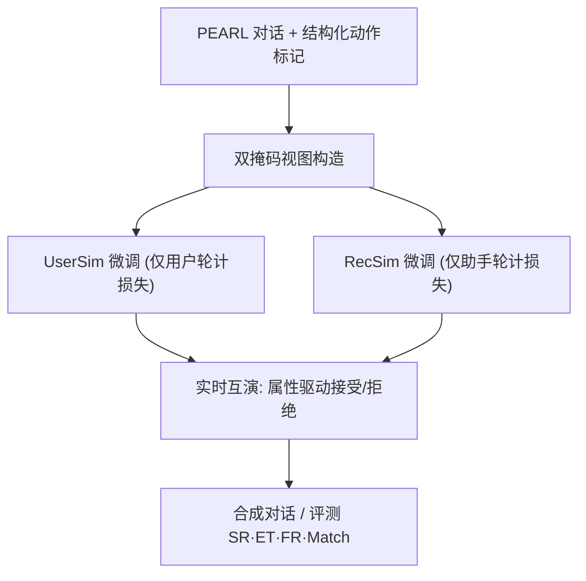
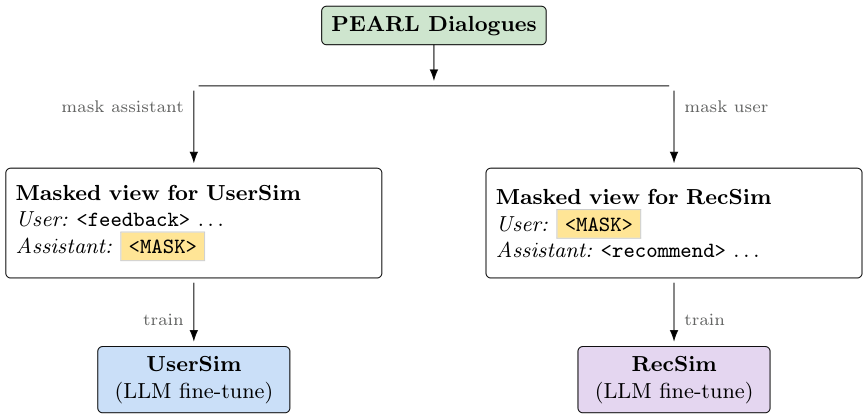
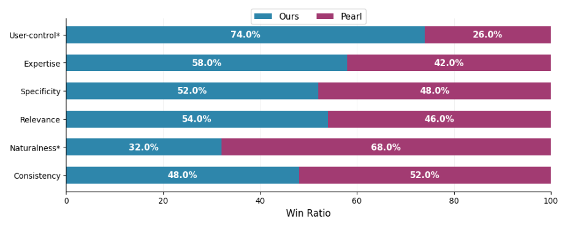

# Interplay: Training Independent Simulators for Reference-Free Conversational Recommendation (面向无参考对话推荐的双独立模拟器互演训练)

- **会议/期刊**: ECIR 2026
- **作者与机构**: Jerome Ramos, Feng Xia, Xi Wang, Shubham Chatterjee, Xiao Fu, Hossein A. Rahmani, Aldo Lipani (UCL / University of Sheffield / Missouri S&T)
- **推荐链路定位**: 数据合成与仿真训练（服务于对话推荐系统的训练与评测）
- **研究方向**: 对话推荐与智能体仿真 / 大语言模型推荐
- **论文原文**: [https://arxiv.org/abs/2603.18573v1](https://arxiv.org/abs/2603.18573v1)
- **开源代码**: [https://github.com/jeromeramos70/interplay-sim](https://github.com/jeromeramos70/interplay-sim)

## TL;DR (1分钟核心速览)

对话推荐（CRS）训练数据稀缺，现有 LLM 仿真普遍采用"参考依赖"范式：把目标物品预先喂给模拟器，导致数据泄漏与剧本化对话。本文提出 Interplay——用同一批 PEARL 对话经**角色掩码损失**分别微调两个独立 8B 模拟器（UserSim / RecSim），用户侧只持有"目标属性"而非目标片名，推荐侧完全无 oracle 知识，二者实时互演。在 PEARL 过滤测试集（2,069 段对话）上，UserSim 成功率 93–95%（Llama3.1-70B 仅 36%），RecSim-Qwen8B 的 Recall@1 达 0.0217，约为 Qwen3-32B 基线的 15 倍。

## Background & Motivation (背景与核心矛盾)

- **主流范式**: 用 LLM 扮演用户与推荐方生成 CRS 对话，以缓解人工标注成本高、众包对话"泛化空洞、缺上下文、缺领域知识"三大顽疾。
- **前人局限**: 其一，**参考依赖（reference dependency）**——模拟器提前知道目标物品，形成 oracle 泄漏，对话退化为"引导用户说出答案"的剧本；其二，**单模型双角色**——通用助手型 LLM 缺乏真实用户的犹豫、偏好不一致与探索性，双方共享知识使"用户不确定 vs 推荐方自信"的天然张力消失。
- **核心洞察 (Key Insight)**: 真实用户找片时说"想要一部烧脑、反转多的惊悚片"，而非锁定《盗梦空间》；只要推荐满足**属性**即会接受。因此把监督信号从"目标物品"降级为"目标属性"，即可在保留真实意图的同时切断 oracle。
- **本文切入点**: 用角色掩码让两个独立模型从同一对话流中各学各的角色，再让它们无预设目标地自由互演。

## Method (核心方法设计)

### 1. 整体框架 (Overall Architecture)

输入为 PEARL 的一段真实对话，经结构化标记（`<action>` 动作块 + `<response>` 文本块，动作含 `<recommend>/<inquire>/<greeting>/<disclose-goal>/<feedback>/<accept>`）改写后，构造两个互补掩码视图：UserSim 视图遮蔽助手轮、保留用户轮；RecSim 视图遮蔽用户轮、保留助手轮。两个 8B 基座（Llama 3.1 / Qwen 3，均用 base 版以避免 instruct 对齐干扰）各自全量微调 2 epoch。推理阶段两模型实时互演：UserSim 携带"总体偏好摘要 + 3 部历史观影及评论 + 目标属性"，RecSim 仅见对话历史，用户输出 `<accept>` 即自然终止。

<figure class="paper-figure" markdown="span">
  <figcaption>图 2. 单条 PEARL 对话用结构标记进行标注，以训练两个独立的模拟器：（左）掩蔽助手轮次并保留用户轮次以训练 UserSim；（右）掩蔽用户轮次并保留助手轮次以训练 RecSim。</figcaption>
</figure>

### 2. 关键设计拆解 (Key Designs)

1. **属性替代物品的无参考用户建模（Breaking the Single-Target Constraint）**：痛点是以往模拟器因推荐不匹配预设片名而拒绝优质推荐。本文从目标影片评论中抽取属性线索（如"复杂反转的烧脑惊悚"）而不暴露片名，使用户对**任一满足属性的物品**均可接受，从而把"收敛到单一答案"的刚性目标松弛为"属性对齐"的软约束，对话得以自然多向演化。
2. **角色特定损失掩码（Role-Specific Loss Masking）**：单流双角色训练会让模型学到角色互换。本文在交叉熵上施加角色掩码，使每个模型"看全对话、只学己方"：
$$\mathcal{L}_{\text{masked}}=-\sum_{t=1}^{T}M_t\cdot\log P(y_t\mid y_{<t},x),\quad M_t=\mathbb{I}[t\in\mathcal{T}_{\text{simulator}}]$$
   直觉上这等价于在共享上下文上做**条件角色解耦**，迫使 UserSim 习得偏好表达与拒绝理由、RecSim 习得追问与说服式解释，行为差异由训练目标自然涌现而非人工编排。
3. **结构化动作生成与自然终止**：强制先输出 `<action>` 再输出 `<response>`，既提供显式推理模板，又使后处理可编程解析动作序列与推荐物品。用户遇满意推荐即输出 `<accept>`，替代 oracle 方法"必须命中 ground-truth 才停"的僵化终止（后者常导致超长对话或固定轮次后人工注入答案）。训练为全参数微调，无负采样环节；推理为自回归逐 token 生成，成本与对话轮数线性相关。

## Experimental Setup & Evaluation Protocol (实验设置与评估协议)

- **数据集与预处理**: PEARL 经清洗（去空对话轮、剔除不在 IMDB 中的影片），过滤掉原始数据的 7.65%，余 52.9k 段对话；测试集 2,069 段，**用户 persona 可见、目标物品未见**。

| 数据集 | #Users | #Items | #Interactions | 稀疏度/密度 | 特征/场景说明 |
| :--- | :---: | :---: | :---: | :---: | :--- |
| PEARL (filtered) | 未报告 | IMDB 影片库 | 52.9k 对话 | — | 电影推荐；含偏好摘要、3 部历史观影+评论、目标属性 |
| PEARL test | 同上 | 同上 | 2,069 对话 | — | seen persona / unseen target item |

- **数据划分与防穿越 (Splitting Strategy)**: 沿用 PEARL 原始划分，测试集保证目标物品未在训练中出现；历史 3 部影片沿用 PEARL 采样以对齐上下文、避免泄漏。
- **排名评测协议 (Ranking Protocol)**: 非全库排序。用户侧采用**对话回放式判定**，统计互斥三率 SR / ET / FR（合计 100%）；推荐侧用 **Recall@1**（单轮仅输出一个推荐）与 **Match Score**（推荐影片与 ground-truth 影片的 MovieLens-32M 训练嵌入余弦相似度，TinyBERT 编码标题/标签/类型 + BPR 学习交互相关性）。
- **对比基线与超参设置**: 基线为 Llama3.1-70B、Qwen3-32B 零样本（提示词与本文模型同构以保证公平）及在 PEARL 上微调的 UniCRS。训练：4×A100、batch 4、梯度累积 4、lr 2e-4、2 epoch；人工评测 10 名标注者对 50 组对话做六维度头对头比较。

## Key Experimental Results (实验关键数据)

### 1. 主实验对比 (Main Results)

**用户模拟器（表 1）**

| Model | SR ↑ | ET | FR ↓ | BERTScore ↑ | Dist-4 ↑ | #Words |
| :--- | :---: | :---: | :---: | :---: | :---: | :---: |
| UserSim-Llama 8B | 0.9265 | 0.0498 | 0.0237 | 0.9364 | 0.3023 | 31.22 |
| **UserSim-Qwen 8B** | **0.9531** | 0.0232 | **0.0237** | **0.9373** | 0.3093 | 30.76 |
| Llama3.1 70B (zero-shot) | 0.3615 | 0.0033 | 0.6351 | 0.8870 | 0.2786 | 43.41 |
| Qwen3 32B (zero-shot) | 0.7772 | 0.0097 | 0.2131 | 0.8921 | **0.3409** | 31.68 |

**推荐模拟器（表 2）**

| Model | Recall@1 ↑ | Match Score ↑ | Dist-4 ↑ | #Words |
| :--- | :---: | :---: | :---: | :---: |
| RecSim-Llama 8B | 0.0193 | 0.9323 | 0.5243 | 37.42 |
| **RecSim-Qwen 8B** | **0.0217** | **0.9333** | **0.5358** | 37.30 |
| Qwen3 32B (zero-shot) | 0.0014 | 0.4745 | 0.4630 | 42.21 |
| UniCRS (fine-tuned) | 0.0119 | 0.9129 | 0.2147 | 29.69 |

相对提升：RecSim-Qwen8B 的 Recall@1 较 Qwen3-32B 提升约 **15×**（0.0217 vs 0.0014），较 UniCRS 提升 **82.4%**；Match Score 较 Qwen3-32B 提升 **96.7%**。

### 2. 消融实验 (Ablation Study)

原文未提供严格意义的组件消融表，但通过"参考依赖 vs 无参考"的对照与人工评测构成等价证据：

| 配置 | 关键指标 | 说明 |
| :--- | :---: | :--- |
| 完整 Interplay（无参考，独立训练） | SR 0.9531 / Recall@1 0.0217 | 本文方案 |
| 去掉独立训练（单模型双角色，即前人范式） | 对话剧本化、需人工注入答案 | 定性对照，见 §3.5 |
| 去掉属性松弛（回退到目标物品 oracle） | 用户拒绝优质推荐、ET 趋零 | 定性对照，见 §3.2 |
| 零样本大模型替代微调（70B/32B） | SR 0.36 / 0.78，Recall@1 0.0014 | 规模换不来角色专精 |

### 3. 关键实验发现 (Key Findings)

1. **角色专精远胜参数规模**：8B 微调模型在 SR 上比 70B 零样本高 56 个百分点以上，Recall@1 高一个数量级，说明 CRS 仿真瓶颈在"角色行为对齐"而非通用语言能力。
2. **无参考不损质量、反增多样性**：UserSim 的 BERTScore（0.9373）高于全部零样本基线，RecSim 的 Dist-4（0.5358）显著高于 UniCRS（0.2147），证明切断 oracle 后模型转向属性匹配而非复述答案，响应更丰富。
3. **人工评测六维持平、用户控制感显著更优**：50 组头对头比较中，Interplay 在 user control 维度显著胜出（$p<0.05$），仅在 naturalness 上略逊——作者归因于训练语料继承 PEARL（GPT-3.5 生成）的文风，而非无参考设计本身的缺陷。

<figure class="paper-figure" markdown="span">
  <figcaption>图 3. 人类评估中无参考对话与 PEARL 数据集的胜率比较。（* 表示 p 值 &lt; 0.05）</figcaption>
</figure>

## Highlights & Limitations (亮点、对比与审稿批判)

- **与代表作对比 (vs. Prior Work)**: 相较 PEARL 等参考依赖式合成（目标物品前置、对话收敛到固定答案），本文把监督信号换成属性，从根源消除泄漏；相较 UniCRS 这类端到端 CRS 模型，本文不追求单模型推荐精度，而是产出可规模化、可解析的**训练数据工厂**；相较 MACRS / Collaborative Self-Play 等多智能体框架，本文的关键差异是"真独立"——两模型分别微调、损失互不干扰，而非同一 LLM 换提示词。
- **可迁移亮点**: ①"属性替代标签"的松弛监督可直接迁移到电商/短视频的对话式数据合成，缓解目标泄漏；②角色掩码损失是一种通用的单流多角色解耦手段，可用于客服-用户、买家-卖家等双边仿真。
- **审稿级局限批判**: ①**领域单一**，仅在电影域验证，电商/音乐/旅行的对话动力学差异未测；②**Match Score 未经人类效度校验**，且 Recall@1 绝对值仅 0.02 量级，推荐能力仍弱；③对话被限制在六类结构化动作内，无法覆盖闲聊、多意图混合轮次；④两模型互演存在无限延长风险，仅靠 `<accept>` 概率性收敛，缺少轮数上界或退化检测机制。

## Rating (四维评分)

- **方法创新性 (Novelty)**: ⭐⭐⭐⭐ （"属性替代物品 + 角色掩码独立训练"组合简洁有力，直击 oracle 泄漏这一领域公认病灶，但单点技术均非全新）
- **评估协议与实验扎实度 (Protocol & Experiments)**: ⭐⭐⭐ （SR/ET/FR 三率互斥设计巧妙、含人工评测，但缺严格消融表、Match Score 未验证、仅单数据集单领域）
- **写作与数学规范度 (Clarity & Rigor)**: ⭐⭐⭐⭐ （动机—设计—证据链条清晰，掩码公式与动作模板定义明确；数学体量偏轻，缺复杂度与收敛性讨论）
- **工业落地与复现价值 (Industrial & Practical Value)**: ⭐⭐⭐⭐⭐ （代码开源、8B 全参微调成本可控、合成数据可无限扩展，是低成本 CRS 数据冷启动的实用方案）
