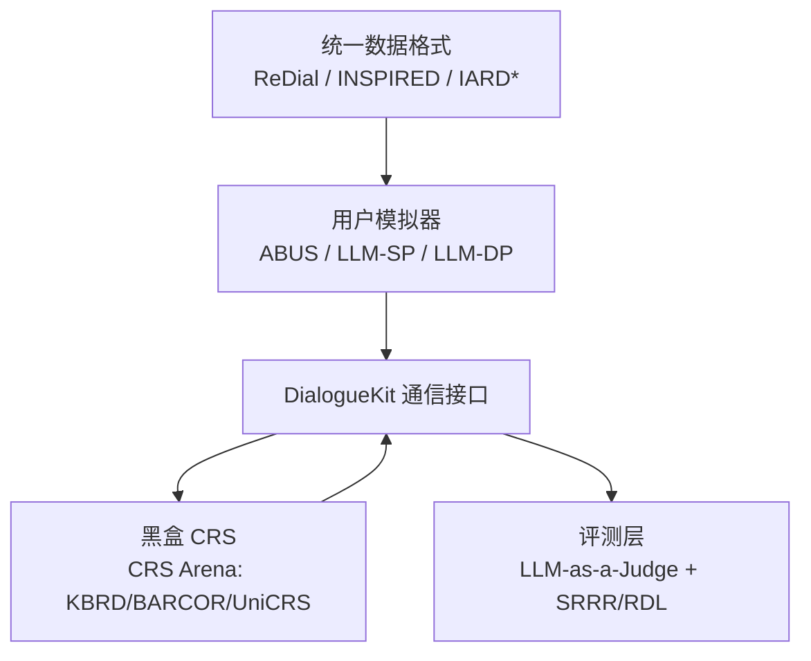

# UserSimCRS v2: Simulation-Based Evaluation for Conversational Recommender Systems (对话推荐系统基于模拟的评测工具包 v2)

- **会议/期刊**: ECIR 2026 (第 48 届欧洲信息检索会议)
- **作者与机构**: Nolwenn Bernard (TH Köln)、Krisztian Balog (University of Stavanger)
- **推荐链路定位**: 评测基础设施（覆盖对话式召回/推荐全链路，非单一排序阶段）
- **研究方向**: 对话推荐与智能体仿真 / 大语言模型推荐
- **论文原文**: [https://arxiv.org/abs/2512.04588v3](https://arxiv.org/abs/2512.04588v3)
- **开源代码**: [https://github.com/iai-group/UserSimCRS](https://github.com/iai-group/UserSimCRS)（底层依赖 [DialogueKit](https://github.com/iai-group/DialogueKit)）

## TL;DR (1分钟核心速览)

对话推荐系统（CRS）的模拟评测长期缺乏可复用资源：v1 仅有规则式议程模拟器、单一数据集与两个指标，且与主流 CRS 框架互不互通。本文提出 UserSimCRS v2，将议程模拟器的 NLU/NLG 替换为 LLM 组件并重写对话策略，新增单/双 Prompt 端到端 LLM 模拟器、统一数据格式（ReDial/INSPIRED/IARD 转换与 LLM 增广）、CRS Arena 接口以及 LLM-as-a-Judge 与用户中心效用指标。在电影域 5 个 CRS × 3 个模拟器 × 3 个数据集的案例中，各模拟器对系统排序给出显著分歧结论，直接证明"模拟器选择即评测结论"。

## Background & Motivation (背景与核心矛盾)

- **主流范式**: CRS 评测分三路——离线测试集（丢失交互性）、人工评测（贵、难复现）、用户模拟（可扩展的折中方案，作为人工评测前的预筛选）。
- **前人局限**: ① CRSLab/RecWizard 等工具包专注"建系统"而非"可复用模拟评测"，研究者被迫从零搭建；② 任务型对话工具包的模拟器不理解推荐特有构念（基于历史交互评估推荐物品），也不支持 ReDial/INSPIRED；③ v1 自身仅有议程模拟器、模板 NLG、随机采样槽值导致对话不连贯、无基准数据集支持、指标仅满意度与轮数。
- **核心洞察 (Key Insight)**: 研究重心已决定性地转向 LLM 用户模拟器（更强 NLU、更流畅多样），但"模拟器—CRS"的互操作性是采用的最大障碍；同时模拟器本身应成为被比较的对象，而非默认可信的度量尺。
- **本文切入点**: 把工具包从"一个模拟器 + 两个指标"升级为"多模拟器 × 多 CRS × 多数据集 × 多指标"的现代评测框架，并用案例实证模拟器间的结论分歧。

## Method (核心方法设计)

### 1. 整体框架 (Overall Architecture)

v2 以 DialogueKit 为底座，将评测流程抽象为四步闭环：定义实验配置（交互模型、用户群体、指标）→ 训练/实例化用户模拟器 → 生成合成对话 → 计算指标。核心模块包括：模拟器层（议程式 ABUS 与 LLM 单/双 Prompt 两类）、用户建模层（偏好/上下文/人格）、统一物品集合、数据集转换与 LLM 增广工具、CRS 黑盒通信接口（经 CRS Arena 接入 KBRD/BARCOR/ChatCRS/UniCRS），以及评测工具层（LLM-as-a-Judge 五维质量评分 + 用户中心效用指标）。所有 LLM 模块共享统一服务接口（OpenAI / Ollama 两种实现），便于替换后端。

<figure class="paper-figure" markdown="span">
  ![图 2：UserSimCRS v2 架构概览。灰色组件继承自 \[1\]，斜线组件和紫色组件分别对应更新或新增的组件。](../../../../assets/papers/2512.04588v3/figure_2.png)<figcaption>图 2：UserSimCRS v2 架构概览。灰色组件继承自 [1]，斜线组件和紫色组件分别对应更新或新增的组件。</figcaption>
</figure>

### 2. 关键设计拆解 (Key Designs)

1. **信息需求驱动的议程模拟器重构（ABUS）**：v1 的槽值随机采样导致对话不连贯，且议程更新不区分对话阶段。v2 显式定义信息需求 $\mathcal{IN}=(\mathcal{C},\mathcal{R},\text{target})$，其中约束集$\mathcal{C}$与请求集$\mathcal{R}$ 分别映射为 `disclosure` 与 `inquiry` 对话行为来初始化议程；议程更新按四类情形分派——elicitation（CRS 追问时压入 disclosure）、recommendation（压入 critique/inquiry）、inquiry、other（与当前状态一致则取议程，否则按历史数据采样）。物理直觉：把"用户想说什么"锚定在固定信息需求上，使多轮对话具备目标一致性，同时复现"先澄清、后推荐、再质询"的真实推荐对话节奏。
2. **单/双 Prompt 端到端 LLM 模拟器**：单 Prompt 版将任务描述、可选人格、信息需求与完整对话历史拼入一个零样本 Prompt 直接生成下一句；双 Prompt 版先由"停止 Prompt"做二分类决策（继续/终止），继续时才调用与单 Prompt 相同的主生成 Prompt。关键差异在于把"何时结束对话"从生成模型中解耦为独立判别，避免 LLM 在长上下文中过早或过晚终止，从而控制对话长度分布这一评测敏感变量。
3. **训练目标、负采样与推理效率**：本文为工具包论文，无端到端训练损失；ABUS 的 LLM-NLU/NLG 采用 few-shot 提示（示例取自增广 IARD），无需标注训练数据即可替代 v1 的监督 NLU 与模板 NLG。推理开销主要来自 LLM API 调用：每个合成对话的轮数 × 每轮 1 次（SP）或 2 次（DP）调用，100 条对话的案例规模在分钟级完成，但大规模网格搜索评测的成本随模拟器类型线性增长。

## Experimental Setup & Evaluation Protocol (实验设置与评估协议)

- **数据集与预处理**: v2 新增三个电影域数据集，统一为 DialogueKit 的"对话行为（intent + slot-value 集合）"格式；缺失标注用 LLM 自动增广（对话行为标注、信息需求抽取），并明确提示需人工抽检 LLM 偏差。

| 数据集 | 领域 | #Dialogues | 标注内容 |
| :--- | :---: | :---: | :--- |
| IARD* (增广) | 电影 | 77 | 对话行为、推荐是否被接受 |
| INSPIRED | 电影 | 1,001 | 社交策略、提及实体、物品反馈 |
| ReDial | 电影 | 10,006 | 电影引用、物品反馈 |

- **数据划分与防穿越 (Splitting Strategy)**: 案例研究不涉及监督训练集划分；模拟器以数据集中的对话/物品集合为知识源实例化，评测阶段生成全新合成对话，不存在测试集泄漏问题。
- **排名评测协议 (Ranking Protocol)**: 非传统 Top-N 排序评测，而是**对话级模拟评测**——每个（模拟器, CRS, 数据集）三元组生成 **100 条合成对话**，在对话上计算指标并报告均值 ± 标准差；无 Full-Ranking / Sampled Ranking 之分。
- **对比基线与超参设置**: 5 个 CRS（BARCOR_OpenDialKG、BARCOR_ReDial、KBRD_ReDial、UniCRS_OpenDialKG、IAI MovieBot）× 3 类模拟器（ABUS、LLM-SP、LLM-DP）× 3 个数据集；指标为用户满意度、流畅度、推荐相关性（均为 1–5 分 LLM-as-a-Judge 评分），另实现 SRRR 与 RDL 效用指标。

## Key Experimental Results (实验关键数据)

### 1. 主实验对比 (Main Results)

下表摘取各数据集下最具代表性的结果（均值 ± 标准差，满分 5）：

| 数据集 | CRS | 满意度 ABUS / SP / DP | 流畅度 ABUS / SP / DP | 推荐相关性 ABUS / SP / DP |
| :--- | :--- | :---: | :---: | :---: |
| MovieBot | IAI MovieBot | 1.5 / 1.7 / **2.5** | **3.4** / 3.1 / 3.3 | 2.1 / 2.3 / **2.9** |
| MovieBot | BARCOR_ReDial | **2.0** / 1.8 / **2.0** | **3.3** / 2.6 / 2.9 | **2.4** / 1.5 / 1.9 |
| MovieBot | UniCRS_OpenDialKG | **2.3** / 1.8 / 1.9 | 2.4 / 2.5 / **2.8** | 1.0 / 1.5 / **1.5** |
| INSPIRED | IAI MovieBot | 1.4 / **2.2** / **2.2** | **3.3** / 2.9 / **3.3** | 2.1 / 2.7 / **3.1** |
| INSPIRED | BARCOR_ReDial | **2.1** / 2.0 / 2.0 | **3.5** / 2.6 / 2.9 | **2.3** / 1.4 / 1.6 |
| ReDial | IAI MovieBot | 2.0 / **2.3** / 2.2 | **4.0** / 2.9 / 3.2 | **4.7** / 2.4 / 2.8 |
| ReDial | BARCOR_ReDial | 2.0 / **2.2** / **2.3** | **3.4** / 2.4 / 2.4 | **2.3** / 1.2 / 1.3 |
| ReDial | KBRD_ReDial | 1.9 / **2.1** / **2.1** | **3.0** / 2.1 / 2.3 | **1.7** / 1.0 / 1.2 |

### 2. 消融实验 (Ablation Study)

本文为工具包论文，未设传统组件消融；其"消融"体现为模拟器类型与数据集的交叉替换实验：

| 配置变化 | 观察到的性能变化 | 说明 |
| :--- | :--- | :--- |
| ABUS → LLM-SP | 满意度普遍 +0.1~0.8，流畅度普遍 −0.2~−1.1 | LLM 模拟器更"宽容"，但流畅度评分反而下降 |
| LLM-SP → LLM-DP | INSPIRED 上三项指标全部 ≥ SP | 停止 Prompt 解耦带来稳定增益 |
| MovieBot → ReDial 数据集 | IAI MovieBot 相关性 2.1 → 4.7 (ABUS) | 系统表现高度依赖数据集 |
| 跨数据集 BARCOR_ReDial 流畅度 | 3.3 / 3.5 / 3.4 (ABUS) | 该系统跨数据集高度稳定 |

### 3. 关键实验发现 (Key Findings)

1. **模拟器直接改变系统排序结论**：MovieBot 数据集上，ABUS 将 IAI MovieBot 的满意度排为末位（1.5），而 LLM-DP 将其排为第一（2.5）；即便排序一致（如 ReDial 上 IAI MovieBot 相关性均第一），分值幅度也相差近一倍（ABUS 4.7 vs. LLM 2.4/2.8），说明单一模拟器的绝对分数不可跨研究比较。
2. **ABUS 是"最有主见"的评分者，LLM 模拟器则系统性压缩分数区间**：ABUS 同时给出全表最高分 4.7 与最低分 1.0，而 LLM 模拟器极少超过 3.3，提示 LLM-as-a-Judge 存在评分趋中偏置，需与规则模拟器交叉验证。
3. **CRS 表现高度数据集依赖，且 LLM-SP 与 LLM-DP 不可互换**：IAI MovieBot 在 ReDial 上相关性达 4.7，在其他数据集仅 2.1；而 BARCOR_ReDial 的流畅度跨三数据集稳定在 3.3–3.5。INSPIRED 上 LLM-DP 三项指标全面 ≥ LLM-SP，证明"停止决策"模块并非可有可无的工程细节。

## Highlights & Limitations (亮点、对比与审稿批判)

- **与代表作对比 (vs. Prior Work)**: 相比 iEvaLM / CONCEPT，本文不绑定 CRSLab 与单一数据集，通过 CRS Arena 接口支持异构框架的 CRS；相比 v1，从"一个规则模拟器"扩展为"规则 + 两类 LLM 模拟器"并补齐数据与指标；相比 CRSLab/RecWizard 等建系统工具包，本文定位是纯评测基础设施，二者互补而非竞争。
- **可迁移亮点**: ① "信息需求 + 对话行为"的统一数据格式可作为跨 CRS 评测的通用中间表示；② 双 Prompt 的"先判停、再生成"解耦策略可迁移到任何 LLM Agent 的多轮交互长度控制。
- **审稿级局限批判**: ① 案例仅覆盖电影单一领域、每配置 100 条对话，统计功效有限，且 LLM-as-a-Judge 与人类判断的相关性未在本文验证，评分偏置（趋中、易被操纵）仍是开放问题；② 工具包重度依赖外部 LLM 服务，API 成本与模型版本漂移会破坏评测可复现性，论文未给出成本量化或版本锁定机制。

## Rating (四维评分)

- **方法创新性 (Novelty)**: ⭐⭐⭐ （工程整合与工具链设计扎实，但各组件多为已有范式——议程模拟、LLM 模拟、LLM-as-a-Judge——的组合与现代化，缺少新的理论贡献）
- **评估协议与实验扎实度 (Protocol & Experiments)**: ⭐⭐⭐ （5 CRS × 3 模拟器 × 3 数据集的交叉设计有说服力，但每格仅 100 条对话、单领域、无显著性检验与人类一致性验证）
- **写作与数学规范度 (Clarity & Rigor)**: ⭐⭐⭐⭐ （架构图与模块职责划分清晰，信息需求示例直观；但作为工具包论文公式极少，指标定义偏描述性）
- **工业落地与复现价值 (Industrial & Practical Value)**: ⭐⭐⭐⭐⭐ （开源、模块化、统一接口，直接填补 CRS 模拟评测的资源空白，是社区可直接复用的基础设施）

