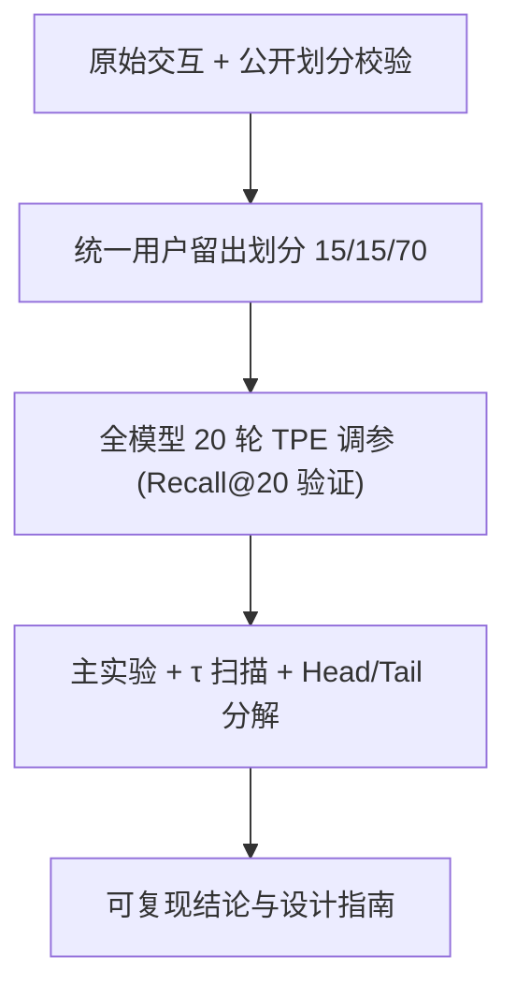

# A Reproducible and Fair Evaluation of Partition-aware Collaborative Filtering (面向划分感知协同过滤的可复现公平评测)

- **会议/期刊**: ECIR 2026 (Reproducibility Track)
- **作者与机构**: Domenico de Gioia, Claudio Pomo, Ludovico Boratto, Tommaso Di Noia（Politecnico di Bari / University of Cagliari）
- **推荐链路定位**: 召回（Item-Item 相似度打分）
- **研究方向**: 协同过滤与双塔召回 / 去偏公平与工业评测基准
- **论文原文**: [arXiv:2512.17015v3](https://arxiv.org/abs/2512.17015v3)
- **开源代码**: [sisinflab/A-Reproducible-and-Fair-Evaluation...](https://github.com/sisinflab/A-Reproducible-and-Fair-Evaluation-of-Partition-aware-Collaborative-Filtering)

## TL;DR (1分钟核心速览)

本文针对划分感知协同过滤（FPSR/FPSR+）此前评测中**数据划分来源不明、基线调参不对等**两大可复现性缺陷，在四个公开数据集上重建统一的用户级留出划分（15%/15%/70%）并对全部模型做 20 轮 TPE 超参搜索，给出透明基准。结论具有"反转性"：在 Amazon-CDs 上 BISM 全面反超 FPSR 家族（R@10 0.1032 vs 0.0984），而 FPSR 家族在 Douban/Yelp2018 保持最优，并在**长尾物品**上系统性优于 BISM（如 Douban Tail R@20 0.0751 vs 0.0628，相对 +19.6%）。

## Background & Motivation (背景与核心矛盾)

- **主流范式**: Item-Item 相似度模型（Item-kNN / EASE / SLIM）推理轻量、可解释，但维护稠密 $N\times N$ 相似度矩阵的代价随目录规模二次增长；图模型（LightGCN）能建模高阶关系但需多轮消息传递、训练开销大。
- **前人局限**: ① FPSR 用谱划分把 $N^2$优化拆成$\sum_k M_k^2$ 的局部子问题，FPSR+ 再加 hub 桥接物品，但原文评测所用划分**未完全公开**（Amazon-CDs、Douban 需跑作者代码重新生成，引入随机性），FPSR+F 甚至**无官方实现**；② 原文对 BISM 等强相似度基线的调参投入不足，性能层级可能源于"调参不对称"而非架构优势。
- **核心洞察 (Key Insight)**: 作者复现发现 Gowalla/Yelp2018 因划分公开而误差仅 $10^{-4}$量级，而 Amazon-CDs/Douban 因划分缺失出现$10^{-2}$ 量级偏差——**划分来源直接决定结论可信度**；同时 BISM 这类块对角正则模型对精细调参高度敏感，公平调参后天花板显著抬升。
- **本文切入点**: 以"复现研究 + 公平基准 + 划分鲁棒性 + 长尾分解"四步，重新回答"划分感知建模究竟何时更优"。

## Method (核心方法设计)

### 1. 整体框架 (Overall Architecture)

本文是评测型工作，其"方法"即一套可复现协议：先按原仓库配置复现 FPSR/FPSR+D/FPSR+F 并量化偏差（RQ1）；再对 FPSR 家族、BISM 与 6 个基线在统一划分下做等量 TPE 调参（RQ2）；随后扫描划分粒度参数 $\tau$ 检验 hub 机制的鲁棒性（RQ3）；最后按训练集交互频次切分 Head(前10%)/Tail(后90%) 做细粒度归因（RQ4）。所有实验在 Elliot 框架下完成，划分与最优超参全部开源。

### 2. 关键设计拆解 (Key Designs)

1. **统一划分与等量调参协议（消除评测偏差）**：痛点在于原评测划分不可得、基线调参不足 $\to$对每个用户随机抽 15% 作测试、再从剩余抽 15% 作验证，其余为训练；所有模型（含 BISM）统一跑 20 次 TPE 试验，以验证集 Recall@20 选参$\to$直觉是"让每个算法都跑到自己的天花板"，从而把架构差异与调参红利分离。核心搜索空间为全局权重$\lambda\in\{0.1,\dots,0.5\}$与划分粒度$\tau\in\{0.1,\dots,0.5\}$。

2. **划分粒度 $\tau$的鲁棒性扫描（检验 hub 设计动机）**：FPSR 的局部相似度在子图$M_k$上学得，当$\tau$过小则$M_k$内共现证据碎片化、跨划分信号丢失$\to$固定最优$\lambda$扫描$\tau$，观察 FPSR 与 FPSR+/FPSR+D 的衰减曲线差异$\to$若 hub 真能桥接划分，则小$\tau$下 FPSR+ 的跌幅应显著小于 FPSR。Douban 上 FPSR 从$\tau=0.5$的 R@20$0.2034$跌至$\tau=0.05$的$0.1631$（约$-20\%$），而 FPSR+D 仅跌约$3\%$，直接验证了 hub 的"跨划分信号缓冲"物理直觉。

3. **Head/Tail 分解评测（超越精度的归因）**：原文仅初步讨论 hub 策略的头部/长尾分工 $\to$本文按训练集交互频次定义 Head(前10%)/Tail(后90%) 三个测试子集，分别计算指标$\to$使"FPSR+D 服务头部、FPSR+F 服务长尾"这一设计假设可被逐数据集证伪。评测指标为 Recall@$\{10,20\}$与 nDCG@$\{10,20\}$，采用全库未交互物品排序（Full-Ranking），并以$p<0.05$ 标注最优与次优的显著性差异。

## Experimental Setup & Evaluation Protocol (实验设置与评估协议)

- **数据集与预处理**: 沿用 FPSR 原文四个数据集，未额外做 k-core 过滤（沿用原始版本），统计如下：

| 数据集 | #Users | #Items | #Interactions | 密度 | Gini$_U$/ Gini$_I$ |
| :--- | :---: | :---: | :---: | :---: | :---: |
| Amazon-CDs | 43,169 | 35,648 | 777,426 | 0.051% | 0.5104 / 0.4613 |
| Douban | 13,024 | 22,347 | 792,062 | 0.272% | 0.6360 / 0.6242 |
| Gowalla | 29,858 | 40,981 | 1,027,370 | 0.084% | 0.4666 / 0.4346 |
| Yelp2018 | 31,668 | 38,048 | 1,561,406 | 0.130% | 0.3921 / 0.5130 |

- **数据划分与防穿越 (Splitting Strategy)**: 统一采用**用户级留出划分**（每用户 15% 测试、15% 验证、70% 训练），替代原文不透明划分；复现阶段则尽量沿用原仓库划分以量化偏差。
- **排名评测协议 (Ranking Protocol)**: 无偏 **Full-Ranking**（对全库未交互物品排序），指标 Recall@$\{10,20\}$、nDCG@$\{10,20\}$；长尾分析额外构造 Head/Tail 子测试集。
- **对比基线与超参设置**: 基线含 Random、MostPop、Item-kNN、RP3$\beta$、EASE$^R$、GF-CF、LightGCN、BISM 共 8 个；全部模型统一 20 轮 TPE 贝叶斯调参，验证指标 Recall@20；显著性阈值$p<0.05$。

## Key Experimental Results (实验关键数据)

### 1. 主实验对比 (Main Results)

| 数据集 | 模型 | R@10 | N@10 | R@20 | N@20 |
| :--- | :--- | :---: | :---: | :---: | :---: |
| Amazon-CDs | LightGCN | 0.0866 | 0.0604 | 0.1304 | 0.0743 |
| | Item-kNN | 0.0837 | 0.0619 | 0.1171 | 0.0726 |
| | EASE$^R$ | 0.0828 | 0.0603 | 0.1180 | 0.0713 |
| | **BISM** | **0.1032\*** | **0.0772\*** | **0.1435\*** | **0.0900\*** |
| | FPSR | 0.0969 | 0.0603 | 0.1327 | 0.0845 |
| | FPSR+D | 0.0970 | 0.0727 | 0.1368 | 0.0852 |
| | FPSR+F | 0.0984 | 0.0738 | 0.1357 | 0.0856 |
| Douban | BISM | 0.1516 | 0.1793 | 0.2079 | 0.1881 |
| | FPSR | 0.1479 | 0.1766 | 0.2034 | 0.1854 |
| | **FPSR+D** | **0.1543\*** | **0.1830\*** | **0.2132\*** | **0.1928\*** |
| | FPSR+F | 0.1482 | 0.1745 | 0.2041 | 0.1841 |
| Gowalla | GF-CF | 0.1341 | 0.1197 | 0.1979 | 0.1411 |
| | **BISM** | **0.1463** | **0.1344** | **0.2072** | **0.1544\*** |
| | FPSR | 0.1436 | 0.1307 | 0.2062 | 0.1515 |
| | FPSR+D | 0.1460 | 0.1335 | 0.2064 | 0.1532 |
| Yelp2018 | BISM | 0.0542 | 0.0577 | 0.0871 | 0.0693 |
| | FPSR | 0.0561 | 0.0589 | 0.0906 | 0.0712 |
| | **FPSR+D** | **0.0595\*** | **0.0626\*** | **0.0965\*** | **0.0759\*** |
| | FPSR+F | 0.0581 | 0.0607 | 0.0944 | 0.0739 |

（`*` 表示最优与次优间 $p<0.05$ 显著；完整 11 模型结果见原文表 3。）

### 2. 消融/分解实验 (Ablation & Breakdown)

| 设置 | Amazon-CDs R@20 | Douban R@20 | Gowalla R@20 | Yelp2018 R@20 |
| :--- | :---: | :---: | :---: | :---: |
| BISM (Head / Tail) | 0.2404 / 0.0819 | 0.2886 / 0.0628 | 0.3622 / 0.1081 | 0.1668 / 0.0270 |
| FPSR (Head / Tail) | 0.2068 / 0.0837 | 0.2749 / 0.0699 | 0.3693 / 0.1013 | 0.1755 / 0.0273 |
| FPSR+D (Head / Tail) | 0.2337 / 0.0742 | 0.2866 / **0.0751** | 0.3624 / 0.1059 | 0.1811 / **0.0306** |
| FPSR+F (Head / Tail) | 0.2315 / 0.0756 | 0.2760 / 0.0682 | 0.3445 / **0.1149** | **0.1930** / 0.0215 |
| FPSR 在 Douban 上 $\tau$: 0.5→0.05 | — | 0.2034→0.1631 ($-19.8\%$) | — | — |
| FPSR+D 在 Douban 上 $\tau$: 0.4→0.05 | — | 0.2132→0.2068 ($-3.0\%$) | — | — |

### 3. 关键实验发现 (Key Findings)

1. **性能层级被公平调参反转**：Amazon-CDs 上 BISM 的 R@10 达 0.1032，比最优 FPSR 变体（FPSR+F 0.0984）高约 4.9%，与原文"FPSR 优于 BISM"的结论相反——说明原结论部分源于对 BISM 调参不足，而非架构劣势。
2. **hub 机制的真实价值在鲁棒性而非精度**：Douban 上 $\tau$从最优降至 0.05 时，vanilla FPSR 的 R@20 相对跌 19.8%，而 FPSR+D 仅跌 3.0%，证明 hub 物品确实在细粒度划分下缓冲了跨划分信号损失；但在$\tau$ 取最优时，FPSR 与 FPSR+ 差距极小（Gowalla 上几乎持平）。
3. **长尾优势是 FPSR 家族最稳健的收益**：四个数据集上 FPSR 变体的 Tail R@20 均不低于 BISM，Douban 上 FPSR+D 达 0.0751（较 BISM 0.0628 相对 +19.6%）；但"FPSR+D 管头部、FPSR+F 管长尾"的分工假设被证伪——Yelp2018 上 FPSR+F 反而拿下最高 Head R@20（0.1930），说明 hub 策略效果**依数据集统计特性而翻转**。

## Highlights & Limitations (亮点、对比与审稿批判)

- **与代表作对比 (vs. Prior Work)**: 与 FPSR/FPSR+ 原文相比，本文的核心差异不在模型而在**评测纪律**——统一划分 + 等量 TPE 调参使 BISM 这一被低估的块感知基线重回竞争中心；与 BISM 原文相比，本文首次在匹配协议下量化了"显式划分 + hub"与"隐式块对角正则"在长尾上的分野。
- **可迁移亮点**: ① "对每个基线做等量贝叶斯调参再比较"应成为新模型宣称 SOTA 的最低门槛；② Head/Tail 子集分解 + $\tau$ 敏感性扫描的组合，可直接迁移到任何带结构先验（聚类/分块/量化）的召回模型评测。
- **审稿级局限批判**: ① 仅覆盖 4 个中小规模数据集，未验证工业级千万物品目录下划分的实际加速比与内存收益；② FPSR+F 为作者自行重实现，且原 FPSR 配置疑似用测试集做模型选择，复现偏差的归因仍存不确定性；③ 未报告训练/推理时延与显存占用的定量对比，"效率优势"仅停留在复杂度分析层面。

## Rating (四维评分)

- **方法创新性 (Novelty)**: ⭐⭐⭐ （无新模型，但以"公平调参反转结论 + 长尾分工证伪"提供了有价值的评测性洞察）
- **评估协议与实验扎实度 (Protocol & Experiments)**: ⭐⭐⭐⭐⭐ （统一划分、20 轮 TPE、显著性检验、$\tau$ 扫描与 Head/Tail 分解齐备，划分与超参全开源）
- **写作与数学规范度 (Clarity & Rigor)**: ⭐⭐⭐⭐ （RQ 驱动结构清晰、复现偏差量化到 $10^{-4}$ 量级，但公式与复杂度分析偏简）
- **工业落地与复现价值 (Industrial & Practical Value)**: ⭐⭐⭐⭐ （代码与划分完全公开、Elliot 可一键复跑；但缺时延/显存实测，工业规模验证待补）

