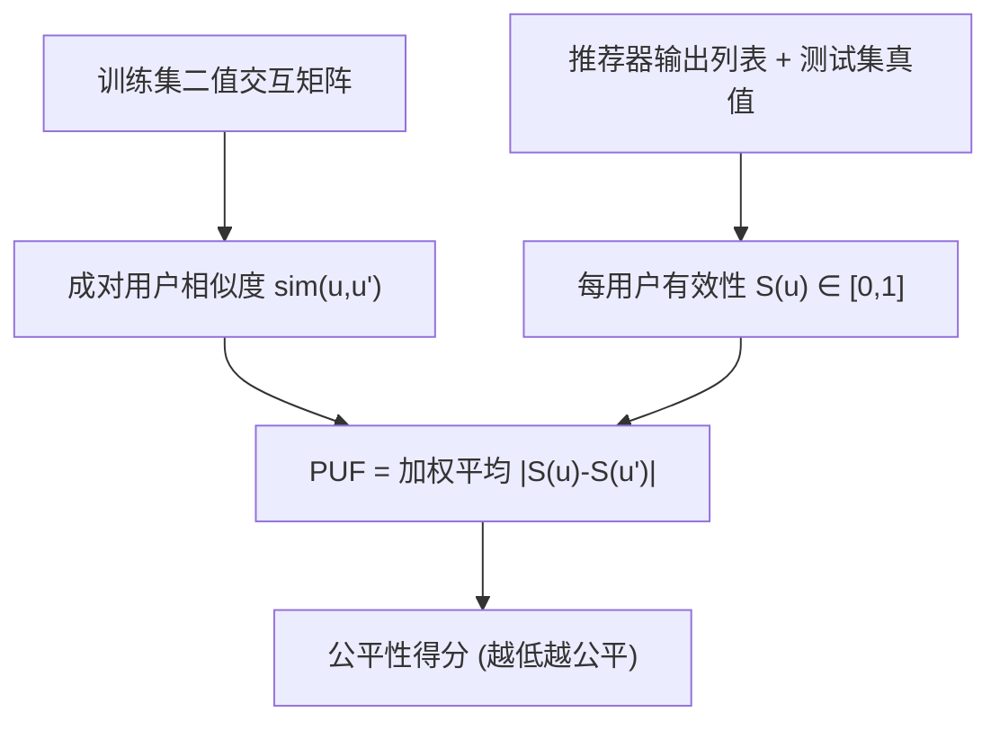

# Measuring Individual User Fairness with User Similarity and Effectiveness Disparity (基于用户相似度与有效性差异的个体用户公平性度量)

- **会议/期刊**: ECIR 2026 (Findings)
- **作者与机构**: Theresia Veronika Rampisela, Maria Maistro, Tuukka Ruotsalo, Christina Lioma (哥本哈根大学; LUT 大学)
- **推荐链路定位**: 离线评测 / 公平性度量（不涉及具体召回精排模型）
- **研究方向**: 去偏公平与可信推荐
- **论文原文**: [https://arxiv.org/abs/2602.02516v1](https://arxiv.org/abs/2602.02516v1)
- **开源代码**: [https://github.com/theresiavr/PUF-individual-user-fairness-recsys](https://github.com/theresiavr/PUF-individual-user-fairness-recsys)

## TL;DR (1分钟核心速览)

现有推荐系统个体公平度量存在根本性割裂：要么只量化用户间有效性（如 P@k、NDCG）的差异而完全无视用户相似度（SD、Gini、Envy 族），要么只比较相似用户所获推荐物品的表示差异而与物品相关性脱钩（UF）。本文提出 PUF（Pairwise User unFairness），以用户对相似度为权重、对有效性得分差的绝对值做加权平均，首次将"相似用户应获相似对待"的个体公平定义与推荐效用同时纳入单一指标。在 4 个数据集、7 个协同过滤推荐器上，PUF 是唯一对有效性变化与相似度分布变化均保持敏感且计算开销低于 40 秒的度量。

## Background & Motivation (背景与核心矛盾)

- **主流范式**: 个体公平的传统定义是"相似个体应被相似对待"（Dwork et al.），在推荐系统中被落地为两类代理指标——一类度量跨用户的有效性得分离散度（SD、Gini、Mean Envy/MME/PEU），另一类度量相似用户所获推荐列表的表示距离（UF）。
- **前人局限**: 第一类指标把"有效性不同"直接等同于"不公平"，但交互稀少或口味极窄的用户本就与大众用户不可比，其有效性差异未必不公；第二类指标（UF）虽引入用户相似度，却只看推荐物品表示的距离，两个相似用户即使都满意各自推荐，只要物品集合不同就被判为不公，与用户真实效用脱节。
- **核心洞察 (Key Insight)**: 公平的判据应当是"有效性差异是否超出了用户相似度所允许的范围"——相似度高则有效性差异应小，相似度低则差异可被容忍。因此相似度应作为**权重**而非**阈值**进入度量，且被加权的对象必须是**相关性/有效性差异**而非物品表示距离。
- **本文切入点**: 用一个极简的成对加权公式同时编码这两要素，并系统性地用受控扰动实验证明现有度量在敏感性上的系统性缺陷。

## Method (核心方法设计)

### 1. 整体框架 (Overall Architecture)

PUF 是一个纯评测指标，不涉及模型训练。其计算流程为：先在训练集二值化交互矩阵上为每一对用户计算相似度（余弦或 Jaccard，逐数据集 min-max 归一化至 $[0,1]$）；再对每个推荐器在测试集上计算每用户的有效性得分$S(u)$（P@k 或 NDCG@k，须缩放至$[0,1]$）；最后对所有无序用户对求"相似度 × 有效性差绝对值"的均值。整个度量只依赖推荐列表与训练交互，与具体推荐模型解耦，可即插即用地替换现有公平性评测模块。

### 2. 关键设计拆解 (Key Designs)

1. **成对相似度加权有效性差异（PUF 核心算子）**：痛点是现有度量要么丢相似度、要么丢相关性。PUF 将二者相乘后在全用户对上取均值：

$$\mathrm{PUF}=\frac{2}{m(m-1)}\sum_{u\in\mathcal{U}}\sum_{u'\in\mathcal{U}\setminus\{u\}}\mathrm{sim}(u,u')\times\left|S(u)-S(u')\right|$$

其中 $m=|\mathcal{U}|\ge 2$，$\mathrm{sim}(u,u')\in[0,1]$，$S$为归一化到$[0,1]$的有效性度量，故$\mathrm{PUF}\in[0,1]$ 且越低越公平。物理直觉：相似用户对获得高权重，其有效性差异被放大惩罚；不相似用户对的差异被自然折扣，从而避免了对"本就不可比用户"的过度惩罚——这正是 SD/Gini 族缺失的机制。

2. **与 UF 的本质分野：加权 vs. 阈值**：UF 对相似度做均值阈值截断后再计算物品表示距离的对数和，阈值本身任意且丢弃了相似度的连续程度信息；PUF 不做截断，让相似度以连续权重进入求和，因而能表达"多相似"而非"是否足够相似"。更关键的是，PUF 加权的是相关性差异，因此"相似用户获得不同但都相关的物品"被判为公平，而 UF 会误判为不公。

3. **计算复杂度与实现**：相似度矩阵每数据集只需计算一次并复用；给定相似度后 PUF 仅需 $O(m^2)$ 次乘加，无需像 ME/MME/PEU 那样对每个用户对重算有效性、也无需像 UF 那样做嵌套成对比较。实测单模型计算时间 3.4–35.6 秒，而 ME/MME/PEU/UF 普遍超过 4 分钟（QK-video 上 ME 族达 1867 秒）。

## Experimental Setup & Evaluation Protocol (实验设置与评估协议)

- **数据集与预处理**: 去除重复交互并保留最近一条；过滤交互数 $<5$的用户与物品；ML-* 将评分$\ge 3$映射为 1、其余丢弃；划分后再次剔除训练集中交互$<5$ 的用户。

| 数据集 | #Users (all/test) | #Items | #Interactions | 稀疏度 | 领域/说明 |
| :--- | :---: | :---: | :---: | :---: | :--- |
| Lastfm | 1,859 / 1,836 | 2,823 | 71,355 | 98.64% | 音乐，隐式反馈 |
| QK-video | 4,656 / 3,514 | 6,423 | 51,777 | 99.83% | 视频，sharing 交互 |
| ML-10M | 49,378 / 1,523 | 9,821 | 5,362,685 | 98.89% | 电影，显式转隐式 |
| ML-20M | 89,917 / 2,178 | 16,404 | 10,588,141 | 99.28% | 电影，显式转隐式 |

- **数据划分与防穿越 (Splitting Strategy)**: 按 6:2:2 划分；ML-* 采用**全局时间戳切分**，Lastfm 与 QK-video 无时间戳故**随机划分**；均为全局（非按用户）切分以避免数据泄漏。
- **排名评测协议 (Ranking Protocol)**: 采用**全库排序（Full-Ranking）**，在测试集全部未交互物品上排序，$k=10$；有效性指标含 HR、MRR、P、MAP、R、NDCG。
- **对比基线与超参设置**: 7 个协同过滤推荐器——U-KNN、I-KNN、BPR、MVAE、NGCF、NMF、NCL，均基于 RecBole 实现，除 KNN 外训练 300 epoch 并早停，网格搜索调参、以验证集 NDCG@10 选模。公平性基线覆盖 SD-P/SD-NDCG、Gini-P/Gini-NDCG、ME/MME/PEU（$\epsilon=0.05$）、UF。PUF 设 4 个变体（余弦/Jaccard × P/NDCG），相似度统一由训练集二值交互矩阵计算。

## Key Experimental Results (实验关键数据)

### 1. 主实验对比 (Main Results)

下表摘取 ML-20M 与 QK-video 上代表性结果（$k=10$，↓ 表示越低越公平，加粗为该列最优）：

| 数据集 | 度量 | U-KNN | BPR | MVAE | NGCF | NCL |
| :--- | :--- | :---: | :---: | :---: | :---: | :---: |
| ML-20M | NDCG↑ | 0.1711 | 0.1584 | 0.1481 | 0.1649 | 0.1626 |
| ML-20M | SD-NDCG↓ | 0.2484 | 0.2333 | **0.2278** | 0.2399 | 0.2385 |
| ML-20M | Gini-NDCG↓ | **0.7021** | 0.7053 | 0.7203 | 0.7022 | 0.7046 |
| ML-20M | MME↓ | **0.0038** | 0.0046 | 0.0049 | 0.0046 | 0.0050 |
| ML-20M | UF↓ | **0.7098** | 0.7339 | 0.7336 | 0.7309 | 0.7246 |
| ML-20M | PUF-NDCG-Jacc↓ | 0.0361 | 0.0333 | **0.0317** | 0.0346 | 0.0343 |
| QK-video | NDCG↑ | 0.0331 | 0.0290 | 0.0314 | 0.0375 | **0.0381** |
| QK-video | SD-NDCG↓ | 0.1089 | 0.1058 | 0.1079 | 0.1191 | 0.1188 |
| QK-video | Gini-NDCG↓ | 0.9215 | 0.9344 | 0.9265 | 0.9156 | **0.9120** |
| QK-video | MME↓ | 0.0012 | 0.0010 | 0.0011 | 0.0011 | 0.0012 |
| QK-video | UF↓ | 0.5731 | 0.5739 | **0.5721** | 0.5734 | 0.5726 |
| QK-video | PUF-NDCG-Jacc↓ | 0.0002 | 0.0002 | 0.0002 | 0.0002 | **0.0002** |

关键观察：不同公平度量给出的"最公平模型"结论彼此矛盾——ML-20M 上 SD 选 MVAE、Gini 选 U-KNN、UF 选 U-KNN、PUF 选 MVAE，而 QK-video 上 Gini 选 NCL、UF 选 MVAE。Kendall $\tau$分析显示 PUF 与所有有效性度量呈负相关（$\tau\le -0.71$，Lastfm 上为$[-0.71,-0.33]$），与 UF 的相关性仅$[-0.14,0.14]$（QK-video 为$-0.52$），即二者对"最公平模型"从未达成一致。

### 2. 消融/敏感性实验 (Sensitivity & Robustness)

PUF 本身无模块可消融，作者以受控扰动实验替代，检验各度量对两大要素的敏感度：

| 扰动实验 | 期望行为 | PUF | SD | Gini / PEU | ME | MME | UF |
| :--- | :--- | :---: | :---: | :---: | :---: | :---: | :---: |
| 逐步将用户替换为全不相关推荐（0→100%） | 倒抛物线（两端最公平） | ✓ 符合 | ✓ 符合 | ✗ 随 Eff 下降单调变"更不公" | ✗ 轻微同向 | ✗ 近乎不变 | ✗ 近乎不变 |
| 改变相似度分布偏度（Weibull $\lambda$ 扫描） | 应随分布变化 | ✓ 敏感 | ✗ 恒定 | ✗ 恒定 | ✗ 恒定 | ✗ 恒定 | ✓ 敏感但弱于 PUF |
| MostFair / MostUnfair 极端分配 | MostFair 应接近 0 | ✓ $\approx 0$| — | — | — | — | ✗ 恒为$\approx 0.8$ |
| 计算时间（单模型） | 越低越好 | 3.4–35.6 s | <0.03 s | <0.03 s | 233–2021 s | 同 ME | 873–1359 s |

### 3. 关键实验发现 (Key Findings)

1. **只有 PUF 与 SD 能正确刻画有效性差异引发的公平变化**：在 0→100% 零相关性用户的扰动中，PUF 与 SD 呈现理论预期的倒抛物线，而 Gini 与 PEU 在有效性整体下滑时反而单调报告"更不公平"，实质是把有效性下降误读为公平性恶化；MME 因观测范围极窄（$\le 5.2\times10^{-3}$）几乎无法区分模型。
2. **忽略相似度会导致公平性误判**：当相似度分布高度右偏（偏度 $>6$，QK-video 的真实情形）时，SD-NDCG 报告约 0.2 的"不公平"，而 PUF 接近 0——即 SD 会系统性低估公平程度；反之在 MostFair 极端分配下 UF 恒为$\approx 0.8$，把本应最公平的情形误判为高度不公。
3. **PUF 在极端情形下行为自洽且代价可接受**：MostFair 下 PUF 接近 0、MostUnfair 下显著高于 MostFair，而 UF 在两种分配下几乎不变，证明其对有效性差异不敏感；同时 PUF 计算时间比 ME/MME/PEU/UF 低 1–2 个数量级，使大规模成对公平评测在工程上可行。

## Highlights & Limitations (亮点、对比与审稿批判)

- **与代表作对比 (vs. Prior Work)**: 相较 SD/Gini/Envy 族（Dwork 定义的"有效性代理"路线），PUF 引入了相似度权重，避免把"用户本就不同"误判为不公；相较 UF（Islam 等的距离型度量），PUF 加权的是相关性差异而非物品表示距离，且以连续权重替代任意阈值，因而不会把"相似用户各得其所"误判为不公；相较面向物品的成对公平度量（如 Deldjoo 等的工作），PUF 作用于用户维度并显式建模相似度。
- **可迁移亮点**: (i) "相似度作连续权重而非阈值"的思路可直接迁移到物品侧公平、跨域公平与多 stakeholder 公平度量；(ii) 本文的受控扰动评测范式（人工注入零相关性用户、扫描相似度分布偏度、构造 MostFair/MostUnfair 分配）是一套可复用的**度量元评估协议**，值得用于检验任何新提出的公平指标。
- **审稿级局限批判**: (i) 相似度与有效性度量均可自由替换，PUF 的绝对数值强烈依赖所选 $S$的归一化方式与相似度分布，跨数据集、跨论文的 PUF 数值不可直接比较，作者也未给出标准化建议；(ii) 实验仅覆盖 7 个传统协同过滤模型与 4 个中小规模数据集，缺少深度序列模型、图对比模型与工业级规模验证，且相似度仅基于二值交互，未利用评分强度或时间衰减信息；(iii) 当整体用户相似度普遍偏低时（如 QK-video），PUF 的绝对数值被压缩至$10^{-4}$ 量级，虽排序仍有效但可读性差。

## Rating (四维评分)

- **方法创新性 (Novelty)**: ⭐⭐⭐⭐ （公式极简但精准填补了"相似度 × 有效性"联合建模的空白，加权而非阈值的处理有清晰的理论直觉，惟数学深度有限）
- **评估协议与实验扎实度 (Protocol & Experiments)**: ⭐⭐⭐⭐ （4 数据集 × 7 推荐器 × 全库排序 + Kendall $\tau$ 一致性分析 + 三类受控扰动实验，元评估设计相当完整，惟缺大规模与深度模型验证）
- **写作与数学规范度 (Clarity & Rigor)**: ⭐⭐⭐⭐⭐ （符号定义干净、公式仅一条却表意完备，对每个基线度量的缺陷均有明确定位，实验叙述与结论严格对应）
- **工业落地与复现价值 (Industrial & Practical Value)**: ⭐⭐⭐⭐ （代码开源、计算开销比同类成对度量低 1–2 个数量级，可直接嵌入离线评测流水线；但绝对分值不可跨场景比较，需配套标准化规范）

