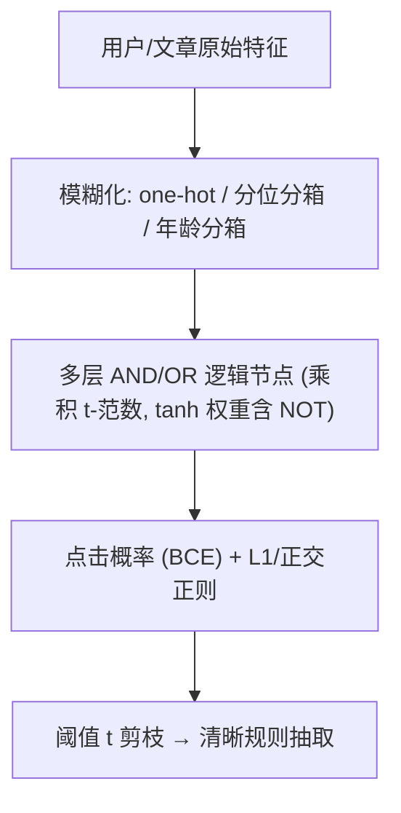
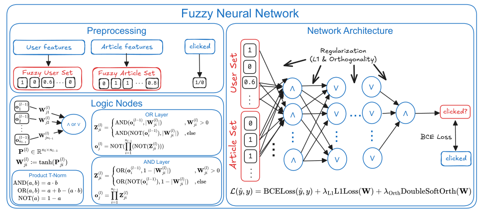

# Modeling Behavioral Patterns in News Recommendations Using Fuzzy Neural Networks (基于模糊神经网络的新闻推荐行为模式建模)

- **会议/期刊**: ECIR 2026 (IR for Good Track)
- **作者与机构**: Kevin Innerebner, Stephan Bartl, Markus Reiter-Haas, Elisabeth Lex（格拉茨技术大学人本计算研究所）
- **推荐链路定位**: 精排（点击相关性打分，可转排序）
- **研究方向**: 去偏公平、可信隐私与工业架构 / CTR 预估与特征交叉
- **论文原文**: [https://arxiv.org/abs/2601.04019v1](https://arxiv.org/abs/2601.04019v1)
- **开源代码**: [匿名仓库](https://anonymous.4open.science/r/FNN4NewsRecommendation/)

## TL;DR (1分钟核心速览)

新闻推荐普遍依赖黑盒深度模型，编辑无法审计“为何推荐”，与欧盟 AI Act 等透明度要求冲突。本文提出多层模糊神经网络（FNN）：把用户/文章特征模糊化为 $[0,1]$原子，用乘积 t-范数的 AND/OR/NOT 逻辑节点逐层组合，端到端训练后用阈值剪枝直接抽出人类可读的 IF-THEN 规则，阈值$t$ 可连续调节“规则复杂度 vs 精度”。在 EB-NeRD-small 上按 impression 分组做全候选排序，nDCG@10 达 0.5664，较 NRMS（0.4648）相对提升 21.9%，且模型仅 2064 个参数。

## Background & Motivation (背景与核心矛盾)

- **主流范式**: 新闻推荐以 NRMS 等双塔神经模型为主，追求 AUC/nDCG，但决策逻辑不可读；混合“算法+编辑精选”只解决内容配比，不解释行为模式。
- **前人局限**: ① 纯模糊逻辑推荐（模糊推理算相似度/类目兴趣）规则库靠领域专家手写或 Wang-Mendel 启发式挖掘，无法随数据端到端更新；② 神经-模糊混合体多把输入映射到**预定义**模糊原子或固定逻辑电路，规则结构本身学不出来，也缺乏否定（NOT）表达能力。
- **核心洞察 (Key Insight)**: 若把逻辑连接权重约束在 $[-1,1]$，负权重天然对应 NOT，则任意逻辑公式都可由分层 AND/OR 网络表示；训练后按阈值剪枝小权重连接，即可把连续模糊网络“离散化”为清晰规则，且阈值是精度-可解释性的连续旋钮。
- **本文切入点**: 用可微的乘积 t-范数替代不可微的 crisp 逻辑，让规则结构与参数一起由 BCE 梯度学习，再用阈值抽取规则。

## Method (核心方法设计)

### 1. 整体框架 (Overall Architecture)

输入侧先把用户特征（设备、性别、年龄段、邮编区域、订阅状态）与文章特征（类目、子类、主题、情感、premium、曝光/点击/阅读时长分位、文章年龄分箱）离散化为 one-hot/分位桶，得到模糊原子 $o^{(0)}\in[0,1]^{n_0}$。随后堆叠 3 个隐藏层（48/32/16 神经元）与 1 个输出层，层间 AND/OR 交替，每层节点对其加权输入做乘积 t-范数聚合；权重经$\tanh$约束到$[-1,1]$，负权即对输入取 NOT。输出为点击概率，BCE 训练，辅以 L1 与双软正交正则。推理时按阈值$t$ 剪枝并自底向上拼装清晰逻辑式，得到规则及其权重。

<figure class="paper-figure" markdown="span">
  <figcaption>图 1：我们模型设计的架构。用户和文章特征被转换为模糊集，作为输入。我们的模型具有多层逻辑节点，对其输入执行乘积 t-范数运算（∧或∨）。逻辑节点的每个输入都被加权，因此高权重会导致输入的强烈影响，而低权重意味着输入对计算影响很小。当相应权重为负时，输入被否定（¬）。</figcaption>
</figure>

### 2. 关键设计拆解 (Key Designs)

1. **可微乘积 t-范数逻辑层（让规则结构可学）**：crisp 逻辑不可导，无法梯度学习规则。本文定义 $\mathrm{AND}(a,b)=a\cdot b$、$\mathrm{OR}(a,b)=a+b-a\cdot b$、$\mathrm{NOT}(a)=1-a$，并把权重矩阵$W^{(l)}\in[-1,1]^{n_l\times n_{l-1}}$融入输入：AND 层取$Z^{(l)}_{ji}=\mathrm{OR}(o^{(l-1)}_i,1-|W^{(l)}_{ji}|)$，OR 层取$Z^{(l)}_{ji}=\mathrm{AND}(o^{(l-1)}_i,|W^{(l)}_{ji}|)$，层输出为$o^{(l)}_j=\prod_i Z^{(l)}_{ji}$（OR 层用德摩根对偶$\mathrm{NOT}(\prod_i \mathrm{NOT}(Z^{(l)}_{ji}))$）。直觉：权重趋 0 时该输入被“屏蔽”，趋 1 时等价 crisp 参与，介于其间则是软逻辑，从而在训练中平滑逼近离散规则。

2. **tanh 权重约束 + 否定表达（相对前作的关键增量）**：前作把参数直接当权重，无法表示 NOT，表达力受限。本文令 $W^{(l)}=\tanh(P^{(l)})$，$P^{(l)}$无约束优化；$W^{(l)}_{ji}<0$ 时先对输入取 NOT 再加权。这样任意布尔公式（含否定）都可被表示，且梯度不被截断。消融显示换成 sigmoid（去掉否定）后 nDCG@10 从 0.565 崩到 0.429，证明否定是表达力核心。

3. **训练目标、正则与规则抽取**：总损失 $\mathcal{L}=\mathcal{L}_{\mathrm{BCE}}+\lambda_{L1}\sum|P|+\lambda_{orth}\mathcal{L}_{orth}$，$\lambda_{L1}=\lambda_{orth}=0.1\times\#\text{params}$；正交正则（双软正交）迫使同层不同子句分工，避免规则冗余。负采样每曝光随机取$K=4$条未点击文章。规则抽取：对每层连接，$|W^{(l)}_{ji}|<t$剪除，否则按符号映射为原子或其否定，自底向上拼成 AND/OR 子句，最终输出一条（或按末层输入拆成多条）清晰规则；规则复杂度$\mathrm{RC}@t$ 计逻辑算子个数。推理开销极小（2064 参数），抽取为一次性离线操作。

## Experimental Setup & Evaluation Protocol (实验设置与评估协议)

- **数据集与预处理**: 使用官方 small 版本，特征离散化见上（类别取 Top-20 + infrequent；数值三分位；文章年龄分箱 30min/1h/2h/4h/8h/12h/1d/2d/3d/>3d，仅归入最小时龄桶）。

| 数据集 | #Users | #Items | #Interactions | 稀疏度/密度 | 特征/场景说明 |
| :--- | :---: | :---: | :---: | :---: | :--- |
| EB-NeRD-small | 官方 small 划分 | 官方 small 划分 | 官方 small 划分 | 高稀疏 | 丹麦 Ekstra Bladet，用户/文章特征丰富，>95% 性别年龄邮编缺失 |
| MIND-small | 官方 small 划分 | 官方 small 划分 | 官方 small 划分 | 高稀疏 | 微软新闻英文，仅用户 ID+历史，文章类目/子类/实体 |

- **数据划分与防穿越 (Splitting Strategy)**: 沿用数据集提供的**时间序 train/validation 划分**（全局时间切分），文章随时间失效，故 KNN/SVD 类基线大量冷启动。
- **排名评测协议 (Ranking Protocol)**: 按 impression 分组对候选文章排序，报告 AUC、MRR、nDCG@5、nDCG@10；负采样训练 $K=4$，评测为 impression 内候选排序（非全库 Full-Ranking）。另定义规则复杂度$\mathrm{RC}@t$与 Kendall's$\tau_b$ 衡量规则-模型排序一致性。
- **对比基线与超参设置**: Random、User-KNN、Item-KNN、SVD++、Decision Tree（同离散输入的可解释基线）、NRMS（黑盒双塔）。AdamW，lr=0.01，batch=8196，20 epoch，weight decay $10^{-5}$，Kaiming 初始化 gain$5/3$；5 次运行取均值，Kruskal-Wallis + Dunn 检验（Bonferroni，$\alpha=0.05$）。

## Key Experimental Results (实验关键数据)

### 1. 主实验对比 (Main Results)

| Method | EB AUC | EB MRR | EB nDCG@5 | EB nDCG@10 | MIND AUC | MIND nDCG@10 |
| :--- | :---: | :---: | :---: | :---: | :---: | :---: |
| Random | .5002 | .3015 | .3211 | .4119 | .4996 | .2858 |
| User-KNN | .5005 | .1681 | .1385 | .2716 | .5004 | .2864 |
| SVD++ | .5010 | .3059 | .3382 | .4244 | .5003 | .2871 |
| Decision Tree | .6039 | .3784 | .4164 | .4840 | .5812 | .3532 |
| NRMS | .5548 | .3488 | .3878 | .4648 | **.6548** | **.4043** |
| FNN-or (ours) | .6915 | **.4582** | **.5175** | .5662 | .5766 | .3339 |
| **FNN-and (ours)** | **.6925** | .4580 | .5176 | **.5664** | .5806 | .3355 |
| Improv. vs NRMS | +24.8% | +31.3% | +33.5% | +21.9% | −11.3% | −17.0% |

### 2. 消融实验 (Ablation Study)

| 配置 | AUC | MRR | nDCG@5 | nDCG@10 | RC@0.5 |
| :--- | :---: | :---: | :---: | :---: | :---: |
| FNN-and (ours) | .692 | .457 | .517 | .565 | 91.2 |
| FNN-or | .689 | .456 | .514 | .564 | 13.2 |
| BCE→MSE | .691 | .458 | .517 | .566 | 33.8 |
| w/o L1 Reg. | .691 | .456 | .516 | .565 | 40.8 |
| w/o Orthog. Reg. | .687 | .453 | .512 | .562 | 2475.0 |
| w/o Neg. Sampling | .680 | .448 | .504 | .555 | 41.0 |
| w/o Article Age | .600* | .374* | .418* | .491* | 80.0 |
| Tanh→Sigmoid | .523* | .310* | .343* | .429* | 1.0* |

### 3. 关键实验发现 (Key Findings)

1. **文章年龄是新闻场景的命门**：去掉 article-age 原子后 AUC 从 .692 跌至 .600、nDCG@10 从 .565 跌至 .491（显著），说明时效性分箱承载了绝大部分可学信号，也解释了 KNN/SVD 因时间切分冷启动而 AUC 仅 ~.50。
2. **否定能力决定表达力上限**：tanh→sigmoid 后 nDCG@10 崩至 .429、RC 降为 1.0，模型退化为无法表示 NOT 的单调逻辑，验证了 $W\in[-1,1]$ 带符号权重是“可表示任意公式”的必要条件。
3. **正交正则是规则可读性的主控阀**：去掉后 RC@0.5 从 91.2 暴涨到 2475（约 27 倍）而精度仅降 0.003，说明它几乎“免费”地压缩了规则冗余；L1 反而因把少数权重推向 1 而**增加**可抽取规则数，与直觉相反。

## Highlights & Limitations (亮点、对比与审稿批判)

- **与代表作对比 (vs. Prior Work)**: 相较 Wang-Mendel 式启发式规则挖掘与“预定义模糊原子+固定逻辑电路”的混合体，本文规则结构与参数全部端到端学习且支持否定；相较 NRMS 黑盒，精度在 EB-NeRD 上反超 21.9% 且参数仅 2064，但 MIND 上不及 NRMS，暴露特征依赖。
- **可迁移亮点**: ① 用 $\tanh$有符号权重 + 阈值剪枝把任意可微逻辑网络“蒸馏”成可读规则，可迁移到风控、审核等需审计的精排场景；② 用 RC@t 与 Kendall's$\tau_b$ 联合刻画“可解释性-保真度”权衡，是可信推荐评测的实用补充。
- **审稿级局限批判**: ① 评测为 impression 内候选排序而非全库 Full-Ranking，且仅在 small 版本上验证，绝对数值与工业规模存在差距；② 规则抽取在 $t>0.8$时退化为恒真/恒假（矛盾式$a\wedge\neg a$），且 MIND 上弱于决策树，说明特征稀缺时多层逻辑反而不如单树稳健；③ 规则是全局的，未做用户分群个性化规则，编辑可用性仍待真实用户研究验证。

## Rating (四维评分)

- **方法创新性 (Novelty)**: ⭐⭐⭐⭐ （多层可微 t-范数 + tanh 有符号权重实现含否定的端到端规则学习，思路清晰但属神经符号既有框架的工程化增强）
- **评估协议与实验扎实度 (Protocol & Experiments)**: ⭐⭐⭐ （双数据集 + 5 次运行 + 显著性检验与完整消融，但仅 small 版本、impression 内排序，缺全库与线上验证）
- **写作与数学规范度 (Clarity & Rigor)**: ⭐⭐⭐⭐ （t-范数与层间算子定义完整、算法伪代码清晰，规则示例可读性强；复杂度分析略简）
- **工业落地与复现价值 (Industrial & Practical Value)**: ⭐⭐⭐⭐ （2064 参数、推理近零开销、匿名代码开源，规则可直接供编辑审计，契合 AI Act 合规诉求）

