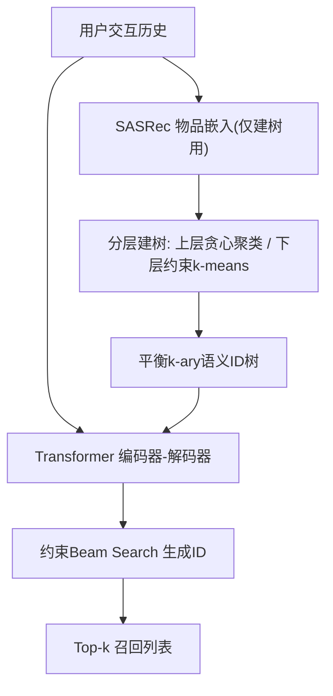

# Efficient Optimization of Hierarchical Identifiers for Generative Recommendation (面向生成式推荐的层次化标识符高效优化)

- **会议/期刊**: ECIR 2026 (Reproducibility Track)
- **作者与机构**: Federica Valeau, Odysseas Boufalis, Polytimi Gkotsi, Joshua Rosenthal, David Vos (University of Amsterdam)
- **推荐链路定位**: 召回（生成式检索）
- **研究方向**: 生成式推荐与离散语义ID / 冷启动与长尾（可扩展性）
- **论文原文**: [https://arxiv.org/abs/2512.18434v2](https://arxiv.org/abs/2512.18434v2)
- **开源代码**: [https://github.com/joshrosie/re-seater](https://github.com/joshrosie/re-seater)

## TL;DR (1分钟核心速览)

本文针对生成式检索模型 SEATER 的核心痛点——其平衡 $k$-ary 语义 ID 树依赖**容量约束$k$-means** 构建，复杂度高达$O((N^3k+N^2k^2+Nk^3)\log(N+k))$且难以并行，在物品规模增大时成为训练瓶颈（Yambda 上占训练总时长 19.4%）。作者在复现 SEATER 并扩展至大规模音乐数据集 Yambda 的基础上，提出**贪心聚类**（Faiss 近似最近邻，$O(Nk)$）与**混合聚类**（上层贪心、下层精确）两种替代建树算法。在 Full-Ranking 协议下，混合法在 Yambda 上 NDCG@20 反超原版 2.5%，建树时间从 82 分钟降至 6 分钟（5–8%）；贪心法建树时间降至 <2%，质量仅轻微下降。

## Background & Motivation (背景与核心矛盾)

- **主流范式**: 生成式检索将召回建模为离散 ID 序列的自回归生成。TIGER 用 RQ-VAE 学语义 ID 但无结构约束；SEATER 进一步用**平衡 $k$-ary 树**组织物品，使标识符等长、前缀即语义粒度，并用约束 beam search 将推理复杂度从$O(bN)$降至$O(bk\log_k N)$。
- **前人局限**: (i) SEATER 的树构建采用**全局容量约束 $k$-means**，最坏复杂度随$N$ 三次方增长，且分配步骤耦合全部物品-簇决策、难以 GPU 并行；(ii) 生成式检索的索引直接编码进模型参数，物品/交互频繁更新时需**反复重建树并重训**，建树开销被放大。
- **核心洞察 (Key Insight)**: 树的上层仅做粗粒度分组（每簇物品数巨大），精确聚类收益有限却耗时最多；真正需要精细语义划分的是靠近叶子的深层。因此"上层近似、下层精确"可在几乎不损质量的前提下大幅降本。
- **本文切入点**: 保持 SEATER 的模型架构、三任务损失与推理流程完全不变，**只替换建树阶段的聚类算子**，用局部贪心 + 分层混合策略破解可扩展性瓶颈。

## Method (核心方法设计)

### 1. 整体框架 (Overall Architecture)

流程完全沿用 SEATER：先用预训练 SASRec 得到物品嵌入（仅用于建树，随后丢弃），在其上递归构建平衡 $k$-ary 树并为每个物品分配等长 token 序列；轻量 Transformer 编码器-解码器以用户历史为输入，自回归生成目标物品的标识符，推理时用限制在合法树路径上的约束 beam search 解码。本文的增量仅在于**建树阶段的聚类算子替换**：将每层的容量约束$k$-means 换成 Faiss 加速的贪心分配，或按簇规模阈值$T$ 在贪心与精确聚类间切换。训练目标、超参与推理复杂度均不变。

### 2. 关键设计拆解 (Key Designs)

1. **贪心聚类建树（Greedy Clustering）**：痛点在于容量约束分配是全局耦合的 NP 难指派问题、无法并行。做法是先用标准 $k$-means 求质心，再按序将物品分配给最近的**未满簇**（每簇容量$N/k$），复杂度降至$O(Nk)$，并用 Faiss 的 GPU 近似最近邻并行化距离计算。直觉：平衡性由容量上限硬保证，牺牲的只是全局最优性，而树的上层本就对局部次优不敏感。

2. **混合聚类建树（Hybrid Clustering）**：贪心的局部序贯性可能在深层造成语义漂移。算法按簇规模阈值 $T$切换：当$|X|>T$时用 `FaissCluster` 贪心分配，否则回退到 `ConstrainedKMeans` 精确聚类，递归至叶节点分配顺序 ID。由于上层主导总耗时，该策略以极小代价保住叶子附近的语义结构。消融显示$T=2000$ 是跨数据集的稳健工作点。

3. **训练目标、负采样与推理效率**：总损失沿用 SEATER 的多任务形式 $\mathcal{L}=\mathcal{L}_{gen}+\lambda_a\mathcal{L}_{ali}+\lambda_r\mathcal{L}_{rank}$，其中$\mathcal{L}_{gen}$为标识符自回归交叉熵，$\mathcal{L}_{ali}$为子节点-父节点 InfoNCE 对齐，$\mathcal{L}_{rank}$为共享更长前缀物品优先的 triplet 排序损失。本文不改动损失与负采样；推理仍为$O(bk\log_k N)$ 的约束 beam search，建树加速不影响线上延迟。

## Experimental Setup & Evaluation Protocol (实验设置与评估协议)

- **数据集与预处理**:

| 数据集 | #Users | #Items | #Interactions | 特征/场景说明 |
| :--- | :---: | :---: | :---: | :--- |
| Yelp | 31,668 | 38,048 | 1,561,406 | 商户点评，LightGCN 官方划分 |
| News (MIND-small) | 50,000 | 39,865 | 1,162,402 | 新闻曝光，按用户 8:1:1 划分 |
| Books (Amazon) | 482,934 | 361,245 | 8,898,041 | 图书，ComiRec 预处理 |
| Yambda | 8,798 | 475,910 | 46,467,212 | Yandex Music，仅保留有机交互且播放≥50%时长 |

- **数据划分与防穿越 (Splitting Strategy)**: Yelp/Books 沿用原工作划分；News 按用户 8:1:1 比例划分，取序列前 80% 为上下文、后 20% 为目标；Yambda 采用**全局时间戳切分**（299 天训练 + 30 分钟 gap + 1 天验证 + 1 天测试）。
- **排名评测协议 (Ranking Protocol)**: 采用无偏 **Full-Ranking**（全库未交互物品排序），指标为 Recall@{20,50}、HR@{20,50}、NDCG@{20,50}，对测试用户取平均；结果报告 3 个随机种子的均值±标准差。
- **对比基线与超参设置**: 基线含双塔类 GRU4Rec/BERT4Rec/SASRec、树方法 TDM、生成式 GPTRec/TIGER 及原版 SEATER；嵌入维度 $d=64$、FFN 256、dropout 0.2、学习率 0.001，单卡 H100；建树嵌入统一来自 SASRec，混合阈值$T=2000$。

## Key Experimental Results (实验关键数据)

### 1. 主实验对比 (Main Results)

| 数据集 | 指标 | SASRec | TIGER | SEATER(原) | SEATER(复现) |
| :--- | :--- | :---: | :---: | :---: | :---: |
| Books | NDCG@20 | 0.0408 | 0.0468 | **0.0592** | 0.0593 |
| Books | Recall@50 | 0.1311 | 0.1179 | **0.1448** | 0.1442 |
| Yelp | NDCG@20 | 0.0468 | 0.0539 | **0.0572** | 0.0527 |
| Yelp | Recall@50 | 0.1195 | 0.1271 | **0.1353** | 0.1268 |
| News | NDCG@20 | 0.0916 | 0.0919 | 0.0942 | **0.0959** |
| Yambda | NDCG@20 | 0.0960 | — | 0.1245 | **0.1495**(Hybrid) |
| Yambda | Recall@50 | 0.1636 | — | 0.1705 | **0.1966**(Hybrid) |

建树效率对比（3 种子均值）：

| 数据集 | 原版建树 | Hybrid 建树 | Greedy 建树 | 加速比 |
| :--- | :---: | :---: | :---: | :---: |
| News | 190.0s | 67.1s | 31.6s | 6.0× |
| Yelp | 189.4s | 61.3s | 31.2s | 6.1× |
| Books | 3232.8s | 184.1s | 93.3s | 34.6× |
| Yambda | 4908.0s | 375.7s | 83.2s | 59.0× |

### 2. 消融实验 (Ablation Study)

混合阈值 $T$ 的敏感性（NDCG@20 / 建树秒数）：

| 数据集 | $T$=50/100 |$T$=1000 |$T$=2000 |$T$=50000 |
| :--- | :---: | :---: | :---: | :---: |
| Books | 0.0566 / 91.5 | 0.0562 / 90.2 | 0.0572 / 187.1 | **0.0585** / 1452.5 |
| Yambda | 0.1507 / 80.0 | 0.1495 / 130.0 | **0.1616** / 380.4 | 0.1509 / 2476.9 |

### 3. 关键实验发现 (Key Findings)

1. **建树是真实瓶颈且随规模非线性放大**：原版建树在 Books/Yambda 上分别耗时 54/82 分钟，占训练总时长最高 19.4%；贪心法将其压至 93s/83s（35×/59×），且整体训练时间也同步下降（Yambda 从 5:39:04 降至 2:37:05），暗示标识符结构影响了收敛速度。
2. **混合法不是"折中"而是"帕累托改进"**：在 Yambda 上 Hybrid 的 NDCG@20 达 0.1616，较原版 0.1245 提升约 2.5%（相对），Recall@50 从 0.1705 升至 0.1966；在 Books/Yelp 上损失 ≤0.2%，说明上层贪心的近似噪声反而起到了正则/去噪作用。
3. **阈值存在明显边际递减**：Books 上 $T$从 2000 增至 50000 仅换来 NDCG@20 +0.0013，建树时间却从 187s 暴涨至 1452s（约 8×）；Yambda 上$T$=2000 即为全局最优，说明"上层粗、下层精"的分界点应设在簇规模约 2000 量级。

## Highlights & Limitations (亮点、对比与审稿批判)

- **与代表作对比 (vs. Prior Work)**: 相较 TIGER 的 RQ-VAE 语义 ID（无结构约束、解码需全序列生成），SEATER 用平衡树换取 $O(bk\log_k N)$ 推理与结构一致性；相较 TDM/JTM 的固定层次索引，SEATER 让标识符参与对比学习优化。本文相对 SEATER 的差异是**纯工程-算法层面的建树加速**，不动模型，因而结论干净、可复现性强。
- **可迁移亮点**: (i) "上层近似、下层精确"的分层聚类阈值策略可直接迁移到任何需要递归量化/建索引的生成式检索（如 RQ-VAE 码本初始化、HNSW 分层构建）；(ii) 用 Faiss GPU 近似最近邻替代全局约束指派，是把 NP 难平衡聚类工程化的通用套路。
- **审稿级局限批判**: (i) 建树嵌入仅来自 SASRec，未验证多模态/元数据嵌入下贪心近似的质量损失是否仍可忽略；(ii) 论文观察到不同建树算法会改变收敛轨迹却未给出解释，且未报告端到端（含 SASRec 预训练）总成本与线上重训频率下的真实收益。

## Rating (四维评分)

- **方法创新性 (Novelty)**: ⭐⭐⭐ （核心是建树算子的工程替换而非新模型，但"分层近似"洞察清晰且被数据验证）
- **评估协议与实验扎实度 (Protocol & Experiments)**: ⭐⭐⭐⭐ （4 数据集含大规模 Yambda、Full-Ranking、3 种子±标准差、阈值消融完整，唯 News 预处理为重建）
- **写作与数学规范度 (Clarity & Rigor)**: ⭐⭐⭐⭐ （复杂度对比表与算法伪代码清晰，RQ1–RQ3 组织严谨，收敛性变化仅作观察未深究）
- **工业落地与复现价值 (Industrial & Practical Value)**: ⭐⭐⭐⭐⭐ （代码全开源、建树最高 59× 加速、模型零改动即可替换，对需频繁重训的生成式召回极具部署价值）
