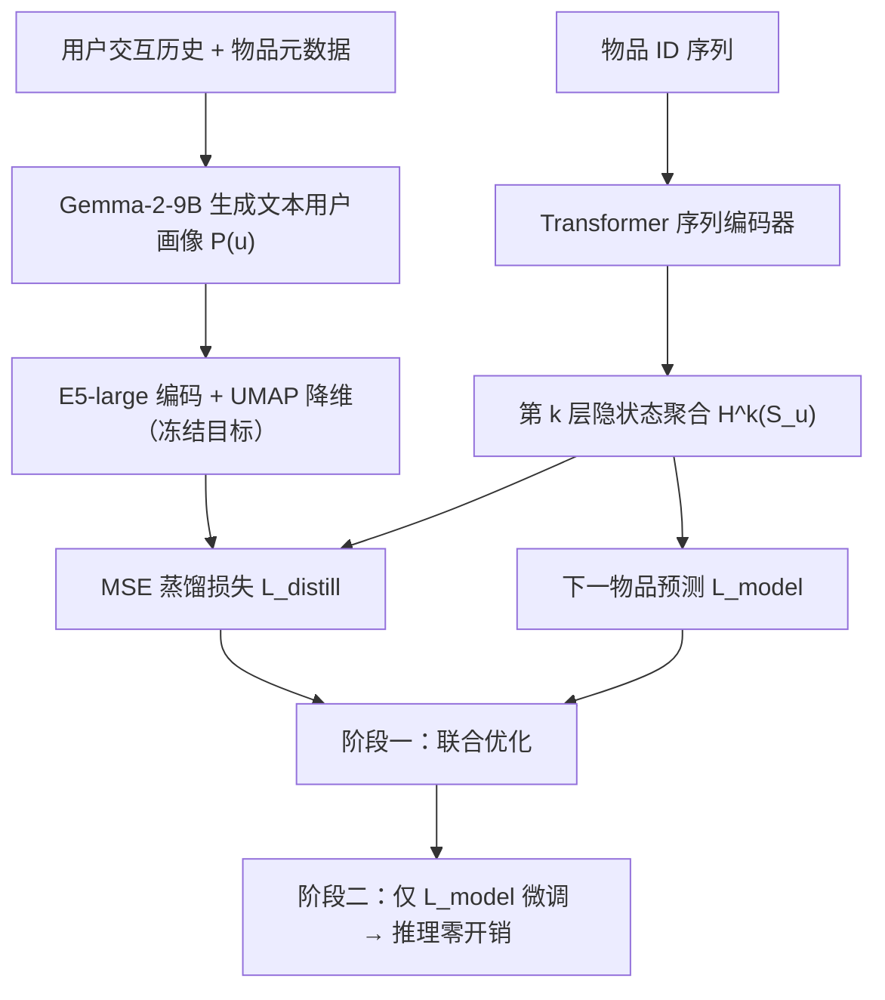
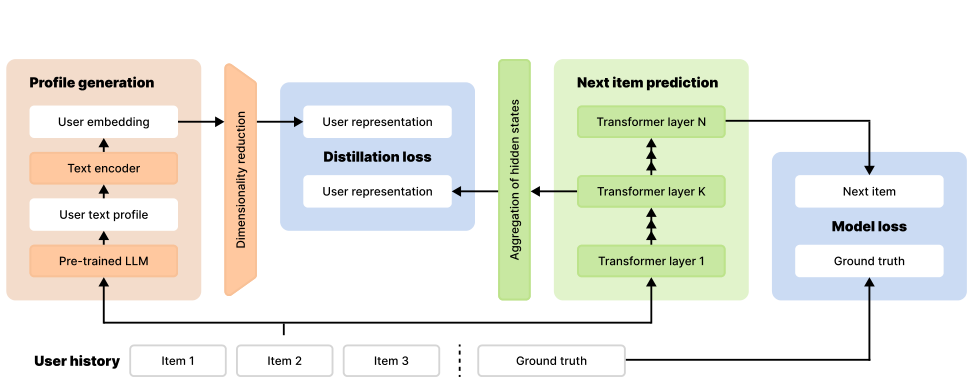

# Pre-trained LLMs Meet Sequential Recommenders: Efficient User-Centric Knowledge Distillation (预训练大模型遇见序列推荐器：高效的用户中心知识蒸馏)

- **会议/期刊**: ECIR 2026
- **作者与机构**: Nikita Severin 等；Sber AI Lab、HSE University、AIRI、Innopolis University、ITMO University 等
- **推荐链路定位**: 召回（序列下一物品预测）
- **研究方向**: 大语言模型推荐 / 序列推荐
- **论文原文**: [https://arxiv.org/abs/2604.21536v1](https://arxiv.org/abs/2604.21536v1)
- **开源代码**: [https://github.com/sb-ai-lab/ECIR26_Pre-trained_LLMs_Meet-Sequential_Recommenders](https://github.com/sb-ai-lab/ECIR26_Pre-trained_LLMs_Meet-Sequential_Recommenders)

## TL;DR (1分钟核心速览)

现有 LLM4Rec 要么在服务时调用 LLM 导致 50–180× 推理延迟，要么依赖昂贵的领域微调。本文提出**用户中心的两阶段知识蒸馏**：先用预训练 LLM（Gemma-2-9B，**不做任何微调**）离线生成文本用户画像，经 E5-large 编码 + UMAP 降维得到冻结目标向量；训练第一阶段用 MSE 辅助损失把序列模型第 $k$ 层聚合隐状态对齐到该目标，第二阶段仅用推荐损失微调。在 4 个数据集、全局时间切分协议下，SASRec 的 NDCG@10 提升 2.02%–5.62%，BERT4Rec 在 Beauty 上 Recall@10 提升 23.53%，而推理延迟与原生 SASRec 完全一致。

## Background & Motivation (背景与核心矛盾)

- **主流范式**: 基于 Transformer 的序列推荐（SASRec / BERT4Rec）以物品 ID 序列建模时序行为，是工业召回的主力架构。
- **前人局限**: ① 纯 ID 序列无法刻画交互模式之外的**用户语义**（如"偏好天然有机成分"），数据稀疏时泛化差；② 现有 LLM 融合路线（zero-shot 提示、特征增广、全量微调、IDGenRec 式语义 ID 生成）要么服务时需 LLM 前向，要么需领域微调，实时部署成本不可接受。
- **核心洞察 (Key Insight)**: 一个有效的推荐模型，其内部用户表征**本应隐式编码**丰富的用户语义；因此可以把 LLM 画像当作"教师标签"直接对齐到隐空间，而非让 LLM 参与推理。
- **本文切入点**: 用**免微调的预训练 LLM** 离线生成用户画像作为蒸馏目标，把语义知识"烧"进序列模型参数，服务时零额外开销、零架构改动。

## Method (核心方法设计)

### 1. 整体框架 (Overall Architecture)

离线阶段：聚合用户历史中的物品元数据（标题/类目/描述/剧情摘要）为文本，送入 Gemma-2-9B 按固定五段式提示（分析历史 → 识别偏好模式 → 区分高/低分物品 → 综合画像）生成文本画像 $P(u)$；再由 multilingual-E5-large 编码并经 UMAP 变换$T$投影到推荐模型隐空间维度，得到**一次性预计算、全程冻结**的目标向量$T(E(P(u)))$。在线训练阶段：序列模型正常前向，取第$k$层隐状态聚合为序列表征$H^k(S_u)$，与冻结目标做 MSE 对齐；训练后期撤除辅助损失，仅保留下一物品预测。推理时模型与原生 SASRec 完全相同。

<figure class="paper-figure" markdown="span">
  <figcaption>图 1：提出的从 LLM 到基于 Transformer 的序列推荐模型的知识迁移方法。</figcaption>
</figure>

### 2. 关键设计拆解 (Key Designs)

1. **层级隐状态聚合作为蒸馏锚点**：痛点在于序列模型没有天然的"用户向量"，而不同数据集的最优时间聚合方式不同。作者在第 $k$层（实验证明末层最佳）对上下文隐状态做聚合，提供两种策略——均值池化$H^k=\frac{1}{m}\sum_{t=1}^{m}h_t^k$适用于偏好稳定的数据集；指数加权$H^k=\sum_{t=1}^{m}\frac{\exp(\gamma t)}{\sum_j \exp(\gamma j)}h_t^k$适用于近期交互更具预测力的场景，$\gamma$ 控制新近性强度。直觉是：让"整段历史压缩成的单一向量"去逼近"LLM 读完整段历史后写出的画像"，等价于强制模型学会语义级摘要。

2. **动态缩放的两阶段蒸馏损失**：直接加权时 $L_{distill}$数值远小于$L_{model}$，会被梯度淹没。作者引入逐 batch 的 stop-gradient 缩放因子$\beta=\mathrm{detach}(L_{model}/L_{distill})$，总损失为
$$\mathcal{L}=\alpha\cdot\beta\cdot\mathcal{L}_{distill}+(1-\alpha)\cdot\mathcal{L}_{model}$$
$\beta$不参与梯度更新，仅做量纲归一，使两个损失在数值上可比。消融显示：无$\beta$时最优$\alpha=0.8$（需手动放大蒸馏项），有$\beta$时最优$\alpha=0.4$，说明自动缩放确实替代了人工调权。

3. **训练目标、负采样与推理效率**：$\mathcal{L}_{model}$ 采用交叉熵（SASRec 全库 softmax 式训练，未引入额外负采样器）；蒸馏阶段约占总 epoch 的 50%，之后纯推荐目标微调。推理侧与 SASRec 完全一致（单次前向），训练开销仅增加 5–25%。

## Experimental Setup & Evaluation Protocol (实验设置与评估协议)

- **数据集与预处理**: 全部采用 $k$-core 过滤（$k=5$），移除交互数不足的用户与物品。

| 数据集 | #Users | #Items | #Interactions | 平均序列长 | 密度 | 领域 |
| :--- | :---: | :---: | :---: | :---: | :---: | :--- |
| Beauty | 70,996 | 39,116 | 436,309 | 6.145 | 0.00304 | 商品评论 |
| ML-20M | 137,165 | 13,132 | 19,933,088 | 143.929 | 0.01096 | 电影 |
| Kion | 16,797 | 5,626 | 287,698 | 17.128 | 0.00055 | 电影 |
| Amazon M2 | 616,502 | 334,060 | 3,651,542 | 5.923 | 0.00002 | 电商 |

- **数据划分与防穿越 (Splitting Strategy)**: 采用**全局时间戳切分 80/20**（遵循 [14]），阈值前为训练集、后为测试集，显式规避未来信息泄漏。
- **排名评测协议 (Ranking Protocol)**: 报告 NDCG@10 与 Recall@10，结果取 5 个随机种子均值并给出标准差；未采用采样负例，属全库排序口径。
- **对比基线与超参设置**: 基线为 SASRec（交叉熵损失）、BERT4Rec 与 LLM 基线 IDGenRec；画像由 Gemma-2-9B 生成、E5-large 编码为 1024 维后 UMAP 降维；网格搜索学习率 {1e-4, 5e-4, 1e-3}、batch {128,256,512}、dropout {0.2,0.3,0.5}、层数 {1,2,4}、头数 {2,4,8}，蒸馏侧额外搜索 $\alpha\in\{0.4,0.6,0.8\}$与$\beta$ 开关。

## Key Experimental Results (实验关键数据)

### 1. 主实验对比 (Main Results)

| 数据集 | 方法 | NDCG@10 | Recall@10 | NDCG 提升 |
| :--- | :--- | :---: | :---: | :---: |
| Beauty | SASRec | 0.0106 | 0.0217 | — |
| Beauty | **SASRec + LLM Distill** | **0.0111** | **0.0228** | **+4.90%** |
| Beauty | BERT4Rec | 0.0051 | 0.0102 | — |
| Beauty | **BERT4Rec + LLM Distill** | **0.0061** | **0.0126** | **+19.61%** |
| ML-20M | SASRec | 0.0453 | 0.0781 | — |
| ML-20M | **SASRec + LLM Distill** | **0.0479** | **0.0819** | **+5.62%** |
| Kion | SASRec | 0.0585 | 0.1135 | — |
| Kion | **SASRec + LLM Distill** | **0.0597** | **0.1145** | **+2.02%** |
| Amazon M2 | SASRec | 0.3647 | 0.5373 | — |
| Amazon M2 | **SASRec + LLM Distill** | **0.3761** | **0.5414** | **+3.14%** |

与 LLM 基线 IDGenRec 的对比（NDCG@10）：Beauty 上 IDGenRec 0.0114 略优于本文 0.0111；但 ML-20M（0.0452 vs **0.0479**）、Kion（0.0452 vs **0.0597**）、Amazon M2（0.1001 vs **0.3761**）本文全面领先。

### 2. 消融实验 (Ablation Study)

Beauty 数据集上 $\alpha$与动态缩放$\beta$ 的联合消融（NDCG@10）：

| $\beta$|$\alpha=0.4$|$\alpha=0.6$|$\alpha=0.8$ |
| :---: | :---: | :---: | :---: |
| no | 0.0105 | 0.0108 | **0.0109** |
| yes | **0.0111** | 0.0106 | 0.0106 |

效率对比（秒，训练单 epoch / 测试集推理）：

| 方法 | Beauty 训练 | Beauty 推理 | ML20M 训练 | ML20M 推理 | Amazon M2 训练 | Amazon M2 推理 |
| :--- | :---: | :---: | :---: | :---: | :---: | :---: |
| IDGenRec | 37.11 | 120.38 | 132.12 | 840.01 | 1529.45 | 7492.11 |
| SASRec | 25.56 | 2.37 | 68.30 | 4.37 | 663.26 | 41.07 |
| **本文** | 26.92 | **2.37** | 71.34 | **4.37** | 833.36 | **41.07** |

### 3. 关键实验发现 (Key Findings)

1. **基线越弱，蒸馏收益越大**：Beauty 上 BERT4Rec 基线 NDCG@10 仅 0.0051，蒸馏后提升 19.61%（Recall@10 +23.53%）；而 ML-20M 上 BERT4Rec 基线已达 0.0623，提升仅 0.80%。说明 LLM 画像主要在语义信号缺失、数据稀疏的场景补位。
2. **动态缩放 $\beta$是必要的工程件**：无$\beta$时需把$\alpha$推到 0.8 才能压过$L_{model}$，且最优值 0.0109 仍低于有$\beta$时$\alpha=0.4$的 0.0111；$\beta$ 让蒸馏项自动获得合适量纲，降低调参成本。
3. **效率优势是本文的核心卖点**：推理延迟与 SASRec 完全持平（Beauty 2.37s vs IDGenRec 120.38s，约 50×；Amazon M2 41.07s vs 7492.11s，约 180×），训练开销仅增 5–25%，而 IDGenRec 训练慢 1.5–2.3×。蒸馏损失曲线（图 3）显示阶段切换后 $L_{distill}$ 仍保持低位，证明语义结构被参数化保留而非过拟合辅助任务。

## Highlights & Limitations (亮点、对比与审稿批判)

- **与代表作对比 (vs. Prior Work)**: 相比 IDGenRec 等 LLM 微调路线，本文**不微调 LLM、不改推荐器架构、服务时不调用 LLM**，把成本全部前置到离线画像生成；相比传统特征增广方法，本文蒸馏的是**用户级语义摘要**而非物品级文本嵌入，且通过隐层对齐而非输入拼接注入知识。
- **可迁移亮点**: ① "离线生成冻结目标 + 两阶段辅助损失 + 动态缩放"这套范式可平移到任何需要注入外部语义的轻量模型（如 CTR 精排、多模态召回）；② 用 stop-gradient 比值做多任务损失量纲归一，是简单有效的工程技巧。
- **审稿级局限批判**: ① 画像质量完全依赖 LLM 与提示设计，论文未量化画像噪声或幻觉对蒸馏的影响，也未做提示敏感性分析；② 主实验仅两个序列基线、指标仅 @10，且 Beauty 上仍略逊于 IDGenRec，缺少与更多 LLM4Rec 方法（如 LLM 嵌入直接拼接）的对照；③ UMAP 降维引入的失真与随机性未被讨论，且画像需为每个用户离线生成一次，冷启动新用户无法即时获得。

## Rating (四维评分)

- **方法创新性 (Novelty)**: ⭐⭐⭐⭐ （首个免 LLM 微调、免服务时推理的用户中心蒸馏框架，思路简洁但理论分析偏薄）
- **评估协议与实验扎实度 (Protocol & Experiments)**: ⭐⭐⭐ （全局时间切分与 5 种子均值规范，但基线数量与指标维度偏少，缺显著性检验）
- **写作与数学规范度 (Clarity & Rigor)**: ⭐⭐⭐⭐ （两阶段流程与损失公式交代清晰，$\beta$ 的动机与消融呼应到位，符号略简）
- **工业落地与复现价值 (Industrial & Practical Value)**: ⭐⭐⭐⭐⭐ （推理零开销、训练仅增 5–25%、代码开源，是可直接上线的 LLM 知识注入方案）

