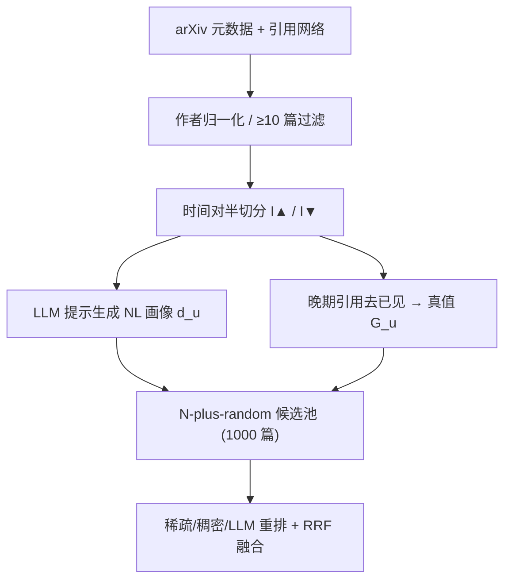
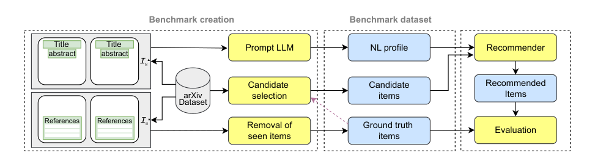

# SciNUP: Natural Language User Interest Profiles for Scientific Literature Recommendation (面向科学文献推荐的自然语言用户兴趣画像)

- **会议/期刊**: ECIR 2026 (第48届欧洲信息检索会议)
- **作者与机构**: Mariam Arustashvili, Krisztian Balog (University of Stavanger, Norway)
- **推荐链路定位**: 召回（画像→候选文献排序）
- **研究方向**: 大语言模型推荐 / 冷启动与长尾推荐
- **论文原文**: [https://arxiv.org/abs/2510.21352v2](https://arxiv.org/abs/2510.21352v2)
- **开源代码**: [https://github.com/iai-group/SciNUP](https://github.com/iai-group/SciNUP)

## TL;DR (1分钟核心速览)

自然语言（NL）用户画像具备可解释、可编辑的优势，但缺乏大规模公开评测集，且现有工作集中于电影/图书域。本文构建 **SciNUP**：从 arXiv 抽取 1,000 名作者，用其早期论文经 LLM 提示生成第一人称 NL 兴趣画像，以晚期论文的参考文献（去除已见/自引）为 ground truth，每人配 1,000 篇候选文献。在此基准上系统对比 BM25/RM3、双塔 kNN、BGE 交叉编码器与 PRP 成对 LLM 重排，发现稀疏检索仍是强基线，而 RRF 融合三类信号将 NDCG@10 从 0.3541 提升至 **0.4481**（相对 +26.5%），揭示巨大改进空间。

## Background & Motivation (背景与核心矛盾)

- **主流范式**: NL 画像推荐通常由 LLM 从评论/评分/历史中推断画像，再在共享嵌入空间做相似度检索，或训练神经模型做评分预测。
- **前人局限**: 其一，缺少大规模公开测试集——收集用户自述兴趣与相关性标注成本高、难扩展；其二，现有数据集局限于电影/图书/POI 域，学术文献域仅有基于标签式概念的稀疏（CiteULike）或私有（OpenReview）数据。
- **核心洞察 (Key Insight)**: 学者的发表历史天然构成"早期兴趣→晚期引用"的时间因果链，可用 LLM 将早期论文摘要压缩为可读画像，晚期参考文献则充当无需人工标注的真实相关性信号。
- **本文切入点**: 以合成方式规模化构造"画像—候选—真值"三元组，并给出跨范式基线全景，把该任务从"缺数据"推进到"缺方法"。

## Method (核心方法设计)

### 1. 整体框架 (Overall Architecture)

数据构造分三步闭环：先对 arXiv 元数据（150 万篇，截至 2019-03）做作者名归一化，保留发表 ≥10 篇的有效作者；对采样用户 $u$的论文集$\mathcal{I}_u$按时间对半切分为早期$\mathcal{I}^{\blacktriangle}_u$与晚期$\mathcal{I}^{\blacktriangledown}_u$；用 LLM 读入$\mathcal{I}^{\blacktriangle}_u$的标题+摘要生成第一人称画像$d_u$；以$\mathcal{I}^{\blacktriangledown}_u$所引且未被$\mathcal{I}^{\blacktriangle}_u$引用、非自引的文献为真值$\mathcal{G}_u$；最后按 N-plus-random 采样 1,000 篇候选（含$N$篇真值 + 同类别加权随机负例，剔除已见项），推荐即对候选按与$d_u$ 的相关性排序。

<figure class="paper-figure" markdown="span">
  <figcaption>图 2：我们方法的概览。</figcaption>
</figure>

### 2. 关键设计拆解 (Key Designs)

1. **画像生成的提示-模型解耦设计**：为抑制单一模型偏置，作者设计 Prompt A（限定三句、明示"服务推荐系统"目的）与 Prompt B（自由描述），并交叉 Llama-4 Maverick 与 GPT-4o，将 1,000 名作者均分为 4 组各 250 人。画像平均长度 117±55 词，Prompt A 显著更短（83±10 vs. 150±61），为后续"提示策略是否影响推荐"提供可控变量。
2. **画像广度的自动分档元数据**：用 few-shot 提示将画像分为 Narrow/Medium/Broad 三档，由 Llama-70B、Gemini-2.5-Flash、GPT-4o 三模型多数投票定档，得到 679/256/65 的分布。该元数据使"兴趣广度是否损害检索"成为可量化问题，而非定性猜测。
3. **训练目标、负采样与推理效率**：本文不训练新模型，全部基线为免训练检索。候选负例采用类别加权随机采样（用户发文多的 arXiv 类别被抽中概率更高），真值项不区分相关度等级。推理侧，LLM 重排采用级联策略——仅对 BM25 top-100 用 PRP 滑窗成对比较（复杂度 $O(n)$），避免全库成对打分。

## Experimental Setup & Evaluation Protocol (实验设置与评估协议)

- **数据集与预处理**: 基于 arXiv 公开元数据（CC0），仅用标题/摘要/类别/引用，作者名归一化后保留 ≥10 篇者，采样 1,000 人。

| 数据集 | #Users | #Items | #Interactions | 稀疏度/密度 | 特征/场景说明 |
| :--- | :---: | :---: | :---: | :---: | :--- |
| SciNUP | 1,000 | 1,000 候选/人 | 每人真值 1/27/438 (min/median/max) | 真值中位 27/1000 ≈ 2.7% | 物理/数学/CS 为主，画像 117±55 词 |

- **数据划分与防穿越 (Splitting Strategy)**: 按作者论文时间对半切分（早期建画像、晚期建真值），并显式剔除早期已引用与自引文献，属时间切分 + 已见项过滤的防泄漏设计。
- **排名评测协议 (Ranking Protocol)**: 每人固定 1,000 候选池的 **Sampled Ranking**（非全库），真值占比约 2.7%；指标为 R@100、MAP、MRR、NDCG@10。
- **对比基线与超参设置**: 稀疏 BM25/RM3（默认参数）、双塔 kNN-SciBERT（768 维 + Faiss）、交叉编码器 BGE-Large / BGE-v2-M3 / BGE-v2-MiniCPM、PRP 重排（Llama-3-8B、Llama-3.3-70B、GPT-4o-mini）；显著性用配对 t 检验 + Bonferroni 校正，$\alpha=0.05$。

## Key Experimental Results (实验关键数据)

### 1. 主实验对比 (Main Results)

| 模型 | R@100 | MAP | MRR | NDCG@10 |
| :--- | :---: | :---: | :---: | :---: |
| BM25 | 0.3491 | 0.1148 | 0.4661 | 0.2869 |
| RM3 | 0.3570 | 0.1391 | 0.5147 | 0.3251 |
| kNN-SciBERT | 0.1480 | 0.0232 | 0.2182 | 0.1019 |
| BGE-Large | 0.2826 | 0.0783 | 0.3666 | 0.2072 |
| BGE-v2-M3 | 0.3472 | 0.1152 | 0.4633 | 0.2763 |
| BGE-v2-MiniCPM | *0.4203* | *0.1673* | *0.5393* | *0.3541* |
| PRP-Llama-3.3 (70B) | 0.3491 | 0.1423 | 0.5378 | 0.3541 |
| PRP-GPT-4o-mini | 0.3491 | 0.1405 | 0.5297 | 0.3542 |
| **Ensemble (RRF)** | **0.4136** | **0.2163** | **0.6333** | **0.4481** |

融合相对最强单模型（BGE-v2-MiniCPM）NDCG@10 提升 **+26.5%**，MAP 提升 **+29.3%**，且对三个组成模型均显著。

### 2. 消融实验 (Ablation Study)

原文未做组件移除式消融，但提供了等价的分组归因分析：

| 分析维度 | 设置 | NDCG@10 趋势 |
| :--- | :--- | :--- |
| 提示策略 | Prompt A vs. Prompt B | A 略优，不显著 |
| 生成模型 | GPT-4o vs. Llama-4 | GPT 略优，不显著 |
| 画像广度 | Narrow / Medium / Broad | 逐档下降，Broad 最差 |
| 真值数量 | 1–110 / 111–219 / 220–328 / 329–438 | 单调上升 |
| 融合 | RM3 + MiniCPM + PRP-GPT | 0.4481，显著最优 |

### 3. 关键实验发现 (Key Findings)

1. **稀疏检索未被击败**：RM3 的 NDCG@10 达 0.3251，反超 BGE-v2-M3（0.2763）与 BGE-Large（0.2072），说明伪相关反馈在领域术语密集的学术文本上仍极具竞争力；双塔 kNN-SciBERT 仅 0.1019，暴露纯向量内积对长画像的语义压缩损失。
2. **模型互补性远大于均值差距**：图 7 的逐作者 NDCG@10 差值显示，全局较弱的模型在相当比例作者上反超强者，这正是 RRF 融合能大幅跃升（0.3541→0.4481）的根因——三类范式捕捉的是不同相关性信号，而非同一信号的不同精度。
3. **画像广度是性能杀手**：Broad 画像在三类模型上均显著劣于 Narrow，因多主题兴趣难以压缩进单一查询向量/词袋，提示未来需要"画像分解 + 多查询路由"式方法，而非更强的单编码器。

## Highlights & Limitations (亮点、对比与审稿批判)

- **与代表作对比 (vs. Prior Work)**: 相较 Sanner 等与 Ramos 等的电影/图书域 NL 画像工作，本文首次将任务迁移到学术域并公开 1,000 用户规模基准；相较 Mysore 等的标签式概念画像，本文用全文摘要生成完整自然语言描述，表达力更强；相较 ArXivDigest 依赖关键词显式兴趣，本文提供可编辑的自然语言画像范式。
- **可迁移亮点**: ①"早期作品→晚期引用"的时间切分真值构造法，可直接迁移到专利、代码仓库、新闻等任意有引用/链接结构的域；②三模型多数投票定档画像广度的做法，为任何需要"用户兴趣宽度"元标签的场景提供低成本标注模板。
- **审稿级局限批判**: ①真值仅取参考文献且不区分相关度等级，忽略"引用但弱相关"与"未引用但强相关"的双向噪声，可能系统性低估稠密检索；②候选池仅 1,000 篇且负例为同类别随机采样，难度远低于全库排序，绝对指标不可外推；③画像由 LLM 合成而非真实用户自述，缺少人工评估验证其保真度，且未报告 LLM 重排的延迟与成本。

## Rating (四维评分)

- **方法创新性 (Novelty)**: ⭐⭐⭐ （基准构建思路扎实、时间切分防泄漏设计巧妙，但方法层面为现有检索器的系统评测，无新模型）
- **评估协议与实验扎实度 (Protocol & Experiments)**: ⭐⭐⭐⭐ （1,000 用户、四指标、显著性检验与逐作者互补性分析完整，扣分在候选池规模与真值噪声）
- **写作与数学规范度 (Clarity & Rigor)**: ⭐⭐⭐⭐ （流程、提示模板、统计表均公开透明，任务定义清晰；形式化程度偏轻，无复杂度分析）
- **工业落地与复现价值 (Industrial & Practical Value)**: ⭐⭐⭐⭐⭐ （数据、基线、评测脚本全开源，RRF 融合结论可直接用于学术搜索/文献推荐产品的召回层）
