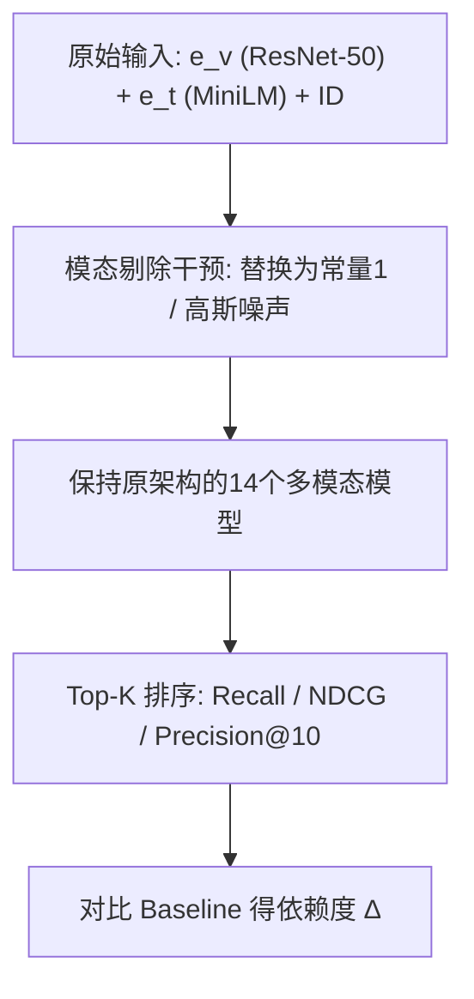

# Are Multimodal Embeddings Truly Beneficial for Recommendation? A Deep Dive into Whole vs. Individual Modalities (多模态嵌入对推荐真的有益吗？整体与单模态的深度剖析)

- **会议/期刊**: ECIR 2026
- **作者与机构**: Yu Ye, Junchen Fu, Yu Song, Kaiwen Zheng, Joemon M. Jose（University of Glasgow / Michigan State University）
- **推荐链路定位**: 召回（Top-K 排序评测）
- **研究方向**: 多模态推荐 / 可信评测与实证复现
- **论文原文**: [论文原文链接](https://arxiv.org/abs/2508.07399v3)
- **开源代码**: [开源代码仓库链接](https://github.com/GAIR-Lab/MKF4MMRec)

## TL;DR (1分钟核心速览)

本文质疑多模态推荐领域"引入文本+图像嵌入必然涨点"的默认假设，提出**模态剔除 (Modality Knockout)** 诊断法：在训练与推理全程将目标模态嵌入替换为常量向量或高斯噪声，从而在保持模型架构不变的前提下隔离数据信号贡献。在 Baby/Clothing/Sports 三个 Amazon 数据集、MMRec 统一协议（5-core + 比例划分 + Full-Ranking）下评测 14 个 SOTA 模型，发现：双剔除后 FREEDOM/DRAGON/LGMRec 的 NDCG@10 暴跌 29.5%/43.0%/31.7%，但 VBPR/BM3/SLMRec 几乎不掉点；单剔除显示**文本单独即可复现全模态性能，图像单独几乎无增益**。

## Background & Motivation (背景与核心矛盾)

- **主流范式**: 以 Sentence-BERT/ResNet-50 预提取的文本与图像嵌入为辅助信号，通过简单拼接（VBPR）、用户-物品多模态图（MMGCN）、物品-物品语义图（LATTICE/FREEDOM）或混合图（DRAGON）进行融合。
- **前人局限**: 其一，现有工作聚焦架构创新与融合策略，从未受控检验嵌入本身的边际贡献；其二，各研究数据集、划分与指标不统一，跨论文比较不可靠，架构、优化与训练启发式混杂，掩盖了嵌入的真实作用。
- **核心洞察 (Key Insight)**: 若复杂融合机制带来的增益并非来自多模态语义，那么"用复杂模型"的前提本身就不成立；必须用**架构保持 (architecture-preserving)** 的干预手段把"数据信号"与"架构伪影"分离。
- **本文切入点**: 借鉴图像领域 patch 遮挡思想，用常量/噪声替换实现模态剔除，做首个 14 模型规模的大样本受控实证。

## Method (核心方法设计)

### 1. 整体框架 (Overall Architecture)

本文不提出新推荐模型，而是提出一套**诊断协议**：对每个待测模型，固定其原始架构、超参与训练流程，仅在嵌入输入层做干预，构造四种条件——Baseline (V+T)、Visual Knockout (T-Only)、Textual Knockout (V-Only)、Dual Knockout (ID-Only)。替换值分两类：常量向量（默认全 1，因全 0 在部分实现中导致训练失败）与高斯随机噪声。所有条件均在**训练与推理两阶段同时施加**替换，确保模型无法在训练中"绕过"被剔除的模态，从而测得模型对该模态的真实依赖度。

### 2. 关键设计拆解 (Key Designs)

1. **模态剔除算子（Modality Knockout）**：痛点是常规消融需改架构、引入混杂因素。本文定义替换映射 $\tilde{e}_i^{m} = \mathbf{c}\ \text{或}\ \boldsymbol{\epsilon},\ \boldsymbol{\epsilon}\sim\mathcal{N}(\mathbf{0},\sigma^2\mathbf{I})$，对$m\in\{v,t\}$ 独立或联合施加，模型其余部分完全不变。有效性直觉：无信息输入迫使模型只能依赖剩余信号，性能落差即为该模态的因果贡献上界。

2. **双剔除隔离纯协同信号**：同时替换 $e_i^v$与$e_i^t$ 后，模型退化为仅含 ID 嵌入的协同过滤器。此条件给出"多模态整体增益"的度量基准，也是识别"伪多模态模型"的关键探针——若性能不掉，说明模型本就没用上模态信息。

3. **VBPR 退化机理分析（架构伪影溯源）**：作者进一步扫描替换向量的数值分布，发现当嵌入置零时 VBPR 严格退化为 BPR，二者 Recall@10 曲线随正则权重 $\lambda$完全重合；而增大常量幅值等价于给物品打分加了一个**偏置项**$b_i \propto \|\mathbf{c}\|$，噪声则引入方差正比于$\sigma^2$ 的随机扰动，在强正则下反而缓解模型坍缩。结论：VBPR>BPR 的"涨点"可能仅来自打分动态范围扩大，而非语义学习。

## Experimental Setup & Evaluation Protocol (实验设置与评估协议)

- **数据集与预处理**: 三个 Amazon 基准，均按 MMRec 库标准做 `5-core` 过滤；图像用 ResNet-50 预提取向量，文本用 `all-MiniLM-L6-v2` 编码标题/描述。

| 数据集 | #Users | #Items | #Interactions | 稀疏度 | 场景说明 |
| :--- | :---: | :---: | :---: | :---: | :--- |
| Baby | 19,445 | 7,050 | 160,792 | 99.88% | 母婴，图文元数据完整 |
| Sports | 35,598 | 18,357 | 296,337 | 99.95% | 运动户外，类目跨度大 |
| Clothing | 39,387 | 23,033 | 278,677 | 99.97% | 服饰，视觉风格强相关 |

- **数据划分与防穿越**: 沿用 MMRec 的**比例划分**（训练/验证/测试），验证集调参、测试集报数，无时间戳切分。
- **排名评测协议**: **Full-Ranking 全库未交互物品排序**（非采样），指标为 Recall@10、NDCG@10、Precision@10，与原文各模型自报设置一致。
- **对比基线与超参设置**: 14 个模型分四组——简单融合（VBPR、BM3）、用户-物品图（GRCN、DualGNN、SLMRec、MMGCN、LGMRec）、物品-物品图（LATTICE、FREEDOM、MGCN、DA-MRS、SMORE）、混合图（DRAGON、PGL）；嵌入维度与超参全部继承 MMRec 默认配置，保证横向可比。

## Key Experimental Results (实验关键数据)

### 1. 主实验对比 (Main Results)

下表为**双剔除（ID-Only，噪声替换）相对 Baseline 的 NDCG@10 变化**，负值越大表示模型越依赖多模态信号（即多模态越"有用"）：

| 模型组 | 模型 | Baby (Base→KO) | Clothing (Base→KO) | Sports (Base→KO) | Δ 均值 |
| :--- | :--- | :---: | :---: | :---: | :---: |
| 物品-物品图 | **FREEDOM** | 0.0407→0.0287 (**-29.5%**) | — | — | 强依赖 |
| 混合图 | **DRAGON** | 0.0421→0.0240 (**-43.0%**) | — | — | 最强依赖 |
| 用户-物品图 | **LGMRec** | 0.0331→0.0226 (**-31.7%**) | — | — | 强依赖 |
| 用户-物品图 | GRCN | 0.0292→0.0292 (+0.0%) | 0.0221→0.0191 (-13.6%) | 0.0309→0.0288 (-6.8%) | 中 |
| 用户-物品图 | MMGCN | 0.0196→0.0186 (-5.1%) | 0.0102→0.0097 (-4.9%) | 0.0201→0.0180 (-10.4%) | 中 |
| 简单融合 | **BM3** | 0.0275→0.0283 (**+3.1%**) | 0.0208→0.0198 (-1.1%) | 0.0326→0.0318 (-4.6%) | 近零 |
| 用户-物品图 | **SLMRec** | 0.0275→0.0271 (-1.4%) | 0.0225→0.0222 (-3.1%) | 0.0365→0.0359 (-3.2%) | 近零 |
| 简单融合 | **VBPR** | 0.0211→0.0224 (**+3.7%**) | 0.0150→0.0142 (-6.1%) | 0.0295→0.0295 (-0.7%) | 近零 |

### 2. 消融实验 (Ablation Study)

以图像敏感模型为例，**单剔除图像（Visual Knockout）** 的 NDCG@10 变化：

| 模型 | Baby | Clothing | Sports | 结论 |
| :--- | :---: | :---: | :---: | :--- |
| GRCN | +0.0% | **-13.6%** | -6.8% | 真用图像 |
| LGMRec | -3.9% | **-11.6%** | -4.9% | 真用图像 |
| MMGCN | -5.1% | -4.9% | **-10.4%** | 中度用图像 |
| FREEDOM（文本剔除） | **-28.0%** | — | — | 文本主导 |
| DRAGON（文本剔除） | **-22.2%** | — | — | 文本主导 |
| LGMRec（文本剔除） | **-18.4%** | — | — | 文本主导 |

### 3. 关键实验发现 (Key Findings)

1. **文本单模态≈全模态，图像单模态≈无模态**：文本剔除造成的跌幅（FREEDOM -28.0%、DRAGON -22.2%）与双剔除（-29.5%、-43.0%）同量级，而图像剔除在多数模型上跌幅不足 5%，PGL 在 Clothing 上甚至小幅上涨——模型处于"文本霸权"状态。
2. **简单融合基线的增益是架构伪影**：VBPR/BM3/SLMRec 在双剔除下波动仅 ±4%，且 VBPR 置零后与 BPR 曲线完全重合、增大常量幅值可"恢复"性能，证明其相对 BPR 的优势来自偏置项与打分动态范围，而非多模态语义。
3. **视觉效用高度依赖架构与编码器**：仅 GRCN/LGMRec/MMGCN 对图像敏感；将 ResNet-50 换成 ViT 后，GRCN 稳定涨点（NDCG@10 +1.7%/+3.2%/+2.9%），而 DRAGON 在 Baby 掉 -11.1%、MMGCN 在 Clothing 掉 -8.8%，说明更强视觉特征未必转化为收益，需编码器-架构协同调优。

## Highlights & Limitations (亮点、对比与审稿批判)

- **与代表作对比 (vs. Prior Work)**: 相较 Pomo et al. 用 LVLM 重造嵌入、Zhou et al. 建基准框架，本文的 Modality Knockout 不改架构、模型无关、训练推理双阶段干预，因果隔离更干净；相较 LATTICE/FREEDOM 等"堆融合模块"的工作，本文直接质疑其收益来源，属"泼冷水"式基础性研究。
- **可迁移亮点**: ① 常量/噪声替换的架构保持消融可直接迁移到序列推荐、跨域推荐等任何"辅助信号是否真有用"的验证场景；② "置零退化到 BPR + 常量幅值扫描"这一诊断套路，可用于识别任何加性融合模块是否退化为偏置项。
- **审稿级局限批判**: ① 仅覆盖 Amazon 三域与 Top-10 排序，未涉及 CTR/排序阶段与工业级大规模场景，结论外推性受限；② 常量替换默认全 1 是为规避实现崩溃的工程妥协，替换分布的选择本身可能影响跌幅幅度，缺乏对 $\sigma$ 与常量幅值的系统性敏感性分析。

## Rating (四维评分)

- **方法创新性 (Novelty)**: ⭐⭐⭐ （诊断协议本身简单，但"架构保持 + 双阶段干预 + 伪影溯源"的组合视角在领域内属首次系统化，理论深度中等）
- **评估协议与实验扎实度 (Protocol & Experiments)**: ⭐⭐⭐⭐⭐ （14 模型 × 3 数据集 × 4 条件 × 2 替换类型的全交叉矩阵，统一 MMRec 协议与 Full-Ranking，规模与受控程度罕见）
- **写作与数学规范度 (Clarity & Rigor)**: ⭐⭐⭐⭐ （RQ 驱动结构清晰、图表信息密度高；但公式层面较浅，未给出依赖度的形式化定义与置信区间）
- **工业落地与复现价值 (Industrial & Practical Value)**: ⭐⭐⭐⭐⭐ （代码数据全开源，结论直接指导"资源受限时优先保文本、慎选视觉重模型"的工程决策，对基线选型有立竿见影的价值）

