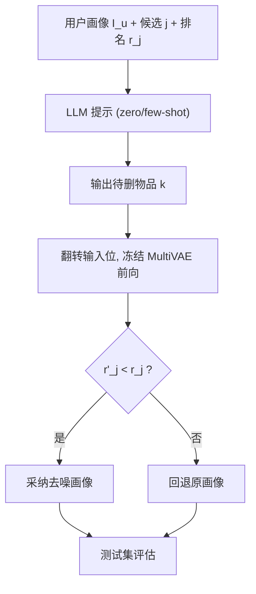
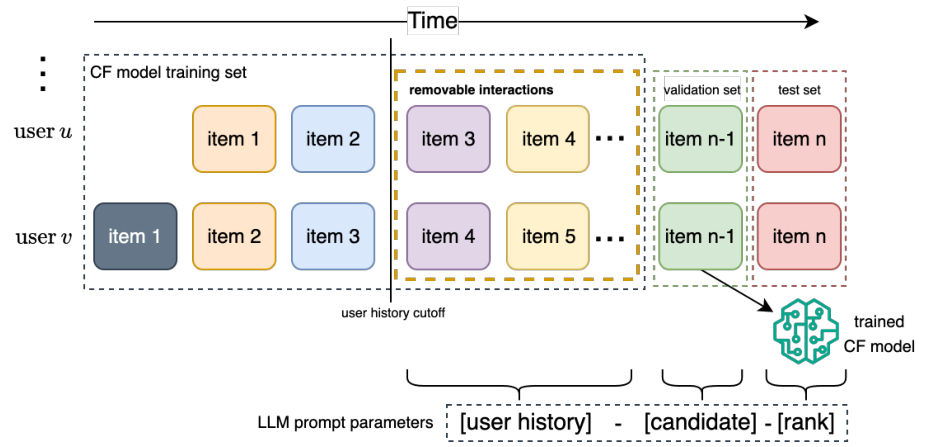

# Post-Training Denoising of User Profiles with LLMs in Collaborative Filtering Recommendation (基于大语言模型的协同过滤用户画像后训练去噪)

- **会议/期刊**: ECIR 2026 (第 48 届欧洲信息检索会议)
- **作者与机构**: Ervin Dervishaj, Maria Maistro, Tuukka Ruotsalo, Christina Lioma (哥本哈根大学、LUT 大学)
- **推荐链路定位**: 召回 (推理前输入侧清洗，模型无关)
- **研究方向**: 自监督对比学习与交互去噪 / 大语言模型推荐
- **论文原文**: [https://arxiv.org/abs/2601.18009v1](https://arxiv.org/abs/2601.18009v1)
- **开源代码**: [https://github.com/edervishaj/denoising-user-profiles-LLM](https://github.com/edervishaj/denoising-user-profiles-LLM)

## TL;DR (1分钟核心速览)

隐式反馈天然含噪，但现有去噪几乎全是 **in-training** 范式：需改目标函数、加辅助模型或微调 LLM，代价高且依赖额外数据（停留时长、跳过信号）。本文提出首个 **post-training** 去噪：CF 模型（MultiVAE）完全冻结，仅把「用户画像 + 候选物品 + 该物品当前排名」喂给 LLM，令其删除画像中 1–2 个物品以提升候选排名，验证集上排名未改善则回退原画像。在 MovieLens 1M / Yelp / Amazon CDs & Vinyl 三数据集、4 个开源/闭源 LLM 上，全用户口径 NDCG@20 最高 +4.9%，被去噪用户子集最高 **+13% HR@20**，且无需重训、无需微调、无需辅助数据。

## Background & Motivation (背景与核心矛盾)

- **主流范式**: 去噪分两派——(a) 依赖辅助信号（dwell time、mid-track skip）识别噪声交互；(b) in-training 去噪，按物品流行度、样本 loss 或预测分对交互重加权，或训练辅助噪声判别模型，或微调 LLM 打分（LLMHD）。
- **前人局限**: 其一，辅助信号需额外埋点采集，冷启动场景不可得；其二，in-training 方案必须改动模型架构/损失/训练流程，或对 LLM 做指令微调，成本高且数据饥渴；其三，Wang 等人用「随机插入物品再让 LLM 识别」构造监督，破坏了画像真实性，生成式替换还可能引入目录外物品。
- **核心洞察 (Key Insight)**: LLM 预训练参数中已蕴含相当的物品世界知识与用户偏好推理能力，因此**无需微调、无需辅助特征**，仅靠提示即可判断画像中哪些交互与候选物品冲突；且去噪本质是「改输入」而非「改模型」，天然与任意已训练 CF 模型解耦。
- **本文切入点**: 将去噪重构为语言建模任务——以验证集候选物品的排名改善作为「锚点信号」，让 LLM 输出待删物品，再用冻结 CF 模型前向验证，形成「提议—验证—回退」闭环。

## Method (核心方法设计)

### 1. 整体框架 (Overall Architecture)

对每个用户按时间戳排序交互，最近一次作测试、次近一次作验证（仅用于构造提示与验证去噪效果），其余训练 MultiVAE。推理前，将「用户画像 + 验证候选物品 $j$+ 其当前排名$r_j$」填入提示模板，LLM 输出待删物品$k$；随后把画像中$k$的输入位翻转为 0，对冻结的 MultiVAE 做一次前向，得到新排名$r'_j$。若$r'_j$优于$r_j$ 则采纳清洗后画像，否则回退原画像（约 50% 用户发生回退）。最终在测试集上评估，全程不重训、不微调。

<figure class="paper-figure" markdown="span">
  <figcaption>图 1. 使用 LLM 进行后训练去噪。CF 模型使用训练集中用户的全部历史交互进行训练。每个用户最近的交互用作测试集。第二近的交互用作验证集。LLM 的提示由用户其余最近的交互构建，其中验证集项目作为候选项目。候选项目的排名由完全训练的 CF 模型检索得到。</figcaption>
</figure>

### 2. 关键设计拆解 (Key Designs)

1. **排名锚定的去噪提示 (Rank-Anchored Prompting)**：痛点在于 LLM 无从判断「删哪个才有用」。本文将候选物品排名 $r_j$ 显式写入提示，把开放式去噪转为有明确优化目标的条件生成：
$$k=\mathrm{LLM}(I_u,\,j,\,r_j,\,e),\quad k\in I_u,\quad r'_j=\mathcal{M}(I_u\setminus\{k\},\,j)$$
排名数字直接告诉 LLM「还有多少提升空间」，使删除决策从「猜噪声」变为「为候选腾位」，物理直觉清晰且可验证。

2. **验证集候选 + 前向验证回退 (Validation-Grounded Verification)**：用验证集（而非测试集）物品作候选，既避免测试泄漏，又因该物品确为用户交互过而提供「真实偏好锚点」，提升跨用户泛化；再用冻结模型前向比对 $r'_j$与$r_j$，把 LLM 的不稳定输出过滤为单调不降的输入变换，这是全用户口径仍能稳定正收益的关键保险。

3. **提示变体与训练/推理开销**：三种提示——zero-shot（仅三要素）、zero-shot-recs（附 CF top-10 推荐列表作参照）、few-shot（在第二验证集上逐项试删，取最好/最差删除作示例）。总目标即最大化验证排名改善，**无任何训练损失、无负采样**；推理开销为每用户一次 LLM 调用 + 一次 MultiVAE 前向，Yelp 万级用户在单张 H100 上约 2 小时，且可完全离线预计算。

## Experimental Setup & Evaluation Protocol (实验设置与评估协议)

- **数据集与预处理**（评分二值化，>0 记 1）：

| 数据集 | #Users | #Items | #Interactions | 稀疏度 | 过滤/场景 |
| :--- | :---: | :---: | :---: | :---: | :--- |
| MovieLens 1M | 6,040 | 3,883 | 1,000,209 | 95.74% | 电影，最少 20 交互/用户 |
| Yelp | 10,000 | 20,073 | 476,769 | 99.76% | 20-core，按交互数分层采样 1 万用户 |
| Amazon CDs & Vinyl | 10,000 | 15,180 | 242,932 | 99.84% | 10-core，分层采样 1 万用户 |

- **数据划分与防穿越**: `Leave-One-Out`（按时间戳排序），最近一次为测试、次近一次为验证（仅构造提示与验证去噪），其余训练；提示中画像长度截断至训练集最小交互数。
- **排名评测协议**: 无偏 `Full-Ranking`（对全库未交互物品排序），指标 NDCG/HR/MRR @10/20/100，配对 t 检验（$p<0.05/0.01/0.001$）。
- **对比基线与超参**: CF 模型为 MultiVAE（RecBole 默认超参）；基线含 random-1/2、top-pop-1/2、semantic-1/2、upperBoundOnVal-1/2（验证集穷举删一项的最优上界）；LLM 为 Qwen3-8B、Mistral-NeMo-12B、GPT-4.1-mini、DeepSeek-V3.1，每配置 3 次随机解码取均值，并统计格式错误率与幻觉率。

## Key Experimental Results (实验关键数据)

### 1. 主实验对比 (Main Results)

全用户口径相对提升（%，节选 NDCG@20 / HR@20，最优加粗）：

| 方法 | ML-1M NDCG@20 | ML-1M HR@20 | Yelp NDCG@20 | Amazon NDCG@20 | Amazon HR@20 |
| :--- | :---: | :---: | :---: | :---: | :---: |
| random-2 | -0.3 | -0.5 | +0.2 | +1.5 | +0.9 |
| top-pop-2 | +1.7 | +2.6 | +2.0 | +0.5 | +2.1 |
| semantic-2 | -0.0 | +0.0 | +0.1 | +1.0 | +1.6 |
| upperBoundOnVal-2 | +3.1 | +3.6 | +3.4 | +11.5 | +9.4 |
| Qwen few-shot-2 | +2.8 | +2.9 | +1.8 | +2.4 | +1.6 |
| Mistral few-shot-2 | +1.7 | +1.9 | +0.1 | **+3.6** | **+4.9** |
| GPT few-shot-2 | +0.9 | +1.3 | -0.1 | +1.6 | +1.4 |
| DeepSeek few-shot-2 | +1.5 | +2.6 | +1.2 | +3.6 | +3.1 |

被去噪用户子集（约 42%–65% 用户被清洗）提升更显著：ML-1M 上 Qwen few-shot-2 达 **+6.4% NDCG@20 / +6.7% HR@20**（50.6% 用户），超过 upperBoundOnVal-2；Amazon 上 Mistral zero-shot-recs-2 达 **+11.7% NDCG@20 / +13.0% HR@20**（42.1% 用户）。

### 2. 消融实验 (Ablation Study)

以 ML-1M 全用户 NDCG@20 为口径的提示/删除数消融：

| 配置 | NDCG@20 相对变化 | 格式错误率 | 幻觉率 |
| :--- | :---: | :---: | :---: |
| Qwen zero-shot-recs-2 | +1.5% | 8.3% | 9.1% |
| Qwen few-shot-2 | **+2.8%** | 1.1% | 0.7% |
| Mistral zero-shot-recs-2 | +0.2% | 1.2% | 20.1% |
| Mistral few-shot-2 | +1.7% | 3.2% | 3.2% |
| 删 1 项 → 删 2 项 | 普遍提升（Mistral zero-shot 除外） | — | — |

### 3. 关键实验发现 (Key Findings)

1. **提示最优性因 LLM 与数据集而异**：ML-1M 上 few-shot-2 最佳（Qwen +2.8%），Amazon 上 zero-shot-recs-2 最佳（Mistral +3.0%），GPT 在两数据集上几乎无波动且增益最小，说明「世界知识丰富度」而非提示工程是主要瓶颈。
2. **幻觉率直接吞噬收益**：Yelp 上 Mistral zero-shot-recs-2 幻觉率高达 37.2%，对应 NDCG@20 仅 +0.6%；而 few-shot 将幻觉压至 8.1% 后 DeepSeek 反超至 +1.2%，验证「示例锚定」是抑制幻觉的关键手段。
3. **收益不挑评分与画像长度**：图 3 显示删除 3 分与 5 分物品均能超越 upperBoundOnVal-2，正向提升最高 +15% 而负向仅 -2.5%；图 4 显示短画像与长画像用户均获正收益，说明方法不依赖特定噪声类型。

## Highlights & Limitations (亮点、对比与审稿批判)

- **与代表作对比 (vs. Prior Work)**: 相比 LLMHD（LLM 噪声分与训练 loss 融合，需重训）与 Wang 等（随机插噪 + LLM 微调 + 生成替换），本文不改架构、不微调、不引入目录外物品，是唯一可在**已上线冻结模型**上即插即用的方案；相比 upperBoundOnVal 这一验证集穷举上界，在去噪子集上竟能反超，说明 LLM 的跨物品泛化优于单点贪心。
- **可迁移亮点**: (1)「候选 + 排名」作为提示锚点，可迁移至重排阶段的列表级输入清洗；(2)「LLM 提议 + 冻结模型前向验证 + 回退」的闭环，是把不可靠生成输出转为单调安全变换的通用范式。
- **审稿级局限批判**: 其一，候选物品本身可能是噪声交互，会误导删除决策，且验证依赖单一候选，方差较大；其二，每用户一次 LLM 调用在亿级用户下成本与延迟不可忽视，论文未给出蒸馏或小模型替代方案；其三，LLM 黑箱导致删除理由不可解释，格式/幻觉错误仍需正则与人工兜底。

## Rating (四维评分)

- **方法创新性 (Novelty)**: ⭐⭐⭐⭐ （首次将去噪从 in-training 迁移到 post-training，问题重构巧妙，但技术组件本身为提示工程组合）
- **评估协议与实验扎实度 (Protocol & Experiments)**: ⭐⭐⭐⭐ （三数据集 × 四 LLM × 多提示 × 全库排序 + 配对 t 检验 + 上界基线，唯缺线上 A/B 与更大规模验证）
- **写作与数学规范度 (Clarity & Rigor)**: ⭐⭐⭐⭐ （公式极简、提示模板完整披露、错误率统计透明，但理论分析偏薄）
- **工业落地与复现价值 (Industrial & Practical Value)**: ⭐⭐⭐⭐ （代码开源、模型无关、可离线预计算，但 LLM 调用成本与幻觉治理是落地门槛）

