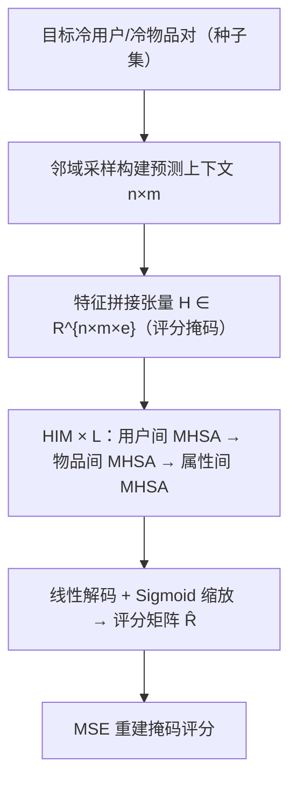
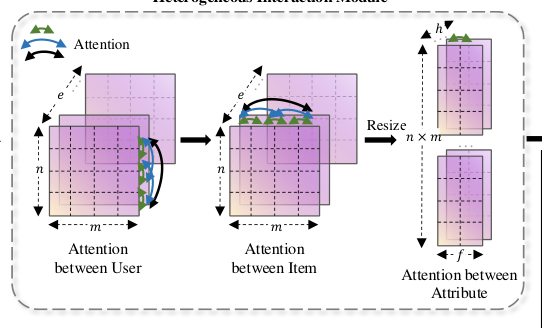

# All-in-One: Heterogeneous Interaction Modeling for Cold-Start Rating Prediction (一体化：面向冷启动评分预测的异构交互建模)

- **会议/期刊**: ICDE 2025
- **作者与机构**: Shuheng Fang, Kangfei Zhao, Yu Rong, Zhixun Li, Jeffrey Xu Yu（香港中文大学 / 北京理工大学 / 阿里巴巴达摩院）
- **推荐链路定位**: 精排（评分预测）
- **研究方向**: 冷启动与长尾推荐 / 图神经网络与知识图谱推荐
- **论文原文**: [https://arxiv.org/abs/2403.17740v3](https://arxiv.org/abs/2403.17740v3)
- **开源代码**: [https://github.com/FangShuheng/HIRE](https://github.com/FangShuheng/HIRE)

## TL;DR (1分钟核心速览)

冷启动评分预测的主流做法依赖**人工预定义的显式关系**（社交边、meta-path 构建的 HIN），但这些关系往往不可靠、与目标任务无关，成为性能天花板。HIRE 抛弃预定义交互模式，把"目标用户/物品 + 邻域采样出的相关用户与物品"打包成一个预测上下文张量，用三层多头自注意力（用户间 / 物品间 / 属性间）在数据驱动下端到端推断隐式异构交互。在 MovieLens-1M、Bookcrossing、Douban 三个数据集、用户冷启动 / 物品冷启动 / 双冷启动三种设定下，相对 12 个基线平均提升 Precision 0.21、NDCG 0.29、MAP 0.22（百分点级绝对提升，如 MovieLens-1M 双冷启动 MAP@5 从 60.34 提升至 67.64）。

## Background & Motivation (背景与核心矛盾)

- **主流范式**: 缓解冷启动有三条主线——CF 类（NeuMF/Wide&Deep/DeepFM/AFN）只用 user-item 单一交互；社交推荐（GraphRec）引入社交边；HIN 类（GraphHINGE/MetaHIN）用 meta-path 构建含 tag、POI 等实体的异构图；此外还有元学习路线（MeLU/MAMO/TaNP）。
- **前人局限**: ① 显式关系**不可靠**——社交边可能缺失或错误，HIN 构图阶段的误分类（如图 1 中把蛋糕归为食物、电影归为娱乐）会直接污染表征；② 显式关系**不相关**——女孩与某男孩的社交关系对她音乐偏好的预测毫无信息量，meta-path 的语义也未必对齐评分任务；③ 元学习方法只建模 user-item 显式交互，且复杂适配模块带来实现与效率负担。
- **核心洞察 (Key Insight)**: MHSA 本质是在**完全图**上以可学习的 soft 邻接矩阵做消息传递（区别于 GNN 的固定邻接矩阵），且天然具备置换等变性与度量学习性质——恰好适合"只有少量交互"的冷启动实体，让模型自己决定"谁和谁该交互"。
- **本文切入点**: 不做图构建、不依赖 side information 的显式语义，而是把异构交互的发现权交给注意力层，在采样出的局部上下文里一次性联合建模用户、物品、属性三个层面的交互。

## Method (核心方法设计)

### 1. 整体框架 (Overall Architecture)

对任一待预测的 (冷用户, 冷物品) 对，HIRE 先以该对为种子集，在 user-item 二部评分图上做**邻域采样**，得到含 $n$个用户、$m$个物品的预测上下文；随后把上下文编码为三维张量$\mathbf{H}\in\mathbb{R}^{n\times m\times e}$（每个格子拼接用户特征、物品特征、评分特征，待预测评分置零掩码、未观测评分置$-1$掩码）；张量依次穿过$L$个 HIM 块，每块内按"用户间注意力 → 物品间注意力 → 属性间注意力"顺序更新；最后一个 HIM 的输出经线性解码器 + Sigmoid 缩放得到$n\times m$ 的评分矩阵，取目标位置即为预测值。训练时对上下文中 90% 的已观测评分做掩码，以 MSE 重建掩码评分，全程无需负采样。

<figure class="paper-figure" markdown="span">
  <figcaption>图 3：HIRE 的架构：对于待预测的冷用户/物品的评分，HIRE 首先采样一个预测上下文。然后，模型为预测上下文构建初始嵌入，并通过 L 个 HIM 学习异构交互。最后，最后一个 HIM 的输出嵌入被转换为预测评分矩阵。</figcaption>
</figure>

### 2. 关键设计拆解 (Key Designs)

1. **邻域采样构建预测上下文（Context Construction）**：冷实体自身交互极少，直接编码必然欠拟合。作者以目标对为种子，逐跳从二部图邻居中采样，预算 $n,m$用尽即止（邻居数不足则全取，超出则均匀采样）。该策略为冷实体注入"有信息量的先验"，且实验证明优于随机采样（平均 +1.26%）与特征相似度采样。上下文张量的构造为$\mathbf{H}[k,j,\cdot]\leftarrow[\mathbf{x}_{u_k}\|\mathbf{x}_{i_j}\|\mathbf{x}_{r}]$，其中用户/物品特征由各自属性的 one-hot 经独立线性变换拼接而成，无属性时退化为 ID 嵌入。

2. **异构交互模块 HIM（三层 MHSA 联合建模）**：这是全文核心。给定 $\mathbf{H}\in\mathbb{R}^{n\times m\times e}$，先取物品$j$的用户视图$\mathbf{H}_{i_j}=\mathbf{H}[\cdot,j,\cdot]\in\mathbb{R}^{n\times e}$，对$n$个用户做 MHSA 得到$\tilde{\mathbf{H}}_{i_j}\leftarrow\mathrm{MHSA}(\mathbf{H}_{i_j})$，所有$m$个视图参数共享并行处理后堆叠为$\mathbf{H}^{(U)}$；再对$\mathbf{H}^{(U)}$的每个用户视图在$m$个物品维度上做 MHSA 得$\mathbf{H}^{(I)}$；最后把特征维$e$拆成$h\times f$，对每个 (用户, 物品) 对的$h$个属性做 MHSA 得$\mathbf{H}^{(A)}$。直觉上，三层分别在"用户完全图""物品完全图""属性完全图"上做消息传递，注意力权重即隐式交互强度，且因 MHSA 置换等变，模型对上下文内用户/物品的输入顺序不敏感（Property 5.1），这是把序列建模工具迁移到集合型推荐任务的理论依据。

3. **训练目标、掩码策略与推理效率**：损失为掩码评分的 MSE，$\mathcal{L}=\frac{1}{|\mathcal{D}|}\sum_{D}\frac{1}{|Q|}\sum_{r\in Q}\|r-\hat{r}\|^2$，$Q$为掩码评分集合，**完全免负采样**。解码器为$\hat{\mathbf{R}}\leftarrow\alpha\cdot\mathrm{Sigmoid}(g_\theta(\mathbf{H}^{(A)}))$。复杂度为$O(Knme(n+m+h))$（$K$为 HIM 块数），瓶颈在$n^2me$与$nm^2e$两项注意力；由于上下文规模固定为$32\times 32$，单次推理开销可控，实测总测试时间优于元学习与 HIN 类基线。

## Experimental Setup & Evaluation Protocol (实验设置与评估协议)

- **数据集与预处理**:

| 数据集 | #Users | #Items | #Interactions | 稀疏度/密度 | 特征/场景说明 |
| :--- | :---: | :---: | :---: | :---: | :--- |
| MovieLens-1M | 6,040 | 3,706 | 1,000,209 | 4.47% | 用户 Age/Occupation/Gender/Zip，物品 Rate/Genre/Director/Actor，评分 1–5 |
| Bookcrossing | 278,858 | 271,379 | 1,149,780 | 0.0015% | 用户 Age，物品 Publication year，评分 1–10 |
| Douban | 23,822 | 185,574 | 1,387,216 | 0.031% | 无属性（用 ID 嵌入替代），含用户好友关系，评分 1–5 |

- **数据划分与防穿越 (Splitting Strategy)**: MovieLens-1M 按用户 8:2 划分训练验证/测试，且**按电影发行年份切分**（1997 年前训练、之后测试）以构造物品冷启动；Bookcrossing 与 Douban 按用户/物品 7:3 划分，训练验证再按 7:1 切分。测试用户/物品视为冷实体，仅暴露其 10% 交互（不超过 3 条）作为可用信息，其余 90% 用于评估——属于**冷启动划分**。
- **排名评测协议 (Ranking Protocol)**: 在预测评分矩阵上按预测值排序取 Top-$k$（$k\in\{5,7,10\}$），计算 Precision、NDCG、MAP；本质是**上下文内排序**（候选为采样上下文中的物品），非全库 Full-Ranking，也未采用采样负例比。
- **对比基线与超参设置**: 12 个基线覆盖 6 类——Popularity、CF 类（NeuMF/Wide&Deep/DeepFM/AFN）、社交（GraphRec，仅 Douban）、HIN（GraphHINGE/MetaHIN，仅 MovieLens-1M）、元学习（MAMO/MeLU/TaNP）、Transformer（TransGNN）。HIRE 用 3 个 HIM 块、8 头注意力、每头 16 维，LAMB + Lookahead 优化器，基础学习率 $10^{-3}$，上下文默认$32\times 32$，90% 评分掩码；结果报告 5 次运行的均值与标准差。

## Key Experimental Results (实验关键数据)

### 1. 主实验对比 (Main Results)

MovieLens-1M 三种冷启动场景（Precision/NDCG/MAP @5，%）：

| 场景 | 方法 | Precision@5 | NDCG@5 | MAP@5 |
| :--- | :--- | :---: | :---: | :---: |
| UC | Popularity | 58.20 | 85.40 | 47.38 |
| UC | TaNP | 57.15 | 87.18 | 47.28 |
| UC | MeLU | 50.93 | 62.54 | 40.11 |
| UC | **HIRE** | **69.99** | **91.69** | **64.54** |
| IC | NeuMF | 57.26 | 72.37 | 49.82 |
| IC | TaNP | 40.68 | 75.64 | 27.20 |
| IC | MeLU | 48.93 | 59.20 | 36.66 |
| IC | **HIRE** | **59.89** | **86.40** | **53.04** |
| U&I C | Popularity | 55.24 | 86.10 | 47.13 |
| U&I C | TaNP | 41.14 | 76.63 | 28.13 |
| U&I C | MeLU | 46.80 | 56.92 | 33.93 |
| U&I C | **HIRE** | **60.30** | **86.93** | **53.62** |

Bookcrossing 双冷启动场景 HIRE 达 Precision@5 60.77 / NDCG@5 90.60 / MAP@5 55.29，相对次优 TaNP（51.14/86.20/43.65）MAP 绝对提升 11.6 个百分点；Douban 用户冷启动 HIRE 为 71.52/92.69/65.95，仅 GraphRec 在 Precision@5 上以 60.65 逼近但 MAP 落后逾 10 点。Warm 场景（表 II）HIRE 同样全面领先（MovieLens-1M Precision@5 78.23 vs. TaNP 58.73）。

### 2. 消融实验 (Ablation Study)

MovieLens-1M 上移除各注意力层（Precision@5 / NDCG@5 / MAP@5，%）：

| 变体 | UC | IC | U&I C |
| :--- | :---: | :---: | :---: |
| **完整 HIRE** | **69.99 / 91.69 / 64.54** | **59.89 / 86.40 / 53.04** | **60.30 / 86.93 / 53.62** |
| w/o Item & Attribute | 44.65 / 78.58 / 32.32 | 43.92 / 76.00 / 31.77 | 46.63 / 77.00 / 34.40 |
| w/o User & Attribute | 65.52 / 89.26 / 58.38 | 52.68 / 81.74 / 43.01 | 52.27 / 81.38 / 42.39 |
| w/o User & Item | 67.52 / 89.86 / 60.40 | 51.63 / 81.28 / 42.02 | 50.67 / 80.79 / 40.73 |
| w/o User | 65.90 / 89.25 / 58.85 | 52.72 / 81.16 / 42.23 | 52.39 / 81.11 / 42.13 |
| w/o Item | 44.61 / 78.66 / 32.38 | 44.14 / 76.10 / 31.93 | 46.87 / 77.00 / 34.47 |
| w/o Attribute | 69.99 / 91.69 / 64.54 | 59.89 / 86.40 / 53.04 | 60.30 / 86.93 / 53.62 |

### 3. 关键实验发现 (Key Findings)

1. **物品间与属性间注意力是主力，用户间注意力是"双刃剑"**：移除 Item 或 Attribute 层后 MAP@5 从 64.54 暴跌至约 32.4（UC），而单独移除 User 层仅降至 58.85；更反直觉的是 w/o Item & Attribute（只剩用户注意力）表现最差，说明用户间交互在缺乏物品/属性锚定时会引入无关噪声——这与"社交关系不可靠"的动机形成闭环验证。
2. **邻域采样优于随机与特征相似度采样**：随机采样平均低 1.26%；特征相似度采样在用户冷启动场景可反超邻域采样（因可用属性算相似度），但在物品冷启动与双冷启动场景显著劣化，说明"沿评分图传播"比"沿属性相似"更能覆盖冷物品。
3. **超参存在数据集相关的甜点**：MovieLens-1M 上 3 个 HIM 块、32 个上下文用户/物品最优，增至 4 块出现过拟合；Bookcrossing/Douban 因属性更少，需 2/4 块与 64 规模上下文来补偿信息量，说明上下文规模本质是"信息量 vs. 噪声"的权衡。

## Highlights & Limitations (亮点、对比与审稿批判)

- **与代表作对比 (vs. Prior Work)**: 相比 GraphHINGE/MetaHIN 依赖人工 meta-path 构图，HIRE 完全免构图、免 meta-path 设计，且注意力权重可视化（图 9）显示其学到的用户/物品关联与真实评分高度一致（如用户 1447 受 4926、3792 影响，三人对同一电影真实评分均为 3/4/4）；相比 MeLU/MAMO/TaNP 的元学习适配，HIRE 无额外记忆模块与内外循环，训练更简单、推理更快（MAMO 慢约一个数量级）；相比 TransGNN，HIRE 不依赖长交互序列，在冷启动下优势明显。
- **可迁移亮点**: ① "把推荐对扩展成局部上下文张量 + 三层 MHSA"的范式可直接迁移到 CTR 预估的邻域增强与冷启动召回；② 掩码评分重建 + 免负采样训练，适合交互极稀疏场景下的自监督预训练。
- **审稿级局限批判**: ① 评测是**上下文内排序**而非全库 Full-Ranking，Top-$k$指标受采样上下文构成影响，与工业召回/排序的真实候选分布存在差距；② 上下文规模$n,m$与 HIM 块数$K$均需按数据集调参，且注意力复杂度$O(Knme(n+m+h))$ 随上下文规模平方增长，扩展到千级候选时推理成本会显著上升；③ 属性缺失时退化为 ID 嵌入（Douban），此时"属性间注意力"的语义解释力被削弱。

## Rating (四维评分)

- **方法创新性 (Novelty)**: ⭐⭐⭐⭐ （用 MHSA 的完全图 soft 邻接替代人工异构关系，配合置换等变性质给出理论支撑，思路简洁但非全新范式）
- **评估协议与实验扎实度 (Protocol & Experiments)**: ⭐⭐⭐⭐ （三数据集 × 三冷启动场景 × 12 基线 + 消融 + 敏感性 + 效率 + 案例可视化，覆盖全面；扣分在上下文内排序而非全库排序）
- **写作与数学规范度 (Clarity & Rigor)**: ⭐⭐⭐⭐ （三层注意力的张量维度流转与复杂度推导清晰，Property 5.1 证明简洁；部分符号如 $\mathbf{H}^{(U)}$与$\tilde{\mathbf{H}}_{i_j}$ 的堆叠关系需对照公式细读）
- **工业落地与复现价值 (Industrial & Practical Value)**: ⭐⭐⭐⭐ （代码已开源，无构图与负采样管线，工程链路轻；但上下文采样需在线实时构图，大规模候选下的延迟仍需验证）

