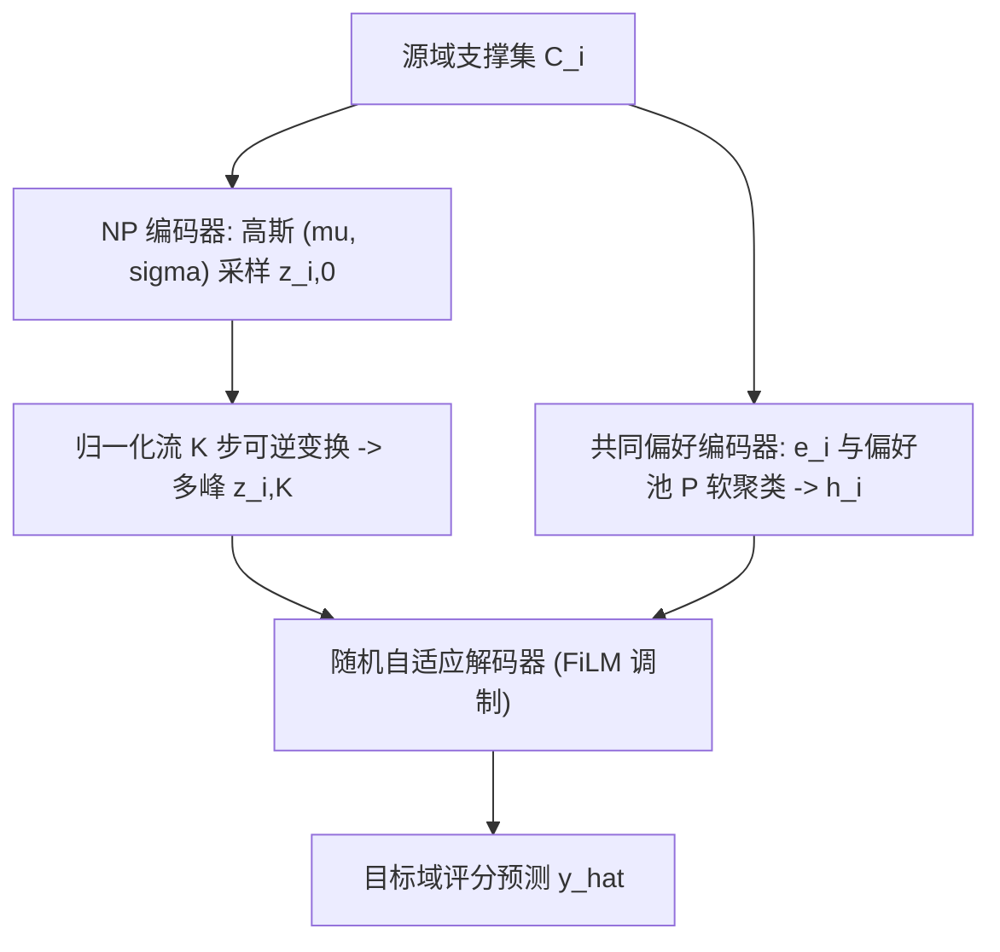
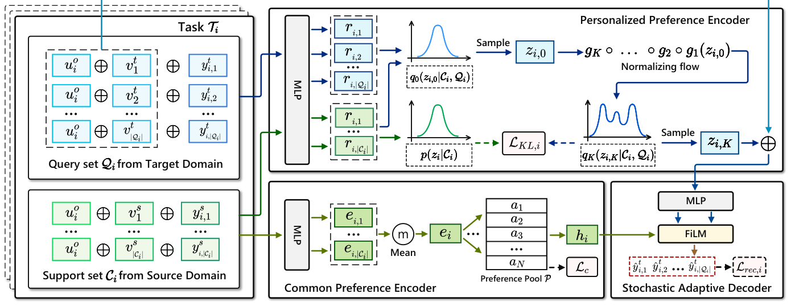

# Personalized Multi-Interest Modeling for Cross-Domain Recommendation to Cold-Start Users (面向冷启动用户跨域推荐的个性化多兴趣建模)

- **会议/期刊**: ICDE 2025
- **作者与机构**: Xiaodong Li, Jiawei Sheng, Jiangxia Cao, Xinghua Zhang, Wenyuan Zhang, Yong Sun, Shirui Pan, Zhihong Tian, Tingwen Liu（中科院信工所、国科大、快手、Griffith University、广州大学）
- **推荐链路定位**: 精排（评分预测）
- **研究方向**: 跨域与多场景推荐 / 冷启动与长尾推荐
- **论文原文**: [https://arxiv.org/abs/2604.25732v1](https://arxiv.org/abs/2604.25732v1)
- **开源代码**: 暂未开源

## TL;DR (1分钟核心速览)

针对跨域冷启动推荐中"EMCDR 共享映射丢失个性化、元学习逐用户建模丢失跨用户共同偏好、且单向量表征无法刻画多兴趣"三大痛点，本文提出 NF-NPCDR：用归一化流（NF）把神经过程（NP）的单峰高斯先验变换为多峰分布以建模个性化多兴趣，用偏好池软聚类捕获跨用户共同偏好，再用 FiLM 式随机自适应解码器融合二者。在 Amazon/Douban 五个跨域场景、20%/50%/80% 冷启动比例下，MAE 相对 SOTA（CDRNP）平均降低约 40%–47%。

## Background & Motivation (背景与核心矛盾)

- **主流范式**: 冷启动 CDR 分两支——EMCDR 系（EMCDR/SSCDR/DCDCSR/CATN/LACDR）学习**用户共享**的源→目标映射函数；元学习系（TMCDR/PTUPCDR/CDRNP）为每个用户学**用户专属**映射函数。
- **前人局限**: 其一，共享映射忽略个性化，元学习映射又逐用户独立建模，**丢弃了不同用户间的共同偏好**（如两用户都爱奇幻书→都爱奇幻电影，可互为信息补充）；其二，两类方法都把用户偏好压成**单一确定性表征**，无法表达多兴趣，导致目标域推荐单一化。
- **核心洞察 (Key Insight)**: NP 天然把用户偏好映射为高斯分布并支持跨域迁移，但高斯是**单峰**的；而 NF 可通过可逆变换把单峰分布"掰"成多峰分布——多峰恰好对应多兴趣，且熵更高、信息更丰富。
- **本文切入点**: 用 NF 增强 NP 得到多峰个性化先验，再叠加一个可学习的偏好池做跨用户软聚类，最后用 FiLM 调制把两路偏好注入解码器。

## Method (核心方法设计)

### 1. 整体框架 (Overall Architecture)

输入为冷启动用户 $u_i$在源域的支撑集$C_i=\{(u_i,v^s_j,y^s_{i,j})\}$与目标域查询集$Q_i$。个性化偏好编码器先用 NP 编码器把$C_i$（及训练期的$Q_i$）编码为高斯参数$(\mu_i,\sigma_i)$并重参数化采样$z_{i,0}$，再经$K$步可逆变换得到多峰隐变量$z_{i,K}$；共同偏好编码器把$C_i$编码为初等表征$e_i$，与偏好池$P$做软聚类得到$h_i$；随机自适应解码器以$h_i$生成 FiLM 调制参数$(\eta^l_i,\delta^l_i)$，逐层调制$[u_i\|v^t_j\|z_{i,K}]$的 MLP 隐层，输出评分$\hat{y}^t_{i,j}$。训练用重叠用户，测试仅用$C_i$ 推断冷启动用户。

<figure class="paper-figure" markdown="span">
  <figcaption>图 3. NF-NPCDR 概览，包括个性化偏好编码器、共同偏好编码器和随机自适应解码器。Ci 和 Ti 均由神经过程编码器编码以生成 p(zi|Ci) 和 q0(zi,0|Ci, Qi)。q0(zi,0|Ci, Qi) 进一步由归一化流编码器转换以生成 qK(zi,K|Ci, Qi)。Ci 由共同偏好编码器编码以生成最终偏好表示 hi。最后，hi 用作 FiLM 的输入，zi,K 与 (uo</figcaption>
</figure>

### 2. 关键设计拆解 (Key Designs)

1. **NF 增强的个性化多兴趣编码器**：痛点在于 NP 的变分后验被假设为对角高斯，单峰无法承载多兴趣。做法是把采样得到的 $z_{i,0}$经$K$步可逆映射$g_k$ 变换，并按变量替换公式修正密度：
$$p_K(z_{i,K}|C_i)=p_0(z_{i,0}|C_i)\prod_{k=1}^{K}\left|\det\frac{\partial g_k}{\partial z_{i,k-1}}\right|^{-1}$$
直觉：可逆变换保持概率质量守恒，但能把单峰"拉伸折叠"为多峰，使 $z_{i,K}$的不同模态对应不同兴趣簇；实验用熵$\text{Entropy}(z_i)$ 验证多峰性（NF 版熵恒高于 w/o NF 版）。

2. **偏好池与共同偏好编码**：痛点在于元学习逐用户建模丢失群体共性。做法是维护 $N$个可训练软聚类中心$P=[a_1,\dots,a_N]$，用 Student's t 分布度量$e_i$与$a_n$的相似度得软分配$c_{in}$，并令$h_i=e_i+Pc_i^\top$；再用辅助分布$D$ 做自训练式 KL 正则：
$$\mathcal{L}_c=\mathrm{KL}(D\|M)=\sum_i\sum_n D_{in}\log\frac{D_{in}}{M_{in}}$$
直觉：$Pc_i^\top$相当于从"兴趣原型库"中检索该用户的共性成分，$\mathcal{L}_c$ 通过锐化高置信分配让池中心收敛为可解释的兴趣簇（可视化显示同看《指环王》的用户被分到同一簇）。

3. **随机自适应解码器与训练目标**：痛点在于两路偏好（随机 $z_{i,K}$与确定$h_i$）量纲与语义不同，简单拼接难以自适应融合。做法借 FiLM：$\eta^l_i=\tanh(\mathrm{MLP}(h_i))$、$\delta^l_i=\tanh(\mathrm{MLP}(h_i))$，逐层$w^{l+1}=\mathrm{ReLU}(\eta^l_i\odot \mathrm{MLP}(w^l)+\delta^l_i)$，即用共同偏好去"门控"个性化表征。总损失为
$$\mathcal{L}=\frac{1}{|\Omega_{tr}|}\sum_{i}\left(\mathcal{L}_{rec,i}+\mathcal{L}_{KL,i}\right)+\lambda\mathcal{L}_c$$
其中 $\mathcal{L}_{rec,i}$为 MSE，$\mathcal{L}_{KL,i}$为 NF 修正后的 KL 项（训练期用$q_K(z_{i,K}|C_i,Q_i)$对齐先验$p(z_{i,K}|C_i)$，测试期无$Q_i$时直接从$p_K(z_{i,K}|C_i)$采样）。**负采样**：本文是评分预测任务，无负采样，直接在查询集候选物品上回归；推理开销为$O(ld^3)+O(Kd)+O(Nd^2)$，全 MLP 架构，参数量仅 11M–38M，显著低于 PTUPCDR（25M–84M）。

## Experimental Setup & Evaluation Protocol (实验设置与评估协议)

- **数据集与预处理**: 过滤交互数 $<5$的用户/物品（5-core），并剔除源域评分$<4$ 的噪声交互；按时间戳构造交互序列防穿越。**使用全量数据**而非子采样。

| 数据集/场景 | #Users(源/目标) | #Overlap | #Items(源/目标) | #Ratings(源/目标) |
| :--- | :---: | :---: | :---: | :---: |
| S1 Movie→Music | 123,960 / 75,258 | 18,031 | 50,052 / 64,443 | 1,697,533 / 1,097,592 |
| S2 Book→Movie | 603,668 / 123,960 | 37,388 | 367,982 / 50,052 | 8,898,041 / 1,697,533 |
| S3 Book→Music | 603,668 / 75,258 | 16,738 | 367,982 / 64,443 | 8,898,041 / 1,097,592 |
| S4 Movie→Book | 2,712 / 2,212 | 2,209 | 34,893 / 95,872 | 1,278,401 / 227,251 |
| S5 Movie→Music | 2,712 / 1,820 | 1,815 | 34,893 / 79,878 | 1,278,401 / 179,847 |

- **数据划分与防穿越 (Splitting Strategy)**: 随机抽取重叠用户的 $20\%/50\%/80\%$作为测试冷启动用户（其目标域评分全部移除），其余为训练用户；源域按时间戳排序构造$C_i$，防止信息泄漏。
- **排名评测协议 (Ranking Protocol)**: 非全库排序，而是**评分预测协议**——对每个测试用户在查询集 $Q_i$ 的候选物品上预测评分，用 **MAE / RMSE** 衡量（越低越好），5 次随机运行取均值。
- **对比基线与超参设置**: 11 个基线，含单域 TGT、共享映射系 CMF/DCDCSR/SSCDR/EMCDR/CATN/LACDR/RecGURU、元学习系 PTUPCDR、多兴趣 REMIT、NP 系 CDRNP。嵌入维度 $d=10$，学习率 0.01，batch 128，MLP 3 层隐层 64；NF 选 Planar flow，步数$K\in\{2,\dots,16\}$（最终 S1 取 6，S2/S3 取 4），$N\in\{10,\dots,60\}$，$\lambda\in[0.1,1.0]$，网格搜索按 MAE 选优。

## Key Experimental Results (实验关键数据)

### 1. 主实验对比 (Main Results)

Amazon 场景（$\alpha=20\%$，MAE/RMSE，完整表见原文 Table III）：

| 方法 | S1 Movie→Music | S2 Book→Movie | S3 Book→Music |
| :--- | :---: | :---: | :---: |
| TGT | 4.4803 / 5.1580 | 4.1831 / 4.7536 | 4.4873 / 5.1672 |
| EMCDR | 1.2350 / 1.5515 | 1.1162 / 1.4120 | 1.3524 / 1.6737 |
| PTUPCDR | 1.1504 / 1.5195 | 0.9970 / 1.3317 | 1.2286 / 1.6085 |
| REMIT | 0.9393 / 1.2709 | 0.8759 / 1.1650 | 1.3749 / 1.9940 |
| CDRNP (SOTA) | 0.7974 / 1.0638 | 0.8846 / 1.1327 | 0.7453 / 0.9914 |
| **NF-NPCDR** | **0.4348 / 0.8146** | **0.4490 / 0.8511** | **0.3894 / 0.7632** |
| Improv. (MAE) | 45.47% | 48.74% | 47.75% |

Douban 场景（$\alpha=20\%$）：

| 方法 | S4 Movie→Book | S5 Movie→Music |
| :--- | :---: | :---: |
| PTUPCDR | 1.6914 / 2.3176 | 1.9116 / 2.5670 |
| REMIT | 1.4628 / 2.0757 | 1.6657 / 2.4962 |
| CDRNP (SOTA) | 0.7350 / 0.9315 | 0.6971 / 0.8937 |
| **NF-NPCDR** | **0.4236 / 0.4861** | **0.4339 / 0.5012** |
| Improv. (MAE) | 42.37% | 37.76% |

### 2. 消融实验 (Ablation Study)

$\alpha=20\%$，指标为 MAE（括号内为相对完整模型的退化幅度）：

| 变体 | S1 | S2 | S3 | S4 | S5 |
| :--- | :---: | :---: | :---: | :---: | :---: |
| **NF-NPCDR (NF+PO+FM)** | **0.4348** | **0.4490** | **0.3894** | **0.4236** | **0.4339** |
| w/o NF | 0.4660 (+7.2%) | 0.4606 (+2.6%) | 0.4132 (+6.1%) | 0.4585 (+8.2%) | 0.4671 (+7.7%) |
| w/o PO | 0.4722 (+8.6%) | 0.4689 (+4.4%) | 0.4127 (+6.0%) | 0.4510 (+6.5%) | 0.4574 (+5.4%) |
| w/o FM | 0.4468 (+2.8%) | 0.4561 (+1.6%) | 0.4009 (+3.0%) | 0.4476 (+5.7%) | 0.4513 (+4.0%) |
| w/o NF,PO,FM | 0.4922 (+13.2%) | 0.4865 (+8.4%) | 0.4304 (+10.5%) | 0.4770 (+12.6%) | 0.4899 (+12.9%) |

### 3. 关键实验发现 (Key Findings)

1. **NF 是最大增益源，且增益随数据稀疏度放大**：去掉 NF 后 S4（Douban 小样本场景）MAE 退化 8.2%，高于 S2 的 2.6%——说明多峰先验在交互稀少时对多兴趣的"补全"作用更关键；熵实验（Fig. 5）进一步证实 NF 版 $\text{Entropy}(z_{i,K})$ 在所有支撑集长度下恒高于 w/o NF 版。
2. **偏好池的共性建模与 NF 互补而非冗余**：单独去 PO 在 S1 退化 8.6%，与去 NF 的 7.2% 量级相当，但二者同时移除退化达 13.2%，说明"个性化多兴趣"与"跨用户共性"是两条正交信息通路；软聚类可视化（Fig. 6）显示同看《指环王》的 $T_2/T_6$被分到相同簇，而无交集用户$T_9/T_{10}$ 分配显著不同。
3. **对重叠用户稀缺极度鲁棒**：在 S1 上，本文用 $\alpha=80\%$（仅 20% 训练用户）仍比 CDRNP 用$\alpha=20\%$（80% 训练用户）MAE 低 42.34%，即"少 4 倍训练数据仍大幅领先"，归因于 NP 的随机过程建模对支撑集长度不敏感（Fig. 4 中性能随$|C_i|$ 从 25 降到 5 几乎不降）。

## Highlights & Limitations (亮点、对比与审稿批判)

- **与代表作对比 (vs. Prior Work)**: 与 PTUPCDR 的本质区别是后者用 meta-network 生成**确定性**用户专属映射，本文用 NP+NF 生成**随机多峰**映射；与 CDRNP 的区别是后者把多用户交互混为一个任务、易受异质偏好噪声干扰，本文严格按用户切分任务并显式迁移个性化偏好；与 REMIT 的区别是后者用多个**确定性**兴趣向量，本文用**概率多峰分布**并额外建模不确定性。
- **可迁移亮点**: (1) "NF 增强 NP 先验"这一插件可迁移到任何用变分隐变量做用户建模的冷启动/少样本推荐；(2) 偏好池 + 辅助分布自训练的软聚类范式，可低成本地为任意用户表征补充群体共性信号。
- **审稿级局限批判**: (1) 任务是**评分预测（MAE/RMSE）**而非 Top-N 排序，未报告 Recall/NDCG，也未做全库排序评估，与主流推荐评测口径存在差距；(2) 训练时间显著高于 CDRNP（S2 上 364.6s vs 98.5s，约 3.7 倍），且 NF 步数 $K$与$\lambda$、$N$需按场景网格搜索，超参敏感度虽被作者称为"鲁棒"，但跨场景最优值差异明显（$K=6$vs$K=4$），工程调参成本不低。

## Rating (四维评分)

- **方法创新性 (Novelty)**: ⭐⭐⭐⭐ （NF+NP 统一用于 CDR 多兴趣建模属首次，多峰先验的物理解释清晰且有熵与案例双重佐证）
- **评估协议与实验扎实度 (Protocol & Experiments)**: ⭐⭐⭐ （五场景 + 三档冷启动比例 + 11 基线较充分，但仅 MAE/RMSE 评分预测、缺 Top-N 排序与显著性检验）
- **写作与数学规范度 (Clarity & Rigor)**: ⭐⭐⭐⭐ （ELBO 经 NF 修正的推导完整，复杂度分析到位；但符号表与正文部分记号略冗余）
- **工业落地与复现价值 (Industrial & Practical Value)**: ⭐⭐⭐ （全 MLP 架构、参数量与显存均低于基线，易部署；但未开源、训练耗时偏高、超参需分场景调）

