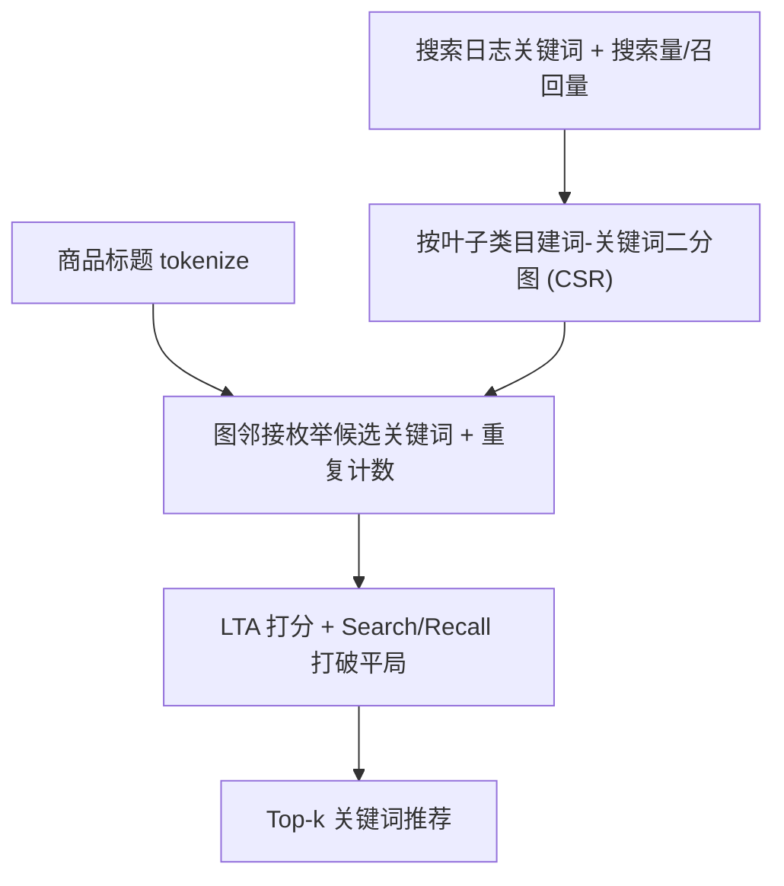

# GraphEx: A Graph-based Extraction Method for Advertiser Keyphrase Recommendation (基于图的广告主关键词推荐抽取方法)

- **会议/期刊**: IEEE ICDE 2025
- **作者与机构**: Ashirbad Mishra, Kamesh Madduri (Penn State) 等；Soumik Dey, Hansi Wu, Jinyu Zhao, He Yu, Kaichen Ni, Binbin Li (eBay Advertising)
- **推荐链路定位**: 召回（广告关键词召回/竞价词推荐）
- **研究方向**: CTR预估与特征交叉 / 去偏公平与工业架构
- **论文原文**: [https://arxiv.org/abs/2409.03140v4](https://arxiv.org/abs/2409.03140v4)
- **开源代码**: 暂未开源

## TL;DR (1分钟核心速览)

电商广告需为商品推荐竞价关键词，主流 XMC 打标范式依赖点击日志，受曝光/流行度偏差与标签稀疏（96% 商品无点击）困扰，且偏向长尾词、无法覆盖冷启商品。GraphEx 将问题重构为「标题 token 排列抽取」：按叶子类目构建「词—关键词」二分图，推理时用标题词枚举候选、以 Label-Title Alignment (LTA) 排序，完全解耦点击数据。在 eBay 三个真实类目上，GraphEx 的相关头部词占比与独占多样性全面领先，线上带来 8.3% 广告收入与 10.3% GMB 增量，CPU 单条推理 <1ms。

## Background & Motivation (背景与核心矛盾)

- **主流范式**: 关键词推荐被建模为极端多标签分类 (XMC)，用搜索日志中的 item-query 点击关联作训练标签，代表工作有 fastText、Graphite、SL-emb 及规则式 RE/SL-query。
- **前人局限**: ① 点击数据存在曝光偏差与流行度偏差，且 90% 有点击商品仅关联 1 个 query，标签极度稀疏，XMC 模型被迫偏向数量庞大的长尾词，在预算@k（每 adgroup 1000 词）下挤掉高价值头部词；② 训练/评估同源点击数据导致模型收敛到相似标签子集，多样性丧失，且与 100% 召回的 RE 去重后增量被吞没。
- **核心洞察 (Key Insight)**: 关键词的价值应由「买家真实搜索量」而非「历史点击」决定；商品标题的 token 本身已蕴含足够信息，只要把标题词排列约束到「真实存在的搜索词集合」内，即可在无监督、无点击依赖下产出高相关且偏头部的结果。
- **本文切入点**: 用叶子类目内的「词—关键词」二分图替代分类器，把 $O(l!)$的排列爆炸压缩为$O(|T|\cdot d_{avg})$ 的图邻接枚举。

## Method (核心方法设计)

### 1. 整体框架 (Overall Architecture)

GraphEx 分构建与推理两阶段。构建阶段：从搜索日志聚合关键词，仅保留高搜索量（头部）词并按叶子类目分组，对每个叶子类目 $l$建二分图$G_l(X,Y,E)$，$X$为关键词去重后的词表、$Y$为该类目关键词集合，词$x$与包含它的关键词$y$连边，图以 CSR 格式存储，关键词的 Search Count$S(l)$与 Recall Count$R(l)$存于独立数组。推理阶段：给定商品标题$T$与其叶子类目，$O(1)$ 哈希取图，枚举标题词的所有邻接关键词并计数去重，再用 LTA 打分排序输出 Top-k。全流程无参数训练、无 GPU。

### 2. 关键设计拆解 (Key Designs)

1. **二分图排列抽取（替代 XMC 打标）**：痛点是把标题映射到标签需遍历海量标签空间且受点击偏差污染。GraphEx 令 $X=\bigcup_{k_i\in Q_l}\{w\}$、$Y=Q_l$，边$(x,y)\in E$当且仅当$x\subset y$。推理时对标题每个词取邻接关键词，重复计数$c=|T\cap l|$ 即标题与该关键词的共现词数。由于只生成「图中真实存在的关键词」，排列空间被关键词表天然剪枝，既保证 100% in-vocabulary 精确匹配（广告竞价要求精确匹配 query），又彻底绕开点击标签。

2. **Label-Title Alignment (LTA) 排序函数**：痛点在于候选词需在预算内优先高相关、低风险者。定义
$$\mathrm{LTA}(l,c)=\frac{c}{|l|-c+1}$$
其中 $|l|$为关键词词数。与 Jaccard（分母含$|T|$）和 WMR（$c/|l|$）不同，LTA 对「关键词中存在但标题中缺失的词」施加更强惩罚：例如标题 10 词时，"A B C" 得$3/1=3$，"A B C D E" 得$4/2=2$，前者胜出。直觉是多出的 token（如 "E"）可能改变商品品类，属于高风险错配，LTA 通过$|l|-c+1$放大惩罚项抑制之。平局时优先高$S(l)$、低$R(l)$——高搜索量带来点击，低召回量意味着竞争商品少、单商品点击概率高。

3. **训练目标、负采样与推理效率**：GraphEx 无损失函数、无负采样、无梯度更新，构建即「训练」。推理复杂度 $O(|T|\cdot d_{avg})$，其中$d_{avg}=|E|/|X|$；枚举后按重复计数分组剪枝至 10–20 个候选，使排序列表长度近似常数，不贡献渐近复杂度。空间为 CSR 的$O(|X|+|E|)$，词与关键词均以无符号整数表示，字符串比较降为$O(1)$ 整数比较。

## Experimental Setup & Evaluation Protocol (实验设置与评估协议)

- **数据集与预处理**: eBay 三个真实 meta category（大/中/小），GraphEx 仅用 6 个月搜索日志且过滤日均搜索 <1 次的关键词；XMC 基线用 1 年点击日志。

| 数据集 | #Items | #Keyphrases (XMC) | #GraphEx Keyphrases | 场景说明 |
| :--- | :---: | :---: | :---: | :--- |
| CAT 1 (大) | 200 M | 3.6 M | 115 K | 头部类目，商品量最大 |
| CAT 2 (中) | 14 M | 0.83 M | 252 K | 中等类目 |
| CAT 3 (小) | 7 M | 0.46 M | 47 K | 小类目，交互稀疏 |

- **数据划分与防穿越 (Splitting Strategy)**: 测试集为在线活跃商品采样（CAT1/2/3 分别 1000/400/200 件）；关键词搜索量统计窗口取与训练期不重叠的 15 天，避免训练期曝光带来的评估泄漏。
- **排名评测协议 (Ranking Protocol)**: 因点击标签稀疏且 MNAR，放弃 Precision/Recall 主评，改用 LLM（Mixtral 8x7B，与人工判断对齐 >90%）逐条判定相关性，并定义 Relevant Proportion (RP)、Head Proportion (HP)（头部阈值取类目搜索量 90 分位）、跨模型 Relative Relevant/Head Ratio (RRR/RHR) 及独占多样性指标；每模型最多输出 40 词。
- **对比基线与超参设置**: 对比 fastText、Graphite、SL-emb（XMC/稠密检索）与 RE、SL-query（规则式）；GraphEx 无超参训练，仅搜索量阈值（90 vs 180）需调。

## Key Experimental Results (实验关键数据)

### 1. 主实验对比 (Main Results)

| 模型 | RP (CAT1/2/3) | HP (CAT1/2/3) | RRR (CAT1/2/3) | RHR (CAT1/2/3) |
| :--- | :---: | :---: | :---: | :---: |
| fastText | 13.1 / 28.4 / 43.4 | 11.3 / 14.6 / 14.9 | 0.31 / 0.51 / 1.25 | 0.55 / 0.61 / 1.24 |
| SL-emb | 25.9 / 32.1 / 37.4 | 3.99 / 5.35 / 5.56 | 0.59 / 0.38 / 0.65 | 0.19 / 0.15 / 0.28 |
| SL-query | 31.6 / 31.9 / 35.2 | 4.86 / 5.41 / 6.91 | 0.33 / 0.19 / 0.33 | 0.11 / 0.07 / 0.19 |
| Graphite | 37.9 / 48.1 / 55.1 | 12.5 / 19.6 / 16.2 | 0.44 / 0.28 / 0.50 | 0.31 / 0.26 / 0.43 |
| RE | **63.7 / 72.8 / 75.5** | 18.7 / **24.7 / 31.2** | 0.95 / 0.88 / 0.81 | 0.59 / 0.69 / 0.97 |
| **GraphEx** | 56.4 / 51.1 / 44.4 | **26.5** / 21.9 / 15.27 | **1.00** | **1.00** |

独占多样性（相对 GraphEx 的独占相关头部词倍数，越高说明 GraphEx 越独特）：vs SL-query 达 **8.72×/12.2×/3.82×**，vs SL-emb 5.07×/5.63×/1.87×，vs Graphite 3.06×/3.26×/1.44×，vs RE 1.57×/1.57×/1.11×。

### 2. 消融实验 (Ablation Study)

| 配置 | CAT1 RP | CAT2 RP | CAT3 RP | 说明 |
| :--- | :---: | :---: | :---: | :--- |
| WMR 对齐 | 33.6 | 40.8 | 42.6 | 仅按匹配比例 |
| JAC 对齐 | 44.5 | 40.8 | 55.0 | 分母含标题长度 |
| **LTA 对齐** | **45.8** | **40.8** | **56.0** | 惩罚多余 token |
| 搜索量阈值 90 | 12.2 (相关) | — | — | 头部词仅 0.43% |
| 搜索量阈值 180 | 10.1 (相关) | — | — | 头部词升至 **5.64%** |

### 3. 关键实验发现 (Key Findings)

1. **LTA 的惩罚项是相关性主来源**：在 1.1 亿商品规模实验中，LTA 较 JAC 在 RP 上稳定高出约 5 个百分点（CAT1 45.8 vs 44.5，CAT3 56.0 vs 55.0），验证「抑制关键词中标题未覆盖 token」比单纯提高匹配比例更有效。
2. **搜索量阈值是头部词产出的杠杆**：阈值从 90 提到 180 时，独占相关词占比从 12.2% 降至 10.1%（仅 -2.1pt），但独占相关头部词从 0.43% 跃升至 5.64%（13 倍），说明高阈值以极小相关性代价换取头部词质量，直接对应广告收入。
3. **低 Precision/Recall 反而是优势**：GraphEx 相对 RE 的 Precision/Recall 最低（表 V 中 SL-emb 召回为 GraphEx 的 4.01 倍），意味着与 100% 召回的 RE 去重损耗最小，独占增量最大——这正是线上 8.3% 收入提升的机制来源；同时推理较 fastText/Graphite 在 CAT1 上快 17×/13×，2 亿商品批量推理仅 1.5 小时（对比 1.75/1.5 天）。

## Highlights & Limitations (亮点、对比与审稿批判)

- **与代表作对比 (vs. Prior Work)**: 与 Graphite 同属图方法，但 Graphite 仍是「词→数据点→标签」的 XMC 打标、依赖点击标签，GraphEx 直接「词→关键词」抽取并解耦点击；与 SL-emb 的稠密检索相比，GraphEx 保证 100% in-vocabulary 精确匹配且无需 GPU/ANN；与 RE 这类 100% 召回规则相比，GraphEx 覆盖冷启商品（item 覆盖 >3×）且独占多样性高一个量级。
- **可迁移亮点**: ①「用图邻接枚举替代生成式排列」的剪枝思路可迁移到任意受限于封闭词表的短语召回任务；②用 LLM 批量判定相关性替代稀疏点击标签做离线评估，是工业界低成本构建无偏评测的实用范式。
- **审稿级局限批判**: ① 评估完全依赖 LLM 判定且无公开数据集，跨平台可复现性弱，LLM 判定的系统性偏好未被量化；② 方法受限于预构建关键词表，无法推荐表外新词（OOV），对 2%/天 的 query churn 只能靠每日重建图缓解，且小类目（CAT3）上已被 fastText 反超，类目规模敏感性缺乏理论刻画。

## Rating (四维评分)

- **方法创新性 (Novelty)**: ⭐⭐⭐⭐ （把 XMC 打标重构为图上的受限排列抽取，思路简洁且有明确的问题驱动，但本质是图检索+启发式排序，理论深度有限）
- **评估协议与实验扎实度 (Protocol & Experiments)**: ⭐⭐⭐⭐ （三个真实规模类目 + LLM 评估 + 独占多样性 + 线上 A/B，工业证据充分；但缺公开数据集与人工标注的细粒度一致性分析）
- **写作与数学规范度 (Clarity & Rigor)**: ⭐⭐⭐⭐ （LTA 设计与复杂度分析交代清楚，动机—挑战—方案的叙事链完整；部分指标定义与表格口径需交叉阅读才能对齐）
- **工业落地与复现价值 (Industrial & Practical Value)**: ⭐⭐⭐⭐⭐ （CPU 毫秒级、无 GPU、构建 <1 分钟、支持每日刷新，已在 eBay 上线并带来 8.3% 收入增量，落地价值极高；可惜未开源）

