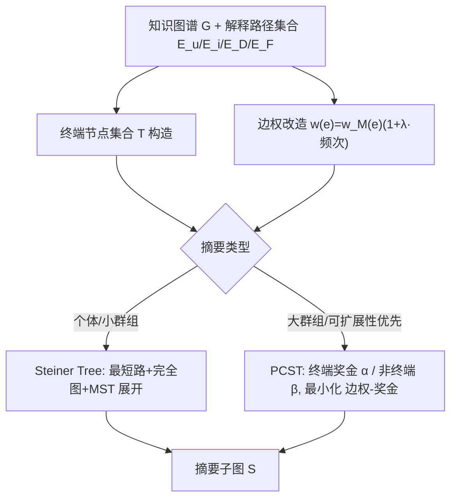
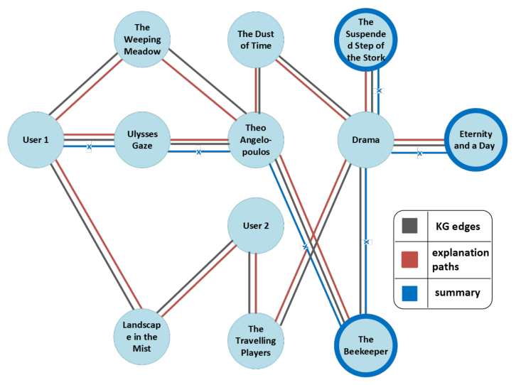

# Path-based summary explanations for graph recommenders (extended version)（图推荐器的路径式摘要解释）

- **会议/期刊**: IEEE ICDE 2025（extended version, arXiv:2410.22020v2）
- **作者与机构**: Danae Pla Karidi (Archimedes/Athena RC)、Evaggelia Pitoura (University of Ioannina & Archimedes/Athena RC)
- **推荐链路定位**: 推荐后处理 / 解释层（不改变推荐结果，只对已生成的解释路径做摘要压缩）
- **研究方向**: 图神经网络与知识图谱推荐 / 去偏公平与可信推荐
- **论文原文**: [https://arxiv.org/abs/2410.22020v2](https://arxiv.org/abs/2410.22020v2)
- **开源代码**: [https://github.com/xsum-rec/xsum](https://github.com/xsum-rec/xsum)

## TL;DR (1分钟核心速览)

现有基于知识图谱的路径解释（PGPR/CAFE/PLM/PEARLM）只解释"单个物品为何推荐给单个用户"，当用户收到 top-10 推荐时需阅读 10 条独立 3-hop 路径，信息过载且大量节点重复。本文首次提出**摘要解释 (summary explanation)**：把多条解释路径聚合为知识图谱上的一个连通子图，并用 **Steiner Tree (ST)** 与 **Prize-Collecting Steiner Tree (PCST)** 两个图算法在"边数最小化 vs. 权重最大化"之间求解。在 ML1M+LFM1M 上，ST 在可理解性（解释长度从 13 边压到 6 边）与相关性上领先，PCST 在多样性、隐私与大规模群组可扩展性上占优；30 人用户研究中 **78.67%** 的参与者更偏好摘要子图解释。

## Background & Motivation (背景与核心矛盾)

- **主流范式**: 图推荐器（PGPR 强化学习寻路、CAFE 粗到细符号推理、PLM/PEARLM 语言模型生成路径）以"用户 $\to$中间实体$\to$ 推荐物品"的路径作为内在可解释性载体，是精度与解释质量的双料 SOTA。
- **前人局限一（粒度错配）**: 所有工作都停留在**单条推荐的单条解释**，而用户真正想要的是"系统整体为什么这样对我"；top-10 推荐意味着 10 条互不相关的路径，用户被迫自行做心智聚合。
- **前人局限二（冗余爆炸）**: 固定 3-hop 路径在物品/实体上高度重叠（同一导演、同一类型反复出现），既拉长解释又稀释关键信息；通用图摘要方法（超节点聚类、边合并）又会抹掉解释所依赖的局部路径结构。
- **核心洞察 (Key Insight)**: 多条解释路径的**共享节点**（如反复出现的 "Theo Angelopoulos"、"Drama"）恰恰就是推荐的核心原因；因此"摘要"不应是文本摘要，而应是**图论意义上的最小连通子图**——把推荐物品作为终端节点，用最少的边把它们连起来，共享节点自然被保留、冗余分支自然被剪掉。
- **本文切入点**: 将解释摘要形式化为 Steiner Tree 问题，并给出 PCST 变体以应对群组场景下终端节点数激增的可扩展性瓶颈。

## Method (核心方法设计)

### 1. 整体框架 (Overall Architecture)

输入是知识图谱 $G=(V,E,w)$（用户-物品交互边 + DBpedia 外部实体边）以及任意路径解释器输出的解释路径集合（user-centric 用$E_u$、item-centric 用$E_i$、user-group 用$E_D$、item-group 用$E_F$）。核心模块把"终端节点集合$T$"（用户/物品/群组 + 被推荐物品）与"路径频次加权后的边权"一起送入 ST 或 PCST 求解器，输出一个弱连通子图$S=(V_S,E_S)$ 作为摘要解释。ST 走"全终端必连"路线，PCST 走"给终端发奖金、允许放弃低价值终端"路线，二者共享同一套边权改造与终端定义，仅求解目标不同。

<figure class="paper-figure" markdown="span">
  <figcaption>图 1：总结性说明</figcaption>
</figure>

### 2. 关键设计拆解 (Key Designs)

1. **路径频次感知的边权改造（让摘要"总结"而非"重造"解释）**：若直接用交互矩阵原始权重 $w_M$，ST 会绕开原解释路径另辟蹊径，产出的是"新解释"而非"原解释的摘要"。本文用$\lambda$ 把边在解释路径中出现的频次注入权重：

$$w(e)=w_M(e)\left(1+\lambda\cdot\frac{\sum_{x\in S}\mathbb{I}_{e\in P}}{|S|}\right)$$

其中 $P$为对应场景的解释路径集合、$S$为终端物品/用户集合。$\lambda=0$退化为"重造解释"，$\lambda$越大越忠实于原始路径；实验取$\lambda\in\{0.01,1,100\}$ 覆盖低/中/高影响。直觉：共享边被反复加权后成为最短路上的"引力中心"，MST 自然把它们保留下来。

2. **ST 摘要（可理解性优先）**：目标是找弱连通子图使 $|E_S|$最小、$\sum_{e\in E_S}w(e)$最大，且终端$T\subseteq V_S$。做法是把权重取负转成标准 Steiner 最小化，再用经典 2-近似：先算终端两两最短路构造完全图$G_c$，求$G_c$的 MST，再把 MST 每条边替换回原图最短路。复杂度$O(|T|(|E|+|V|\log|V|))$，近似比$\le 2$。因为所有终端被强制连成一棵树，摘要天然紧凑——这正是可理解性与低冗余的来源。

3. **PCST 摘要（可扩展性优先）与训练/推理开销**：群组场景下 $|T|$随群规模线性膨胀，ST 的$|T|$依赖使其迅速失速。PCST 放松连通约束：终端奖金$p(v)=\alpha=\max w(e)$、非终端$p(v)=\beta=\min w(e)$，最小化

$$C(S)=\sum_{e\in E_S}w'(e)-\sum_{v\in V_S}p(v)$$

即"连一个终端的边成本 vs. 放弃它的奖金损失"之间的权衡，用 2-近似算法在 $O((|V|+|E|)\log|V|)$内求解，**与$|T|$无关**。实践中发现带边权的 PCST 会产出过大摘要，故 PCST 实际忽略边权、仅用$p(v)\in\{1,0\}$ 的二值奖金。整个方法**无需训练、无负采样**，是纯推理期的图算法后处理，单次摘要开销为秒级（见性能实验）。

## Experimental Setup & Evaluation Protocol (实验设置与评估协议)

- **数据集与预处理**: ML1M 交互 + DBpedia 知识图谱融合；LFM1M 作为补充验证集。

| 数据集 | #Users | #Items | #External | #Edges | 稀疏度/密度 | 说明 |
| :--- | :---: | :---: | :---: | :---: | :---: | :--- |
| ML1M-KG | 6,040 | 3,883 | 10,820 | 1,125,631 | 密度 0.0057 | 平均度 113.45，平均路径长 3.20，直径 6.0 |
| LFM1M-KG | 4,817 | 12,492 | 17,491 | 1,091,274 | — | 音乐域，用户-歌曲交互 |
| Synthetic G1–G5 | 3,043–9,131 | 1,956–5,870 | 5,452–16,357 | 0.56M–1.68M | — | 节点 1万–3万，测可扩展性 |

- **数据划分与防穿越 (Splitting Strategy)**: 本文不训练推荐模型，而是**复用** PGPR/CAFE/PLM/PEARLM 已产出的解释路径；采样 200 用户（100 男 100 女，保持原评分分布）、100 物品（50 最热 + 50 最冷），对每个用户取 top-$k$（$k=1\ldots10$）推荐、每条路径最长 3 跳。
- **排名评测协议 (Ranking Protocol)**: 非排序类评测，而是**解释质量多指标评测**：可理解性 $C(S)=1/|E_S|$、可操作性$A(S)=|I\cap V_S|/|V_S|$、多样性（边对 Jaccard 相似度的补）、冗余度（重复节点占比）、一致性（$S_k$与$S_{k+1}$的 Jaccard）、相关性$\sum_{e\in E_S}w_M(e)$、隐私$1-|U\cap V_S|/|V_S|$，外加执行时间/内存的性能指标。
- **对比基线与超参设置**: 基线为原始路径解释 PGPR、CAFE（主实验）与 PLM、PEARLM（补充），以及"不摘要的路径并集"；ST 取 $\lambda\in\{0.01,1,100\}$，PCST 取二值奖金；按前人设置$w_A=0$、$\beta_2=0$（另做 recency 敏感性实验）。用户研究 30 人（ML 相关本硕博），5 组随机顺序配对比较 + 7 项指标 1–5 分打分。

## Key Experimental Results (实验关键数据)

### 1. 主实验对比 (Main Results)

以 ML1M + PGPR 路径、user-centric 场景 $k=10$ 为代表（数值为各指标相对表现的方向性汇总，原文以图 2–图 9 呈现）：

| 方法 | 可理解性 $C(S)$| 可操作性$A(S)$| 多样性$D(S)$| 冗余度$R(S)$| 相关性$R(S)$| 隐私$P(S)$ | 执行时间 |
| :--- | :---: | :---: | :---: | :---: | :---: | :---: | :---: |
| PGPR 原始路径 | 低（10×3 跳） | 高且稳定 | **最低** | 高 | **最高**（user-centric） | 中 | 基准 |
| CAFE 原始路径 | 低 | 高且稳定 | 低 | 高 | 高 | 中 | 基准 |
| ST ($\lambda=0.01$) | 高 | 中 | 中 | **最低** | 中 | 低 | 中 |
| ST ($\lambda=100$) | **最高** | **最高** | 中 | **最低** | 高（随$\lambda$ 上升） | 低 | 中 |
| PCST | 中（优于基线，逊于 ST） | 最低 | **最高** | 低（略高于 ST） | 高（大子图聚合权重） | **最高** | **最低** |

**用户研究**：78.67% 参与者偏好摘要子图；指标有用性评分：可理解性 **4.52** > 多样性 **4.45** > 相关性 **4.38** > 冗余度 **4.14** > 可操作性 3.79 > 一致性 3.72 > 隐私 3.69。

### 2. 消融实验 (Ablation Study)

| 配置 | 可理解性 | 多样性 | 隐私 | 可扩展性 | 说明 |
| :--- | :---: | :---: | :---: | :---: | :--- |
| ST, $\lambda=0$ | 退化为"重造解释" | — | — | — | 频次项失效，不再忠实于原路径 |
| ST, $\lambda=0.01/1/100$| 单调上升 | 基本持平 | 下降 | 不变 |$\lambda$ 控制忠实度-紧凑度权衡 |
| PCST 带边权 | 差（摘要过大） | — | — | 差 | 预实验失败，故弃用边权 |
| PCST 二值奖金 | 中 | 高 | 高 | **最优** | 最终采用配置 |
| ST vs. PCST 群规模扫描 | ST 随群增大迅速劣化 | — | — | PCST 近似平坦 | $|T|$ 依赖是分水岭 |
| 合成图 G1→G5 | — | — | — | ST 时间陡增，PCST 缓增 | 与 ML1M 结论一致 |

### 3. 关键实验发现 (Key Findings)

1. **ST 的"强制连通"是双刃剑**：它把 13 条边压到 6 条边、冗余度全场最低、可理解性最高，但代价是必须把用户节点纳入树中（唯一带权边是用户-物品边），导致隐私指标反而**低于**不摘要的基线；PCST 因倾向物品与外部实体，隐私全场最高。
2. **$\lambda$是"忠实 vs. 紧凑"的旋钮，且与 recency 存在耦合**：$\lambda$ 增大时相关性单调上升（更多高权交互边被纳入）；而 recency 实验显示评分权重主导时摘要更短更可理解、recency 权重主导时多样性更高——说明摘要形态可被业务目标显式调控。
3. **可扩展性的分水岭是 $|T|$而非$|V|$**：群规模从 100 继续增大时 ST 执行时间快速上升，PCST 因复杂度与$|T|$ 无关而近似平坦；在 3 万节点合成图上 PCST 的增速显著慢于 ST，这直接决定了群组摘要应默认走 PCST。
4. **公平性副产品**：初步实验显示基线对冷门物品的可理解性显著差于热门物品，而本文摘要方法未表现出该流行度偏差，提示摘要化可能顺带缓解解释层的流行度偏置。

## Highlights & Limitations (亮点、对比与审稿批判)

- **与代表作对比 (vs. Prior Work)**: 与 PGPR/CAFE 的本质区别是**问题层级不同**——它们解决"如何找到一条好路径"，本文解决"如何把多条路径压成一个可读子图"，因此可与任意路径解释器正交组合（实验已覆盖 4 种）。与通用图摘要（超节点聚类、边合并、中心性+Steiner）的区别是：本文把**推荐物品显式设为终端**并用路径频次改造边权，保证摘要忠实于原解释而非重造结构。
- **可迁移亮点**: (1) "把解释集合的共享节点当作核心原因"这一图论视角可直接迁移到多模态/序列推荐的事后解释聚合；(2) PCST 的"终端奖金 vs. 边成本"权衡范式可用于任意需要"必选集合 + 成本约束"的子图抽取任务（如证据子图、溯源图）。
- **审稿级局限批判**: (1) **评估以图指标为主**，除 30 人小样本用户研究外缺乏大规模在线验证，且 7 项指标间存在此消彼长（ST 赢可理解性、PCST 赢隐私），论文未给出统一加权或帕累托前沿分析；(2) **摘要质量强依赖上游路径质量**，若解释器本身不忠实，摘要只会把错误结构化地放大；此外 PCST 弃用边权、ST 隐私偏低均为工程妥协，缺少对奖金分配策略（如按中心性赋奖）的系统探索。

## Rating (四维评分)

- **方法创新性 (Novelty)**: ⭐⭐⭐⭐ （首次把"解释摘要"形式化为 Steiner/PCST 子图问题，问题定义本身即贡献，但算法为经典图算法的直接套用，理论增量有限）
- **评估协议与实验扎实度 (Protocol & Experiments)**: ⭐⭐⭐⭐ （7 维指标 + 4 种上游解释器 + 2 真实数据集 + 合成图可扩展性 + 用户研究，覆盖面广；扣分在于缺大规模在线 A/B 与指标间权衡分析）
- **写作与数学规范度 (Clarity & Rigor)**: ⭐⭐⭐⭐ （四类摘要场景定义清晰、两算法伪代码与复杂度/近似比交代完整；但主实验以图呈现、缺紧凑数值表，跨方法比较需读者自行读图）
- **工业落地与复现价值 (Industrial & Practical Value)**: ⭐⭐⭐⭐ （纯推理期后处理、无需训练、代码开源、PCST 与 $|T|$ 无关易扩展；扣分在于 ST 隐私短板与对上游路径质量的强依赖）

