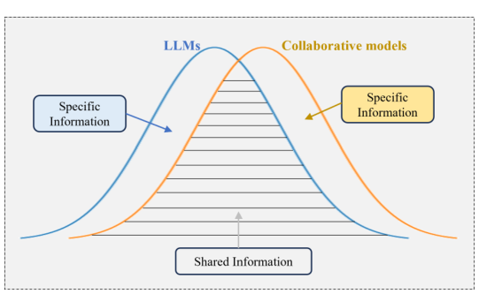
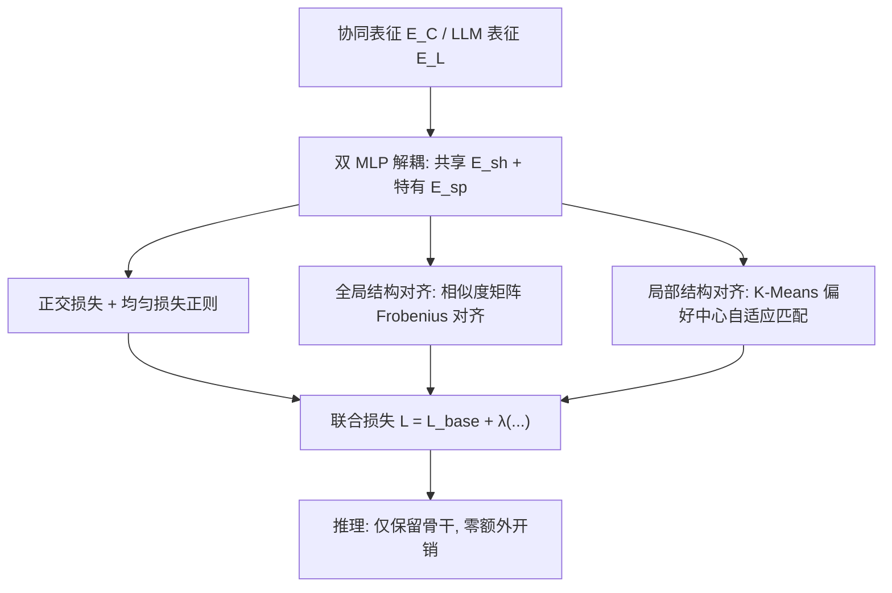
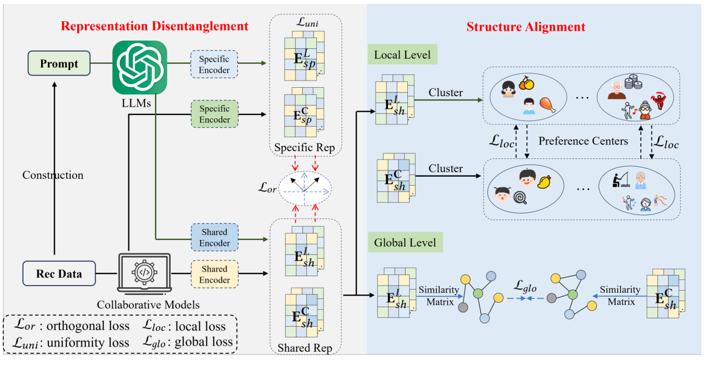

# DaRec: A Disentangled Alignment Framework for Large Language Model and Recommender System (面向大语言模型与推荐系统的解耦对齐框架)

- **会议/期刊**: ICDE 2025
- **作者与机构**: Xihong Yang, Heming Jing, Zixing Zhang, Jindong Wang, Huakang Niu, Shuaiqiang Wang, Yu Lu, Junfeng Wang, Dawei Yin, Xinwang Liu, En Zhu, Defu Lian, Erxue Min（国防科技大学、百度、中国科学技术大学）
- **推荐链路定位**: 召回（协同过滤表征增强，即插即用）
- **研究方向**: 大语言模型推荐 / 自监督对比与去噪
- **论文原文**: [https://arxiv.org/abs/2408.08231v2](https://arxiv.org/abs/2408.08231v2)
- **开源代码**: 暂未开源

## TL;DR (1分钟核心速览)

现有 LLM4Rec 蒸馏工作（如 RLMRec）用对比学习把 LLM 语义表征与协同模型表征直接拉近，本文从互信息角度证明：当两模态信息间隙 $\Delta_p$较大时，**零间隙精确对齐反而给下游推荐误差设下$\Delta_p$的下界**。为此提出即插即用的 DaRec：先将两侧表征解耦为共享/特有分量（正交+均匀正则），再在共享分量上做全局相似度矩阵对齐与局部偏好中心对齐。在 Amazon-book/Yelp/Steam 三个数据集、全库排序协议下，套在 6 个骨干上 Recall@20 最高相对提升 5.33%，且全部指标$p<0.05$ 显著。

## Background & Motivation (背景与核心矛盾)

- **主流范式**: 用 GPT-3.5 生成用户/物品画像文本并编码为语义向量，再以对比学习（RLMRec-Con/Gen、KAR）将其与 LightGCN 类协同表征对齐，把 LLM 知识蒸馏进轻量推荐模型。
- **前人局限**: 其一，协同模型吃的是交互 ID 数据、LLM 吃的是自然语言，两者输入分布与训练目标天然异构，直接对齐会把各自"特有信息"中的噪声互相注入；其二，对比学习只做实例级拉近，忽略了表征空间的**结构**（全局成对关系与局部兴趣簇）一致性。
- **核心洞察 (Key Insight)**: 定义信息间隙 $\Delta_p=|I(D;Y)-I(D';Y)|$，证明若强行令$E_C=E_L$，则最优推荐误差比用原始输入时可达到的误差至少高出$\Delta_p$——**精确对齐是有代价的**，间隙越大代价越高。
- **本文切入点**: 不做"全对齐"，而是"解耦后只对齐共享部分"，把对齐从点级松弛为结构级。

<figure class="paper-figure" markdown="span">
  <figcaption>图 1：LLMs 与协同模型之间信息差距的示意图。各方面特定信息中的噪声信号阻碍了共享信息的对齐，导致表示质量下降。</figcaption>
</figure>
图 1：LLM 与协同模型间的信息间隙示意——各方面特有信息中的噪声阻碍共享信息对齐，导致表征质量下降。

## Method (核心方法设计)

### 1. 整体框架 (Overall Architecture)

输入为协同模型（任意 CF 骨干，如 LightGCN/SGL/SimGCL/DCCF/AutoCF）输出的 $E_C$与 LLM（GPT-3.5 + text-embedding-ada-002）对 prompt 编码得到的$E_L$。两侧各经两个独立 MLP 编码器拆成共享分量$E_{sh}$与特有分量$E_{sp}$；正交损失保证两分量互补、均匀损失保证特有分量不退化为噪声；随后**仅用共享分量**做全局（相似度矩阵）与局部（K-Means 偏好中心）两级结构对齐；总损失与骨干原损失加权联合训练，推理时丢弃全部对齐分支，只保留骨干网络，故零额外在线开销。

<figure class="paper-figure" markdown="span">
  <figcaption>图 2：我们提出的解耦对齐策略示意图。在我们的方法中，我们首先使用两个独立的编码器将表示解耦为共享和特定组件，并引入正交损失和均匀性损失以保证表示具有信息量。然后，基于共享表示，我们在全局和局部层面设计了结构对齐策略，以增强从 LLMs 到协同模型的语义知识迁移。</figcaption>
</figure>
图 2：DaRec 解耦对齐策略总览——先解耦为共享/特有分量并以正交、均匀损失保证信息量，再在共享分量上做全局与局部结构对齐。

### 2. 关键设计拆解 (Key Designs)

1. **表征解耦与双重正则**：痛点是对齐会引入互扰噪声。用 $E^{C}_{sh}=f^C_{sh}(E_C)$、$E^{C}_{sp}=f^C_{sp}(E_C)$（LLM 侧同理）拆分后，正交损失$\mathcal{L}_{or}=\frac{1}{N}\sum_i (S(E_{sp,i},E_{sh,i}))^2$强制两分量余弦正交，均匀损失$\mathcal{L}_{uni}=\log\mathbb{E}_{x,y\sim E_{sp}}e^{-2\|G(x)-G(y)\|^2}$ 把特有分量摊开在超球面上。直觉：正交保证"共享的不重复、特有的不越界"，均匀保证特有分量承载的是可区分的信息而非坍缩噪声。

2. **全局+局部结构对齐**：痛点是对比学习只对齐点、丢失流形结构。全局层面对共享分量算相似度矩阵 $S^G_C=E^C_{sh}(E^C_{sh})^\top$、$S^G_L=E^L_{sh}(E^L_{sh})^\top$，以$\mathcal{L}_{glo}=\|S^G_C-S^G_L\|_F^2$对齐全部成对关系；局部层面用 K-Means 得偏好中心$C_C,C_L\in\mathbb{R}^{K\times d}$，先按欧氏距离升序做**自适应中心匹配**（贪心配对，解决无标签下中心错位），再以$\mathcal{L}_{loc}=\frac{1}{K}\sum_i(S^C_{ii}-1)^2+\frac{1}{K^2-K}\sum_{i\neq j}(S^C_{ij})^2$拉近同簇、推开异簇。直觉：全局对齐传递"谁和谁像"的拓扑，局部对齐传递"用户属于哪类兴趣"的粗粒度语义，二者互补且都只作用于共享分量，天然规避了$\Delta_p$ 惩罚。

3. **训练目标与复杂度**：总损失 $\mathcal{L}=\mathcal{L}_{base}+\lambda(\mathcal{L}_{or}+\mathcal{L}_{uni}+\mathcal{L}_{glo}+\mathcal{L}_{loc})$，$\lambda=0.1$。理论复杂度$O(N^2d+Nd+K^2d)$，实践中随机采样$\hat{N}=4096$个实例近似，降为$O(\hat{N}^2d+\hat{N}d)$；由于$K\ll\hat{N}$，局部项可忽略。负采样沿用骨干原有策略（如 BPR 均匀负采样），对齐分支本身免负采样。

## Experimental Setup & Evaluation Protocol (实验设置与评估协议)

- **数据集与预处理**: 过滤评分低于 3 的交互，采用稀疏划分：

| 数据集 | #Users | #Items | #Interactions | 密度 | 场景说明 |
| :--- | :---: | :---: | :---: | :---: | :--- |
| Amazon-book | 11,000 | 9,332 | 120,464 | 1.2e-3 | 图书评论 |
| Yelp | 11,091 | 11,010 | 166,620 | 1.4e-3 | 本地生活 |
| Steam | 23,310 | 5,237 | 316,190 | 2.6e-3 | 游戏平台 |

- **数据划分与防穿越**: 比例划分，训练/验证/测试 = 3:1:1（稀疏划分），非 Leave-One-Out。
- **排名评测协议**: 无偏 **Full-Ranking（全库未交互物品排序）**，指标 Recall@{5,10,20} 与 NDCG@{5,10,20}。
- **对比基线与超参设置**: 传统 CF 骨干 GCCF、LightGCN、SGL、SimGCL、DCCF、AutoCF；LLM 增强方法 RLMRec-Con、RLMRec-Gen、KAR。学习率 1e-3（Adam），$\lambda=0.1$，$\hat{N}=4096$，$K\in[4,8]$最优；显著性检验$p<0.05$（表中 † 标注）。

## Key Experimental Results (实验关键数据)

### 1. 主实验对比 (Main Results)

以最具代表性的 LightGCN 与 AutoCF 两个骨干为例（完整 6 骨干结果见原文表 III）：

| 骨干 | 方法 | Amazon R@20 | Amazon N@20 | Yelp R@20 | Yelp N@20 | Steam R@20 | Steam N@20 |
| :--- | :--- | :---: | :---: | :---: | :---: | :---: | :---: |
| LightGCN | Baseline | 0.1411 | 0.0856 | 0.1157 | 0.0733 | 0.1348 | 0.0855 |
| LightGCN | RLMRec-Con | 0.1483 | 0.0903 | 0.1230 | 0.0776 | 0.1421 | 0.0902 |
| LightGCN | RLMRec-Gen | 0.1446 | 0.0887 | 0.1209 | 0.0761 | 0.1433 | 0.0907 |
| LightGCN | KAR | 0.1416 | 0.0863 | 0.1194 | 0.0756 | — | — |
| LightGCN | **DaRec** | **0.1495** | **0.0910** | **0.1246** | **0.0789** | **0.1456** | **0.0914** |
| LightGCN | Improv. | +0.81% | +0.78% | +1.30% | +1.68% | +1.61% | +0.77% |
| AutoCF | Baseline | 0.1536 | 0.0984 | 0.1280 | 0.0813 | 0.1358 | 0.0855 |
| AutoCF | RLMRec-Con | 0.1586 | 0.1001 | 0.1319 | 0.0835 | 0.1372 | 0.0872 |
| AutoCF | **DaRec** | **0.1590** | **0.1016** | **0.1344** | **0.0861** | **0.1422** | **0.0895** |
| AutoCF | Improv. | +0.25% | +1.50% | +1.05% | +1.53% | +0.85% | +1.02% |

Yelp 上 AutoCF 套用 DaRec 后，R@5/R@10/N@5/N@10 分别领先次优方法 3.85%/1.57%/3.15%/2.07%；GCCF 骨干在 Yelp 上 R@20 提升达 5.33%，为全文最大相对增益。

### 2. 消融实验 (Ablation Study)

原文以图 3 给出四个损失逐项移除的结果（LightGCN/SGL/SimGCL/DCCF × 三数据集 × 四指标），趋势一致，此处归纳为定性表：

| 变体 | 现象 | 归因 |
| :--- | :--- | :--- |
| w/o $\mathcal{L}_{or}$ | 各指标一致下降 | 共享/特有分量混叠，噪声回流 |
| w/o $\mathcal{L}_{uni}$ | 下降幅度最大之一 | 特有分量坍缩为无信息噪声 |
| w/o $\mathcal{L}_{glo}$ | 中等下降 | 丢失全局成对拓扑迁移 |
| w/o $\mathcal{L}_{loc}$ | 中等下降 | 丢失兴趣簇级粗粒度语义 |
| 完整 DaRec | 全部指标最优 | 四项互补 |

### 3. 关键实验发现 (Key Findings)

1. **"松弛对齐"优于"精确对齐"被实验坐实**：所有 6 个骨干上 DaRec 均稳定超过直接对比对齐的 RLMRec-Con，且增益在信息间隙更大的 Yelp（文本与交互分布差异最大）上最显著（R@20 +1.30%~+5.33%），与定理 1 中"$\Delta_p$ 越大、精确对齐代价越高"的预测方向一致。
2. **局部结构项对 $K$敏感但鲁棒区间宽**：$K\in[4,8]$时最优，$K=2$兴趣中心过少无法覆盖多样偏好、$K=100$中心过散失去判别力，两端均显著掉点；$\lambda\in[0.1,1.0]$ 为稳定区间，取 0.01 或 100 均破坏损失平衡。
3. **采样近似几乎无损**：$\hat{N}$从 1024 增至 4096 性能持续上升，4096→8192 基本饱和，说明$O(\hat{N}^2)$ 的结构对齐可用 4096 采样在效果与开销间取得平衡；t-SNE（图 6）显示 DaRec 下 LLM 与 LightGCN 的共享表征形成清晰对齐的兴趣簇，案例研究（图 8）中相隔 >5 跳的用户 u2734 与 u3648 相似度排名上升，证明捕获了全局协同依赖。

## Highlights & Limitations (亮点、对比与审稿批判)

- **与代表作对比 (vs. Prior Work)**: RLMRec 用对比/生成式对齐做实例级拉近，ControlRec 用双辅助对比目标缩窄语义鸿沟，CTRL 把表格与文本视作两模态做对比对齐——三者本质都是"全表征精确对齐"；DaRec 首次从互信息给出该做法次优的理论判据，并把对齐对象限制在解耦后的共享分量、对齐粒度提升到结构级，这是与三者最本质的分野。
- **可迁移亮点**: ①"解耦+仅对齐共享分量"可作为任意跨模态蒸馏（如多模态推荐、跨域迁移）的通用正则插件；②局部偏好中心的自适应贪心匹配，可在无标签条件下解决两组聚类中心错位问题，直接复用于跨域用户对齐。
- **审稿级局限批判**: ①全局对齐的 $O(\hat{N}^2d)$ 复杂度虽经采样缓解，但采样引入的方差未做理论分析，且每步需重算相似度矩阵，训练开销高于 RLMRec；②LLM 侧表征依赖 GPT-3.5 离线生成，论文未报告 prompt 模板、画像长度与生成成本，也未讨论换用开源 LLM 时结论是否稳健；③评测仅覆盖三个中等规模公开数据集与离线全库排序，缺少工业级千万级物品与线上 A/B 验证。

## Rating (四维评分)

- **方法创新性 (Novelty)**: ⭐⭐⭐⭐ （首次以互信息定理刻画"零间隙对齐的代价"，解耦+结构对齐的组合有理论支撑且非拼凑）
- **评估协议与实验扎实度 (Protocol & Experiments)**: ⭐⭐⭐⭐ （6 骨干 × 3 数据集 × 6 指标 + 全库排序 + $p<0.05$ 显著性，消融与超参分析完整，但缺线上验证）
- **写作与数学规范度 (Clarity & Rigor)**: ⭐⭐⭐⭐ （定理 1/2 证明链条完整，符号统一；局部中心匹配的贪心流程描述略简，图 3 消融仅以曲线呈现未给数值表）
- **工业落地与复现价值 (Industrial & Practical Value)**: ⭐⭐⭐⭐ （即插即用、推理零额外开销、采样后训练可承受，工程友好；但代码未开源且依赖 GPT-3.5 离线编码，复现门槛中等）

