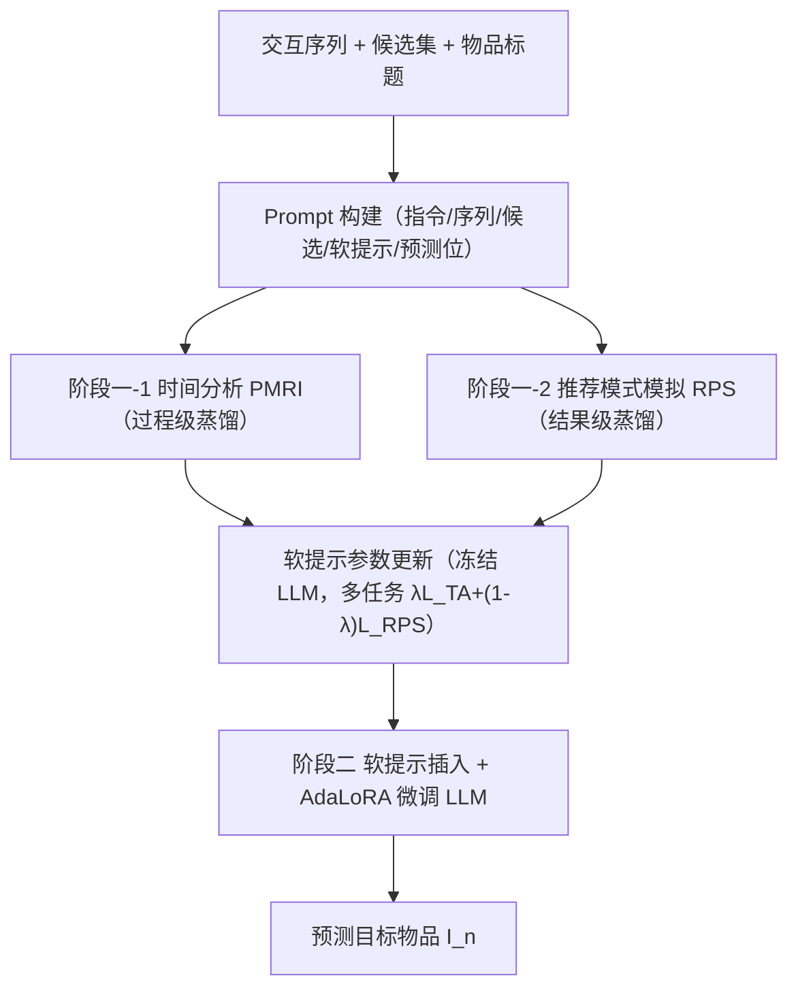

# DELRec: Distilling Sequential Pattern to Enhance LLMs-based Sequential Recommendation (蒸馏序列模式以增强基于 LLM 的序列推荐)

- **会议/期刊**: ICDE 2025（投稿 IEEE，arXiv v4）
- **作者与机构**: Haoyi Zhang, Guohao Sun, Jinhu Lu, Guanfeng Liu, Xiu Susie Fang（东华大学、麦考瑞大学）
- **推荐链路定位**: 精排（Next-Item 预测）
- **研究方向**: 大语言模型推荐 / 序列推荐
- **论文原文**: [https://arxiv.org/abs/2406.11156v4](https://arxiv.org/abs/2406.11156v4)
- **开源代码**: [https://github.com/haoge6660101/DELRec](https://github.com/haoge6660101/DELRec)

## TL;DR (1分钟核心速览)

现有 LLM 序列推荐融合传统 SR 模型的三条路线各有硬伤：文本提示信息量不足、embedding+projector 映射丢信息、双塔拼接牺牲可解释性。DELRec 提出两阶段软提示蒸馏：阶段一用「时间分析 (PMRI) + 推荐模式模拟」两个任务把 SASRec/GRU4Rec/Caser 的行为模式压进软提示；阶段二把软提示插入 prompt 并 AdaLoRA 微调 LLM。在 4 个真实数据集、HR/NDCG 全指标上相对 SASRec 与 KDALRD 均取得显著提升（如 Beauty HR@1 0.2573→0.3177，+23.5%）。

## Background & Motivation (背景与核心矛盾)

- **主流范式**: 传统 SR（GRU4Rec/Caser/SASRec）只学交互序列的时序模式，忽略物品标题的语义与世界知识；LLM 直接做推荐又缺领域知识，表现甚至不如传统模型（Flan-T5-XL 在 ML-100K 的 HR@1 仅 0.0938）。
- **前人局限**: ① 文本提示路线（RecRanker/LLM-TRSR）用自然语言描述传统模型结果，信息量不足以刻画其行为模式；② embedding+projector 路线（LLaRA/LLM2BERT4Rec）因 projector 设计粗糙、维度变换导致信息损失，embedding 与语言空间对不齐；③ 双塔拼接路线（LlamaRec/KDALRD）虽融合两方信息，却牺牲了 LLM 的简洁性与可解释性。
- **核心洞察 (Key Insight)**: 软提示（soft prompt）不受自然语言词表约束，可承载「只有 LLM 能理解」的知识；与其把传统模型的输出/embedding 硬塞给 LLM，不如让 LLM 在蒸馏阶段「主动模拟」传统模型的行为，把模式写进软提示。
- **本文切入点**: 用两个精心设计的蒸馏任务（过程级的时间分析 + 结果级的推荐模式模拟）把传统 SR 模型的知识转成软提示，再在第二阶段冻结软提示、微调 LLM 学会「参考」这份辅助信息。

## Method (核心方法设计)

### 1. 整体框架 (Overall Architecture)

DELRec 分两阶段。阶段一「Distill Pattern from Conventional SR Models」：为时间分析与推荐模式模拟各构造一个 prompt（含指令、处理后的交互序列、候选集、软提示、待预测位），冻结 LLM 参数、仅更新软提示参数，以多任务方式联合优化，使软提示吸收传统 SR 模型的时间聚合特性与推荐结果偏好。阶段二「LLMs-based Sequential Recommendation」：把学好的软提示插入第二阶段 prompt 的预留空位并冻结，用 ground truth 以 AdaLoRA 微调 LLM，使其把软提示当作参考而非答案。所有物品在 prompt 中以文本标题（而非 ID）表示，并显式写出传统模型名称以激活 LLM 的预训练知识。

### 2. 关键设计拆解 (Key Designs)

1. **时间分析 Temporal Analysis（PMRI 任务）**：传统 SR 靠把历史物品特征聚合到最近物品来获得时序感知，LLM 缺这一能力。做法是让 LLM 预测序列中「倒数第二个物品」$I_{n-2}$：把$I_{1:\alpha-1}$作为 in-context 示例告知「第$\alpha$个物品是下一交互」，再对$I_{\alpha:n-2}$掩码$I_{n-2}$令其预测，标签$y_0=I_{n-2}$。损失$\mathcal{L}_{TA}=\sum_{(x_0,y_0)}-\log P_{\Phi_0+\Phi}(y_0|x_0)$。直觉：迫使 LLM 复现「最近物品主导」的聚合行为，从而获得与传统模型同构的时间意识。

2. **推荐模式模拟 RPS（结果级蒸馏）**：仅有时序意识不够，还要让 LLM 复现传统模型的推荐偏好。给定序列 $I_{1:n-1}$与传统模型 top-$h$结果$sr_{1:h}$，取最高概率项$sr_1$作为标签$y_1$，损失$\mathcal{L}_{RPS}=\sum_{(x_1,y_1)}-\log P_{\Phi_0+\Phi}(y_1|x_1)$。两任务以$\min_{\Phi}\{\lambda\mathcal{L}_{TA}+(1-\lambda)\mathcal{L}_{RPS}\}$联合优化（$\lambda$ 动态调整），一个管「过程」一个管「结果」，互补覆盖传统模型的知识面。

3. **训练目标、负采样与推理效率**：阶段二损失 $\mathcal{L}_{LSR}=\sum_{(x,y)}-\log P_{\Phi_0+\Delta\Phi_0(\Theta)+\Phi}(y|x)$，冻结软提示$\Phi$、仅更新 AdaLoRA 参数$\Theta$。候选集为 1 正 + 14 随机负（$m=15$），属采样排序而非全库排序。推理时 Flan-T5-XL 主干 0.161 s/请求，DELRec 0.182 s/请求，仅多 21 ms；模型约 30 亿参数（软提示仅 0.2 M），推理峰值显存约 68 GB。

## Experimental Setup & Evaluation Protocol (实验设置与评估协议)

- **数据集与预处理**: 全部按 `5-core` 过滤（用户/物品交互数 <5 剔除），按时间戳排序。

| 数据集 | #Users | #Items | #Interactions | 稀疏度 | 场景说明 |
| :--- | :---: | :---: | :---: | :---: | :--- |
| MovieLens-100K | 943 | 1,682 | 100,000 | 93.70% | 电影评分+标题 |
| Steam | 11,938 | 3,581 | 274,726 | 99.36% | 游戏评论+游戏名 |
| Beauty | 324,038 | 32,586 | 371,345 | 99.99% | Amazon 美妆 |
| Home & Kitchen | 9,767,606 | 1,286,050 | 21,928,568 | 99.99% | Amazon 家居（大规模） |

- **数据划分与防穿越 (Splitting Strategy)**: 按时间戳排序后 `8:1:1` 比例划分训练/验证/测试，保证训练交互不出现在后续数据中，避免信息泄漏。
- **排名评测协议 (Ranking Protocol)**: `Sampled Ranking`——每个样本 1 个正样本 + 14 个随机负样本（$m=15$），指标为 HR@1/5/10、NDCG@5/10。
- **对比基线与超参设置**: 传统基线 GRU4Rec/Caser/SASRec；LLM 基线 Bert-Large、Flan-T5-Large/XL、RecRanker、LLMSEQPROMPT、LLM-TRSR、LLaRA、LLM2BERT4Rec、LlamaRec、LLMSEQSIM、KDALRD（LLM 主干统一替换为 Flan-T5-XL 保证公平）。序列长 $n=10$，软提示长度$k$默认 80，ICL 示例数$\alpha$在 ML-100K/Beauty 取 4、Steam/Home 取 6；阶段一 Lion 优化器 lr=5e-3，阶段二 AdaLoRA+Lion lr=1e-4；配对 t-test 检验显著性（$p\le0.01$/$p\le0.05$）。

## Key Experimental Results (实验关键数据)

### 1. 主实验对比 (Main Results)

以 DELRec(SASRec) 为主力变体，摘取 HR@1 / HR@10 / NDCG@10（完整表见原文 Table II）：

| 模型 | ML-100K HR@1 | ML-100K NDCG@10 | Steam HR@1 | Steam NDCG@10 | Beauty HR@1 | Beauty NDCG@10 | Home HR@1 | Home NDCG@10 |
| :--- | :---: | :---: | :---: | :---: | :---: | :---: | :---: | :---: |
| SASRec | 0.3341 | 0.5727 | 0.3852 | 0.5943 | 0.2573 | 0.4368 | 0.1146 | 0.1685 |
| Flan-T5-XL | 0.0938 | 0.2121 | 0.1033 | 0.2474 | 0.0652 | 0.1931 | 0.0257 | 0.0427 |
| LLaRA | 0.3523 | 0.5632 | 0.3855 | 0.5943 | 0.2752 | 0.4310 | 0.1545 | 0.1902 |
| LLM2BERT4Rec | 0.3365 | 0.5518 | 0.3825 | 0.5706 | 0.2575 | 0.4392 | 0.1393 | 0.1819 |
| LlamaRec | 0.2870 | 0.5387 | 0.3511 | 0.5489 | 0.2361 | 0.4065 | 0.1082 | 0.1574 |
| KDALRD | 0.3618 | 0.5824 | 0.4028 | 0.6077 | 0.2856 | 0.4485 | 0.1684 | 0.1945 |
| **DELRec (SASRec)** | **0.3701** | **0.5950** | **0.4372** | **0.6203** | **0.3177** | **0.4683** | **0.1836** | **0.2064** |
| Improv. vs SASRec | +10.8% | +3.9% | +13.5% | +4.4% | +23.5% | +7.2% | +60.2% | +22.5% |
| Improv. vs KDALRD | +2.3% | +2.2% | +8.5% | +2.1% | +11.2% | +4.4% | +9.0% | +6.1% |

### 2. 消融实验 (Ablation Study)

以 SASRec 为骨干，摘取 HR@1 / NDCG@10（完整见原文 Table III/IV）：

| 变体 | ML-100K HR@1 | ML-100K NDCG@10 | Beauty HR@1 | Beauty NDCG@10 | Home HR@1 | Home NDCG@10 |
| :--- | :---: | :---: | :---: | :---: | :---: | :---: |
| Default (完整) | **0.3701** | **0.5950** | **0.3177** | **0.4683** | **0.1836** | **0.2064** |
| w/o SP（去软提示） | 0.3020 | 0.5646 | 0.2765 | 0.4521 | 0.1539 | 0.2483 |
| w MCP（人工文本描述替代） | 0.3106 | 0.5712 | 0.2698 | 0.4463 | 0.1602 | 0.2557 |
| w USP（随机未训练软提示） | 0.2752 | 0.5259 | 0.2384 | 0.4210 | 0.1341 | 0.2215 |
| w/o DPSM（去阶段一蒸馏） | 0.3020 | 0.5646 | 0.2765 | 0.4521 | 0.1539 | 0.2483 |
| w/o LSR（去阶段二微调） | 0.2814 | 0.5314 | 0.2666 | 0.4475 | 0.1491 | 0.2425 |
| w/o TA（去时间分析） | 0.3425 | 0.5797 | 0.2815 | 0.4563 | 0.1564 | 0.2490 |
| w/o RPS（去推荐模式模拟） | 0.3379 | 0.5715 | 0.2903 | 0.4587 | 0.1682 | 0.2512 |
| w UDPSM（阶段一同训 LLM） | 0.3513 | 0.5906 | 0.3067 | 0.4644 | 0.1738 | 0.2588 |
| w ULSR（阶段二同训软提示） | 0.3486 | 0.5823 | 0.2945 | 0.4619 | 0.1704 | 0.2561 |
| w Flan-T5-Large（换小主干） | 0.2592 | 0.5008 | 0.2384 | 0.4288 | 0.1235 | 0.2373 |

### 3. 关键实验发现 (Key Findings)

1. **软提示必须「训练过」才有价值**：随机初始化的 w USP 在 ML-100K 上 HR@1 仅 0.2752，甚至低于 w/o SP 的 0.3020，说明未蒸馏的软提示是纯噪声；而人工文本描述（w MCP, 0.3106）也远逊于蒸馏软提示（0.3701），证明传统模型的行为模式难以用自然语言完整表达，必须走软提示通道。
2. **两阶段缺一不可，且参数更新范围敏感**：去掉阶段一（w/o DPSM）或阶段二（w/o LSR）在 Beauty 上 HR@1 分别掉到 0.2765/0.2666；阶段一若同时更新 LLM（w UDPSM）或阶段二若同时更新软提示（w ULSR），性能均下降（Beauty 0.3067/0.2945），说明「阶段一只动软提示、阶段二只动 LLM」的解耦是蒸馏成功的关键。
3. **稀疏度是主要瓶颈但方法仍稳健**：在 KuaiRec（83.72% 稀疏）上 DELRec HR@1 0.5615 仍优于 KDALRD 0.5446 与 SASRec 0.5379；冷启动场景（Home & Kitchen 交互 <3 的用户）DELRec HR@1 0.1082 优于 SASRec 0.0954、与 KDALRD 0.1077 持平，说明蒸馏软提示带来了一定的先验迁移能力。

## Highlights & Limitations (亮点、对比与审稿批判)

- **与代表作对比 (vs. Prior Work)**: 相比 LLaRA（embedding+projector 路线），DELRec 用软提示绕开 projector 的信息损失，Beauty HR@1 高出 15.4%；相比 RecRanker/LLM-TRSR（文本提示路线），软提示承载的信息密度远高于自然语言描述；相比 KDALRD（双塔拼接路线），DELRec 保留 LLM 端到端生成范式与可解释性，同时精度更高。
- **可迁移亮点**: ①「过程级 + 结果级」双任务蒸馏范式可迁移到任何「小模型有强归纳偏置、大模型缺领域知识」的场景（如 CTR 精排蒸馏到 LLM 重排）；② 阶段一冻结 LLM 只训软提示、阶段二冻结软提示只训 LLM 的解耦训练策略，能有效防止辅助信息被主任务梯度冲垮。
- **审稿级局限批判**: ① 评估采用 1 正 14 负的采样排序而非全库 Full-Ranking，负样本仅 14 个，指标绝对值偏高且可能高估真实排序能力；② 依赖 Flan-T5-XL（3B）主干，训练峰值显存 234 GB、需 10 张 3090，工业部署成本高，且论文未报告与轻量级 LLM（如 1B 以下）的对比；③ 软提示长度 $k$超过 80 后收益饱和甚至引入噪声，超参对数据集较敏感（$\alpha$ 需按数据集调 4 或 6）。

## Rating (四维评分)

- **方法创新性 (Novelty)**: ⭐⭐⭐⭐ （软提示双任务蒸馏思路清晰，「过程+结果」互补设计有巧思，但蒸馏+软提示的组合本身不算全新范式）
- **评估协议与实验扎实度 (Protocol & Experiments)**: ⭐⭐⭐ （四数据集+11 基线+两组消融+显著性检验较完整，但采样排序协议偏弱、缺全库排序与线上验证）
- **写作与数学规范度 (Clarity & Rigor)**: ⭐⭐⭐⭐ （三范式归纳清晰、公式与符号定义完整，但部分记号如 $\Phi_0+\Phi$ 的加号语义略含糊）
- **工业落地与复现价值 (Industrial & Practical Value)**: ⭐⭐⭐ （代码已开源、推理仅增 21 ms，但 3B 主干+234 GB 训练显存对中小团队门槛偏高）

