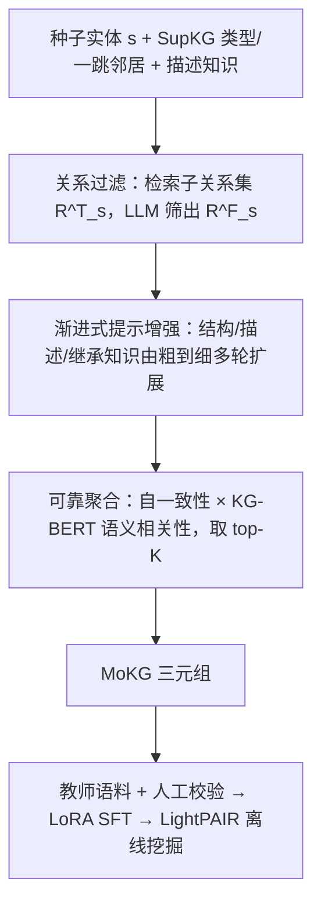
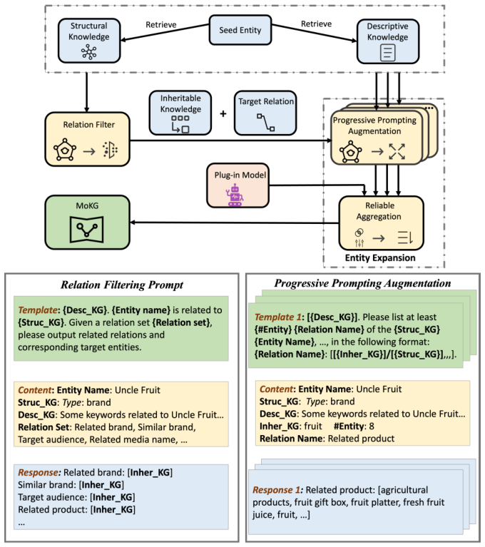

# Making Large Language Models Better Knowledge Miners for Online Marketing with Progressive Prompting Augmentation (用渐进式提示增强让大模型成为更好的营销知识挖掘器)

- **会议/期刊**: ICDE 2025（新版标题：Effectively PAIRing LLMs with Online Marketing via Progressive Prompting Augmentation）
- **作者与机构**: Chunjing Gan, Dan Yang, Binbin Hu, Ziqi Liu, Yue Shen, Zhiqiang Zhang, Jinjie Gu, Jun Zhou, Guannan Zhang（蚂蚁集团 Ant Group）
- **推荐链路定位**: 召回（受众定向的图谱侧知识供给，离线挖掘 + 在线解耦服务）
- **研究方向**: 大语言模型推荐 (LLM4Rec) / 图神经网络与知识图谱推荐 (Graph & KG Rec)
- **论文原文**: [https://arxiv.org/abs/2312.05276v2](https://arxiv.org/abs/2312.05276v2)
- **开源代码**: 暂未开源

## TL;DR (1分钟核心速览)

支付宝营销场景需要一张营销导向知识图谱 (MoKG) 作为用户偏好与营销活动之间的"桥"，但传统 SupKG 式流水线依赖 NER/RE 人工标注，而裸调 LLM 又存在关系发散、单提示不稳、175B 部署不可承受三大痛点。本文提出 PAIR：把"关系生成"降维为有限关系空间上的 LLM 自适应关系过滤，再用由粗到细的渐进式提示增强做实体扩展，并以自一致性与语义相关性双重打分聚合；同时用 GPT-3.5 产出的高质量语料 SFT 出白盒 LightPAIR。在 MoKG-181/500 人工盲评协议下准确率 90.1%/90.7%，且新颖性 40.4% 远超 KG 补全类方法（其新颖性为 0），线上受众定向覆盖提升 15.3%–122.0%。

## Background & Motivation (背景与核心矛盾)

- **主流范式**: 知识图谱构建走两条路——人工众包/多级文本挖掘流水线（WordNet、ATOMIC、SupKG 的 NER+RE+语义解析），或 LM 驱动的 KG 生成（COMET、BertNet、LMCRAWL 用 GPT-3.5 做 Subject Paraphrasing→Relation Generation→Object Generation）。
- **前人局限**: (i) 文本挖掘流水线需为每个子过程单独标注训练，成本高且规模受限；(ii) LM 驱动方法挖掘的是**世界常识**，对"果叔""兔喜生活+"这类营销实体与"发券/权益适用意图"这类营销关系完全陌生，且纯关系生成不可控——给"三体"会吐出"相关科学家""相关组织"等与营销无关的关系，污染后续扩展。
- **核心洞察 (Key Insight)**: 营销场景的关系集合其实是**封闭且可枚举**的（105 条专家定义关系），因此不需要 LLM"发明"关系，只需它"筛选"关系；而实体扩展的不稳定源于单一提示对先验知识覆盖不足，可用多视角提示 + 多次采样的一致性来对冲。
- **本文切入点**: 将挖掘过程形式化为 $P(r,t|s)=\int_\kappa P(\kappa|s)P(r|s,\kappa)P(t|s,\kappa,r)$，三段分别对应"先验知识注入 → 关系过滤 → 实体扩展"，逐段用领域知识把 LLM 的行为约束住。

## Method (核心方法设计)

### 1. 整体框架 (Overall Architecture)

对每个种子实体 $s$，先从 SupKG 查实体类型并检索出子关系集$\mathcal{R}^T_s$（$|\mathcal{R}^T_s|\ll|\mathcal{R}|$），连同结构知识（一跳邻居 + 实体类型消歧）与描述知识（维基/私有库摘要）拼成提示，让 LLM 输出**期望关系子集**$\mathcal{R}^F_s$及每条关系的一个"可继承"候选实体；随后对每个$(s,r)$用结构/描述/继承三类知识构造由粗到细的多组提示反复查询，得到多轮扩展结果$\{T^1_{s,r},\dots,T^n_{s,r}\}$，经自一致性 + KG-BERT 语义相关性聚合后取 top-$K$（$K=8$）作为最终三元组。离线阶段再用 GPT-3.5 在 4K–10K 种子实体上的输出经三人人工校验、坏例过滤，构造 25K/100K 语料，LoRA SFT 小模型得到 LightPAIR 承接全量挖掘。

<figure class="paper-figure" markdown="span">
  <figcaption>图2：PAIR的整体架构。</figcaption>
</figure>

### 2. 关键设计拆解 (Key Designs)

1. **LLM 作为关系过滤器（把生成降维为筛选）**：痛点是开放关系生成不可控。做法是先按实体类型检索子关系集，再让 LLM 在封闭集合内做判别：$s \xrightarrow{\phi(\cdot;\mathcal{K}),\mathcal{R}} \mathcal{R}^T_s \xrightarrow{M(\cdot;\rho_R(s,\kappa))} \mathcal{R}^F_s$。因为候选空间被压缩到同类型关系，LLM 只需做"这条关系对当前实体是否成立"的二值判断，幻觉空间被结构性封死；同时过滤阶段顺带产出的候选实体作为"继承知识"流入下一阶段，形成阶段间知识传递。

2. **渐进式提示增强 + 可靠聚合（对抗单提示敏感）**：痛点是提示微改即输出漂移。做法是构造 $\{\rho_E(s,r;\kappa_S),\rho_E(s,r;\kappa_D),\rho_E(s,r;\kappa_I),\rho_E(s,r;\kappa_S,\kappa_D),\dots,\rho_E(s,r;\kappa_S,\kappa_D,\kappa_I)\}$ 的由粗到细提示序列，每条提示重复调用 3 次，聚合分数为
$$\tau_{s,r,t}=\log\!\Big(1+\sum_{k}\mathbb{I}(t\in T^k_{s,r})\Big)\cdot \mathrm{MLP}(\boldsymbol{x}_{s,r,t})$$
其中 $\boldsymbol{x}_{s,r,t}$ 是 KG-BERT 对三元组 token 序列的 `[CLS]` 表示。对数项奖励"多轮都出现"的高自一致实体，MLP 项惩罚语义上不搭的实体，二者相乘使"高频但跑题"与"低频但精准"都被压制——这正是纯投票或纯语义打分单独做不到的。

3. **教师蒸馏与推理开销**：总目标即上述聚合排序（无额外对比损失），训练侧靠教师 LLM 生成 + 人工三票制校验构造 SFT 语料，学生模型用 LoRA（Adam、lr $5\times10^{-5}$、batch 8、上下文 4096）微调。挖掘为**纯离线**任务，无需日更推理，LightPAIR 可单卡 A100 部署、多卡并行满足时限，因此渐进式提示的多倍调用成本不进入在线链路。

## Experimental Setup & Evaluation Protocol (实验设置与评估协议)

- **数据集与预处理**: 从 SupKG 随机抽两组种子实体，配 105 条专家定义营销关系：

| 数据集 | #Seed Entities | #Candidate Relations | 说明 |
| :--- | :---: | :---: | :--- |
| MoKG-181 | 181 | 105 | 主评测集，覆盖多实体类型 |
| MoKG-500 | 500 | 105 | 规模泛化验证 |
| Train-25K / 100K | 4K–10K 种子 | 105 | 教师 GPT-3.5 产出 + 人工校验的 SFT 语料 |

- **数据划分与防穿越 (Splitting Strategy)**: 非传统 train/test 切分；采用**种子实体隔离**——SFT 语料来自 4K–10K 种子实体，评测固定在 MoKG-181（MoKG-500 结果因篇幅省略但趋势一致），避免训练实体泄漏到评测实体。
- **排名评测协议 (Ranking Protocol)**: 人工盲评，三名标注者对每个三元组做正/误判定，≥2 票为 accepted；所有基线与本方法的预测**混合打乱后匿名呈现**，属全量人工 Full-Judging 而非采样。指标：Accuracy（接受率）、Novelty（不在 SupKG 中的实体占比）、Diversity（AEE 平均扩展实体数、ILAD 表示空间平均成对欧氏距离）。
- **对比基线与超参设置**: KG 补全类 BERT、TRMP；KG 构建类 LMCRAWL、COMET；PAIR 主干为 GPT-3.5 (175B)，KG-BERT 110M，每条提示调用 3 次，$K=8$。

## Key Experimental Results (实验关键数据)

### 1. 主实验对比 (Main Results)

| 方法 | MoKG-181 Acc | Nov | AEE | ILAD | MoKG-500 Acc | Nov | AEE | ILAD |
| :--- | :---: | :---: | :---: | :---: | :---: | :---: | :---: | :---: |
| BERT (KG 补全) | 58.4% | – | 43.0 | 4.86 | 57.7% | – | 42.7 | 4.97 |
| TRMP (KG 补全) | 91.1% | – | 13.8 | 3.12 | 91.3% | – | 14.1 | 3.07 |
| LMCRAWL | 86.3% | 41.2% | 36.3 | 5.98 | 85.2% | 41.7% | 37.1 | 6.00 |
| COMET | 86.7% | 35.9% | 26.1 | 5.06 | 85.9% | 34.6% | 25.3 | 4.95 |
| **PAIR** | **90.1%** | 40.4% | **43.7** | 5.88 | **90.7%** | **43.6%** | **42.8** | 5.78 |
| – Agg | 88.7% | 39.6% | 30.8 | 5.89 | 88.9% | 36.4% | 31.3 | 5.84 |
| – Agg & Pr | 86.9% | 36.8% | 30.8 | 5.82 | 87.2% | 34.2% | 31.4 | 5.87 |
| – Agg & Pr & Rf | 84.9% | 39.2% | 46.3 | **6.15** | 84.3% | 39.4% | 47.2 | **6.20** |

LightPAIR 蒸馏结果（MoKG-181，Train-100K）：GLM(10B) 准确率 **90.7%**、Baichuan2(7B) **92.2%**，已追平甚至超过教师 GPT-3.5 的 90.1%；未 SFT 的 GLM(10B) 仅 79.2%。

### 2. 消融实验 (Ablation Study)

| 变体 | Acc (181) | Nov (181) | AEE (181) | 结论 |
| :--- | :---: | :---: | :---: | :--- |
| PAIR 完整 | 90.1% | 40.4% | 43.7 | 基准 |
| w/o Aggregation | 88.7% (−1.4) | 39.6% | 30.8 (−12.9) | 聚合主要贡献多样性 |
| w/o Agg & Progressive | 86.9% (−3.2) | 36.8% | 30.8 | 渐进提示贡献准确率 |
| w/o Agg & Pr & Relation Filter | 84.9% (−5.2) | 39.2% | 46.3 (+2.6) | 裸 LLM 多样性最高但准确率崩塌 |

### 3. 关键实验发现 (Key Findings)

1. **准确率与新颖性存在真实权衡，PAIR 是唯一同时守住两者的点**：TRMP 准确率 91.1% 看似最高，但新颖性为 0（只能补全已有边，挖不出新实体），对 MoKG 毫无增量价值；裸 LLM 变体 AEE 46.3 最高却准确率仅 84.9%。PAIR 以 90.1% 准确率 + 40.4% 新颖性 + 43.7 AEE 落在帕累托前沿。
2. **关系过滤是准确率的第一道闸门**：去掉 Rf 后准确率从 86.9% 掉到 84.9%，且案例研究显示无知识提示会把"果叔"关联到"佳能"、把"兔喜生活+"关联到"兔喜餐饮"这类幻觉/谬误实体，说明封闭关系空间 + 领域知识注入是抑制营销域幻觉的关键。
3. **蒸馏可把 175B 能力压进 7B 白盒**：Baichuan2(7B) 在 100K 语料下准确率 92.2% 反超教师，且 25K→100K 语料扩容带来全线单调提升（GLM 准确率 89.0%→90.7%），证明瓶颈在语料质量而非学生容量；线上受众定向中 LightPAIR 相对原 EGL(TRMP) 系统在六个营销场景覆盖提升 15.3%–122.0%（如 Land Lords +122.0%、三体 +98.1%）。

## Highlights & Limitations (亮点、对比与审稿批判)

- **与代表作对比 (vs. Prior Work)**: 相比 TRMP 的"检索-排序式图谱补全"，PAIR 挖的是 SupKG 中不存在的新实体，是增量而非补全；相比 LMCRAWL 的"关系生成→对象生成"开放流水线，PAIR 用封闭关系集把生成改成判别，准确率 +3.8pt 且 AEE 更高；相比 COMET 的常识生成，PAIR 靠领域知识注入把输出锚定在营销语义上。
- **可迁移亮点**: (i) "把开放生成降维为有限空间判别"这一招可直接迁移到任何 schema 相对封闭的 KG 补全或标签体系扩展任务；(ii) 自一致性计数 × 语义相关性打分的乘性聚合，是低成本对冲 LLM 输出方差的通用后处理。
- **审稿级局限批判**: (i) 评测完全依赖三人人工盲评，样本规模与标注者间一致性（如 Cohen's $\kappa$）未报告，且 MoKG-500 的 LightPAIR 结果被省略，泛化证据偏薄；(ii) 渐进式提示需对每条$(s,r)$ 多次调用教师模型，虽为离线但构建全量 MoKG 的绝对成本与端到端时延未量化，且 LightPAIR 的收益高度依赖教师语料分布，跨业务域迁移时需重新标注。

## Rating (四维评分)

- **方法创新性 (Novelty)**: ⭐⭐⭐⭐ （把关系生成重构为封闭空间判别 + 渐进提示聚合，工程直觉清晰，但各组件均为已有技术的巧妙组合，理论分析偏弱）
- **评估协议与实验扎实度 (Protocol & Experiments)**: ⭐⭐⭐⭐ （人工盲评 + 混合打乱保证公平，消融与蒸馏对比完整，但缺标注一致性统计与 MoKG-500 的 LightPAIR 结果）
- **写作与数学规范度 (Clarity & Rigor)**: ⭐⭐⭐⭐ （概率分解式与聚合公式定义清楚，提示模板附录详实，但部分符号如 $\kappa$ 三类知识的边界在正文略含糊）
- **工业落地与复现价值 (Industrial & Practical Value)**: ⭐⭐⭐⭐⭐ （真实支付宝线上受众定向验证 +15%–122%，LightPAIR 单卡 A100 可部署、离线解耦在线服务，落地价值极高；扣分项为代码未开源）

