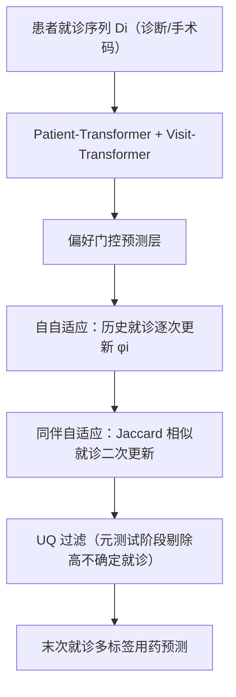
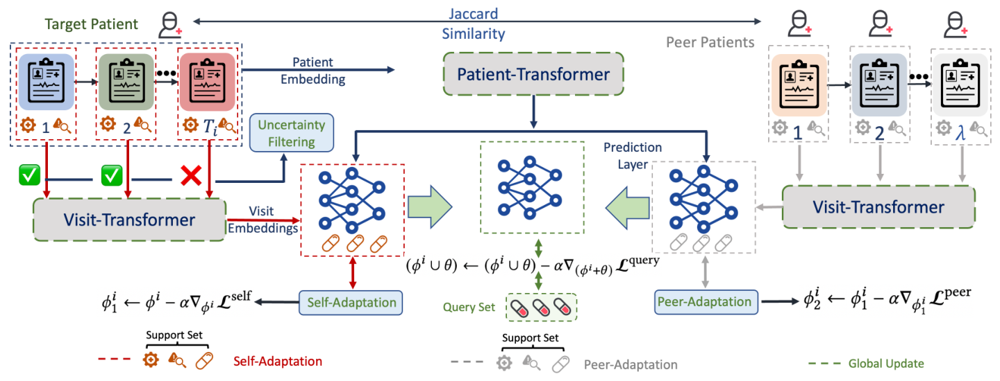

# User-Adaptive Meta-Learning for Cold-Start Medication Recommendation with Uncertainty Filtering (面向冷启动用药推荐的不确定性过滤用户自适应元学习)

- **会议/期刊**: IEEE ICDE 2026
- **作者与机构**: Arya Hadizadeh Moghaddam, Mohsen Nayebi Kerdabadi, Dongjie Wang, Mei Liu, Zijun Yao（University of Kansas / UF Health）
- **推荐链路定位**: 精排（末次就诊多标签用药预测）
- **研究方向**: 冷启动与长尾推荐 / 序列推荐
- **论文原文**: [https://arxiv.org/abs/2601.22820v1](https://arxiv.org/abs/2601.22820v1)
- **开源代码**: [https://github.com/aryahm1375/MetaDrug](https://github.com/aryahm1375/MetaDrug)

## TL;DR (1分钟核心速览)

用药推荐中的**患者（user）冷启动**长期被忽视：现有工作用医学知识图谱只解决 item 冷启动，元学习方案（如 MELU）又只做 item 级自适应，无法处理 EHR 的"就诊序列 + 每次就诊多码共现"结构。MetaDrug 提出**两级元自适应**——自自适应用患者自身历史就诊序列逐次更新预测层，同伴自适应用 Jaccard 相似就诊做第二轮更新——并训练一个**不确定性量化模型**在元测试阶段过滤高不确定支持就诊。在 MIMIC-III 与 AKI 上按 80/20 五折评估，PRAUC 分别达 0.752 / 0.533，较最强基线 Micron / ARCI 相对提升约 2.5% / 6.2%。

## Background & Motivation (背景与核心矛盾)

- **主流范式**: 用药推荐以 Deepr/RETAIN 类序列编码器 + GAMENet/SafeDrug/MoleRec 类 DDI 知识图谱约束为主，近年 ARCI 用多层 Transformer 建模跨就诊用药意图。
- **前人局限**: ① 知识图谱路线（GRAM/HAP/Adore）只补 item 语义，对"患者画像稀疏"无解；② 元学习路线（MELU/MetaHin/M2EU）在传统 RS 中按 item 级做 few-shot 自适应，无法处理 EHR 中"一次就诊 = 多个共现码"的集合交互与就诊间时序依赖。
- **核心洞察 (Key Insight)**: 作者实证发现**就诊次数多但医学码少的患者依然预测差**，而就诊少但码丰富的患者反而预测好——因此冷启动应以"医学码数量"而非"就诊次数"定义（取最低 10%–50% 分位）。同时 t-SNE 显示冷启动患者嵌入在自适应前明显偏离主流人群。
- **本文切入点**: 把自适应下沉到**就诊级**，并用"自身历史 + 相似同伴就诊"两级支持集 + 不确定性过滤，直接重塑冷启动患者嵌入。

## Method (核心方法设计)

### 1. 整体框架 (Overall Architecture)

输入为患者 $i$的就诊序列$\mathcal{D}_i=\{V_{i,t}\}_{t=1}^{T_i}$，每次就诊含诊断/手术码集合。先用 **Patient-Transformer** 编码全历史码序列得到患者嵌入$\hat{\boldsymbol{E}}^p_i$，用 **Visit-Transformer** 编码末次就诊得到$\hat{\boldsymbol{E}}^{V_i}_{T_i}$；经偏好门控生成患者专属预测层权重后输出多标签用药概率。训练采用元学习范式：内循环先在**自自适应**中用历史就诊逐次更新预测层参数$\phi_i$，再在**同伴自适应**中用 Jaccard 检索到的相似就诊做第二轮更新；外循环用 query（末次就诊）损失更新全局参数$\theta\cup\phi_i$。元训练结束后另训一个 UQ 模型确定阈值$\gamma$，元测试时先过滤高不确定就诊再做两级自适应与预测。

<figure class="paper-figure" markdown="span">
  <figcaption>图 2. 在 MetaDrug 框架中，首先使用 Patient Transformer 生成患者嵌入，同时通过 Visit Transformer 获得就诊嵌入。在自自适应阶段，利用患者的历史就诊记录对预测层进行局部更新以实现自适应。在同伴自适应阶段，基于 Jaccard 相似度识别其他患者的相似就诊记录，并利用这些记录对预测层进行第二轮局部自适应。最终使用自适应后的模型对查询集进行预测。最后，训练后的模型</figcaption>
</figure>

### 2. 关键设计拆解 (Key Designs)

1. **就诊级自自适应（Self-Adaptation）**：痛点在于传统元学习按单个 user-item 交互更新，而 EHR 一次就诊是码集合且需时序递进。做法是冻结编码器 $\theta$，仅对预测层$\phi_i$ 按历史就诊逐次求损失并平均后做一步梯度更新：
$$\mathcal{L}^{self}=\frac{1}{T_i-1}\sum_{t=1}^{T_i-1}\mathcal{L}\big(f(\hat{\boldsymbol{E}}^p_i,\hat{\boldsymbol{E}}^{V_i}_t,\phi_i),Y_{i,t}\big),\quad \phi^1_i\leftarrow\phi_i-\alpha\nabla_{\phi_i}\mathcal{L}^{self}$$
只更新预测层既保住通用表征、又大幅降低自适应开销，符合元学习"任务特异参数 vs 通用知识"的分工直觉。

2. **同伴自适应（Peer-Adaptation）**：冷启动患者常只有 1 次历史就诊，自自适应支持集过小。作者以末次就诊的码集合做 Jaccard 检索，取 top-$\lambda$（$\lambda=3$）相似就诊作为额外支持集，在$\phi^1_i$ 基础上再更新一次：
$$\phi^2_i\leftarrow\phi^1_i-\alpha\nabla_{\phi^1_i}\frac{1}{\lambda}\sum_{n=1}^{\lambda}\mathcal{L}\big(f(\hat{\boldsymbol{E}}^p_i,\hat{\boldsymbol{E}}^{V_j}_k,\phi^1_i),Y_{j,k}\big)$$
关键细节是**只比末次就诊而非全病史**——患者健康状况随时间漂移，早期就诊与当前用药决策弱相关。

3. **不确定性过滤与训练目标**：部分就诊（如冬季感冒）不代表患者整体画像，会污染自自适应。作者用 Auxiliary Error Prediction 定义不确定性 $S^{(j)}_{i,t_i}=|Y^{(j)}_{i,t_i}-\hat{y}^{(j)}_{i,t_i}|$，训练 Transformer 预测器$\hat{S}_{i,t_i}=f_{slf\text{-}atn}(\hat{\boldsymbol{E}}^p_i)$，对预测为正的标签取均值$U^i_{t_i}$，在训练集上按$\beta=20$分位确定阈值$\gamma$，元测试时剔除$U^i_{t_i}>\gamma$ 的就诊。总损失为各阶段 BCE 之和，**无负采样**（多标签 sigmoid 逐药独立判定），推理仅需一次前向 + 两次轻量梯度更新。

## Experimental Setup & Evaluation Protocol (实验设置与评估协议)

- **数据集与预处理**: 仅保留就诊数 $>1$ 的患者以支撑元自适应；药物统一映射到 ATC level-3 分类。

| 数据集 | #Patients | 平均药物/患者 | 平均诊断/患者 | 平均手术/患者 | 平均就诊数 | 场景说明 |
| :--- | :---: | :---: | :---: | :---: | :---: | :--- |
| MIMIC-III | 6,514 | 48.13 | 37.26 | 10.64 | 2.66 | 公开 ICU 重症监护 |
| AKI | 24,881 | 72.38 | 111.31 | 133.95 | 3.65 | 堪萨斯大学医学中心真实队列（取 50%） |

- **数据划分与防穿越 (Splitting Strategy)**: **比例划分** 80% 训练 / 20% 测试，五折独立重复并报告 95% 置信区间；预测目标为末次就诊 $T_i$的用药，输入严格截断至$T_i$ 之前的条件与手术码，无未来信息泄漏。
- **排名评测协议 (Ranking Protocol)**: 非全库排序，而是**多标签分类协议**——对全部候选药物逐项输出概率，阈值 $\eta=0.3$（贪心搜索确定）二值化后计算 Jaccard / F1 / PRAUC，另用 DDI rate 衡量安全性。
- **对比基线与超参设置**: 9 个基线覆盖三类——序列模型（Deepr、RETAIN、Transformer）、知识图谱/DDI 模型（GAMENet、SafeDrug、MoleRec、ARCI）、元学习模型（MELU）及残差 RNN（Micron）。最优超参 $\alpha=0.01$、$\lambda=3$、$d=256$、$\beta=20$、注意力头数 1。

## Key Experimental Results (实验关键数据)

### 1. 主实验对比 (Main Results)

MIMIC-III（五折均值 ± 95% CI）：

| 模型 | PRAUC↑ | F1↑ | Jaccard↑ | DDI↓ |
| :--- | :---: | :---: | :---: | :---: |
| Deepr | 0.723 | 0.610 | 0.450 | 0.073 |
| GAMENet | 0.694 | 0.592 | 0.432 | 0.068 |
| Micron | 0.734 | 0.623 | 0.466 | **0.066** |
| RETAIN | 0.727 | 0.609 | 0.451 | 0.074 |
| SafeDrug | 0.683 | 0.584 | 0.425 | 0.067 |
| MELU | 0.657 | 0.566 | 0.408 | 0.071 |
| MoleRec | 0.703 | 0.592 | 0.432 | 0.069 |
| ARCI | 0.722 | 0.608 | 0.449 | 0.076 |
| **MetaDrug** | **0.752** | **0.641** | **0.494** | 0.083 |
| Improv. (vs 最优基线) | +2.45% | +2.89% | +6.01% | — |

AKI：

| 模型 | PRAUC↑ | F1↑ | Jaccard↑ | DDI↓ |
| :--- | :---: | :---: | :---: | :---: |
| Deepr | 0.508 | 0.372 | 0.298 | 0.071 |
| Micron | 0.472 | 0.339 | 0.274 | **0.064** |
| RETAIN | 0.491 | 0.354 | 0.282 | 0.085 |
| SafeDrug | 0.474 | 0.348 | 0.271 | 0.078 |
| MELU | 0.402 | 0.281 | 0.216 | 0.079 |
| MoleRec | 0.498 | 0.361 | 0.288 | 0.073 |
| ARCI | 0.502 | 0.369 | 0.301 | 0.080 |
| **MetaDrug** | **0.533** | **0.390** | **0.333** | 0.086 |
| Improv. (vs 最优基线) | +4.92% | +4.84% | +10.63% | — |

### 2. 消融实验 (Ablation Study)

MIMIC-III（AKI 趋势一致，括号内为 AKI PRAUC）：

| 配置 | PRAUC↑ | F1↑ | Jaccard↑ | 说明 |
| :--- | :---: | :---: | :---: | :--- |
| **MetaDrug 完整** | **0.752** (0.533) | **0.641** | **0.494** | 两级自适应 + UF |
| w/o UF | 0.746 (0.527) | 0.633 | 0.489 | 去掉不确定性过滤 |
| 仅 Peer-Adaptation | 0.728 (0.504) | 0.615 | 0.458 | 仅同伴支持集 |
| 仅 Self-Adaptation | 0.740 (0.519) | 0.630 | 0.480 | 仅自身历史 |
| No Adaptation | 0.714 (0.493) | 0.597 | 0.440 | 仅全局元训练 |

UQ 方法选择（MIMIC-III PRAUC）：Auxiliary Error 0.752 > NC Dropout 0.748 > Deep Ensemble 0.746；$\beta$敏感性：$\beta=10/20/30$ 对应 0.748 / **0.752** / 0.745。

### 3. 关键实验发现 (Key Findings)

1. **两级自适应互补且自自适应贡献更大**：MIMIC-III 上仅自自适应即从 0.714 提升到 0.740（+3.6%），仅同伴自适应到 0.728；两者叠加再涨 1.6%，说明"自身时序画像"是主信号、"同伴就诊"是稀疏补偿，与冷启动患者平均仅 2.66 次就诊的数据特性吻合。
2. **不确定性过滤是"锦上添花"但稳定有效**：去掉 UF 后 PRAUC 降 0.006（MIMIC-III）/ 0.006（AKI），且 $\beta=20$ 优于 10 与 30——过滤太少噪声残留、过滤太多支持集不足，验证了"适度剔除"的直觉。
3. **冷启动分位越低优势越明显**：在最低 10% 分位（医学码最少）上 MetaDrug 在四项指标全面领先，且随码数增加优势进一步扩大；t-SNE 显示自适应后冷启动患者嵌入被拉近主流人群，直接证明元自适应在重塑用户表征而非仅拟合标签。

## Highlights & Limitations (亮点、对比与审稿批判)

- **与代表作对比 (vs. Prior Work)**: 相比 MELU 的 item 级自适应，MetaDrug 把自适应下沉到"就诊集合 + 时序"层级，MIMIC-III 上 PRAUC 高出 0.095；相比 ARCI 的多层 Transformer 纯表征路线，本文用简单编码器 + 元自适应即反超 0.030，说明**数据稀疏场景下"如何适应"比"如何编码"更关键**；相比 SafeDrug/MoleRec 的 DDI 约束路线，本文未建模药物相互作用，安全性指标落后。
- **可迁移亮点**: ① "只比末次交互而非全历史"的相似度检索策略，可直接迁移到会话推荐中的相似会话召回；② 用辅助误差预测器做支持集过滤，是一种轻量、免重训的元测试期去噪手段，可套用到任何 few-shot 推荐。
- **审稿级局限批判**: ① **DDI 全面劣于基线**（MIMIC-III 0.083 vs Micron 0.066），临床安全性存疑，且未与 DDI 损失联合优化；② 冷启动定义依赖"医学码数量分位"这一数据集相关阈值，缺乏跨数据集可迁移性验证；③ 元测试阶段需对每位患者做两次梯度更新 + UQ 前向，在线延迟未量化，且 $\lambda$、$\beta$均需贪心调参，超参敏感度分析仅覆盖$\beta$。

## Rating (四维评分)

- **方法创新性 (Novelty)**: ⭐⭐⭐⭐ （首次将元学习自适应下沉到 EHR 就诊级并引入同伴支持集与 UQ 过滤，组合新颖但单点技术均为已有组件的巧妙拼装）
- **评估协议与实验扎实度 (Protocol & Experiments)**: ⭐⭐⭐⭐ （双数据集五折 + 95% CI + 分位冷启动分析 + UQ/β 消融较完整，但缺少全库排序协议与线上验证）
- **写作与数学规范度 (Clarity & Rigor)**: ⭐⭐⭐⭐ （公式与符号表清晰、算法伪代码完整，但部分符号如 $\hat{S}$与$S$ 的上下标略冗余）
- **工业落地与复现价值 (Industrial & Practical Value)**: ⭐⭐⭐⭐ （代码已开源、仅更新预测层使自适应开销极低，但 DDI 安全性与在线延迟是落地前必须补齐的短板）
