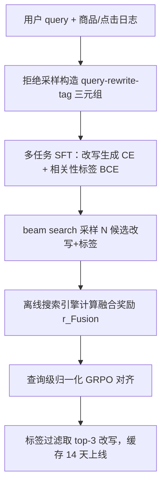
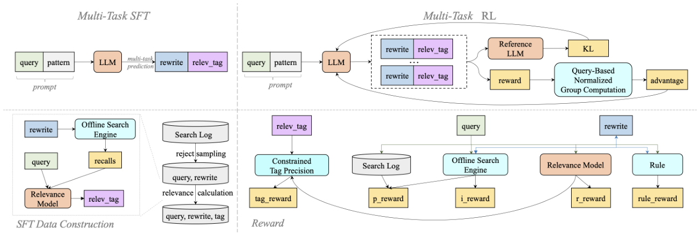

# Relevance Matters: A Multi-Task and Multi-Stage Large Language Model Approach for E-commerce Query Rewriting (相关性至上：面向电商查询改写的多任务多阶段大模型方法)

- **会议/期刊**: ICDE 2026
- **作者与机构**: Aijun Dai, Jixiang Zhang, Haiqing Hu, Guoyu Tang, Lin Liu, Ziguang Cheng（京东 / 清华大学）
- **推荐链路定位**: 召回（查询理解与改写，为倒排/向量召回提供改写词）
- **研究方向**: 大语言模型推荐 / CTR 预估与特征交叉（相关性建模）
- **论文原文**: [https://arxiv.org/abs/2603.02555v1](https://arxiv.org/abs/2603.02555v1)
- **开源代码**: [huggingface/trl](https://github.com/huggingface/trl)（训练框架，模型本身未开源）

## TL;DR (1分钟核心速览)

电商查询改写长期只追求"改写词的字面多样性/转化"，忽视改写与原查询的**相关性**：改写词抢占共享召回预算，反而拉低整体召回质量。本文提出多任务多阶段框架：SFT 阶段让 LLM 同时生成改写词与相关性标签（交叉熵 + BCE 联合损失），RL 阶段用**查询级归一化 GRPO** 优化由标签奖励、产出奖励、增量奖励、相关性奖励与规则奖励构成的融合奖励。离线在 100k 查询召回集上召回率 67.94%、相关性 69.65%，线上 7 天 A/B 中 UCVR +0.181%、UCTR +0.082%，已全量上线京东搜索。

## Background & Motivation (背景与核心矛盾)

- **主流范式**: 查询改写分判别式（BM25/HNSW 检索相似词扩展）与生成式（LLM 直接改写）两派；近期 LLM 工作多把相关性作为复合 RL 奖励的一个分量。
- **前人局限**: ①判别式依赖精确词面匹配，语义脆弱，无法识别不同表述的语义等价；②生成式与 RL 复合奖励只关注改写多样性/转化，相关性信号被其他竞争信号**稀释**，无法细粒度对齐。
- **核心洞察 (Key Insight)**: 改写词与其它召回通道共享同一召回预算，无约束地扩大改写文本多样性会"垄断"预算、挤掉相关商品，导致整体召回质量下降——相关性不是锦上添花而是硬约束。
- **本文切入点**: 把相关性从"奖励里的一个分量"升级为**与改写生成并列的显式预测任务**（输出确定性相关性标签），在 SFT 与 RL 两阶段都强制对齐。

## Method (核心方法设计)

### 1. 整体框架 (Overall Architecture)

以京东用户行为与商品信息预训练的 Qwen3-8B 为底座，两阶段闭环：**多任务 SFT** 阶段从搜索日志用拒绝采样构造 `<query, rewrite, tag>` 三元组（改写召回集与点击集有交集才保留；相关性分 $r_R>\tau_{relev}=0.2$ 标 1 否则 0），模型一次前向同时输出改写词与相关性标签；**多任务 RL** 阶段以离线搜索引擎反馈构造融合奖励，用 beam search 采样候选组、查询级归一化 GRPO 对齐；线上采用近线部署，beam 采样后按标签过滤取 top-3 改写并缓存 14 天。

<figure class="paper-figure" markdown="span">
  <figcaption>图 1：多任务 SFT 与 RL 架构。(1) 在 SFT 中，LLM 以提示为输入生成改写，相关性标签由离线搜索引擎与相关性模型构建。(2) 在 RL 中，LLM 通过基于查询的归一化 GRPO 进行优化。综合奖励由标签奖励、产出奖励、增量奖励、相关性奖励和规则奖励组成。</figcaption>
</figure>

### 2. 关键设计拆解 (Key Designs)

1. **多任务 SFT：把相关性变成可监督的确定性输出**：单任务 SFT 只保证改写"像"，不保证"对"。本文令模型在生成改写序列的同时预测二值相关性标签，联合损失为
$$\mathcal{L}_{SFT}(\theta)=-\mathbb{E}_{(x,y,t)\sim\mathcal{D}_{sft}}\Big[\sum_{i=1}^{|y|}\log\pi_\theta(y_i|y_{0:i-1},x)+\lambda\big(t\log p_\theta(1|x,y)+(1-t)\log p_\theta(0|x,y)\big)\Big]$$
直觉：标签作为"显式中间监督"迫使模型在解码时同步评估改写与原查询的语义一致性，而非事后由外部模型过滤。

2. **融合奖励与查询级归一化 GRPO**：改写是一对多任务，无 ground-truth，故用离线搜索引擎反馈构造奖励。相关性奖励 $r_R(x,\mathcal{R}_y)=\prod_{j=1}^{M}\mathrm{relev}(x,\mathcal{R}_{y_j})$（召回商品相关性连乘，惩罚任一不相关项）；产出奖励$r_P$按点击是否落在改写召回集及召回位置（top 100%/70%/30% 权重 1/2/3）加权；增量奖励$r_I=(|\mathcal{R}_y|-|\mathcal{R}_x\cap\mathcal{R}_y|)/|\mathcal{R}_x|$度量改写带来的**互补**召回；规则奖励$r_{Rule}=\alpha\cdot\mathrm{diff}(x,y)\cdot\frac{\mathrm{len}(x)}{\mathrm{len}(y)}$ 抑制超长与简单拼接。最终
$$r_{Fusion}(x,y,t)=r_{Rewrite}(x,y)\times r_{Tag}(x,y,t),\quad r_{Rewrite}=r_{Rule}\times\big(r_R\times r_I+r_P\big)$$
标签奖励为硬约束：输出格式不合规或标签与 $r_R>\tau_{relev}$不一致则整体奖励置 0。组内优势$A_i=(r_i-\mathrm{mean})/\mathrm{std}$，目标为带 KL 正则的裁剪策略梯度。关键点：**乘法融合**使"高相关性但低增量"或"高增量但标签错"的候选都被压制，避免复合奖励中信号相互稀释。

3. **训练目标、负采样与推理效率**：SFT 用 560 万 query-rewrite 对（8×Ascend 910B，25h）；RL 用 36k 查询（4×H800，18h），GRPO 阶段用 **beam search 采样**而非 top-k/top-p（beam size 10 最优），无需人工负样本；线上近线生成 + 14 天缓存，规避 LLM 在线推理延迟。

## Experimental Setup & Evaluation Protocol (实验设置与评估协议)

- **数据集与预处理**:

| 数据集 | 规模 | 构造方式 | 用途 |
| :--- | :---: | :--- | :--- |
| 多任务 SFT 集 | ~5.6M query-rewrite 对 | 日志采样 + 点击过滤拒绝采样 + 相关性模型打标 | SFT 训练 |
| RL 集 | 36k 查询 + 点击商品集 | 由 SFT 集按 RL 奖励筛选 | GRPO 训练 |
| 标签评测集 | 1k `<query,rewrite>` 对 | 人工标注相关性标签 | 标签准确率 |
| 召回评测集 | 100k 查询及召回商品对 | 倒排/向量召回，商品为该查询高频点击 | 召回率/相关性 |

- **数据划分与防穿越**: 离线评测集独立人工标注/独立采样，与训练日志查询不重叠；线上采用 10% 流量 7 天 A/B。
- **排名评测协议**: 非全库排序，采用**集合级召回协议** $\text{recall}=\frac{1}{|\mathcal{D}|}\sum_{x}|\mathcal{R}_Y\cap\mathcal{C}_x|$，即改写召回集与有效点击集的交集规模；相关性为逐对语义分均值。
- **对比基线与超参设置**: 底座对比 Baichuan-7B、Qwen2.5-7B、Hunyuan-7B、Qwen3-8B、R1-Distill-Qwen3-8B；RL 对比 DPO（72k 偏好对，1 正 2 负）、PPO；SFT 学习率 2e-5、batch 64、5 epoch；GRPO 学习率 1e-6、KL 系数 $\beta=0.4$、beam size 10。

## Key Experimental Results (实验关键数据)

### 1. 主实验对比 (Main Results)

底座模型对比（多任务 SFT 后）：

| Model | Acc(%) | Recall(%) | Relev(%) |
| :--- | :---: | :---: | :---: |
| Baichuan-7B | 79.9 | 62.69 | 73.03 |
| Qwen2.5-7B | 80.5 | 62.79 | 72.90 |
| Hunyuan-7B | 80.7 | 62.85 | 71.57 |
| **Qwen3-8B** | **80.8** | **62.86** | **73.21** |
| R1-Distill-Qwen3-8B | 81.6 | 63.18 | 71.79 |

RL 算法综合对比（均基于 Qwen3-8B 领域预训练 + SFT）：

| Method | Acc(%) | Recall(%) | Relev(%) |
| :--- | :---: | :---: | :---: |
| pretrain+SFT | 80.0 | 63.74 | 72.32 |
| +DPO | 81.2 | 63.93 | 72.61 |
| +PPO | 80.9 | 65.89 | 70.03 |
| +GRPO ($r_{Feedback}\&Tag$) | **81.9** | 59.36 | 73.29 |
| +GRPO ($r_{Rewrite}$) | 80.1 | **70.18** | 64.16 |
| **+GRPO ($r_{Fusion}$)** | 81.5 | 67.94 | 69.65 |

线上 A/B（7 天，10% 流量，相对上代改写模型）：

| 流量桶 | UV value | UCVR | UCTR |
| :--- | :---: | :---: | :---: |
| 全量 | +0.106% | +0.181% | +0.082% |
| Top | +0.240% | +0.170% | +0.110% |
| Torso | +0.430% | +0.030% | +0.020% |
| 长尾 | **+0.490%** | **+0.290%** | +0.110% |

### 2. 消融实验 (Ablation Study)

| 配置 | Acc(%) | Recall(%) | Relev(%) | 说明 |
| :--- | :---: | :---: | :---: | :--- |
| 单任务 SFT（仅改写） | — | ~66.5 | ~66.0 | 图 2：召回高、相关性低 |
| 多任务 SFT | — | ~63.0 | ~73.5 | 相关性 +7.5pt，召回 -3.5pt |
| GRPO beam=3 | 62.9 | 66.76 | 65.86 | 组太小，优势估计噪声大 |
| GRPO beam=5 | 68.7 | 67.30 | 66.05 | 逐步改善 |
| GRPO beam=10 | 78.5 | 67.94 | 69.65 | 最优折中 |
| GRPO beam=15 | 78.9 | 68.97 | 67.79 | 召回升、相关性回落 |
| 改写数 3 / 4 / 5 | — | 67.94 / 69.44 / 69.96 | 69.65 / 69.65 / 69.80 | 改写数增加召回单调升 |

### 3. 关键实验发现 (Key Findings)

1. **多任务 SFT 是"以召回换相关性"的显式旋钮**：相比单任务，相关性从 ~66.0 升至 ~73.5（+7.5pt），召回从 ~66.5 降至 ~63.0；GRPO 阶段再把召回拉回 67.94，实现"先对齐再补召回"的两阶段分工，这是本文最核心的工程洞察。
2. **单一奖励分量必然偏科，乘法融合才均衡**：仅 $r_R$使相关性飙至 84.15 但召回崩到 34.07；仅$r_I$使召回跌至 47.22、相关性仅 33.97；$r_{Rewrite}$召回最高 70.18 但相关性掉到 64.16；只有$r_{Fusion}$ 同时拿到 67.94/69.65，验证了"标签硬约束 × 反馈奖励"的乘法门控设计。
3. **GRPO 显著优于 DPO/PPO**：DPO 仅 +0.19pt 召回、+0.29pt 相关性，PPO 召回 +2.15pt 但相关性 -2.29pt；GRPO 融合奖励在保持 Acc 81.5 的同时召回 +4.2pt、相关性仅 -2.7pt，说明组内相对优势更适合改写这种一对多、无绝对标签的任务。线上长尾桶 UV value +0.490% 远高于 Top 桶 +0.240%，印证改写对长尾查询的边际收益最大。

## Highlights & Limitations (亮点、对比与审稿批判)

- **与代表作对比 (vs. Prior Work)**: 相比 Query2doc / LLM 零样本扩展类工作，本文引入京东领域预训练与搜索引擎反馈闭环；相比 VALUE、LeSeR 等 RL 改写工作把相关性塞进复合奖励，本文将其提升为**并列预测任务 + 硬约束标签奖励**，从"奖励加权"变为"结构门控"，这是本质差异。
- **可迁移亮点**: ①"生成 + 判别标签"双输出多任务 SFT 可直接迁移到标题生成、商品卖点生成等需保真度的生成式召回任务；②用召回集与点击集的交并比构造增量奖励 $r_I$，是无需人工标注的通用"互补性"奖励模板。
- **审稿级局限批判**: ①召回评测集仅 100k 且商品为高频点击，存在流行度偏置，长尾查询的召回收益可能被高估；②线上增益绝对值偏小（UCVR +0.181%），且未报告改写延迟分布与缓存未命中率；③$\tau_{relev}=0.2$、$\lambda$、$\alpha$、beam size 等多个超参缺乏敏感性分析，跨平台迁移成本未知。

## Rating (四维评分)

- **方法创新性 (Novelty)**: ⭐⭐⭐⭐ （把相关性从奖励分量升级为并列预测任务与硬门控，思路清晰但组件均为已有技术组合）
- **评估协议与实验扎实度 (Protocol & Experiments)**: ⭐⭐⭐⭐ （离线四指标 + 线上 7 天 A/B + 分流量桶分析完整，但召回协议为集合级而非全库排序，缺显著性检验）
- **写作与数学规范度 (Clarity & Rigor)**: ⭐⭐⭐⭐ （公式与奖励设计交代清楚，但部分符号如 $r_{Feedback}$与$r_{Rewrite}$ 关系表述略绕，缺少复杂度分析）
- **工业落地与复现价值 (Industrial & Practical Value)**: ⭐⭐⭐⭐⭐ （京东全量上线、近线部署 + 14 天缓存方案可直接复用，TRL 框架训练细节完整）
