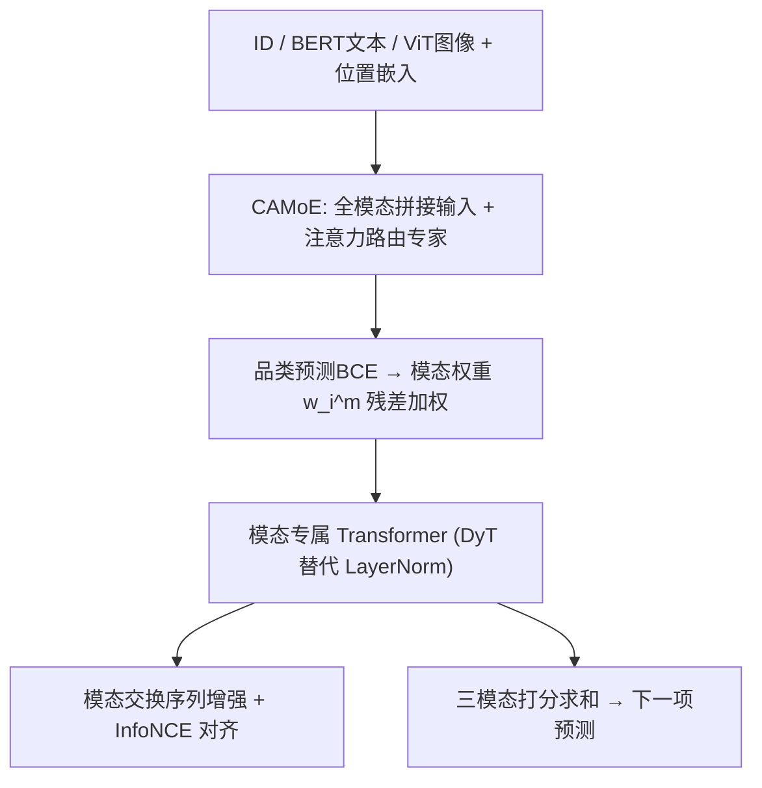
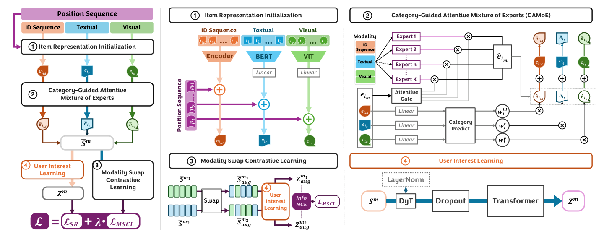

# CAMMSR: Category-Guided Attentive Mixture of Experts for Multimodal Sequential Recommendation (类别引导的注意力混合专家多模态序列推荐)

- **会议/期刊**: ICDE 2026
- **作者与机构**: Jinfeng Xu, Shuo Yang, Jinze Li, Edith C. H. Ngai (香港大学)；Zheyu Chen (北京理工大学)；Hewei Wang, Yijie Li (CMU)；Jianheng Tang, Yunhuai Liu (北京大学)
- **推荐链路定位**: 召回（序列下一项预测）
- **研究方向**: 多模态推荐 / 序列推荐
- **论文原文**: [https://arxiv.org/abs/2603.04320v1](https://arxiv.org/abs/2603.04320v1)
- **开源代码**: 暂未开源（论文称代码在补充材料中）

## TL;DR (1分钟核心速览)

现有多模态序列推荐采用启发式静态融合（拼接/加权求和），无法刻画"同一用户在不同品类下对图文模态偏好不同"以及"单模态无吸引力、组合后才触发兴趣"的协同效应。CAMMSR 提出类别引导注意力 MoE（CAMoE）：以辅助品类预测任务的 BCE 损失差异作为模态可信度信号，经 softmax 转为模态权重，并让每个模态专家吃全模态拼接输入以显式建模协同；再叠加序列级模态交换对比学习对齐跨模态表征。在 4 个 Amazon 数据集、`Leave-One-Out` + `Full-Ranking` 协议下，NDCG@5 相对最强基线 IISAN 提升 6.67%–15.32%，且收敛最快（53–65 epoch）。

## Background & Motivation (背景与核心矛盾)

- **主流范式**: 以 SASRec/BERT4Rec 为序列编码骨架，用 BERT/ViT 抽取文本与图像特征，再通过拼接、门控（MISSRec）或模态专属/跨模态 MoE（M3SRec）做融合。
- **前人局限一**: 融合权重是静态或与上下文无关的，无法表达"买美妆看图片、买游戏看文字"这种随品类漂移的模态偏好。
- **前人局限二**: 各模态特征先独立过专家再加权，天然丢失跨模态协同——"折扣文案"或"动漫图案"单独都不足以促成购买，组合出现才引爆销量。
- **核心洞察 (Key Insight)**: 品类是模态重要性的天然代理标签；某模态对品类预测越"准"，说明该模态承载的判别信息越强，理应获得更高融合权重。
- **本文切入点**: 把品类预测当作辅助任务，用其逐模态的预测误差反向生成模态权重，并用模态交换构造序列级对比视图补足跨模态对齐。

## Method (核心方法设计)

### 1. 整体框架 (Overall Architecture)

ID 嵌入可学习，文本/图像分别经冻结的 BERT/ViT 取 `[CLS]` 后线性投影到 $d$维并加位置嵌入，得到三路序列$E^{id},E^{t},E^{v}$。CAMoE 对每个模态$m$用注意力路由聚合$K$个吃"三模态拼接"输入的 FFN 专家，同时用辅助品类预测的 BCE 误差算出模态权重$w_i^m$做残差加权。三路序列各自过 Transformer（LayerNorm 换成 DyT）得到用户兴趣$Z^m$，各模态打分求和得$\hat{y}_i$。训练时额外用模态交换增强序列构造 InfoNCE 对比损失，与主交叉熵联合优化。

<figure class="paper-figure" markdown="span">
  <figcaption>图1：CAMMSR 的整体框架。左侧描述流程，右侧详述各组件。1）项目表示初始化利用带位置序列的预训练提取器初始化项目多模态表示。2）类别引导的注意力专家混合利用额外的类别预测任务和注意力机制有效分配模态权重。3）模态交换对比学习通过模态交换操作构建增强对比视图，并应用对比学习以</figcaption>
</figure>

### 2. 关键设计拆解 (Key Designs)

1. **类别引导注意力 MoE（CAMoE）**：针对"独立模态专家丢失协同"的痛点，专家输入改为三模态拼接而非单模态，路由用注意力而非线性门控：$\hat{e}_i^m=\sum_{k=1}^{K}g_k^m\,\mathrm{Expert}_k(\mathrm{Con}(e_i^{id},e_i^t,e_i^v))$，其中$G^m=\mathrm{Softmax}(Q^m(K^m)^\top/\sqrt{K})V^m$由$E^m$ 线性投影得到。直觉是让每个专家在"看到全部模态"的条件下做特化，从而把协同信号编码进专家输出。

2. **品类引导的模态权重分配**：针对数据稀疏下模态权重难以学习的问题，对每个模态单独接线性分类头得 $\hat{y}_c^m$，计算 BCE 差异$d_i^m=-\sum_{c\in\mathcal{C}}[y_c\log\hat{y}_c^m+(1-y_c)\log(1-\hat{y}_c^m)]$，再 softmax 归一化$w_i^m=\exp(d_i^m)/\sum_{n}\exp(d_i^n)$，最终$\bar{e}_i^m=e_i^m+w_i^m\hat{e}_i^m$。误差越大权重越小，等价于用"品类判别力"作为模态可信度的无监督代理，且天然逐物品自适应。

3. **模态交换对比学习与训练目标**：对模态对 $\langle m_1,m_2\rangle$以概率 0.5 随机交换两条序列中对应位置的物品表征，构造增强视图$Z^{m_1}_{aug},Z^{m_2}_{aug}$，用 InfoNCE 拉近同一样本跨模态视图、推远 batch 内其他样本。总损失$\mathcal{L}=\mathcal{L}_{SR}+\lambda\mathcal{L}_{MSCL}$，$\mathcal{L}_{SR}$为全库 softmax 交叉熵（免负采样，全库即负样本），$\lambda$ 默认 0.25（Home 因稀疏度 99.97% 取 0.5）。

## Experimental Setup & Evaluation Protocol (实验设置与评估协议)

- **数据集与预处理**: 四个 Amazon 数据集，均做 `5-core` 过滤，按时间戳排序构造序列；文本拼接 title+category+brand，图像取商品首图。

| 数据集 | #Users | #Items | #Interactions | 稀疏度 | 场景说明 |
| :--- | :---: | :---: | :---: | :---: | :--- |
| Toys | 19,412 | 11,924 | 167,597 | 99.93% | 玩具 |
| Games | 24,303 | 10,672 | 231,780 | 99.91% | 电子游戏 |
| Beauty | 22,363 | 12,101 | 198,502 | 99.93% | 美妆 |
| Home | 66,520 | 28,238 | 551,682 | 99.97% | 家居厨房 |

- **数据划分与防穿越**: `Leave-One-Out`（末位交互为测试、倒数第二为验证），序列按时间戳排序，最大长度 50。
- **排名评测协议**: 无偏 `Full-Ranking`（全库未交互物品排序，不采样），指标 NDCG@{5,10} 与 MRR@{5,10}。
- **对比基线与超参设置**: 5 个纯序列基线（GRU4Rec/SASRec/LRURec/FEARec/TiCoSeRec）+ 9 个多模态基线（NOVA/DIF-SR/UniSRec/MISSRec/M3SRec/IISAN/MMMLP/TedRec/FindRec），统一 RecBole 实现，$d=64$、batch 1024、2 层 2 头 Transformer、学习率 1e-3，$K\in\{1,2,4,8,16\}$、$\lambda\in\{0.25,0.5,0.75,1\}$网格搜索，$t$-test 显著性$p<0.05$。

## Key Experimental Results (实验关键数据)

### 1. 主实验对比 (Main Results)

| 模型 | Toys N@5 | Toys N@10 | Toys MRR@5 | Games N@5 | Beauty N@5 | Beauty N@10 | Home N@5 | Home N@10 |
| :--- | :---: | :---: | :---: | :---: | :---: | :---: | :---: | :---: |
| SASRec | 0.0348 | 0.0411 | 0.0257 | 0.0391 | 0.0325 | 0.0412 | 0.0118 | 0.0148 |
| FEARec | 0.0354 | 0.0442 | 0.0266 | 0.0411 | 0.0342 | 0.0434 | 0.0121 | 0.0152 |
| M3SRec | 0.0416 | 0.0486 | 0.0363 | 0.0493 | 0.0345 | 0.0428 | 0.0122 | 0.0144 |
| MMMLP | 0.0378 | 0.0466 | 0.0344 | 0.0486 | 0.0351 | 0.0433 | 0.0133 | 0.0165 |
| TedRec | 0.0318 | 0.0397 | 0.0265 | 0.0468 | 0.0330 | 0.0419 | 0.0113 | 0.0140 |
| FindRec | 0.0390 | 0.0480 | 0.0357 | 0.0501 | 0.0359 | 0.0447 | 0.0137 | 0.0171 |
| IISAN | 0.0395 | 0.0489 | 0.0354 | 0.0525 | 0.0372 | 0.0464 | 0.0152 | 0.0187 |
| **CAMMSR** | **0.0477** | **0.0542** | **0.0421** | **0.0560** | **0.0429** | **0.0517** | **0.0168** | **0.0199** |
| Improv. | +14.66% | +10.84% | +15.98% | +6.67% | +15.32% | +11.42% | +10.53% | +6.42% |

### 2. 消融实验 (Ablation Study)

| 变体 | Toys N@10 | Games N@10 | Beauty N@10 | Home N@10 | 说明 |
| :--- | :---: | :---: | :---: | :---: | :--- |
| CAMMSR | **0.0542** | **0.0701** | **0.0517** | **0.0199** | 完整模型 |
| w/o Att. | 0.0530 | 0.0690 | 0.0503 | 0.0191 | 注意力路由→线性路由 |
| w/o CG | 0.0493 | 0.0675 | 0.0476 | 0.0185 | 品类权重→等权融合 |
| w/o DyT | 0.0536 | 0.0693 | 0.0509 | 0.0193 | DyT→LayerNorm |
| r CMoE | 0.0524 | 0.0689 | 0.0492 | 0.0190 | 换 M3SRec 跨模态 MoE |
| r MoE | 0.0513 | 0.0684 | 0.0479 | 0.0188 | 换 vanilla MoE |
| w/o 全部 | 0.0482 | 0.0667 | 0.0470 | 0.0182 | 三组件全去 |

### 3. 关键实验发现 (Key Findings)

1. **品类引导权重是最大贡献项**：去掉 CG 后 Toys NDCG@10 从 0.0542 掉到 0.0493（-9.0%），降幅超过去掉注意力路由（-2.2%）与 DyT（-1.1%）；且统计显示仅 0.16%–0.61% 的测试样本上去掉 CG 反而变好，说明"品类→模态重要性"的代理假设在绝大多数样本上成立。
2. **协同建模优于独立专家**：CAMoE 换成 M3SRec 的跨模态 MoE 后 Beauty NDCG@10 掉 4.8%，换成 vanilla MoE 掉 7.4%，证明"专家输入吃全模态拼接"是捕获协同效应的关键，而非 MoE 结构本身。
3. **效率与鲁棒性双优**：CAMMSR 每 epoch 训练 84s/68s（Games/Beauty），仅需 65/53 epoch 收敛，总训练时间 1h31m/1h0m，远快于 IISAN 的 4h47m/3h38m；在 20% 误导性品类噪声下 Toys NDCG@10 仍达 0.0505，高于 w/o CG 的 0.0493，说明品类信号在现实噪声范围内净收益为正。

## Highlights & Limitations (亮点、对比与审稿批判)

- **与代表作对比 (vs. Prior Work)**: 相比 M3SRec 的"模态专属+跨模态"双 MoE，本文把专家输入统一为全模态拼接并用注意力路由，协同建模更彻底；相比 MISSRec 的门控动态融合，本文的权重来自可验证的品类预测误差而非黑盒门控；相比 IISAN 的静态 PEFT 融合，本文权重逐物品自适应，Beauty 上 NDCG@5 领先 15.32%。
- **可迁移亮点**: (1) 用"辅助任务逐模态误差"作为模态可信度代理，可平移到多行为/多场景融合的权重分配；(2) 序列级模态交换增强（按位置概率交换）比物品级替换更保留时序结构，适合任何多模态序列对比学习。
- **审稿级局限批判**: (1) 品类引导强依赖品类标签质量，30% 误导噪声下 Toys NDCG@10 掉 11.07%，且论文未给出噪声过滤机制；(2) 主实验仅覆盖 Amazon 四域、$d=64$的小规模设定，缺少工业级千万物品全库排序的延迟与显存评估，MoE 专家数$K=4$ 的最优性也仅在离线验证。

## Rating (四维评分)

- **方法创新性 (Novelty)**: ⭐⭐⭐⭐ （品类预测误差→模态权重的代理机制新颖且可解释，但 MoE 与对比学习骨架本身属组合式创新）
- **评估协议与实验扎实度 (Protocol & Experiments)**: ⭐⭐⭐⭐ （四数据集 + Full-Ranking + 14 个基线 + 显著性检验 + 噪声/效率/超参/多标签品类分析齐全，缺线上验证）
- **写作与数学规范度 (Clarity & Rigor)**: ⭐⭐⭐⭐ （公式链条清晰、符号表完整，但 Eq.5 中 $g_k^m$与路由向量$G^m$ 的维度对应关系表述略含糊）
- **工业落地与复现价值 (Industrial & Practical Value)**: ⭐⭐⭐⭐ （收敛快、推理开销低、超参不敏感，但代码未正式开源且依赖品类标签维护）
