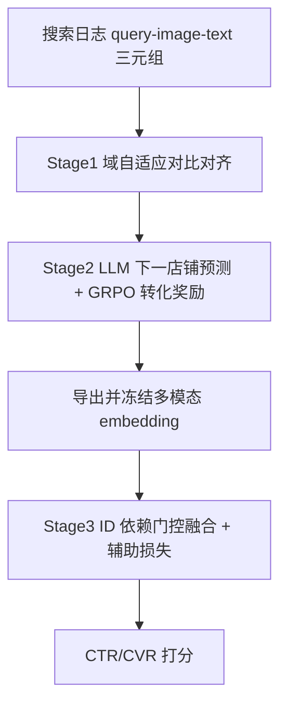
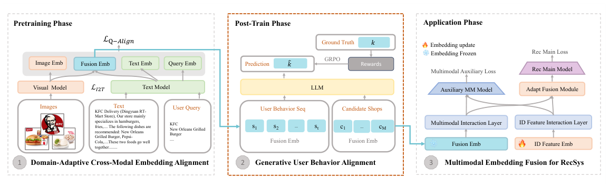

# GALA: Generative Aligned Learning for Adaptive Multimodal Representation in the Taobao Shangou Recommender System (淘宝闪购自适应多模态表征的生成式对齐学习)

- **会议/期刊**: IEEE ICDE 2026 (Industry and Applications Track)
- **作者与机构**: Jiping Liu, Zhongmin Zhang, Zisen Sang, Zhijia Fang 等（阿里巴巴淘宝闪购 / Rajax Network；中南大学）
- **推荐链路定位**: 精排（多模态表征预训练 + 排序融合，端到端离线表征、在线 KV 查表）
- **研究方向**: 多模态推荐 / 大语言模型推荐
- **论文原文**: [https://arxiv.org/abs/2607.29213v1](https://arxiv.org/abs/2607.29213v1)
- **开源代码**: 暂未开源

## TL;DR (1分钟核心速览)

工业级多模态推荐的主流两阶段范式把「图文语义预训练」与「行为驱动排序」割裂，冻结表征无法反映动态用户意图，且在外卖场景下通用 CLIP 类模型读不懂「蚂蚁上树」这类本地化菜名。GALA 提出三阶段流水线：搜索日志挖掘 query–image–text 三元组做域自适应对比对齐；再用 Qwen2.5-7B 以「下一店铺预测」为任务、转化事件为奖励做 GRPO 生成式后训练，把多模态 embedding 直接拉向下游目标；最后用 ID 依赖门控 + 辅助损失把冻结多模态表征融入 ID 主导的排序模型。离线 Recall@K 达 0.877（+3.4pt），AUC +0.12/+0.20，线上 A/B 订单量 +0.55%（p<0.01）。

## Background & Motivation (背景与核心矛盾)

- **主流范式**: 受毫秒级延迟与高吞吐约束，工业系统采用「离线算 embedding → 在线 KV 查表 → 轻量排序」的两阶段范式，多模态编码器在通用图文对齐任务上预训练后冻结，再注入排序模型。
- **前人局限**: 其一，端到端联合训练（EM3、LEMUR）需逐请求编码或频繁刷新编码器，且依赖 memory-bank 缓存，在快变长尾店铺库中覆盖率不足——论文实测聚合过去 60 天训练数据对次日候选店铺覆盖率仅约 80%；其二，两阶段范式下预训练分布（静态内容）与排序目标（动态行为）存在目标与分布双重错位，冻结表征无法体现近期交互。
- **核心洞察 (Key Insight)**: 外卖场景的用户偏好高度上下文化（荤菜权重高于主食、早餐与下午茶偏好迥异），且存在强本地化术语（"蚂蚁上树"指肉末粉丝），通用多模态预训练无法蒸馏这些细粒度域特征；同时 ID 特征在长期训练中会压制多模态信号，导致门控塌缩。
- **本文切入点**: 在两阶段之间插入一个「生成式 RL 对齐」后训练阶段，用行为序列与转化奖励直接精修多模态 embedding，并以辅助损失守住多模态分支。

## Method (核心方法设计)

### 1. 整体框架 (Overall Architecture)

GALA 由三阶段紧耦合构成。Stage 1 从搜索日志挖掘「query–图–文」三元组，用对比学习做域自适应跨模态对齐，得到 128 维店铺融合表征；Stage 2 将该表征作为 LLM 解码器的输入 embedding，以「在可配送候选集中预测下一购买店铺」为任务，用转化奖励驱动 GRPO 更新解码器与多模态 embedding，导出后冻结；Stage 3 在排序模型中用 ID 依赖门控动态融合冻结多模态表征与可训练 ID 表征，并以主损失 + 辅助损失联合训练，防止多模态分支被 ID 信号淹没。

<figure class="paper-figure" markdown="span">
  <figcaption>图 2：三阶段框架 GALA 概览。</figcaption>
</figure>

### 2. 关键设计拆解 (Key Designs)

1. **域自适应三元组对齐（Stage 1）**：通用图文对齐缺乏意图信号 $\to$以「搜索后实际下单」定义正样本三元组$(q, \text{img}, \text{txt})$，批内其余店铺为负样本（MoCo 式动量负采样缓解伪负例），并联合优化 query–text、query–image、query–fusion 三路对比损失：

$$\mathcal{L}_{Q\text{-}Align}=w_1\mathcal{L}_{Q\text{-}Text}+w_2\mathcal{L}_{Q\text{-}Image}+w_3\mathcal{L}_{Q\text{-}Fusion}$$

其中 $w_1{=}0.3, w_2{=}0.3, w_3{=}0.4$。直觉：把「用户搜什么就买什么」这一高置信行为直接编码进表征，使 query 意图在预训练阶段即注入，而非等到排序阶段才被动使用。

2. **GRPO 生成式行为对齐（Stage 2）**：冻结表征与排序目标错位 $\to$构造融合 prompt$X=[c;e(s_1);\dots;e(s_t);e(c_1);\dots;e(c_M)]$，其中$e(\cdot)$为 Stage 1 的多模态 embedding 直接替换占位 token 的输入嵌入；解码器先输出推理 token 再输出索引 token，以转化事件定义二值奖励$r=\mathbb{I}[\text{last}(o)=\langle\text{index}_y\rangle]$，用组内归一化优势$\hat{A}_{i,t}=(r_i-\text{mean}(r))/\text{std}(r)$做 GRPO 优化，并加 PPO 裁剪（$\epsilon{=}0.2$）与 KL 正则（$\beta{=}0.001$）。关键点在于梯度会回传至$e(\cdot)$，使多模态表征被「买没买」这一业务目标直接塑形，而非仅拟合内容相似度。

3. **自适应门控融合与混合损失（Stage 3）**：ID 信号长期主导导致多模态被压制 $\to$以 ID 表征$h_{id}$为门控输入计算$g=\sigma(W_g h_{id}+b_g)$，融合表征$h_f=g\cdot h_{id}+(1-g)\cdot h_m$；同时引入辅助损失$\mathcal{L}_{aux}$，在$[h_m;\text{sg}(h_{id})]$上（ID 分支停梯度）直接监督多模态通路，总损失$\mathcal{L}_{rec}=\mathcal{L}_{main}+\lambda\mathcal{L}_{aux}$，$\lambda{=}0.01$。直觉：门控按数据丰裕度自动分配权重（头部店铺偏 ID、长尾偏多模态），辅助损失则保证多模态分支始终有梯度流，避免门控塌缩。

## Experimental Setup & Evaluation Protocol (实验设置与评估协议)

- **数据集与预处理**: 全部来自淘宝闪购专有日志，四套数据对应三阶段：

| 数据集 | 规模 | 用途/说明 |
| :--- | :---: | :--- |
| Stage 1 图文对 | 8M | 商家上传店铺/菜品内容，剔除主食/餐具等非核心类目 |
| Stage 1 三元组 | 14M | 搜索→购买日志挖掘，每店 top-10 query、top-5 购买商品 |
| Stage 2 行为序列 | 900M（周采样 ~7M） | 3 个月曝光/点击/下单日志 |
| Stage 3 排序样本 | 42B | 2 个月训练窗口，次日测试 |

- **数据划分与防穿越 (Splitting Strategy)**: Stage 1 随机 8:2 划分；Stage 2 用过去 3 个月日志训练、次日日志测试；Stage 3 用过去 2 个月排序日志训练、次日日志测试，均为严格时间切分。
- **排名评测协议 (Ranking Protocol)**: 表征质量用三类检索任务（Item / Shop / Composite Intention）的 Recall@K（K∈{1,5,10,20} 取均值），正样本来自真实搜索-购买日志；排序质量用 AUC 与 PCOC（$\text{PCOC}=\mathbb{E}[\hat{p}]/\mathbb{E}[y]$，越接近 1 校准越好）。未采用采样负例排序，属工业全量日志评估。
- **对比基线与超参设置**: 表征侧对比 ALBEF、CNCLIP、GME；排序侧对比 MMREC、SimTier、AlignRec、LUM 及 GALA 的单模态/替换 embedding 变体。Stage 1 全局 batch 24,576、学习率 $2\times10^{-5}$、温度$\tau{=}2.0$；Stage 2 学习率$5\times10^{-5}$、最大生成长度 2048；Stage 3$\lambda{=}0.01$。GALA 表征维度仅 128（GME 为 1536）。

## Key Experimental Results (实验关键数据)

### 1. 主实验对比 (Main Results)

表征检索（平均 Recall@K）：

| 模型 | Dim | Item | Shop | Comp | Overall |
| :--- | :---: | :---: | :---: | :---: | :---: |
| ALBEF | 128 | 0.724 | 0.107 | 0.791 | 0.541 |
| CNCLIP | 768 | 0.691 | 0.471 | 0.782 | 0.648 |
| GME | 1536 | 0.788 | 0.869 | 0.841 | 0.843 |
| GALA (MLP) | 128 | 0.841 | 0.877 | 0.851 | 0.856 |
| GALA (T5) | 128 | 0.844 | 0.887 | 0.848 | 0.860 |
| **GALA (T5+GRPO)** | 128 | **0.866** | **0.896** | **0.868** | **0.877** |

排序性能：

| 模型 | CTR-AUC | CVR-AUC | CTR-PCOC | CVR-PCOC |
| :--- | :---: | :---: | :---: | :---: |
| MMREC | 0.7242 | 0.8158 | 1.0435 | 1.0832 |
| SimTier | 0.7237 | 0.8155 | 1.0338 | 1.0649 |
| AlignRec | 0.7243 | 0.8162 | 1.0321 | 1.0521 |
| LUM | 0.7251 | 0.8171 | 1.0302 | 1.0625 |
| GALA-gme emb | 0.7251 | 0.8165 | 1.0388 | 1.1027 |
| GALA-image emb | 0.7250 | 0.8167 | 1.0442 | 1.0982 |
| GALA-text emb | 0.7253 | 0.8168 | 1.0484 | 1.0912 |
| **GALA** | **0.7263** | **0.8193** | **1.0212** | **1.0276** |

### 2. 消融实验 (Ablation Study)

| 配置 | CTR-AUC | CVR-AUC | CTR-PCOC | CVR-PCOC | 说明 |
| :--- | :---: | :---: | :---: | :---: | :--- |
| GALA (完整) | **0.7263** | **0.8193** | **1.0212** | **1.0276** | — |
| w/o GRPO (T5) | 0.7253* | 0.8168* | 1.0484* | 1.0912* | 检索 Recall 0.860 vs 0.877 |
| w/o 融合 emb（用 GME） | 0.7251 | 0.8165 | 1.0388 | 1.1027 | 换更强通用 embedder 仍不及 |
| w/o 文本模态 | 0.7253 | 0.8168 | 1.0484 | 1.0912 | 单模态退化 |
| w/o 图像模态 | 0.7250 | 0.8167 | 1.0442 | 1.0982 | 单模态退化 |
| $\lambda{=}0.1$ | 0.7261 | 0.8187 | 1.0245 | 1.0400 | 辅助损失过强 |
| $\lambda{=}1$ | 0.7150 | 0.8102 | 1.0196 | 1.0484 | 主辅目标冲突 |

（*注：原文未单列「去 GRPO」的排序行，此处以 GALA-text emb 行作为多模态分支弱化参照，检索侧 GRPO 增益为 +1.7pt。）

### 3. 关键实验发现 (Key Findings)

1. **GRPO 是表征增益的最大单一来源**：T5 融合到 T5+GRPO 的 Recall@K 从 0.860 升至 0.877（+1.7pt），且仅用 128 维即超过 1536 维 GME 的 0.843，说明行为奖励对齐比堆维度更有效。
2. **门控确实按长尾程度自适应**：图 11 显示从头部 L6 到尾部 L1，多模态门控权重逐步上升、ID 权重下降；分桶实验中 L1 尾部店铺 CTR-AUC 提升 0.0033、CVR-AUC 提升 0.0022，验证多模态在稀疏 ID 场景的补偿作用。
3. **辅助损失权重极敏感**：$\lambda$ 从 0.01 增至 1，CVR-AUC 从 0.8193 跌至 0.8102，CVR-PCOC 从 1.0276 恶化到 1.0484，说明主辅目标存在优化冲突，必须弱监督（0.01 量级）。

## Highlights & Limitations (亮点、对比与审稿批判)

- **与代表作对比 (vs. Prior Work)**: 相比 AlignRec / SimTier 等两阶段方法，GALA 的关键差异是把多模态表征从「静态输入」变为「被业务奖励塑形的可优化变量」；相比 EM3 / LEMUR 等端到端方案，GALA 不追求联合训练，而是用离线 RL 后训练 + 冻结部署绕开延迟与长尾覆盖矛盾（覆盖率 99.975% vs 约 80%）。
- **可迁移亮点**: ①「用 LLM 下一物品预测 + 转化奖励做 embedding 后训练」可迁移到任何有强行为信号的召回/精排表征精修；②「ID 分支停梯度的辅助损失」是防止多模态/内容分支在 ID 主导模型中被淹没的通用低成本技巧。
- **审稿级局限批判**: ① 全部实验基于单一平台私有日志，无公开数据集复现，且 Stage 2 依赖 Qwen2.5-7B 与 72B 教师模型合成 1M 推理样本，训练成本（周级 18h+24h）对小团队不友好；② 奖励仅为二值转化，未建模订单金额/评分等效用，且 PCOC 在部分分桶（如 L6 的 CTR-PCOC 1.0958）反而偏离 1，校准收益并非全局一致。

## Rating (四维评分)

- **方法创新性 (Novelty)**: ⭐⭐⭐⭐ （把 GRPO 用于多模态 embedding 的行为后训练属较新颖的工业范式迁移，但各组件本身多为已有技术的组合）
- **评估协议与实验扎实度 (Protocol & Experiments)**: ⭐⭐⭐⭐ （42B 样本离线 + 大规模线上 A/B 且报告置信区间与 p 值，但缺公开数据集与采样排序对照）
- **写作与数学规范度 (Clarity & Rigor)**: ⭐⭐⭐⭐ （三阶段公式与 GRPO 目标交代完整，但部分符号如 $w_1/w_2/w_3$与 Stage 3 的$\lambda$ 关系略散，图表编号与正文引用偶有错位）
- **工业落地与复现价值 (Industrial & Practical Value)**: ⭐⭐⭐⭐⭐ （2 亿 DAU 全量部署、P99 延迟仅 +1.7ms、订单量 +0.55%，工程闭环与开销分析极为完整，唯代码未开源）

