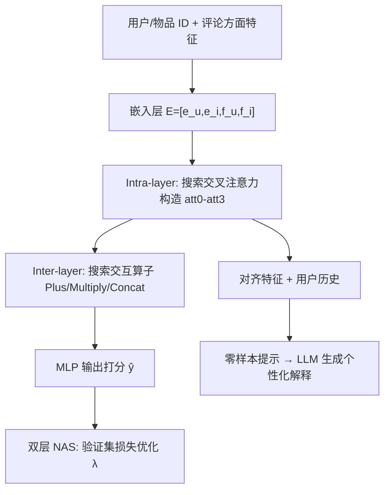

# Bi-NAS: Towards Effective and Personalized Explanation for Recommender Systems via Bi-Level Neural Architecture Search (基于双层神经架构搜索的有效个性化推荐解释)

- **会议/期刊**: ICDM 2025
- **作者与机构**: Longfeng Wu, Tong Zeng, Lecheng Zheng, Dawei Zhou (Virginia Tech)；Yao Zhou, Zhimin Peng, Bhanu Pratap Singh Rawat, Giovanni Seni (Amazon)
- **推荐链路定位**: 精排（打分）+ 解释生成
- **研究方向**: 对话推荐与智能体仿真 / 大语言模型推荐
- **论文原文**: [https://arxiv.org/abs/2607.01387v1](https://arxiv.org/abs/2607.01387v1)
- **开源代码**: [https://github.com/wulongfeng/Bi-NAS.git](https://github.com/wulongfeng/Bi-NAS.git)

## TL;DR (1分钟核心速览)

可解释推荐长期受困于「解释结构靠人工设计、固定架构跨数据集泛化差、LLM 直接生成易幻觉」三重矛盾。本文提出 Bi-NAS：把交叉注意力的四种构造方式（intra-layer）与特征交互算子（inter-layer）组成 72 个候选架构的搜索空间，用可微双层 NAS 端到端搜索；再把搜索对齐出的用户偏好特征与物品质量特征作为零样本提示的「事实锚点」交给 LLM 生成解释。在 Amazon 四个类目上，Hit@10 相对最强基线 NAR 提升 2.4%–20.4%，解释 F1 提升 5.2%–15.5%。

## Background & Motivation (背景与核心矛盾)

- **主流范式**: 可解释推荐分三支——评论情感/方面级模型（EFM、TriRank）、注意力内在可解释模型（NAR）、反事实解释（CER）；近年 LLM 被直接用于生成自然语言理由。
- **前人局限**: 其一，注意力结构、可解释路径均需专家手工设计，人力成本高且带人类先验偏置；其二，单一固定架构在不同规模/稀疏度数据集上无法通用（NAR 在 Video 上 Hit@10 达 0.520，在 Instrument 上仅 0.284）；其三，LLM 零样本直出解释缺乏用户上下文约束，易产生泛化、幻觉与「非个性化」输出。
- **核心洞察 (Key Insight)**: 用户评论中高频提及的方面即其真实关注点，物品评论的方面情感均值即其质量画像；二者在「同一特征维度」上的对齐本身就是最可信的解释证据。因此解释的「结构」应交由搜索决定，解释的「内容」应锚定在对齐特征上而非让 LLM 自由发挥。
- **本文切入点**: 用 NAS 替代人工设计可解释结构，用对齐特征约束 LLM 生成，一举同时解决 C1/C2/C3。

## Method (核心方法设计)

### 1. 整体框架 (Overall Architecture)

输入为 (用户 ID, 物品 ID, 用户特征向量 $\mathbf{f}_u$, 物品特征向量$\mathbf{f}_i$)，其中特征向量由 Sentire 抽取的 (Aspect, Opinion, Sentiment) 三元组经频率-情感饱和函数映射到$[0,T]$区间。嵌入层拼接为$\mathbf{E}=[\mathbf{e}_u,\mathbf{e}_i,\mathbf{f}_u,\mathbf{f}_i]$；交叉注意力层按搜索出的构造方式聚合特征，交互层按搜索出的算子做二阶交叉，MLP 输出点击概率；训练阶段以验证集损失为上层目标、训练集损失为下层目标做双层优化；推理阶段固化最优架构，并把对齐特征 + 用户历史填入零样本提示模板交由 Llama-3.1-8B-Instruct 生成解释。

### 2. 关键设计拆解 (Key Designs)

1. **Intra-layer：四种交叉注意力构造的可微选择**：固定注意力只让用户嵌入生成注意力矩阵，忽略了「物品特性也会反向塑造用户偏好」这一互惠关系。本文定义四种构造：`att0` 仅用户嵌入生成 $\mathbf{M}_a$；`att1` 用户偏好同时影响用户与物品特征；`att2` 物品特性反向影响二者；`att3` 双向互影响。以 `att0` 为例，注意力权重与聚合表示为
$$\alpha_k=\frac{\exp(\mathbf{e}_u^\top \mathbf{M}_a \mathbf{w}_k)}{\sum_{k=1}^{p}\exp(\mathbf{e}_u^\top \mathbf{M}_a \mathbf{w}_k)},\quad \tilde{\mathbf{f}}_u=[\alpha_1,\dots,\alpha_p]\odot\mathbf{f}_u$$
直觉上，$\alpha_k$ 越大意味着该方面在解释中被「点名」的概率越高，因此注意力构造直接决定了生成解释的方面选择粒度。

2. **Inter-layer：算子混合的连续松弛**：交互层需融合 $\tilde{\mathbf{f}}_u,\tilde{\mathbf{f}}_i$与原始$\mathbf{e}_u,\mathbf{e}_i$，但「加/乘/拼接」哪个更优高度依赖数据分布。本文将离散选择松弛为所有候选算子的加权混合：
$$\hat{g}=\sum_{t=1}^{|\mathcal{O}|}\lambda_t\, g_t(\tilde{\mathbf{f}}_u,\tilde{\mathbf{f}}_i),\quad \text{s.t.}\ \lambda\in\mathcal{C},\ \|\lambda\|_0=1$$
搜索结束后取 $g=\arg\max_{g_i\in\mathcal{O}}\lambda_i$离散化。由于$\lambda$ 可微，梯度下降即可替代 RL/进化算法，这是相对 MANAS 类方法把 10 万分钟级开销压到 1 万分钟级的关键。

3. **训练目标、负采样与推理效率**：双层目标为
$$G=\arg\min_{\lambda}\mathcal{L}_{val}(\hat{w}(\lambda),\lambda)\ \ \text{s.t.}\ \hat{w}=\arg\min_{w}\mathcal{L}_{train}(w,\lambda)$$
其中 $\mathcal{L}$为二分类交叉熵，4–5 星视为正反馈、其余为未标注并在其中做负采样。搜索空间规模为 intra$4$× inter$18$ = 72，连续松弛后无需穷举；推理阶段仅保留单一离散架构，与普通精排模型同量级开销，额外成本集中在一次性搜索。

## Experimental Setup & Evaluation Protocol (实验设置与评估协议)

- **数据集与预处理**: Amazon 四个顶层类目，仅保留含文本评论的交互，4–5 星为正、其余负采样；特征由 Sentire 抽取方面词与情感。

| 数据集 | #Users | #Items | #Interactions | #Features | 密度 |
| :--- | :---: | :---: | :---: | :---: | :---: |
| Instrument | 1,276 | 843 | 3,581 | 325 | 0.33% |
| Video | 4,333 | 1,486 | 11,759 | 350 | 0.18% |
| Beauty | 21,472 | 11,897 | 105,659 | 1,985 | 0.04% |
| Clothing | 37,703 | 22,647 | 142,553 | 1,462 | 0.02% |

- **数据划分与防穿越**: 随机 `70%/20%/10%` 训练/验证/测试比例划分，仅保留正样本数 > 5 的用户（等价 5-core 过滤）。
- **排名评测协议**: 采用 `Sampled Ranking`（测试阶段对未交互物品负采样后排序），指标为 Hit@10、NDCG@10、MRR；解释评测用 Precision/Recall/F1，以用户真实评论中正面情感方面为 ground truth。
- **对比基线与超参设置**: NCF、VBPR、CER、NAR、MANAS 五类基线，均按官方实现与默认超参；嵌入维度沿用各基线默认设置，未额外报告显著性检验。

## Key Experimental Results (实验关键数据)

### 1. 主实验对比 (Main Results)

推荐性能（节选 Hit@10 / NDCG@10 / MRR）：

| Method | Video Hit@10 | Video NDCG@10 | Instrument Hit@10 | Beauty Hit@10 | Clothing Hit@10 | Clothing MRR |
| :--- | :---: | :---: | :---: | :---: | :---: | :---: |
| NCF | 0.505 | 0.295 | 0.300 | 0.413 | 0.317 | 0.136 |
| VBPR | 0.507 | 0.285 | 0.262 | 0.401 | 0.289 | 0.123 |
| CER | 0.463 | 0.267 | 0.259 | 0.559 | 0.396 | 0.167 |
| NAR | 0.520 | 0.294 | 0.284 | 0.506 | 0.400 | 0.178 |
| MANAS | 0.341 | 0.202 | 0.148 | 0.477 | 0.204 | 0.098 |
| **Ours** | **0.543** | **0.307** | **0.342** | 0.545 | **0.406** | **0.185** |
| Improv. vs 最强基线 | +4.4% | +4.1% | +20.4% | −2.5% | +1.5% | +3.9% |

解释质量（F1）：

| Method | Video | Instrument | Beauty | Clothing |
| :--- | :---: | :---: | :---: | :---: |
| Random | 0.011 | 0.014 | 0.019 | 0.018 |
| CER | 0.154 | 0.146 | 0.225 | 0.201 |
| NAR | 0.174 | 0.192 | 0.254 | 0.235 |
| **Ours** | **0.201** | **0.201** | **0.262** | **0.247** |
| Improv. vs NAR | +15.5% | +4.7% | +3.1% | +5.1% |

### 2. 消融实验 (Ablation Study)

| 配置 | 推荐性能 | 解释性能 | 说明 |
| :--- | :---: | :---: | :--- |
| w/o cross-attention | 明显下降 | 明显下降 | 图 6（Beauty）显示两项指标同步退化 |
| Full Bi-NAS | 最优 | 最优 | 交叉注意力对推荐与解释均不可或缺 |

搜索所得架构（表 VI）显示：Instrument 选 `att1 + Plus`，Video 选 `att2 + Concat`，Beauty 选 `att2 + Concat`，Clothing 选 `att2 + Concat,Multiply`——四个数据集的最优架构互不相同。

### 3. 关键实验发现 (Key Findings)

1. **固定架构确实不通用**：NAR 在 Video 上 Hit@10 达 0.520 却只有 0.284（Instrument），而 Bi-NAS 在 Instrument 上把该指标从 0.284 拉到 0.342（+20.4%），说明小规模数据集恰恰是固定注意力最吃亏、搜索收益最大的场景。
2. **搜索出的架构无普适最优**：表 VI 中四个数据集的最优 intra/inter 组合各不相同，且没有任何单一算子组合在全部数据集上胜出，直接为「必须按数据集自适应搜索」提供了实证支撑。
3. **解释增益与推荐增益不同源**：Beauty 上 Bi-NAS 的 Hit@10（0.545）略低于 CER（0.559），但解释 F1（0.262）仍高于 CER（0.225），说明对齐特征 + LLM 提示带来的解释质量提升并非单纯由排序精度传导，而是独立的结构性收益。

## Highlights & Limitations (亮点、对比与审稿批判)

- **与代表作对比 (vs. Prior Work)**: 相比 NAR 的固定注意力架构，Bi-NAS 把「注意力怎么建」本身变成可学习变量；相比 MANAS 的模块化逻辑算子搜索，本文搜索的是交叉注意力构造 × 特征交互算子的联合空间，且用连续松弛把搜索成本降低一个数量级（Clothing 上 10,343 分钟 vs. 104,453 分钟）；相比 CER 的物品扰动反事实，本文以方面级对齐特征为解释证据，粒度更细。
- **可迁移亮点**: 其一，「方面频率-情感饱和映射」把评论文本压成 $[0,T]$ 区间的稠密特征向量，可直接复用于任何带评论的推荐场景做用户画像；其二，把 NAS 搜出的对齐特征作为 LLM 提示的硬约束槽位，是抑制解释幻觉的通用低成本手段。
- **审稿级局限批判**: 其一，评测采用采样排序而非 Full-Ranking，且未报告显著性检验，Hit@10 的绝对差距（如 Clothing 上 0.406 vs. 0.400）在采样协议下稳健性存疑；其二，搜索阶段开销仍达万分钟级（Clothing 10,343 分钟），且解释质量依赖 Sentire 方面抽取与 Llama-3.1-8B 的提示稳定性，跨语言/跨领域迁移成本未评估。

## Rating (四维评分)

- **方法创新性 (Novelty)**: ⭐⭐⭐⭐ （首次把可解释结构本身纳入 NAS 搜索空间，intra/inter 双层联合搜索 + LLM 锚定提示的组合有新意，但各组件单独看均非首创）
- **评估协议与实验扎实度 (Protocol & Experiments)**: ⭐⭐⭐ （四数据集 + 推荐/解释双维度评测较完整，但采样排序、无显著性检验、消融仅以图呈现且只报 Beauty 一个数据集，扎实度打折）
- **写作与数学规范度 (Clarity & Rigor)**: ⭐⭐⭐⭐ （搜索空间规模推导清晰、双层目标与松弛公式定义完整，但部分符号如 $\mathbf{M}_a$与$\mathbf{w}_k$ 的维度关系交代略简）
- **工业落地与复现价值 (Industrial & Practical Value)**: ⭐⭐⭐⭐ （代码与数据已开源，推理阶段仅保留单一离散架构、线上开销可控，但一次性搜索成本与 LLM 调用成本需在工程侧权衡）

