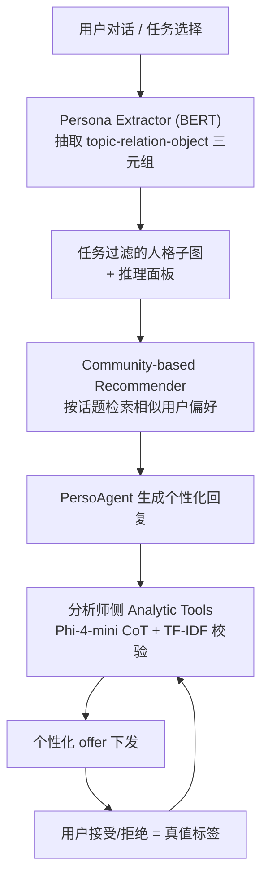
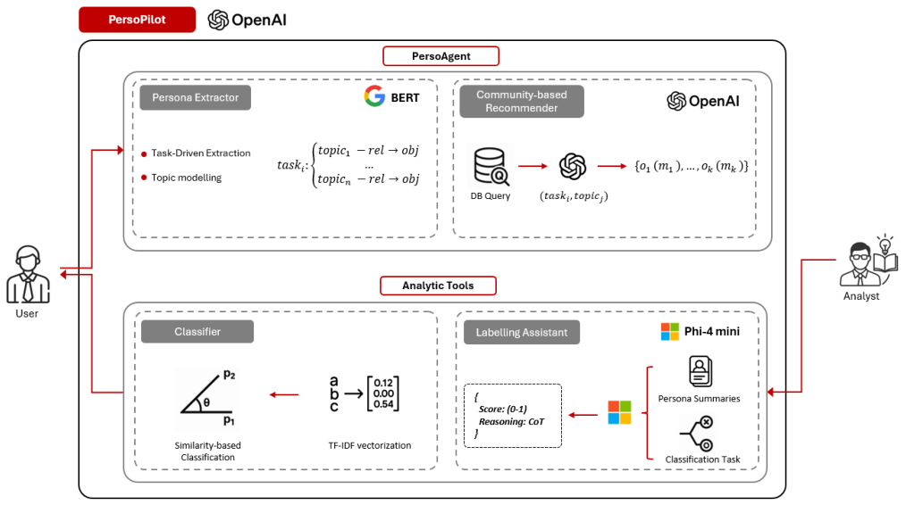

# PersoPilot: An Adaptive AI-Copilot for Transparent Contextualized Persona Classification and Personalized Response Generation (PersoPilot：面向透明上下文化人格分类与个性化回复生成的自适应 AI Copilot)

- **会议/期刊**: IEEE ICDM 2025（Demo Track）
- **作者与机构**: Saleh Afzoon, Amin Beheshti, Usman Naseem（麦考瑞大学计算学院，悉尼）
- **推荐链路定位**: 端到端生成式（对话式个性化服务 + 分析师在环标注闭环）
- **研究方向**: 对话推荐与智能体仿真 / 大语言模型推荐
- **论文原文**: [https://arxiv.org/abs/2602.04540v1](https://arxiv.org/abs/2602.04540v1)
- **开源代码**: [https://github.com/salehafzoon/PersoPilot](https://github.com/salehafzoon/PersoPilot)（模型侧依赖 [Phi-4-mini-instruct](https://huggingface.co/microsoft/Phi-4-mini-instruct)）

## TL;DR (1分钟核心速览)

现有对话式个性化系统把「人格画像」与「情境上下文」当作两路独立输入，导致回复缺乏任务敏感度，且分析师侧完全不可解释、无法迭代。PersoPilot 提出双模式 Agentic Copilot：用户侧 PersoAgent 用 BERT 人格抽取器把对话实时转成 topic–relation–object 三元组写入任务过滤的人格子图，再由社区推荐器按当前话题检索相似用户偏好；分析师侧用 Phi-4-mini 少样本 CoT 生成带置信度与理由的标签，TF-IDF 余弦相似度做交叉校验，用户对推荐邀约的接受/拒绝回流为真值，构成主动学习闭环。在 UniEval 上取得 Naturalness 0.84、Coherence 1.0、Groundedness 1.0、Understandability 0.86。

## Background & Motivation (背景与核心矛盾)

- **主流范式**: kBot、E-DHAP 等系统从对话历史或传感器数据做隐式人格建模，ExBigBang、CoBERT 引入文本+表格混合建模与可解释输出，E-ReDial 用自然语言理由增强推荐信任。
- **前人局限**: 其一，人格画像被当作**静态档案**，无法随任务目标（内容消费 / 生活方式 / 职业发展）动态裁剪，上下文与人格始终是两路拼接而非耦合；其二，上述系统几乎全部以**终端用户**为中心设计，分析师侧的标注可解释性与人在环控制不是设计目标，导致人格标签无法规模化、可持续地更新。
- **核心洞察 (Key Insight)**: 人格的价值不在「全量画像」，而在**任务条件下的上下文过滤**——只检索与当前任务/话题最相关的少量特质，既能降低知识 grounding 的噪声，又能让推理链对用户可见；同时，用户对个性化邀约的接受/拒绝本身就是最廉价、最真实的标注信号。
- **本文切入点**: 把「用户对话」与「分析师标注」放进同一个反馈回路，用轻量模型（BERT + TF-IDF + 4B 级 Phi-4-mini）而非重型微调来支撑可解释、可迭代的个性化。

## Method (核心方法设计)

### 1. 整体框架 (Overall Architecture)

系统由两个模块构成并互为闭环。**PersoAgent** 基于 LangChain 构建自主 Agent，挂载两个工具：Persona Extractor（ConvAI2 训练的 BERT 流水线，抽取任务相关实体并借预定义任务-话题分类体系构造 topic–relation–object 三元组，CPU 可部署）与 Community-based Recommender（按当前任务上下文从后端库检索相关话题与对象，回传给 Agent 与最新对话话题对齐后生成回复）。Agent 由结构化 prompt 驱动：任务背景 → 角色定义 → 用户信息 → 工具说明与调用条件 → 每工具一个 few-shot 示例 → 强制 JSON 输出以对接 FastAPI。**Analytic Tools** 侧，人格摘要与分类任务送入 Phi-4-mini-instruct（<4B 参数，单张 8GB GPU 可跑）做少样本 CoT 推理，输出标签、置信度与理由；TF-IDF 分类器计算人格文本与类别向量的余弦相似度作为快速可解释交叉校验。分析师确认标签后自动下发个性化 offer，用户接受/拒绝回流为标注数据，累积到阈值后解锁「随机分类新用户」批量预测，进入下一轮。

<figure class="paper-figure" markdown="span">
  <figcaption>图1：PersoPilot框架的架构概览。</figcaption>
</figure>

### 2. 关键设计拆解 (Key Designs)

1. **上下文过滤的人格子图（Contextual Persona Subgraph）**：痛点是静态全量画像在具体任务下引入大量无关特质、稀释 grounding。本文不做穷举式人格图，而是按所选任务预定义的话题清单对三元组做**上下文过滤**，只保留相关子图并实时增量写入新抽取的偏好条目。有效性直觉：检索空间从「全画像」收缩到「任务相关切片」，既提升回复与当前意图的对齐度，又让用户在推理面板中直接看到「我的哪条偏好被用来生成这句话」，透明性即来自过滤本身。

2. **双通道可解释标注（LLM CoT + TF-IDF 交叉校验）**：痛点是纯 LLM 标注不可审计、纯规则标注不灵活。Phi-4-mini 对每个人格摘要输出标签、置信度 $c$与理由，默认以阈值$\tau=0.60$划分正负类；同时 TF-IDF 将人格摘要向量化后与类别向量算余弦相似度$\cos(\mathbf{v}_p,\mathbf{v}_k)$ 作为独立第二意见。分析师可在下拉框中逐条覆写。有效性直觉：两路信号一个偏语义推理、一个偏词面统计，错误模式不相关，交叉校验能在低成本下暴露 LLM 的过度自信样本。

3. **主动学习闭环与训练/推理开销**：无梯度训练，全部依赖少样本 prompt 与相似度检索。闭环的「损失」实质是分析师覆写率与用户 offer 接受率构成的隐式反馈流：新标注累积后触发 TF-IDF 分类器对未标注用户批量打标，预测结果驱动下一波 offer，其接受/拒绝再回流。推理侧 PersoAgent 走 OpenAI API（作者明确说明同规模开源模型在多步工具调用时格式稳定性不足），Analytic Tools 本地单卡 8GB 即可，整体工程门槛极低。

## Experimental Setup & Evaluation Protocol (实验设置与评估协议)

- **数据集与预处理**: 本文为 Demo 论文，**未使用标准推荐基准数据集**，也未报告用户/物品/交互统计表。人格抽取器训练于 ConvAI2（persona-aligned 对话样本）；评估仅用「有限数量的 prompt 与输出」做系统级质量评测。

| 数据集 | #Users | #Items | #Interactions | 稀疏度/密度 | 特征/场景说明 |
| :--- | :---: | :---: | :---: | :---: | :--- |
| ConvAI2（仅训练抽取器） | 未报告 | 未报告 | 未报告 | 未报告 | 人格对齐对话，用于 BERT 抽取流水线 |
| UniEval 评测集 | 未报告 | — | 有限 prompt 集 | — | 回复级四维质量评估 |

- **数据划分与防穿越 (Splitting Strategy)**: 未报告。无训练/验证/测试划分，无 Leave-One-Out 或时间戳切分。
- **排名评测协议 (Ranking Protocol)**: **不适用**。本文不做 Top-N 排序评测，无 Full-Ranking 或 Sampled Ranking，无 Recall@K / NDCG@K / HR@K 指标。
- **对比基线与超参设置**: **无基线对比**。仅报告系统自身在 UniEval 框架下的绝对分数；关键超参为分类置信度阈值 $\tau=0.60$、Phi-4-mini（<4B）、BERT-base-uncased、TF-IDF 余弦相似度。

## Key Experimental Results (实验关键数据)

### 1. 主实验对比 (Main Results)

原文未设基线，仅有 UniEval 绝对分数（满分 1.0）：

| 评估维度 | PersoPilot 得分 | 说明 |
| :--- | :---: | :--- |
| Naturalness | 0.84 | 回复流畅自然度 |
| Coherence | **1.00** | 结构与逻辑连贯性 |
| Groundedness | **1.00** | 与用户查询的事实对齐 |
| Understandability | 0.86 | 可理解性 |

### 2. 消融实验 (Ablation Study)

**原文未提供任何消融实验**。Persona Extractor、Community Recommender、Phi-4-mini CoT、TF-IDF 校验四个组件均无 `w/o` 对照，也无主动学习轮次的增益曲线。

### 3. 关键实验发现 (Key Findings)

1. **Groundedness 与 Coherence 双双满分（1.00），而 Naturalness/Understandability 停在 0.84/0.86**：说明上下文过滤 + 工具化 grounding 确实压住了幻觉与跑题，但生成侧的表达自然度仍是短板，瓶颈在回复措辞而非知识对齐。
2. **评测规模极小且无基线**：作者自述仅在「limited set of prompts and outputs」上评测，四维分数不具备统计显著性，无法判断 0.84 相对通用 LLM 直答是否真有增益。
3. **系统成本结构极轻**：Phi-4-mini <4B 单卡 8GB、BERT 抽取器 CPU 可跑、TF-IDF 无需训练，说明该闭环的落地瓶颈不在算力而在标注冷启动与分析师人力。

## Highlights & Limitations (亮点、对比与审稿批判)

- **与代表作对比 (vs. Prior Work)**: 相比 kBot / E-DHAP 只做终端用户侧隐式人格建模，本文把**分析师在环**提升为一等设计目标；相比 ExBigBang / CoBERT 的混合特征分类，本文用「LLM CoT + TF-IDF」双通道替代重型融合模型，牺牲精度换可审计性；相比 E-ReDial 的静态领域理由生成，本文的理由随任务子图与对话话题动态变化，并接入主动学习回路。
- **可迁移亮点**: 其一，「任务过滤子图 + 推理面板」这一透明化范式可直接迁移到对话推荐的可解释理由生成；其二，把**推荐邀约的接受/拒绝当作免费标注信号**回流训练分类器，是冷启动场景下极低成本的标签获取技巧。
- **审稿级局限批判**: 其一，**评估严重不足**——无基准数据集、无基线、无消融、无用户研究，UniEval 四维分数在极小样本上无法支撑任何有效性结论，作为 Demo 可接受但作为论文证据链薄弱；其二，**架构耦合外部 API**，PersoAgent 依赖 OpenAI 接口，离线/隐私敏感场景不可用，且多步工具调用的延迟与成本未做任何测量；此外 $\tau=0.60$ 阈值与 TF-IDF 类别向量的构造方式均无敏感性分析。

## Rating (四维评分)

- **方法创新性 (Novelty)**: ⭐⭐⭐ （双模式闭环与上下文过滤子图的设计思路清晰，但各组件均为成熟技术的工程组合，缺少新的学习目标或理论支撑）
- **评估协议与实验扎实度 (Protocol & Experiments)**: ⭐⭐ （无基准数据集、无基线、无消融、无划分协议，仅有限 prompt 上的 UniEval 绝对分，证据强度不足以支撑性能主张）
- **写作与数学规范度 (Clarity & Rigor)**: ⭐⭐⭐ （系统架构与两个 Demo 场景描述清楚、工程细节可复现，但全文无一个形式化公式，阈值与相似度定义停留在文字层面）
- **工业落地与复现价值 (Industrial & Practical Value)**: ⭐⭐⭐⭐ （代码与前后端全开源，Phi-4-mini 单卡 8GB + CPU 抽取器，落地门槛极低，主动学习闭环对真实业务标注流程有直接参考价值）

