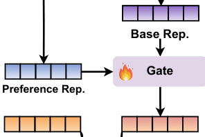
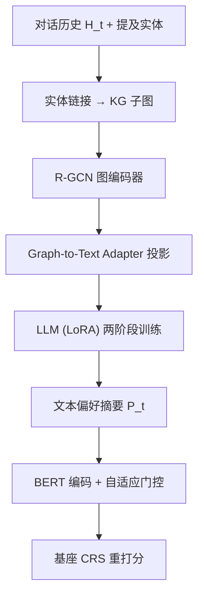

# Reasoning over User Preferences: Knowledge Graph-Augmented LLMs for Explainable Conversational Recommendations (基于知识图谱增强大语言模型的用户偏好推理与可解释对话推荐)

- **会议/期刊**: ICDM 2025
- **作者与机构**: Zhangchi Qiu, Linhao Luo, Shirui Pan, Alan Wee-Chung Liew（Griffith University / Monash University）
- **推荐链路定位**: 重排（作为即插即用增强器，为已有 CRS 提供偏好表征后重打分）
- **研究方向**: 对话推荐与智能体仿真 / 大语言模型推荐
- **论文原文**: [https://arxiv.org/abs/2411.14459v2](https://arxiv.org/abs/2411.14459v2)
- **开源代码**: [https://github.com/icedpanda/COMPASS-official](https://github.com/icedpanda/COMPASS-official)

## TL;DR (1分钟核心速览)

现有对话推荐系统（CRS）把用户偏好压成隐向量，既不可解释、也难以推理对话中未明说的隐式兴趣；而直接用 LLM 做偏好总结又缺乏领域知识、且结构化 KG 与自然语言之间存在模态鸿沟。COMPASS 提出两阶段训练：先用 R-GCN+Adapter 做**图实体描述预训练**把 KG 实体翻译成自然语言，再做**知识感知指令微调**让 LLM 从对话历史与 KG 上下文中生成"推理链+整体偏好+当前兴趣+推荐"四段式文本偏好摘要，最后用自适应门控注入任意 CRS。在 ReDial/INSPIRED 全库排序协议下，KBRD 的 HR@10 提升 44.76%，最强基线 MSCRS 仍再涨 7.78%。

## Background & Motivation (背景与核心矛盾)

- **主流范式**: 以 KBRD/KGSF/UniCRS/MSCRS 为代表，用 KG 或 PLM 抽取用户偏好并编码为隐向量，再与物品表征做内积打分。
- **前人局限**: 其一，隐向量无法回答"系统到底认为我喜欢什么"，推荐理由不可验证；其二，纯 item-centric 建模只能捕捉对话中显式提及的物品，无法推断隐式动机（如"喜欢高智商犯罪片"）。
- **LLM 直上的困境**: 通用 LLM 缺乏物品属性与关系的领域知识，且 KG 的图结构与 LLM 的 token 序列存在**模态鸿沟**，无法直接做跨模态推理。
- **核心洞察 (Key Insight)**: 若能把 KG 实体"翻译"成 LLM 能读的自然语言描述，LLM 就能在对话与知识之间做显式推理，并把偏好以人类可读文本形式输出。
- **本文切入点**: 用"图实体描述预训练"对齐模态，再用指令微调教会 LLM 做跨模态偏好推理，输出可直接插拔的文本偏好。

<figure class="paper-figure" markdown="span">
  <figcaption>图 2：我们的 COMPASS 的整体框架。COMPASS 由三个组件组成：图编码器、适配器和 LLM。适配器将知识图谱对齐到 LLM。COMPASS 遵循两阶段训练范式——(a) 图实体描述生成和 (b) 知识感知指令微调。训练完成后，COMPASS 可以轻松与现有 CRS 模型集成，用于 (c) 偏好增强推荐。</figcaption>
</figure>

## Method (核心方法设计)

### 1. 整体框架 (Overall Architecture)

COMPASS 由三部件构成：**R-GCN 图编码器**（以 PLM 编码实体描述为初值，多层关系感知消息传递得到实体嵌入）、**Graph-to-Text Adapter**（单层线性投影把图嵌入映射到 LLM 语义空间）、**LLM 主干**（Llama3.1-8B，冻结参数 + LoRA）。训练分两阶段：阶段一图实体描述预训练，让 LLM 学会把投影后的实体嵌入"读"成实体描述；阶段二知识感知指令微调，输入对话历史 + 提及实体嵌入 + 指令，输出结构化偏好摘要。推理时 COMPASS 冻结，摘要经 BERT 编码后与基座 CRS 的用户表征做门控融合再打分。

### 2. 关键设计拆解 (Key Designs)

1. **图实体描述预训练（Graph Entity Captioning）**：痛点是不对齐则 LLM 读不懂图嵌入。做法是为每个实体构造"输入=投影嵌入 $h_e^\tau$+ 指令$I_c$，输出=实体描述$C_e$"的样本，用 NLL 训练：
$$\mathcal{L}_{\text{caption}}=-\sum_{e\in\mathcal{E}}\log P(C_e\mid h_e^\tau, I_c)$$
其中 $h_e^\tau=f_P(h_e)$，$h_e$由 R-GCN 逐层聚合$h_e^{(l+1)}=\sigma\big(\sum_{r}\sum_{e'\in\mathcal{E}_e^r}\frac{1}{Z_{e,r}}W_r^{(l)}h_{e'}^{(l)}+W_e^{(l)}h_e^{(l)}\big)$ 得到。直觉上这等价于"用生成任务反向监督投影层"，把图结构信息压进 LLM 可解码的语义槽位，类似视觉-语言模型的 captioning 对齐。

2. **知识感知指令微调（Knowledge-aware Instruction Tuning）**：痛点是 LLM 不会主动把对话与 KG 交叉验证。做法是用粗到细四段式指令（推理 → 整体偏好 → 当前兴趣 → 推荐），输入提及实体嵌入 $E_t$、指令$I_p$与对话历史$H_t$，监督信号由 GPT-4 依据对话与 KG 元数据生成的偏好摘要$P_t$ 提供：
$$\mathcal{L}_{\text{preference}}=-\sum_{D\in\mathcal{C}}\sum_{H_t\in D}\log P(P_t\mid E_t, I_p, H_t)$$
"推理"段强制模型显式写出证据链，使偏好可溯源；"当前兴趣"段则承担动态偏好建模，弥补静态画像的不足。

3. **自适应门控注入与训练目标**：基座 CRS 的用户表征 $s_b$与摘要编码$s_c$经$\gamma=\sigma(W[s_b;s_c])$、$s_u=\gamma s_b+(1-\gamma)s_c$融合，再以$\text{softmax}(s_u\cdot I_i)$打分，用交叉熵$\mathcal{L}_{\text{rec}}$ 训练门控与编码器（COMPASS 冻结）。门控让模型按对话轮次自适应决定"信基座还是信 LLM 摘要"，避免弱基座被强摘要淹没、强基座被噪声摘要拖累。训练全程无负采样，全库 softmax 计算。

## Experimental Setup & Evaluation Protocol (实验设置与评估协议)

- **数据集与预处理**: 两个英文电影对话推荐基准，均用官方划分；KG 由 IMDB 按片名+年份爬取构建。

| 数据集 | #Conversations | 领域 | 特点 |
| :--- | :---: | :---: | :--- |
| ReDial | 11,348 | 电影 | AMT 众包，规模大、噪声多 |
| INSPIRED | 999 | 电影 | 含社会科学理论驱动的推荐策略标注 |

- **数据划分与防穿越 (Splitting Strategy)**: 采用数据集**官方划分**（对话级切分），偏好摘要的 ground truth 由 GPT-4 离线生成，不与测试对话重叠。
- **排名评测协议 (Ranking Protocol)**: 报告 HR@10/50、NDCG@10/50、MRR@10/50，属**全库候选打分**（对全部物品做 softmax 排序），非采样排序；显著性用 $t$-test，$p<0.05$。
- **对比基线与超参设置**: 基线覆盖传统 CRS（ReDial）、KG 方法（KBRD、KGSF）、语言模型（BERT、GPT-2、Llama3.1-8B）、元数据增强（PECRS）、KG+LM 混合（BARCOR、UniCRS、DCRS、MSCRS）。图编码器 1 层、隐维 768；LLM 冻结 + LoRA；预训练 batch 256 / 微调 128（ReDial 均 128）；A100 运行。摘要质量另用 ROUGE-1/2/L/Sum、GPT-4o-mini 评的 Reasoning Proficiency (RP) 与 Factual Consistency (FC)，以及 LLM 模拟用户排序（Alignment / Explainability）。

## Key Experimental Results (实验关键数据)

### 1. 主实验对比 (Main Results)

| 模型 | ReDial HR@10 | ReDial NDCG@10 | ReDial MRR@10 | INSPIRED HR@10 | INSPIRED NDCG@10 | INSPIRED MRR@10 |
| :--- | :---: | :---: | :---: | :---: | :---: | :---: |
| KBRD | 0.151 | 0.099 | 0.071 | 0.172 | 0.106 | 0.086 |
| KGSF | 0.183 | 0.098 | 0.072 | 0.175 | 0.106 | 0.088 |
| Llama3.1-8B | 0.188 | 0.103 | 0.078 | 0.190 | 0.118 | 0.094 |
| UniCRS | 0.216 | 0.118 | 0.087 | 0.250 | 0.182 | 0.148 |
| DCRS | 0.242 | 0.142 | 0.111 | 0.225 | 0.152 | 0.128 |
| MSCRS | 0.255 | 0.153 | 0.122 | 0.257 | 0.163 | 0.145 |
| COM.+KBRD | 0.199 (+31.79%) | 0.103 (+4.04%) | 0.075 (+5.63%) | 0.249 (+44.76%) | 0.152 (+43.39%) | 0.123 (+43.02%) |
| COM.+BERT | 0.182 (+27.27%) | 0.098 (+34.25%) | 0.073 (+40.38%) | 0.207 (+15.64%) | 0.129 (+35.79%) | 0.105 (+45.83%) |
| COM.+Llama3.1-8B | 0.215 (+13.76%) | 0.118 (+14.45%) | 0.089 (+12.82%) | 0.232 (+22.11%) | 0.146 (+23.73%) | 0.117 (+24.47%) |
| **COM.+MSCRS** | **0.264 (+3.53%)** | **0.160 (+4.58%)** | **0.129 (+5.74%)** | **0.277 (+7.78%)** | **0.183 (+12.27%)** | **0.154 (+6.21%)** |

### 2. 消融实验 (Ablation Study)

| 变体 (ReDial) | KBRD HR@10 | KGSF HR@10 | Llama HR@10 | KBRD NDCG@10 | Llama NDCG@10 |
| :--- | :---: | :---: | :---: | :---: | :---: |
| 基座 | 0.151 | 0.183 | 0.188 | 0.099 | 0.103 |
| +COM w/o KG | 0.195 | 0.196 | 0.209 | 0.102 | 0.116 |
| +COM w/o REC | 0.190 | 0.192 | 0.202 | 0.100 | 0.109 |
| +COM w/o GEP | 0.188 | 0.196 | 0.212 | 0.100 | 0.117 |
| **+COMPASS** | **0.199** | **0.198** | **0.215** | **0.103** | **0.118** |

摘要质量侧（表 III）：COMPASS 在 ReDial 上 ROUGE-1 62.71 / RP 82.20 / FC 84.21，均高于 w/o KG（62.06 / 81.33 / 82.13）与 w/o GEP；INSPIRED 上 ROUGE-1 59.37、FC 85.17 同样最优。

### 3. 关键实验发现 (Key Findings)

1. **增益与基座强度反相关**：KBRD 在 INSPIRED 上 HR@10 暴涨 44.76%，而最强基线 MSCRS 仅 +7.78%，说明 COMPASS 主要补的是"偏好建模能力"而非"知识量"，弱基座受益最大，强基座则获得可解释性增量。
2. **KG 与预训练缺一不可且量级相当**：去掉 KG 或去掉 GEP 在 KBRD 上 HR@10 分别掉到 0.195/0.188（vs. 0.199），说明模态对齐与领域知识是两条独立增益路径，仅给结构化知识而不对齐，LLM 仍读不懂图。
3. **摘要中的"推荐"段是硬需求**：w/o REC 变体在 Llama 基座上 HR@10 从 0.215 掉到 0.202、NDCG@10 从 0.118 掉到 0.109，是消融中最大跌幅之一，表明摘要若只描述偏好而不给出候选引导，下游重打分几乎失去方向性信号。

## Highlights & Limitations (亮点、对比与审稿批判)

- **与代表作对比 (vs. Prior Work)**: 相比 UniCRS/DCRS 把 KG 作为 prompt 或检索证据喂给 LLM、最终仍回归隐向量，COMPASS 的产物是**人类可读的偏好文本**，可解释性从"事后生成理由"变为"偏好本身就是理由"；相比 GPT-4o 直接总结（图 3），COMPASS 在 INSPIRED 上以更小模型全面胜出，证明领域 KG 比模型规模更关键。
- **可迁移亮点**: ①"图实体描述预训练"这一模态对齐范式可平移到任何 GNN+LLM 的推荐场景（如 POI、电商 KG）；②自适应门控 $\gamma$ 提供了一种零改动的即插即用增强接口，适合工业侧渐进式上线。
- **审稿级局限批判**: ①偏好摘要的监督信号由 GPT-4 生成，存在教师模型偏差与幻觉传导风险，且未报告人工评估；②每轮对话需一次 LLM 前向 + 实体链接 + 图编码，在线延迟与成本未量化，对实时 CRS 部署不友好；③INSPIRED 仅 999 条对话，44.76% 这类大幅提升的统计稳健性存疑。

## Rating (四维评分)

- **方法创新性 (Novelty)**: ⭐⭐⭐⭐ （图实体描述预训练把视觉-语言对齐思路迁移到 KG-LLM，思路清晰但组件均为已有技术组合）
- **评估协议与实验扎实度 (Protocol & Experiments)**: ⭐⭐⭐⭐ （全库排序 + 5 个基座插拔 + 摘要质量与模拟用户三重评估较完整，但缺人工评测与小样本稳健性分析）
- **写作与数学规范度 (Clarity & Rigor)**: ⭐⭐⭐⭐ （两阶段训练与门控公式交代清楚，符号统一；部分模块如实体链接细节略简）
- **工业落地与复现价值 (Industrial & Practical Value)**: ⭐⭐⭐⭐ （代码开源、即插即用门控设计友好，但 LLM 在线推理开销与延迟是落地主要障碍）

