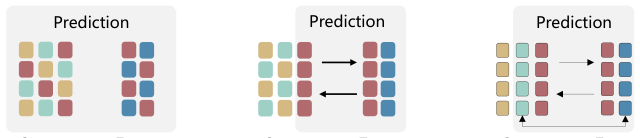
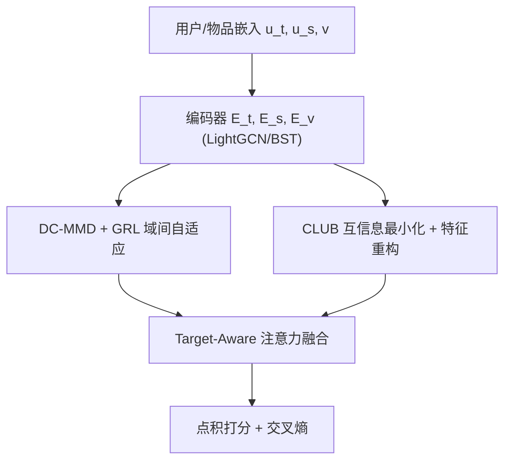

# Adversarial Alignment and Disentanglement for Cross-Domain CTR Prediction with Domain-Encompassing Features (面向域包容特征的跨域 CTR 对抗对齐与解耦)

- **会议/期刊**: ICDM 2025
- **作者与机构**: Junyou He, Lixi Deng, Huichao Guo, Yong Li, Sulong Xu (京东搜索与推荐平台部)；Ye Tang (石化盈科)
- **推荐链路定位**: 精排（跨域 CTR 预估）
- **研究方向**: 跨域与多场景推荐 / CTR 预估与特征交叉
- **论文原文**: [https://arxiv.org/abs/2601.17472v1](https://arxiv.org/abs/2601.17472v1)
- **开源代码**: [https://github.com/youzi0925/A-2DCDR](https://github.com/youzi0925/A-2DCDR)

## TL;DR (1分钟核心速览)

现有解耦式跨域推荐（DisenCDR/DCCDR/DDCDR）只把「域不变特征 + 目标域特有特征」送进预测层，把源域中与目标域分布不对齐、但对目标域仍有增益的信号（如 Sport→Cloth 中的「每周健身频次」）当作噪声丢弃。本文提出 A²DCDR：用带梯度反转的域约束 MMD（DC-MMD）把源域表征「推」成域包容特征，用 CLUB 互信息上界做域内解耦，再用特征重构保证信息完整性，最后以 Target-Aware 注意力融合。在 4 组 Amazon 场景上 HR@10 相对最强基线最高提升 6.96（Cloth），线上 15 天 A/B 的 CTR 提升 7.18%。

## Background & Motivation (背景与核心矛盾)

- **主流范式**: 跨域推荐分两支——混合式（CoNet/DTCDR/DDTCDR/BiTGCF）直接共享或映射用户嵌入；解耦式（DisenCDR/DCCDR/DDCDR/GDCCDR）把表征拆成域不变与域特有，仅迁移域不变部分。
- **前人局限**: ① 混合式不做区分，源域噪声直接污染目标域，存在负迁移风险；② 解耦式以分布对齐为唯一准则，凡与目标域分布不一致的特征一律被排除，但「非对齐 ≠ 无用」——源域独有信号可能正是目标域缺失的补充信息。
- **核心洞察 (Key Insight)**: 对齐只保证分布一致，不保证信息完备。源域表征 $h^A_t$ 应当同时覆盖「与目标域重叠的域不变部分」和「源域独有但对目标域有价值的非对齐部分」，即域包容特征（domain-encompassing feature）。
- **本文切入点**: 用对抗式 MMD 把 $h^A_t$从目标域特有表征$h^B_s$处「推开」而非「拉齐」，从而在保留对齐能力的同时把非对齐信息留在$h^A_t$ 内。

<figure class="paper-figure" markdown="span">
  <figcaption>图 1. 现有跨域推荐（CDR）方法示意图：(a) 混合式 CDR 方法，将包括噪声在内的所有跨域表示混合；(b) 解耦式 CDR 方法，侧重于分离域不变信息与域特有信息；(c) 本文提出的 A2DCDR 框架，通过对抗训练与特征重构同时捕获域不变特征与有价值的非对齐特征。</figcaption>
</figure>

## Method (核心方法设计)

### 1. 整体框架 (Overall Architecture)

每个域的用户被拆成两套 $d$维嵌入：域包容$u_t$与域特有$u_s$，物品嵌入$v$域内共享；三路编码器（公开数据用 2 层 LightGCN，工业侧换 BST）分别产出$h_t, h_s, h_v$。域间自适应模块用 DC-MMD 对齐$h^A_t$与$h^B_t$，同时借 GRL 把$h^A_t$推离$h^B_s$；域内解耦器用 CLUB 互信息上界压低$I(h_t;h_s)$，并用重构器从$[h_t;h_s]$还原原始嵌入以防信息流失；最后 Target-Aware 注意力以候选物品$h_v$为 query 对$\{h^{B}_t, h^{A}_t, h^{A}_s\}$ 加权，点积打分后接交叉熵。

### 2. 关键设计拆解 (Key Designs)

1. **域约束 MMD（DC-MMD）**：传统 MMD 只做单向拉齐，无法保留非对齐信息。本文在 RKHS 中写两项：第一项对齐 $h^A_t$与$h^B_t$的均值嵌入；第二项经两层网络$G_B$与梯度反转层作用于$h^B_s$，**最大化**其与$h^A_t$的核均值距离，等价于把$h^A_t$ 撑大成「包含对齐区 + 源域独有区」的更大簇：
$$\mathcal{L}_{\text{DC-MMD}}=\Big\|\tfrac{1}{N}\textstyle\sum_i \phi(h^A_{t,i})-\tfrac{1}{N}\sum_i \phi(h^B_{t,i})\Big\|_{\mathcal{H}_\kappa}+\Big\|\tfrac{1}{N}\sum_i \phi(h^A_{t,i})-\tfrac{1}{N}\sum_i \phi(G_B(\text{GRL}(h^B_{s,i})))\Big\|_{\mathcal{H}_\kappa}$$
   直觉：第一项保证可迁移性，第二项保证 $h^A_t$ 不被压缩到目标域子空间，从而隐式吸收源域独有信号。

2. **CLUB 互信息解耦 + 特征重构**：仅靠域间对齐只是「间接」解耦，$h_t$与$h_s$ 仍可能共享冗余。本文用 CLUB 的对比 log-ratio **上界**（而非 InfoNCE 的下界）直接最小化域内互信息，配合打乱样本构造负对：
$$\mathcal{L}^A_{\text{mi}}=\tfrac{1}{N}\textstyle\sum_i\big[\log q_\theta(h^A_{t,i}\mid h^A_{s,i})-\log q_\theta(\tilde{h}^A_{t,i}\mid h^A_{s,i})\big]$$
   同时重构器 $R$以 Frobenius 范数还原原始嵌入$\mathcal{L}_{\text{rec}}=\sum_i\gamma\|\hat{u}_i-u_i\|_F^2$，堵住「解耦越彻底、信息丢得越多」的漏洞——这是 DisenCDR/DCCDR 均未处理的盲点。

3. **Target-Aware 融合与训练目标**：静态拼接无法区分各表征对具体候选的贡献，故以候选物品为 query 做注意力：$e^A_{u_i,j}=\sum_{h\in\{h^{B}_t,h^{A}_t,h^{A}_s\}}\text{softmax}(\langle h^A_{v_j},h\rangle/\sqrt{d})\,h$，再$\hat{r}=\langle e^A_{u_i,j},h^A_{v_j}\rangle$。总损失$\mathcal{L}_{\text{total}}=\mathcal{L}_{\text{ce}}+\alpha\mathcal{L}_{\text{DC-MMD}}+\mathcal{L}_{\text{mi}}+\mathcal{L}_{\text{rec}}$，负采样沿用 DisenCDR 的 1 正 999 随机负协议，无额外难负采样设计。

## Experimental Setup & Evaluation Protocol (实验设置与评估协议)

- **数据集与预处理**: 沿用 DisenCDR 的 Amazon 四域切分，构造 Elec&Phone、Sport&Cloth、Sport&Phone、Elec&Cloth 四组场景，不使用任何 side information。

| 数据集(域对) | #Users | #Items | #Interactions(Train/Test) | 密度 | 场景说明 |
| :--- | :---: | :---: | :---: | :---: | :--- |
| Elec&Phone | 3,325 | 38,706 / 17,709 | 115,554+50,407 / 2,560+2,559 | 0.091%/0.089% | 3C 跨类 |
| Sport&Cloth | 9,928 | 30,796 / 39,008 | 92,612+87,829 / 8,326+7,540 | 0.033%/0.024% | 运动→服饰 |
| Sport&Phone | 4,998 | 20,845 / 13,655 | 50,558+42,446 / 3,698+3,999 | 0.052%/0.068% | 样本最少 |
| Elec&Cloth | 15,761 | 51,447 / 48,781 | 210,865+121,083 / 13,824+12,526 | 0.027%/0.017% | 最大规模 |

- **数据划分与防穿越 (Splitting Strategy)**: 与 DisenCDR 完全一致的固定训练/测试集划分（非时间戳切分），保证与历史基线可比。
- **排名评测协议 (Ranking Protocol)**: `Sampled Ranking`——每正样本配 999 个随机负样本，报告 HR@10 与 NDCG@10；显著性用配对 t 检验，$p<0.05$。
- **对比基线与超参设置**: 单域 NeuMF/NGCF/LightGCN，跨域 DDTCDR/PPGN/BiTGCF/DCCDR/DisenCDR/DDCDR/GDCCDR；嵌入维度统一 $d=128$，学习率网格$\{0.00175,\dots,0.002\}$，batch 1024，100 epoch，5 个随机种子取均值；$\alpha=1.0$、$\beta_A=10^{-4}$、$\beta_B=9\times10^{-4}$、$\gamma_A=0.01$、$\gamma_B=0.09$。

## Key Experimental Results (实验关键数据)

### 1. 主实验对比 (Main Results)

| 场景 | 指标@10 | LightGCN | BiTGCF | DisenCDR | DDCDR | GDCCDR | **A²DCDR** | Improv. |
| :--- | :---: | :---: | :---: | :---: | :---: | :---: | :---: | :---: |
| Elec | HR | 19.17 | 22.14 | 24.57 | 24.78 | 23.71 | **25.66** | +0.88 |
| Elec | NDCG | 10.28 | 12.20 | 14.51 | 14.94 | 15.23 | **16.30** | +1.07 |
| Phone | HR | 23.25 | 25.71 | 28.76 | 28.89 | 29.75 | **30.44** | +0.69 |
| Phone | NDCG | 12.72 | 13.93 | 16.13 | 17.93 | 19.10 | **19.47** | +0.37 |
| Sport | HR | 13.19 | 14.83 | 17.55 | 17.86 | 19.54 | **21.25** | +1.71 |
| Sport | NDCG | 6.94 | 7.95 | 9.46 | 9.77 | 12.03 | **14.40** | +2.37 |
| Cloth | HR | 13.58 | 14.68 | 16.31 | 18.32 | 20.56 | **23.73** | +3.17 |
| Cloth | NDCG | 7.29 | 7.93 | 9.03 | 10.94 | 14.35 | **16.84** | +2.49 |
| Sport(→Phone) | HR | 16.33 | 18.63 | 20.17 | 19.25 | 20.57 | **24.45** | +3.88 |
| Phone(→Sport) | HR | 16.47 | 21.10 | 23.55 | 24.02 | 23.17 | **27.81** | +3.79 |
| Elec(→Cloth) | HR | 19.97 | 21.61 | 23.71 | 23.91 | 21.92 | **24.15** | +0.24 |
| Cloth(→Elec) | HR | 11.24 | 13.11 | 15.13 | 16.75 | 17.03 | **23.99** | +6.96 |

### 2. 消融实验 (Ablation Study)

| 变体 (Sport&Cloth) | Sport HR | Sport NDCG | Cloth HR | Cloth NDCG |
| :--- | :---: | :---: | :---: | :---: |
| LightGCN | 13.19 | 6.94 | 13.58 | 7.29 |
| Inter-domain Only | 17.32 | 9.40 | 18.94 | 12.33 |
| Intra + Inter | 20.30 | 13.29 | 22.10 | 14.88 |
| w/o TAFC | 21.12 | 13.75 | 22.95 | 16.42 |
| **A²DCDR** | **21.25** | **14.40** | **23.73** | **16.84** |

### 3. 关键实验发现 (Key Findings)

1. **DC-MMD 是最大贡献源**：仅加域间模块即把 Sport HR 从 13.19 拉到 17.32（+4.13），已追平 DisenCDR/DDCDR 量级，说明「保留非对齐信息」比「更精细的对齐」更值钱；后续三个模块合计再贡献 +3.93。
2. **稀疏场景收益最大**：Sport&Phone 训练样本最少，HR 提升 +3.88/+3.79；分桶实验中 Cloth 侧 1–10 交互用户 HR 从 15.37（DisenCDR）升至 21.45，验证域包容特征对冷用户补信息的作用。
3. **线上可落地**：BST 骨干下离线 AUC 71.5→72.7，15 天 A/B 的 CTR +7.18%；跨域嵌入增量 3.8GB（基线 100GB），推理额外开销 <1ms，P99 仍在 33ms 内，说明重计算全部前置到离线阶段的设计成立。

## Highlights & Limitations (亮点、对比与审稿批判)

- **与代表作对比 (vs. Prior Work)**: 相比 DisenCDR（变分推断 + KL 解耦）与 DCCDR（对比学习解耦），本文的关键差异是把「非对齐」从被消除的对象改为被保留的对象，并用 GRL 显式制造排斥；相比 DDCDR 的教师-学生选择性蒸馏，本文不需要额外的教师模型与两阶段训练，单阶段端到端即可，训练 30s/epoch（DDCDR 18s、DisenCDR 88s）。
- **可迁移亮点**: ① 「对齐 + 排斥」的双向 MMD 可作为通用域适应正则，直接插到任意双域共享用户的场景；② CLUB 上界 + 重构损失的组合是解耦任务中防信息坍塌的通用配方，可迁移到多模态解耦与序列兴趣解耦。
- **审稿级局限批判**: ① 评估仍是 1:999 随机负采样排序，未做 Full-Ranking，且划分沿用固定切分而非时间切分，存在乐观偏差；② 超参 $\beta_A,\beta_B,\gamma_A,\gamma_B$四个独立取值且量级差异大（$10^{-4}$vs$0.09$），跨场景迁移时调参成本高，论文未给出敏感性分析；③ 仅覆盖共享用户的双方域设定，非重叠用户与多域层级场景留作 future work。

## Rating (四维评分)

- **方法创新性 (Novelty)**: ⭐⭐⭐⭐ （「非对齐特征也有价值」的洞察扎实，DC-MMD 的 GRL 排斥项设计简洁有效，但 MMD/CLUB/GRL 均为已有组件的组合式创新）
- **评估协议与实验扎实度 (Protocol & Experiments)**: ⭐⭐⭐⭐ （四组 Amazon 场景 + 稀疏分桶 + t-SNE + 线上 A/B 链条完整，扣分在采样排序与固定切分而非 Full-Ranking/时间切分）
- **写作与数学规范度 (Clarity & Rigor)**: ⭐⭐⭐ （公式与模块定义清晰，但存在符号笔误如 $h^A_s$/$h^B_s$ 混用、结论段模型名误写为 "Disentangled Domain Distribution"，且缺复杂度分析）
- **工业落地与复现价值 (Industrial & Practical Value)**: ⭐⭐⭐⭐⭐ （京东真实双流场景上线，BST 骨干可插拔，代码开源，离线重计算/在线轻推理的拆分对工程侧极具参考价值）

