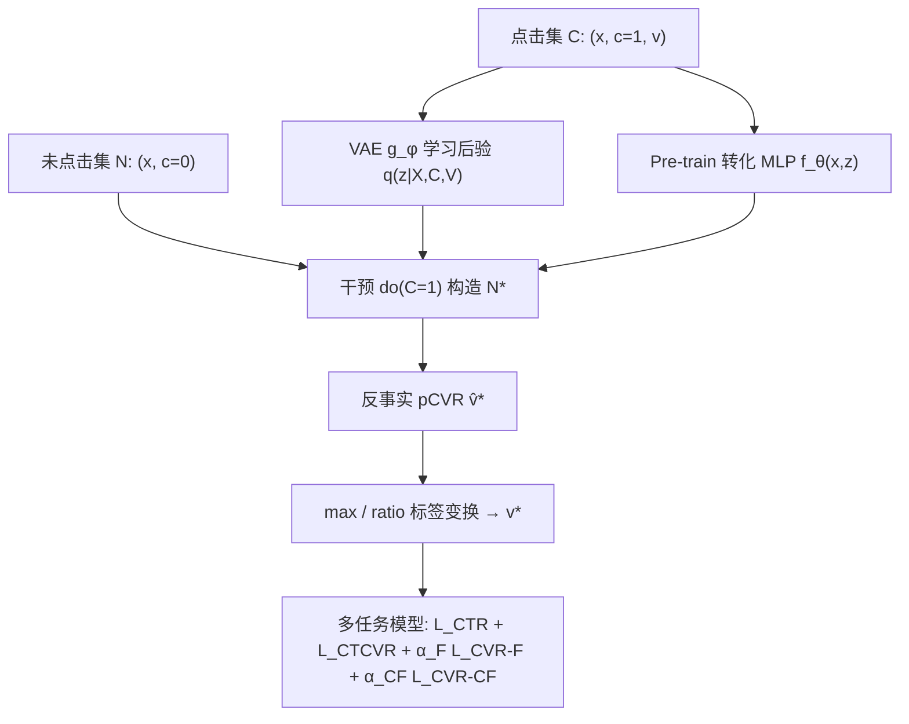
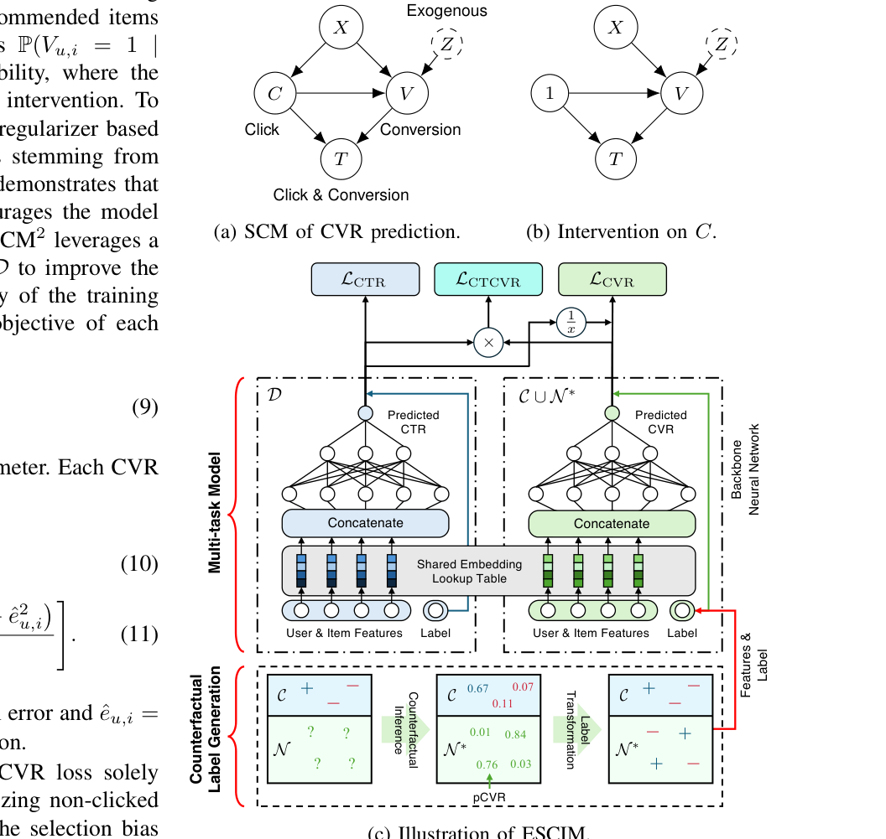

# On Predicting Post-Click Conversion Rate via Counterfactual Inference (基于反事实推断的点击后转化率预估)

- **会议/期刊**: IEEE ICDM 2025
- **作者与机构**: Junhyung Ahn (Naver Corp. / 工作完成于 Dable)、Sanghack Lee (Seoul National University)
- **推荐链路定位**: 精排（CVR/CTCVR 预估）
- **研究方向**: CTR/CVR 预估与特征交叉 / 去偏与因果推断
- **论文原文**: [https://arxiv.org/abs/2510.04816v1](https://arxiv.org/abs/2510.04816v1)
- **开源代码**: [https://github.com/JunhyungAhn/ESCIM](https://github.com/JunhyungAhn/ESCIM)

## TL;DR (1分钟核心速览)

CVR 预估只能在点击样本上训练，面临选择偏差与极端稀疏（Ali-CCP 中点击率约 3.85%、转化率仅约 0.55%）。本文提出 ESCIM：先用 VAE 对转化外生变量 $Z$做后验推断（Abduction），再对未点击样本施加假设干预$do(C=1)$ 推断反事实 pCVR，最后用 `max` / `ratio` 两种策略把连续 pCVR 转成硬标签，与真实点击空间联合训练多任务模型。在 Ali-CCP 与 Ali-Express 四国数据上，CVR/CTCVR AUC 平均提升 1.01%/1.02%；线上 5 天 A/B 中 CVR +17.35%、CTCVR +5.60%、CPA −23.36%。

## Background & Motivation (背景与核心矛盾)

- **主流范式**: ESMM 类多任务框架在曝光全空间上联合优化 CTR 与 CTCVR，以 $pCTCVR = pCTR \times pCVR$ 间接监督 CVR；ESCM2 进一步用 IPS/DR 正则去除点击与转化之间的混杂偏差。
- **前人局限**: ESMM 假设点击与转化在给定特征下条件独立，导致 CVR 系统性高估；ESCM2 的 IPS/DR 正则仍只在稀缺的点击集 $\mathcal{C}$上构造，无法覆盖未点击空间$\mathcal{N}$，且从$\mathcal{C}$到$\mathcal{D}$ 的无偏性难以保证。
- **DCMT 的启发式缺陷**: DCMT 为未点击样本构造镜像反事实空间 $\mathcal{N}^{*}$，但**一刀切地把所有反事实转化标签置为 1**，使$\mathcal{N}^{*}$的标签分布与真实点击空间$\mathcal{C}$ 严重错配，本质上仍是启发式而非因果推导。
- **核心洞察 (Key Insight)**: 未点击样本的转化标签并非不可知——在"若用户点击了该物品"的假设世界里，其转化结果可由已点击样本学到的因果机制外推；关键在于**用 SCM 显式建模外生变量 $Z$**，而非拍脑袋赋 1。
- **本文切入点**: 把"反事实标签生成"拆成 Pre-train → Abduction → Action → Prediction 四步，再用阈值策略把 pCVR 离散化为硬标签，注入多任务训练。

## Method (核心方法设计)

### 1. 整体框架 (Overall Architecture)

ESCIM 分两阶段。**阶段一（反事实标签生成）**：在点击集 $\mathcal{C}$上预训练转化 MLP$f_\theta(x, z)$；用 VAE$g_\phi$以 ELBO 目标学习外生变量后验$q_\phi(z) \approx p(Z|X,C,V)$；对未点击样本施加$do(C=1)$切断$X \to C$边，采样$z \sim q_\phi$后送入$f_\theta$得到反事实 pCVR$\hat{v}^{*}$；再经 `max` 或 `ratio` 策略转为二值标签$v^{*}$。**阶段二（多任务训练）**：以 ESMM 式共享底层 + CTR/CVR 双塔结构，在$\mathcal{C}$、$\mathcal{N}$、$\mathcal{N}^{*}$ 三空间联合优化。

<figure class="paper-figure" markdown="span">
  <figcaption>图2：ESCIM的整体流程。(a) Z表示转化事件的外生变量，作为用户转化行为的潜在因素。(b) 对C的假设干预模拟了将点击事件设为1以生成反事实转化结果的场景。(c) 通过反事实推断和标签变换（底部）为非点击样本生成反事实标签。生成的标签随后用于训练CVR预测模型（顶部）。</figcaption>
</figure>

### 2. 关键设计拆解 (Key Designs)

1. **SCM 建模与反事实推断（Abduction-Action-Prediction）**：痛点在于反事实量 $P(V(C=1)=1 \mid X, C=0, V=0)$在理论上不可识别，只能靠 SCM 模拟。本文设$Z \sim \mathcal{N}(0,I)$ 为转化外生变量，用 VAE 以 ELBO 逼近其后验：

$$\mathcal{L}_{\text{ELBO}} = \mathbb{E}_{(u,i)\in\mathcal{C}}\left[\mathbb{E}_{q_\phi(z)}[p(z|x_{u,i},v_{u,i})] - \beta\,\mathrm{KL}(p(z)\,\|\,q_\phi(z))\right]$$

   直觉：$Z$承载"用户为何转化"的隐因子，从已点击且未转化样本中反推$Z$的后验，相当于把"未点击用户若被强制点击"的潜在倾向从观测数据中"借"过来，比直接假设$Z\sim\mathcal{N}(0,I)$ 更贴合真实分布（消融中 AE-US 提升 0.96 个千分点）。

2. **两种硬标签变换策略（max / ratio）**：连续 pCVR 无法直接当标签用，且反事实空间不确定性高。`max` 策略以点击集最大 pCVR 为阈值：$v^{*}_{u,i}=1 \iff \hat{v}^{*}_{u,i} \ge \max_{(u,i)\in\mathcal{C}}\hat{v}_{u,i}$，即只给"比任何真实点击样本都更可能转化"的样本打正标，极度保守；`ratio` 策略按点击集转化比例外推正例数$k=|\mathcal{V}|\cdot|\mathcal{N}|/|\mathcal{C}|$，取反事实 pCVR Top-$k$ 为正。前者抗噪、后者保分布对齐，二者互补。

3. **训练目标与推理开销**：总损失为

$$\mathcal{L}_{\text{ESCIM}} = \mathcal{L}_{\text{CTR}} + \mathcal{L}_{\text{CTCVR}} + \alpha_F \mathcal{L}_{\text{CVR-F}} + \alpha_{CF}\mathcal{L}_{\text{CVR-CF}}$$

   其中事实项沿用 ESCM2 的 IPS 形式 $\mathcal{L}_{\text{CVR-F}}=\mathbb{E}_{\mathcal{C}}[\ell(\hat{v},v)/\hat{c}]$，反事实项为$\mathcal{L}_{\text{CVR-CF}}=\mathbb{E}_{\mathcal{N}^{*}}[\ell(\hat{v},v^{*})/\hat{c}]$；$\alpha_{CF}=0$ 时退化为 ESCM2。反事实标签为**离线一次性生成**，在线推理与普通 ESMM 完全一致，无额外延迟；训练 Ali-CCP 约 3 小时（4×T4）。

## Experimental Setup & Evaluation Protocol (实验设置与评估协议)

- **数据集与预处理**: 工业数据按 30/3/1 天时序切分，负采样至点击正负比 5:1；公开数据统计如下（未点击样本天然构成负例，无需额外负采样）：

| 数据集 | #Train | #Val | #Test | #Click | #Conv. | 场景说明 |
| :--- | :---: | :---: | :---: | :---: | :---: | :--- |
| Industrial | 6.6M | 0.7M | 0.1M | 0.7M | 0.2M | 公司推荐系统 34 天日志 |
| Ali-CCP | 38.1M | 4.2M | 43.3M | 3.3M | 18.3K | 淘宝展示/点击/转化日志 |
| AE-ES / FR / NL / US | 11.0M–21.1M | 1.2M–2.2M | 5.6M–9.3M | 0.4M–0.8M | 10.9K–19.0K | AliExpress 四国搜索日志 |

- **数据划分与防穿越 (Splitting Strategy)**: 公开数据集沿用官方 Train/Val/Test 划分（随机抽 10% 训练集作验证）；工业数据为**全局时间戳切分**（30 天训练 / 3 天验证 / 1 天测试），严格防穿越。
- **排名评测协议 (Ranking Protocol)**: 采用 AUC 评估 CVR 与 CTCVR，属**全测试集排序**（非采样排序）；每个 backbone 跑 5 个随机种子取均值±标准差，标准差普遍在 0.001–0.003 量级，差异具统计意义。
- **对比基线与超参设置**: 基线为 ESMM、Multi-IPS、Multi-DR、ESCM2-IPS、ESCM2-DR、DCMT；backbone 覆盖 MLP、DeepFM、AutoInt、DCN-V2。Embedding 维度 Ali-CCP 为 5、Ali-Express 为 32；$z$维度等于总 Embedding 维度；batch 8192，$\alpha_F=0.1$、$\alpha_{CF}=10^{-4}$，Adam 学习率$10^{-4}$。

## Key Experimental Results (实验关键数据)

### 1. 主实验对比 (Main Results)

Ali-CCP 各 backbone（CVR AUC / CTCVR AUC）：

| Method | MLP | DeepFM | AutoInt | DCN-V2 |
| :--- | :---: | :---: | :---: | :---: |
| ESMM | 0.6474 / 0.6379 | 0.6398 / 0.6213 | 0.6543 / 0.6302 | 0.6495 / 0.6373 |
| ESCM2-IPS | 0.6691 / 0.6424 | 0.6487 / 0.6281 | 0.6681 / 0.6407 | 0.6609 / 0.6374 |
| ESCM2-DR | 0.6609 / 0.6353 | 0.6502 / 0.6280 | 0.6485 / 0.6329 | 0.6489 / 0.6313 |
| DCMT | 0.6743 / 0.6451 | 0.6528 / 0.6338 | 0.6702 / 0.6389 | 0.6603 / 0.6350 |
| **ESCIM-max** | **0.6792** / 0.6487 | **0.6585** / **0.6401** | 0.6737 / 0.6413 | **0.6698** / 0.6467 |
| **ESCIM-ratio** | 0.6756 / **0.6566** | 0.6523 / 0.6382 | **0.6774** / **0.6475** | 0.6683 / **0.6534** |
| Improv.% (vs. DCMT) | +0.73% / +1.78% | +0.87% / +0.99% | +1.07% / +1.35% | +1.44% / +2.90% |

Ali-Express 四国（MLP backbone，CVR / CTCVR AUC）：

| Method | AE-ES | AE-FR | AE-NL | AE-US |
| :--- | :---: | :---: | :---: | :---: |
| ESCM2-IPS | 0.8199 / 0.8777 | 0.8078 / 0.8511 | 0.7867 / 0.8511 | 0.8018 / 0.8573 |
| DCMT | 0.8251 / 0.8838 | 0.8089 / 0.8628 | 0.7897 / 0.8525 | 0.8140 / 0.8620 |
| **ESCIM-max** | **0.8314** / 0.8935 | **0.8210** / 0.8776 | **0.7951** / **0.8613** | **0.8332** / **0.8782** |
| **ESCIM-ratio** | 0.8305 / **0.8951** | 0.8192 / **0.8821** | 0.7907 / 0.8583 | 0.8201 / 0.8643 |

线上 A/B（5 天，vs. ESCM2-IPS）：CVR 逐日 +21.55%/+16.94%/+12.59%/+17.42%/+18.24%，CTCVR +7.41%/+4.76%/+3.98%/+5.56%/+6.31%，CPA −27.16%/−26.67%/−16.05%/−22.53%/−24.38%，宏平均 **CVR +17.35%、CTCVR +5.60%、CPA −23.36%**。

### 2. 消融实验 (Ablation Study)

外生变量 $Z$ 建模方式（Ali-Express，CVR AUC）：

| 变体 | AE-ES | AE-FR | AE-NL | AE-US |
| :--- | :---: | :---: | :---: | :---: |
| w/o $Z$（朴素插补） | 0.8284 | 0.8150 | 0.7893 | 0.8185 |
| $Z\sim\mathcal{N}(0,I)$（跳过 Abduction） | 0.8269 | 0.8148 | 0.7904 | 0.8236 |
| $Z\sim p(Z\mid X,C,V)$（完整 ESCIM） | **0.8314** | **0.8210** | **0.7951** | **0.8332** |

潜在转化数据（Ali-CCP 测试集中训练/验证期未点击、测试期有点击的用户）：

| Method | CVR AUC | CTCVR AUC |
| :--- | :---: | :---: |
| ESCM2-IPS | 0.6724 | 0.6067 |
| ESCM2-DR | 0.6627 | 0.5983 |
| DCMT | 0.6783 | 0.5926 |
| **ESCIM-max** | **0.6905** | **0.6289** |

### 3. 关键实验发现 (Key Findings)

1. **标签质量是核心增益来源**：ESCIM 相对 DCMT 的提升（DCN-V2 上 CTCVR +2.90%）几乎全部来自"不再把所有未点击样本标为 1"——`max` 与 `ratio` 两种策略在 4 个 backbone 上分别拿下 CVR 与 CTCVR 的最优，说明反事实标签的**分布对齐**比单纯扩大训练空间更重要。
2. **后验推断不可省，且朴素高斯假设有害**：跳过 Abduction 直接令 $Z\sim\mathcal{N}(0,I)$在 AE-ES/AE-FR 上反而**低于**完全不用$Z$（0.8269 vs. 0.8284、0.8148 vs. 0.8150），而完整后验在 AE-US 上带来 +0.96 个千分点，证明"从点击数据反推$Z$"是反事实推断有效性的必要条件。
3. **对潜在转化用户泛化显著**：在训练期从未点击的潜在转化样本上，ESCIM-max 的 CVR/CTCVR AUC 比最强基线 DCMT 高 1.80%/3.66%，且图 4 显示其 pCVR/pCTCVR 分布整体右移，说明反事实训练确实"预演"了未观测的点击-转化路径。

## Highlights & Limitations (亮点、对比与审稿批判)

- **与代表作对比 (vs. Prior Work)**: 与 ESMM 的本质区别是显式建模 $C \to V$ 的因果方向而非条件独立假设；与 ESCM2 的区别是把去偏从"点击集上的 IPS 正则"扩展到"未点击集上的反事实标签生成"；与 DCMT 的区别是把"全标 1"的启发式替换为 SCM 推断 + 阈值变换，标签分布与事实空间可比。
- **可迁移亮点**: (1) "VAE 学外生变量后验 + 干预采样"这套 Abduction-Prediction 流程可直接迁移到曝光偏差、流行度偏差等其他 MNAR 场景的伪标签生成；(2) `ratio` 策略"按事实空间转化比例外推正例数"是一个极轻量、无需调阈值的分布对齐技巧。
- **审稿级局限批判**: (1) 反事实标签为**离线一次性硬标签**，一旦生成即固定，无法随训练迭代修正，且 `max`/`ratio` 的阈值选择依赖对 $\mathcal{C}$与$\mathcal{N}^{*}$分布相似的强假设；(2) 目标中 IPS 权重$1/\hat{c}$的方差问题未解决，附录图 5 显示$\alpha_{CF}$从$10^{-4}$增至$10^{-1}$ 时 CVR AUC 下降 5.56%，对超参较敏感，且整体效果高度依赖 CTR 估计精度。

## Rating (四维评分)

- **方法创新性 (Novelty)**: ⭐⭐⭐⭐ （首次把完整 SCM 反事实推断流程用于未点击样本的 CVR 伪标签生成，替代 DCMT 的启发式全标 1，因果建模链条完整）
- **评估协议与实验扎实度 (Protocol & Experiments)**: ⭐⭐⭐⭐⭐ （2 个公开数据集 + 4 国子集 + 4 种 backbone + 5 种子标准差 + 5 天线上 A/B + 潜在转化专项分析，覆盖度在 CVR 去偏方向属上乘）
- **写作与数学规范度 (Clarity & Rigor)**: ⭐⭐⭐⭐ （SCM 图、三算法伪代码与 ELBO 推导清晰，且诚实讨论了反事实量不可识别性；但部分符号在正文与附录间略有重复定义）
- **工业落地与复现价值 (Industrial & Practical Value)**: ⭐⭐⭐⭐⭐ （反事实标签离线生成、在线推理零额外开销，线上 CPA 降 23.36% 直接对应广告成本，代码已开源，工程迁移成本极低）

