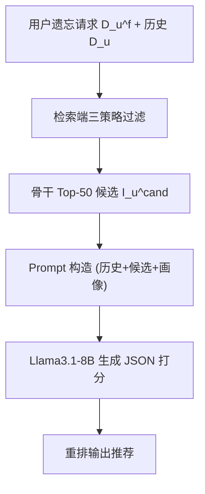
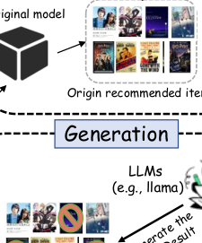

# Customized Retrieval-Augmented Generation with LLM for Debiasing Recommendation Unlearning (基于 LLM 定制化 RAG 的去偏推荐遗忘)

- **会议/期刊**: ICDM 2025
- **作者与机构**: Haichao Zhang, Chong Zhang, Peiyu Hu, Shi Qiu, Jia Wang (西安利物浦大学)
- **推荐链路定位**: 端到端生成式（传统骨干召回 + LLM 重排生成）
- **研究方向**: 去偏公平与工业架构 / 大语言模型推荐
- **论文原文**: [https://arxiv.org/abs/2511.05494v1](https://arxiv.org/abs/2511.05494v1)
- **开源代码**: [https://github.com/zhanghaichao520/LLM_rec_unlearning](https://github.com/zhanghaichao520/LLM_rec_unlearning)

## TL;DR (1分钟核心速览)

现有推荐遗忘方法（精确分片 SISA/RecEraser 与近似影响函数 SCIF/IFRU）均在**数据集级**做参数更新，导致"遗忘偏置"——删除用户 A 的数据会通过协同效应扭曲行为相似用户 B、C 的推荐。本文提出 CRAGRU，把遗忘重构为 **RAG 检索端的用户级信息过滤**问题：遗忘请求只在检索阶段剔除目标数据，LLM 基于过滤后的 prompt 重新生成推荐，全程不更新骨干参数。在 ML-100K/ML-1M/Netflix 三数据集、BPR/LightGCN 双骨干上，遗忘耗时平均加速 4.5×（最高 7.3×），并保留约 90% 原模型效用，显著优于所有遗忘基线。

## Background & Motivation (背景与核心矛盾)

- **主流范式**: 精确遗忘（SISA 分片重训、GraphEraser 图聚类分片、RecEraser 交互分片+注意力聚合）与近似遗忘（SCIF/IFRU 用影响函数估计并反转数据影响）两条路线。
- **前人局限**: ① 精确方法中，被遗忘用户与同分片用户参数纠缠，删除数据会连带损伤同片用户；② 近似方法中，影响函数会漂移行为相似用户的隐向量（latent drift），且大模型 Hessian 计算不可行；③ 分片法在连续/高频遗忘请求下，几乎需重训全部子模型（10 分片下 100 次请求触发全量重训概率近 100%）。
- **核心洞察 (Key Insight)**: 遗忘偏置的根源是**遗忘粒度停留在数据集级/参数级**，而协同过滤把用户影响全局耦合。若把每个用户的推荐视为**原子单元**，遗忘只需切断该用户的信息通路，无需触碰共享参数。
- **本文切入点**: 用 RAG 把遗忘下沉到检索阶段——"不喂给 LLM 即等于遗忘"，从机制上保证条件独立，天然去偏。

## Method (核心方法设计)

### 1. 整体框架 (Overall Architecture)

CRAGRU 采用 Retrieval–Augmentation–Generation 三段式：传统骨干（BPR/LightGCN）先对全库打分取 Top-$K$（$K=50$）候选集$I_u^{cand}$；检索阶段从可动态更新的交互库中取出用户历史$D_u$，并用过滤函数剔除遗忘集$D_u^f$得到$D_u^{filtered}$；增强阶段将过滤后历史、候选集与用户画像拼成 prompt$P(u)=\text{Format}(I_u^{cand}, D_u^{filtered}, C)$；生成阶段由 Llama3.1-8B 输出 JSON 格式的候选打分并重排。骨干参数全程冻结，遗忘仅改变检索索引内容。

<figure class="paper-figure" markdown="span">
  <figcaption>图 2. CRAGRU 的框架。当用户提交遗忘请求时，检索器利用该请求从数据集中获取相关信息，并过滤掉需要遗忘的信息。剩余信息随后用于构建遗忘提示。最后，LLM 根据用户需求生成推荐结果。</figcaption>
</figure>

### 2. 关键设计拆解 (Key Designs)

1. **用户偏好感知过滤 (Preference-based Filtering)**：痛点是被遗忘用户的长尾类目交互被误删后语义断裂。按类目占比等比保留：$K_c=\lfloor p_{u,c}\times K\rfloor$，其中$p_{u,c}=|D_{u,c}|/|D_u|$，再从每类随机采样$K_c$ 条。直觉是保持用户长期兴趣分布的语义一致性，使过滤后历史仍能代表其偏好骨架。

2. **多样性感知过滤 (Diversity-aware Filtering)**：痛点是纯比例采样会让历史过度集中于少数类目。将其建模为背包问题：预计算性能矩阵 $M[c][p]$（类目$c$保留$p\%$ 交互的 Hit Rate），求解
$$x^{*}=\arg\max_{x}\sum_{c\in C}M[c][x_c]\quad \text{s.t.}\ \sum_{c\in C}x_c=K'$$
用动态规划 $DP[i][j]=\max_{x_i}\{DP[i-1][j-x_i]+M[i][x_i]\}$ 求解并回溯得各类目保留比例。以全局分布优化换取更低的检索偏置与计算成本。

3. **注意力感知过滤 (Attention-aware Filtering)**：痛点是无差别保留会稀释关键交互。用多头注意力对每个候选 $i_c$计算历史交互权重$\alpha_{j,c}=\text{softmax}(\text{score}(i_j,i_c))$，为每个候选保留 Top-$K$交互$D_u^{filtered}(i_c)=\text{Top-}K(D_u,\{\alpha_{j,c}\})$。直觉是让"对当前候选最有解释力"的历史进入 prompt，兼顾精度与遗忘彻底性。

**训练目标、负采样与推理效率**：本文**无训练损失、无负采样**——骨干沿用原模型，LLM 仅做零样本推理。遗忘开销即一次 LLM 前向（14–17s），且随遗忘交互数**线性增长**，而分片法呈指数增长。

## Experimental Setup & Evaluation Protocol (实验设置与评估协议)

- **数据集与预处理**: 显式评分（1–5），保留 10% 原始数据作为遗忘集 $D^f$，其余按 70/10/20 划分训练/验证/测试。

| 数据集 | #Users | #Items | #Interactions | 稀疏度 | 说明 |
| :--- | :---: | :---: | :---: | :---: | :--- |
| ML-100K | 944 | 1,683 | 100,000 | 93.71% | 电影评分 |
| ML-1M | 6,041 | 3,707 | 1,000,209 | 95.53% | 电影评分 |
| Netflix | 7,315 | 17,129 | 2,266,452 | 98.19% | Netflix Prize |

- **数据划分与防穿越**: 比例划分（70/10/20）+ 独立 10% 遗忘集，遗忘集与测试集不重叠。
- **排名评测协议**: 在剩余集 $D^r$上计算 HR@K 与 NDCG@K（$K\in\{5,10,20\}$），属**全候选排序**（骨干对全库打分取 Top-K 后由 LLM 重排）；遗忘完整性另在遗忘集上对比 HR@K/NDCG@K（$K\in\{1,3,5\}$）。
- **对比基线与超参**: Retrain、SISA、GraphEraser、RecEraser、SCIF、IFRU 六基线；骨干 BPR 与 LightGCN；LLM 为 Llama3.1-8B；配对 t 检验 $p<0.01$。

## Key Experimental Results (实验关键数据)

### 1. 主实验对比 (Main Results)

ML-1M + LightGCN（节选，完整见原文表 II）：

| 方法 | HR@5 | NDCG@5 | HR@10 | NDCG@10 | HR@20 | NDCG@20 |
| :--- | :---: | :---: | :---: | :---: | :---: | :---: |
| Retrain | **0.6111** | **0.2670** | **0.7377** | **0.2533** | **0.8339** | **0.2582** |
| SISA | 0.2093 | 0.0593 | 0.2964 | 0.0588 | 0.3928 | 0.0624 |
| GraphEraser | 0.4249 | 0.1283 | 0.5635 | 0.1295 | 0.6968 | 0.1388 |
| RecEraser | 0.4560 | 0.1464 | 0.6003 | 0.1467 | 0.7379 | 0.1574 |
| SCIF | 0.4823 | 0.1796 | 0.6060 | 0.1723 | 0.7230 | 0.1764 |
| IFRU | 0.2656 | 0.1659 | 0.4350 | 0.2205 | 0.6502 | 0.2746 |
| **CRAGRU** | 0.5520 | 0.2354 | 0.6556 | 0.2221 | 0.7406 | 0.2270 |
| Improv. vs RecEraser | +21.1% | +60.8% | +9.2% | +51.4% | +0.4% | +44.2% |

Netflix + BPR：CRAGRU HR@10 = 0.8190 vs RecEraser 0.6673（+22.7%），Retrain 0.9041。ML-100K + BPR：CRAGRU HR@10 = 0.7116 vs RecEraser 0.4582（+55.3%）。

**效率对比（表 III，单位秒）**：

| 方法 | ML-100K(BPR) | ML-1M(LightGCN) | Netflix(BPR) |
| :--- | :---: | :---: | :---: |
| Retrain | 248 | 4209 | 527 |
| RecEraser | 29 | 275 | 404 |
| SCIF | 18 | 64 | 299 |
| **CRAGRU** | **14** | **15** | **16** |
| 加速比 | 1.8× | 4.3× | 7.3× |

### 2. 消融实验 (Ablation Study)

ML-1M 上三种检索策略的 NDCG@10（图 4 数据）：

| 配置 | BPR | LightGCN |
| :--- | :---: | :---: |
| 无过滤（骨干原输出） | 0.1920 | 0.2092 |
| + 偏好感知过滤 | 0.2050 | 0.2180 |
| + 多样性感知过滤 | 0.2010 | 0.2140 |
| + 注意力感知过滤 | **0.2127** | **0.2221** |

### 3. 关键实验发现 (Key Findings)

1. **遗忘偏置被显著抑制**：ML-1M+LightGCN 上 CRAGRU 较 RecEraser 提升 HR@10 9.64%、NDCG@10 12.3%，逼近 Retrain 上限，说明检索端原子过滤切断了协同传播路径，而非像 SCIF/IFRU 那样留下隐向量漂移残影。
2. **遗忘完整性可验证**：ML-1M+BPR 上遗忘集 HR@1 仅为剩余集的 55.85%，$K=3/5$时升至 67.61%/72.36%——遗忘集性能系统性塌陷且随$K$ 增大差距收窄（候选池扩大引入弱相关物品稀释过滤精度），证明遗忘效应被局部化在目标用户。
3. **效率随请求量线性扩展**：CRAGRU 遗忘耗时 14–17s 且与遗忘交互数线性相关，而分片法在连续请求下近指数增长；注意力感知过滤在三策略中增益最高（ML-1M 上 NDCG@10 较无过滤 +5.71%/+6.16%），因其从多视角评估交互对候选的解释力。

## Highlights & Limitations (亮点、对比与审稿批判)

- **与代表作对比 (vs. Prior Work)**: 相较 RecEraser（分片+注意力聚合，仍改参数、受同片纠缠），CRAGRU 完全冻结骨干、遗忘零参数更新；相较 SCIF/IFRU（影响函数近似，需 Hessian 且留残影），CRAGRU 以"检索即遗忘"实现机制级条件独立，无近似误差。
- **可迁移亮点**: ① "遗忘下沉到检索索引"的思路可迁移到任意 RAG 推荐系统的隐私合规改造；② 注意力感知过滤（按候选动态选历史）可直接用于 LLM 推荐的 prompt 压缩与上下文裁剪。
- **审稿级局限批判**: ① 依赖 Llama3.1-8B 在线推理，单用户 14–17s 延迟对高并发工业场景仍偏重，且未报告 token 成本与批量吞吐；② 遗忘完整性仅以"遗忘集性能下降"间接验证，缺乏成员推断攻击（MIA）等强隐私度量；③ 多样性过滤的性能矩阵 $M$ 需离线预计算，跨数据集迁移成本未讨论。

## Rating (四维评分)

- **方法创新性 (Novelty)**: ⭐⭐⭐⭐ （首次将推荐遗忘重构为 RAG 检索端过滤，用户级原子遗忘视角新颖，但三策略本身为成熟技术的组合）
- **评估协议与实验扎实度 (Protocol & Experiments)**: ⭐⭐⭐⭐ （三数据集双骨干六基线齐全、$p<0.01$ 显著性检验、效率与完整性双维度评估，但缺 MIA 强隐私验证）
- **写作与数学规范度 (Clarity & Rigor)**: ⭐⭐⭐⭐ （三阶段流程与背包 DP 推导清晰，隐私分析给出条件独立论证，但部分符号如 $K'$与$K_c$ 关系表述略松）
- **工业落地与复现价值 (Industrial & Practical Value)**: ⭐⭐⭐⭐ （代码开源、骨干无关即插即用、遗忘线性扩展契合 GDPR 连续请求场景，但 LLM 推理延迟是部署瓶颈）

