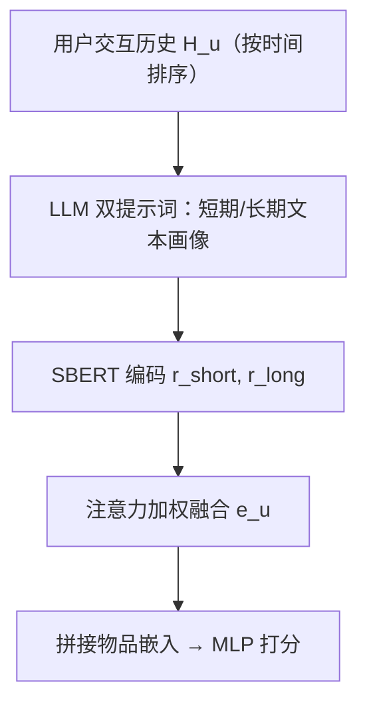
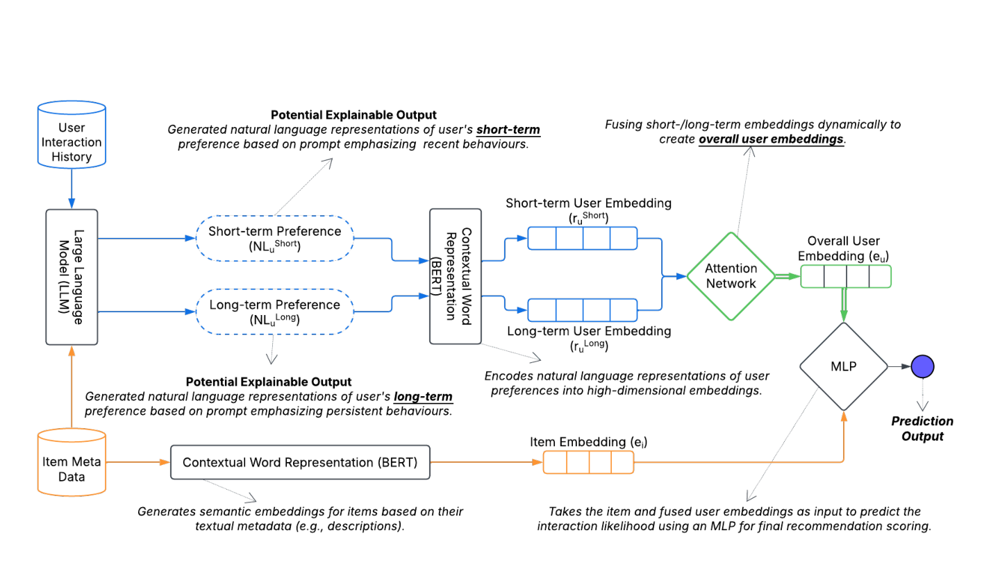
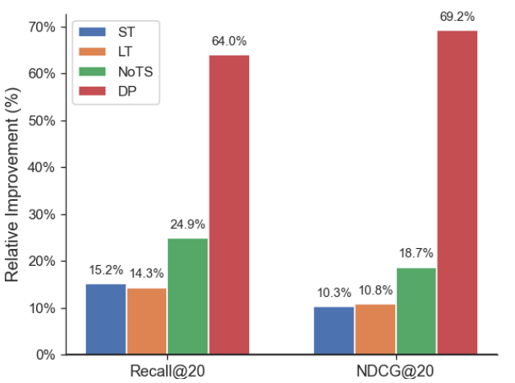

# Effectiveness of LLMs in Temporal User Profiling for Recommendation (LLM 驱动的时序用户画像推荐有效性研究)

- **会议/期刊**: IEEE ICDM 2025 Workshop (UMRec)
- **作者与机构**: Milad Sabouri, Kun Lin, Bamshad Mobasher (DePaul University); Masoud Mansoury (TU Delft)
- **推荐链路定位**: 召回（内容画像表征 + 打分）
- **研究方向**: 大语言模型推荐 / 序列推荐
- **论文原文**: [https://arxiv.org/abs/2511.00176v1](https://arxiv.org/abs/2511.00176v1)
- **开源代码**: [https://github.com/milsab/UMRec](https://github.com/milsab/UMRec)

## TL;DR (1分钟核心速览)

传统用户画像把"短期冲动"与"长期稳定偏好"混为一谈（如平均物品嵌入），既损精度又不可解释。本文用 LLM 对同一交互历史施加两套提示词，分别生成短期/长期自然语言画像，经 SBERT 编码后用可学习注意力加权融合成统一用户向量，再与物品向量拼接过 MLP 打分。在 Amazon Movies&TV 与 Video Games 上采用严格按用户时间戳留出协议，Movies&TV 上 Recall@10 相对 Centric 基线提升 17%、NDCG@10 提升 14%，但稀疏域收益骤降至 3%。

## Background & Motivation (背景与核心矛盾)

- **主流范式**: 时序推荐分两派——时间感知矩阵分解（TimeSVD++）与序列深度模型（GRU4Rec、SASRec）从交互序列学动态；画像派则用物品嵌入平均（Centric）或图/文本混合表征刻画用户。
- **前人局限**: ① 平均嵌入把短暂兴趣与持久品味压缩为单一向量，时序语义不可分；② 序列模型虽建模顺序，但用户表征缺乏自然语言 grounding，无法向用户解释"这条推荐来自近期还是长期偏好"。
- **核心洞察 (Key Insight)**: 短期与长期偏好是否**可分离**，本身是域相关的——高活跃域（Movies&TV，人均 11.79 条交互）两类兴趣差异明显，稀疏域（Games，人均 4.55 条）偏好更稳定、时序切分几乎无增量信息。
- **本文切入点**: 不做新架构，而是把"时序解耦"交给 LLM 的提示词工程，用两段文本画像 + 注意力权重同时换取精度与内在可解释性。

## Method (核心方法设计)

### 1. 整体框架 (Overall Architecture)

三段式流水线：给定按时间排序的交互历史 $H_u$，先用两套提示词分别调用 LLM 生成短期画像$\text{NL}^{short}_u$与长期画像$\text{NL}^{long}_u$；再用 SBERT (MiniLM-L6-v2, 384 维) 将两段文本编码为向量$\boldsymbol{r}^{short}_u,\boldsymbol{r}^{long}_u$；最后用单层可学习注意力计算两个标量权重并加权求和得用户向量$\boldsymbol{e}_u$，与物品嵌入拼接后经 MLP 输出交互概率。LLM 仅在离线画像生成阶段调用一次，在线打分只走 SBERT + MLP，推理开销与常规双塔内容模型同量级。

<figure class="paper-figure" markdown="span">
  <figcaption>图1. LLM驱动的时序用户画像生成与推荐流程。</figcaption>
</figure>

### 2. 关键设计拆解 (Key Designs)

1. **双提示词时序解耦（Temporal Disentanglement via Prompting）**：痛点是把历史压成单向量后时序语义丢失。本文不改模型只改指令——长期提示要求 LLM 提炼全历史中反复出现的持久主题，短期提示聚焦最近行为与转瞬兴趣，得到两段互补文本：
$\text{NL}^{short}_u=\text{LLM}(H_u,\text{Prompt}_{short}),\quad \text{NL}^{long}_u=\text{LLM}(H_u,\text{Prompt}_{long})$
直觉上，LLM 的语义归纳能力替代了人工窗口切分，且输出天然是人类可读的画像。

2. **注意力自适应融合（Adaptive Attention Fusion）**：固定权重或简单拼接无法适配"有的用户靠近期驱动、有的靠长期品味"的异质性。本文用可学习向量 $\boldsymbol{W}_a\in\mathbb{R}^{1\times d}$ 计算 softmax 权重：
$\alpha^{short}_u=\frac{\exp(\boldsymbol{W}_a\boldsymbol{r}^{short}_u)}{\exp(\boldsymbol{W}_a\boldsymbol{r}^{short}_u)+\exp(\boldsymbol{W}_a\boldsymbol{r}^{long}_u)},\quad \boldsymbol{e}_u=\alpha^{short}_u\boldsymbol{r}^{short}_u+(1-\alpha^{short}_u)\boldsymbol{r}^{long}_u$
权重本身即"推荐依据来自近期还是长期"的显式信号，构成内在可解释性来源。

3. **训练目标与打分**：$\hat{y}_{u,i}=\text{MLP}([\boldsymbol{e}_u;\boldsymbol{e}_i])$，以二元交叉熵训练：
$\mathcal{L}=-\frac{1}{|\mathcal{D}|}\sum_{(u,i,y_{u,i})\in\mathcal{D}}\left[y_{u,i}\log\hat{y}_{u,i}+(1-y_{u,i})\log(1-\hat{y}_{u,i})\right]$
未使用任何负采样技巧（隐式反馈全量 BCE），MLP 隐层 128、dropout 0.2、batch 2048、Adam + 早停 (patience=5)。LLM 侧用 GPT-4o-mini，画像离线缓存，故在线成本可忽略。

## Experimental Setup & Evaluation Protocol (实验设置与评估协议)

- **数据集与预处理**: 两个 Amazon 域，仅保留英文描述长度 > 500 字符的物品；画像统计见表 2（Movies&TV 人均 11.79 条、Games 4.55 条）。

| 数据集 | #Users | #Items | #Interactions | 密度 | 场景说明 |
| :--- | :---: | :---: | :---: | :---: | :--- |
| Movies&TV | 10,000 | 14,420 | 202,583 | 0.14% | 高活跃、兴趣漂移明显 |
| Video Games | 10,371 | 3,790 | 83,842 | 0.21% | 低活跃、偏好稳定 |

- **数据划分与防穿越 (Splitting Strategy)**: 严格 **per-user 时间戳留出**——每个用户交互按时间排序后切分，训练集恒早于验证/测试集，杜绝用户内时间泄漏。
- **排名评测协议 (Ranking Protocol)**: 报告 Recall@10/20 与 NDCG@10/20；原文未明示候选集构造细节（未声明 Full-Ranking 或采样负例比例），此为评估透明度上的一个缺口。
- **对比基线与超参设置**: Centric（物品嵌入平均，主基线，显著性检验对象）、Temp-Fusion（数值化短/长窗口嵌入 + 同款注意力融合，用于隔离 LLM 文本贡献）、Popularity、MF；显著性 $p<0.05$；SBERT 384 维，MLP 隐层 128。

## Key Experimental Results (实验关键数据)

### 1. 主实验对比 (Main Results)

| 方法 | Movies Recall@10 | Movies NDCG@10 | Movies Recall@20 | Movies NDCG@20 | Games Recall@10 | Games NDCG@10 | Games Recall@20 | Games NDCG@20 |
| :--- | :---: | :---: | :---: | :---: | :---: | :---: | :---: | :---: |
| Popularity | 0.0082 | 0.0145 | 0.0133 | 0.0191 | 0.0397 | 0.0324 | 0.0706 | 0.0453 |
| MF | 0.0048 | 0.0085 | 0.0087 | 0.0124 | 0.0457 | 0.0370 | 0.0754 | 0.0491 |
| Centric | 0.0113 | 0.0191 | 0.0199 | 0.0269 | 0.0645 | 0.0532 | 0.0932 | 0.0649 |
| Temp-Fusion | 0.0118 | 0.0201 | 0.0207 | 0.0276 | **0.0693** | **0.0589** | 0.0982 | **0.0712** |
| **LLM-TP (本文)** | **0.0132** | **0.0217** | **0.0223** | **0.0293** | 0.0665 | 0.0547 | **0.1021** | 0.0683 |
| Improv. vs Centric | +17% | +14% | +12% | +9% | +3% | +3% | +10% | +5% |

### 2. 消融实验 (Ablation Study)

Movies&TV 数据集：

| 变体 | Recall@20 | NDCG@20 | 相对 Full 变化 |
| :--- | :---: | :---: | :---: |
| Short-Term Only (ST) | 0.0193 | 0.0266 | Recall −13.5% |
| Long-Term Only (LT) | 0.0195 | 0.0265 | Recall −12.6% |
| General Preferences (No TS，单一整体画像) | 0.0178 | 0.0247 | Recall −20%+ / NDCG −18% |
| Dot-Product Scoring (DP) | 0.0136 | 0.0173 | Recall −39% |
| **Full Model (LLM-TP)** | **0.0223** | **0.0293** | — |

<figure class="paper-figure" markdown="span">
  <figcaption>图4. 在Movies&amp;TV数据集上，完整模型相对于消融变体在Recall@20和NDCG@20上的相对增益。</figcaption>
</figure>

### 3. 关键实验发现 (Key Findings)

1. **时序解耦是主要增益来源**：去掉短/长切分改用单一整体画像（No TS）后 Recall@20 掉超 20%，跌幅大于仅保留单侧时序（ST/LT 各掉约 13%），说明"区分"比"覆盖"更关键，且短、长两路信号互补。
2. **非线性打分不可替代**：把 MLP 换成点积（DP）后 Recall@20 从 0.0223 崩至 0.0136（−39%），甚至低于 Centric，表明文本画像与物品嵌入处于不同语义空间，必须靠非线性交互对齐。
3. **收益强依赖域活跃度**：Movies&TV 上 LLM-TP 全面超越 Temp-Fusion（Recall@10 0.0132 vs 0.0118），但在稀疏的 Games 域小 K 指标反被 Temp-Fusion 压制（0.0665 vs 0.0693），仅 Recall@20 领先——印证"时序可分离性"假设，也提示 LLM 画像应做域自适应启用。

## Highlights & Limitations (亮点、对比与审稿批判)

- **与代表作对比 (vs. Prior Work)**: 相比 SASRec 等序列模型，本文不学序列编码器而直接让 LLM 输出语义画像，天然可读；相比 Centric 平均嵌入，显式分离短/长偏好；相比 Temp-Fusion，唯一变量是"文本语义 vs 数值平均"，从而干净隔离了 LLM 的贡献——这是本文实验设计上最值得称道的一点。
- **可迁移亮点**: ① 用"双提示词 + 可学习注意力权重"把任意 LLM 摘要转成可解释的融合表征，可平移到跨域画像或多兴趣召回；② 以 Temp-Fusion 作为"同架构无数值 LLM"对照组的消融范式，值得 LLM4Rec 论文借鉴以排除架构混淆。
- **审稿级局限批判**: ① 评测协议未交代候选集构造（Full-Ranking 还是采样负例、负正比多少），绝对指标值极低（Recall@10 约 1%），跨论文可比性存疑；② 画像生成依赖 GPT-4o-mini 离线批量调用，成本与提示词敏感性未量化，且"可解释性"仅停留在注意力权重与文本展示，未做用户研究验证；③ 仅两个 Amazon 域、单一 SBERT 编码器，结论外推性有限。

## Rating (四维评分)

- **方法创新性 (Novelty)**: ⭐⭐⭐ （提示词级时序解耦 + 注意力融合思路朴素但切中"短/长偏好混淆"痛点，缺乏架构层面新意）
- **评估协议与实验扎实度 (Protocol & Experiments)**: ⭐⭐⭐ （时间戳留出防穿越与 Temp-Fusion 对照设计严谨，但候选集协议缺失、仅两数据集、绝对指标偏低）
- **写作与数学规范度 (Clarity & Rigor)**: ⭐⭐⭐⭐ （公式简洁、符号一致、流水线与提示词示例清晰，复杂度与成本分析略欠）
- **工业落地与复现价值 (Industrial & Practical Value)**: ⭐⭐⭐⭐ （代码/提示词全开源，画像离线缓存使在线开销可控，但 LLM 调用成本与稀疏域负收益限制直接上线）

