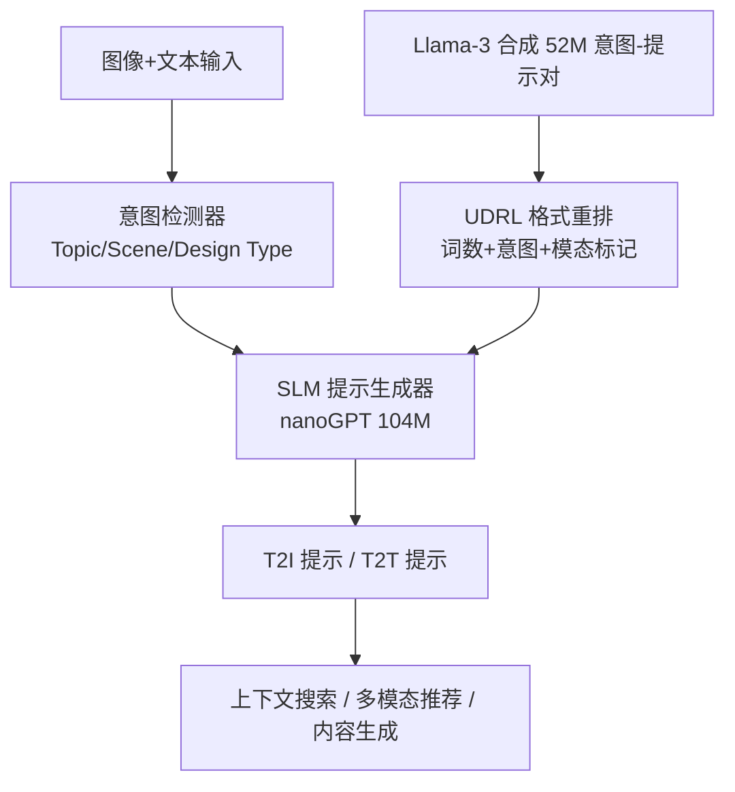
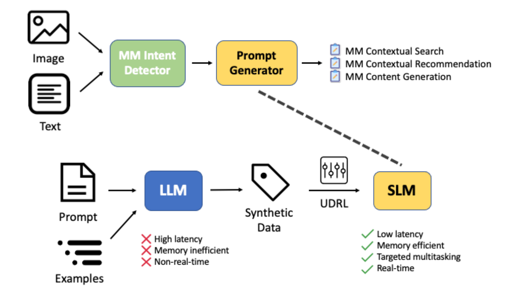

# Scaling Multimodal Search and Recommendation with Small Language Models via Upside-Down Reinforcement Learning (基于倒置强化学习的小语言模型多模态搜索与推荐扩展)

- **会议/期刊**: ICDM 2025 (MMSR Workshop)
- **作者与机构**: Yu-Chen Lin, Hari Manikandan, Jayant Kumar, Tracy Holloway King, Jing Zheng (Adobe); Sanat Sharma (Meta)
- **推荐链路定位**: 端到端生成式（意图理解 → 提示生成 → 下游检索/推荐/内容生成）
- **研究方向**: 大语言模型推荐 / 多模态推荐
- **论文原文**: [https://arxiv.org/abs/2502.09854v2](https://arxiv.org/abs/2502.09854v2)
- **开源代码**: [https://github.com/karpathy/nanoGPT](https://github.com/karpathy/nanoGPT)（仅基座 nanoGPT，训练管线未开源）

## TL;DR (1分钟核心速览)

多模态搜索与推荐若直接调用 8B 级 LLM 做提示生成，单卡需 ~80GB 显存、吞吐仅 76–142 tok/s，无法支撑高频实时场景。本文用 Llama-3 以结构化 few-shot 提示合成 5200 万条「意图-提示」对，蒸馏进 104M 参数的 nanoGPT，并用倒置强化学习（UDRL）把「目标词数 + 模态标记」编码为输入条件，实现长度与任务可控的多任务提示生成。在 GPT-4o-mini 作裁判的 1–10 分相关性评测上，零样本 SLM 取得 T2I 8.31 / T2T 8.45，与 Qwen3 8B（8.52/8.37）、Llama-3 8B（8.36/8.33）差距在 6% 以内，而显存仅 ~500MB、吞吐 353 tok/s，约为基线的 3–5 倍。

## Background & Motivation (背景与核心矛盾)

- **主流范式**: 多模态发现任务普遍采用「意图检测器 + 大模型提示生成器」两段式管线，由 LLM 依据用户图文上下文生成检索/推荐/创作提示，再驱动下游 T2I、模板生成或上下文推荐。
- **前人局限**: 其一，8B 级 LLM 推理需 ~80GB 显存、吞吐不足 150 tok/s，在高频实时推荐链路中延迟与成本不可接受；其二，通用 LLM 无法按业务要求精确控制输出长度与模态类型（T2I vs. T2T），few-shot 提示又进一步抬高上下文开销。
- **核心洞察 (Key Insight)**: 提示生成本质是「给定意图与目标规格 → 映射到动作序列」的条件生成问题，恰是倒置强化学习（UDRL）的建模形式——不预测奖励，而把期望回报（此处为词数、模态）直接作为输入条件，从而在推理时"拨盘式"控制输出。
- **本文切入点**: 用 LLM 合成数据把任务知识蒸馏到 104M 小模型，再用 UDRL 的「目标条件化」训练范式替代传统 RL 奖励优化，一次性解决效率与可控性两个矛盾。

## Method (核心方法设计)

### 1. 整体框架 (Overall Architecture)

系统分上下两条工作流。上方为在线服务流：用户图像与文本输入先经内部意图检测器解析出结构化意图（如 Topic: birthday, Scene object: balloon），再送入 SLM 提示生成器，产出对齐意图的提示文本，驱动上下文搜索、多模态推荐与内容生成三类下游应用。下方为离线训练流：先用 Llama-3 配合结构化 few-shot 提示批量合成 5200 万意图-提示对（vLLM 并行加速），再以 UDRL 格式重排为「目标词数 + 意图 + 模态标记 + 提示」的单序列样本，从零训练 25,600 词表 BPE 分词器后，用 next-token prediction 在 4×A10G 上训练 30 万步（batch 128，lr 6e-4，约 10 天）。推理时仅需在输入前拼接长度 token 与模态 token，即可零样本控制输出规格，无需任何示例。

<figure class="paper-figure" markdown="span">
  <figcaption>图 1. 上方工作流展示了我们的多模态系统，通过意图检测和提示生成实现上下文搜索、推荐和内容生成。下方工作流展示了我们通过合成数据蒸馏和倒置强化学习训练小型语言模型（SLM）的流程，从而为大型语言模型提供高效的实时替代方案。</figcaption>
</figure>

### 2. 关键设计拆解 (Key Designs)

1. **UDRL 目标条件化生成（把"想要什么"写进输入）**：传统 RL 需设计奖励函数并做策略梯度优化，训练不稳定且难以精确控制离散属性。UDRL 改为把目标规格 $g$（目标词数$n^\star$、模态$m\in\{\text{IP},\text{TP}\}$）与意图$c$一并前置为条件，模型直接学习$p_\theta(y \mid c, g)$，训练目标即标准自回归负对数似然：
$$\mathcal{L}_{\text{UDRL}} = -\sum_{t=1}^{|y|}\log p_\theta\!\left(y_t \mid c,\, n^\star,\, m,\, y_{<t}\right)$$
直觉上，模型把"达成目标"内化为条件分布的建模问题，推理时改变 $n^\star$或$m$ 即切换行为，无需重训或采样搜索，这是长度 MSE 能稳定压在 1 附近的结构性原因。

2. **合成数据蒸馏与任务对齐的样本格式**：直接让小模型学通用语料无法获得业务对齐能力，本文用结构化提示（高层任务描述 + few-shot 示例 + 语气/风格/上下文约束）驱动 Llama-3 生成，意图标签取自内部创意知识图谱并辅以图像与模板元数据扩充，保证覆盖真实用例。样本统一序列化为 `<|#words|> <|intent|> INTENT <|IP/TP|> PROMPT`，使词数、意图、模态三类控制信号在同一序列内联合编码，模型得以在单一框架内共享 T2I 与 T2T 的表征。

3. **训练目标、负采样与推理效率**：整体为纯监督的下一词预测（无负采样、无偏好对齐阶段），UDRL 仅体现为条件格式而非额外损失项；词表经合规审查剔除冒犯性词汇。推理侧单张 A10G 上非批处理、非量化即达 338–353 tok/s，显存 ~500MB，相较 vLLM 部署的 8B 基线（~80GB、76–142 tok/s）实现 3–5 倍加速与两个数量级的显存压缩。

## Experimental Setup & Evaluation Protocol (实验设置与评估协议)

- **数据集与预处理**: 自建合成数据集，由 Llama-3 生成 5200 万条意图-提示对，覆盖 T2I 与 T2T 两类任务；意图来源为内部创意知识图谱与资产元数据，无公开用户交互日志。

| 数据集 | #Users | #Items | #Interactions | 稀疏度/密度 | 特征/场景说明 |
| :--- | :---: | :---: | :---: | :---: | :--- |
| 合成意图-提示对 (自建) | N/A | N/A | 52M 对 | N/A | 意图来自内部创意 KG + 图像/模板元数据；T2I 与 T2T 双任务 |
| 人工评测集 | 18 位评审 | 180 条 | 180 次评分 | N/A | 提示质量 1–3 分制相关性/正确性 |
| 端到端推荐评测 | 17 位评审 | 210 次 | 210 次排序 | N/A | 画布场景下生成图像采纳意愿 |

- **数据划分与防穿越 (Splitting Strategy)**: 原文未报告训练/验证/测试划分比例，评测采用独立构造的意图查询集与人工评审集，属**留出式人工评测**而非标准离线切分，这是本文评估协议的主要薄弱点。
- **排名评测协议 (Ranking Protocol)**: 非传统 Top-N 排序评测。相关性采用 **LLM-as-a-judge（GPT-4o-mini）1–10 分打分**，评分准则含 Correctness / Clarity / Completeness / Usefulness 四项；任务遵循度用目标词数与实际词数的 **MSE** 及 **±2 词命中率**衡量；端到端推荐用人工**采纳率**替代 NDCG/Recall。
- **对比基线与超参设置**: 基线为 Llama-3 8B、Ministral 8B、Gemma-3 4B、SmolLM3 3B、Llama-3.2 3B、Phi-4-mini 3.8B、Qwen3 8B，均在 few-shot 与 zero-shot 两种设置下评测；SLM 为 12 层 / 12 头 / $d=768$ / 104M 参数，BPE 词表 25,600。原文未报告显著性检验。

## Key Experimental Results (实验关键数据)

### 1. 主实验对比 (Main Results)

提示相关性评分（1–10，GPT-4o-mini 裁判）与效率对比：

| Model | T2I (FS) | T2T (FS) | T2I (ZS) | T2T (ZS) | Tokens/s | Memory | #Params |
| :--- | :---: | :---: | :---: | :---: | :---: | :---: | :---: |
| **SLM (Ours)** | N/A | N/A | 8.31 | **8.45** | **353** | **~500MB** | **104M** |
| Llama-3 8B | 8.63 | 8.56 | 8.36 | 8.33 | 80 | ~80GB | 8.0B |
| Qwen3 8B | **8.80** | **8.63** | **8.52** | 8.37 | 76 | ~80GB | 8.2B |
| Ministral 8B | 8.55 | 8.40 | 7.87 | 7.18 | 78 | ~80GB | 8.0B |
| Gemma-3 4B | 8.66 | 8.41 | 8.51 | 8.49 | 100 | — | 4.3B |
| SmolLM3 3B | 8.70 | 8.68 | 8.19 | 8.35 | 121 | — | 3.1B |
| Llama-3.2 3B | 8.65 | 8.60 | 8.40 | 8.44 | 142 | — | 3.2B |
| Phi-4-mini | 8.59 | 8.45 | 8.27 | 8.15 | 118 | — | 3.8B |

任务遵循度（长度控制）：

| Target Length (words) | 10 | 20 | 30 | 35 |
| :--- | :---: | :---: | :---: | :---: |
| Mean Length | 10.3 | 19.2 | 31.1 | 33.8 |
| MSE | 0.365 | 0.881 | 1.131 | 1.179 |
| % Within ±2 Words | **98%** | **96%** | **93%** | **95%** |

### 2. 消融实验 (Ablation Study)

原文未提供严格意义的组件消融表，仅以 few-shot / zero-shot 设置切换与人工评测作为替代性分析：

| 配置 | T2I | T2T | 说明 |
| :--- | :---: | :---: | :--- |
| SLM (ZS, 完整) | 8.31 | 8.45 | 蒸馏 + UDRL 条件化 |
| SLM 对标 Llama-3 8B (FS) | −3.7% | −1.3% | 相对教师模型的蒸馏损失 |
| SLM 对标 Qwen3 8B (ZS) | −2.5% | +1.0% | T2T 上反超最强基线 |
| 人工评审（相关性） | 87% | — | 18 人 × 180 条，1–3 分制 |
| 人工评审（正确性） | 96% | — | "somewhat/very correct" 占比 |
| 端到端采纳率 | 86% | — | 17 人 × 210 次画布集成评测 |

### 3. 关键实验发现 (Key Findings)

1. **蒸馏几乎无损、零样本反超教师**：SLM 在零样本 T2I 上仅比 Llama-3 8B 低 0.05 分（8.31 vs. 8.36），T2T 上反超 0.12 分（8.45 vs. 8.33），说明 5200 万合成对已把任务知识压缩到 104M 参数内，few-shot 示例带来的增益对小模型并不必要。
2. **效率优势是数量级的而非边际的**：353 tok/s vs. 76–142 tok/s、500MB vs. ~80GB，意味着单卡可并发部署上百个实例，这对推荐链路中"每请求一次提示生成"的高频调用模式是决定性的成本结构改变。
3. **UDRL 条件化确实带来可控性**：四个目标长度档位的 MSE 均 ≤1.18、±2 词命中率 93%–98%，且长目标（35 词）的均值 33.8 略低于目标，说明模型学到的是"不超过目标"的保守偏置，而非简单复制长度 token。

## Highlights & Limitations (亮点、对比与审稿批判)

- **与代表作对比 (vs. Prior Work)**: 与常规 LLM4Rec 蒸馏工作（如用大模型打标后微调小模型做排序）不同，本文蒸馏的是**生成式提示**而非打分信号，且把控制目标写进输入而非损失；与标准 RLHF/PPO 路线相比，UDRL 完全绕开奖励建模与在线采样，训练退化为纯监督，工程复杂度大幅下降；与 SmolLM3、Phi-4-mini 等通用小模型相比，本文的增益来自任务特化数据而非架构。
- **可迁移亮点**: 其一，「目标规格前置为输入 token」的条件化范式可直接迁移到推荐场景的长度/多样性/风格可控的文案或标题生成；其二，用内部知识图谱意图 + 结构化 few-shot 合成领域数据的管线，是低成本构建垂直领域 SLM 的通用配方。
- **审稿级局限批判**: 其一，评估协议薄弱——无标准离线切分、无公开数据集、无显著性检验，相关性由 GPT-4o-mini 单一裁判打分，存在裁判偏置且不可复现；其二，所谓"推荐"实为提示生成驱动的间接推荐，全文未报告任何 Recall/NDCG 类排序指标，与推荐系统主流评测口径存在断层；此外 UDRL 在文中仅体现为数据格式，缺少与普通条件 SFT 的对照消融，其增益归因尚不充分。

## Rating (四维评分)

- **方法创新性 (Novelty)**: ⭐⭐⭐ （把 UDRL 的目标条件化用于提示生成控制是巧妙但轻量的组合创新，缺少与条件 SFT 的对照，理论支撑有限）
- **评估协议与实验扎实度 (Protocol & Experiments)**: ⭐⭐ （无标准数据划分、无排序指标、无显著性检验，仅靠 LLM 裁判与百人级人工评测，基线覆盖虽广但口径不严）
- **写作与数学规范度 (Clarity & Rigor)**: ⭐⭐⭐ （管线与样本格式描述清晰、表格完整，但公式极少、UDRL 的数学形式未展开，复杂度分析缺失）
- **工业落地与复现价值 (Industrial & Practical Value)**: ⭐⭐⭐⭐ （500MB 显存 + 353 tok/s 的部署收益极具说服力，合成数据管线可复用；但训练代码与数据未开源，复现需自建管线）

