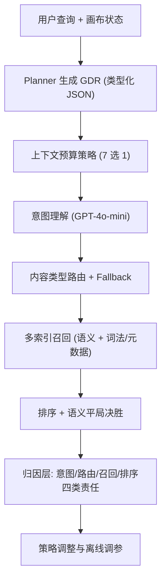
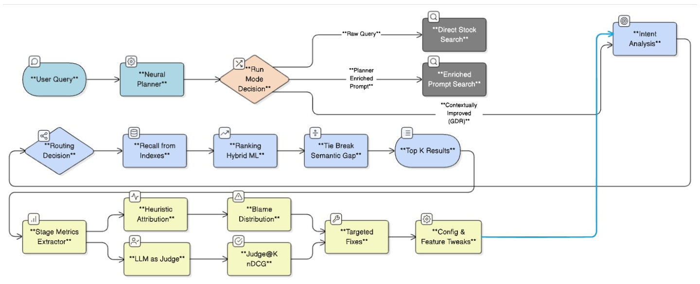

# FUSE: Failure-aware Usage of Subagent Evidence for MultiModal Search and Recommendation (面向多模态搜索推荐、失败感知的子智能体证据利用框架)

- **会议/期刊**: ICDM 2025 (MMSR Workshop on Multimodal Search and Recommendations)
- **作者与机构**: Tushar Vatsa, Vibha Belavadi, Priya Shanmugasundaram, Suhas Suresha, Dewang Sultania (Adobe Inc.)
- **推荐链路定位**: 召回 + 排序（多阶段搜索子智能体流水线）
- **研究方向**: 多模态推荐 / 对话与智能体推荐
- **论文原文**: [https://arxiv.org/abs/2601.02365v1](https://arxiv.org/abs/2601.02365v1)
- **开源代码**: 暂未开源

## TL;DR (1分钟核心速览)

创意设计助手把用户目标拆给布局/样式/检索等子智能体，但检索失败可能源于意图、路由、召回、排序任一环节，而直接喂原始图像给 VLM 既贵又慢（GPT-4o 处理 800×800 图超 5 秒）。FUSE 用紧凑的 Grounded Design Representation (GDR) 替代大部分图像提示，系统对比 7 种上下文预算策略，并构建五阶段归因层定位失败。在 788 条真实查询上，Context Compression 取得 93.3% 意图准确率、86.8% 路由成功率、99.4% 召回与 88.5% NDCG@5，p95 延迟较 Baseline 降 45%、输入 token 较 CoT 少 8 倍。

## Background & Motivation (背景与核心矛盾)

- **主流范式**: 现代多模态创意助手采用 agentic orchestration——神经 Planner 分解用户查询并路由到布局、样式、检索、生成等专用子智能体，检索子智能体是整条链路的"命门"。
- **前人局限**: 其一，现有 agent 框架（ReAct、Toolformer、Cascades、HM-RAG）聚焦协调效率或组件级优化，缺乏对"失败发生在哪一阶段"的系统性诊断；其二，朴素地把原始图像塞进 VLM 提示，每张图需切 patch 贡献数百 token，商业 API 视觉输入约 $10/百万 token，延迟与成本对实时 SLA 不可接受。
- **核心洞察 (Key Insight)**: 作者分析约 36,000 条生产查询发现，用户查询多为短命令（平均 7 词，高频词为 add/background/replace/shape/image）且高度依赖上下文——"find beans" 在咖啡海报上应返回咖啡豆而非普通豆类；纯原始查询模式人工评测通过率仅 63%，说明上下文必须在检索前被显式化。
- **本文切入点**: 用 Planner 产出的紧凑类型化 JSON（GDR）替代原始图像，把"上下文预算"当作一等公民系统对比，并用归因层把子智能体信号转成可操作的阶段级检查。

## Method (核心方法设计)

### 1. 整体框架 (Overall Architecture)

系统有三种运行模式：(a) 原始查询直接检索；(b) Planner 增强提示词；(c) Planner 提示词 + 紧凑 GDR。上下文子智能体依次执行意图分析、内容类型路由、召回、排序与语义平局决胜；评估与归因层抽取各阶段指标，结合启发式与 LLM-as-judge 评估，通过责任分布定位失败并驱动针对性修复与配置更新。GDR 由轻量 GPT-4o-mini 消费，序列化画布元素（图像/文本/形状/图标/视频/logo）的几何、外观、颜色角色、LLaVA 描述与检测区域，从而在不重算 800 亿资产 embedding 的前提下注入画布语义。

<figure class="paper-figure" markdown="span">
  <figcaption>图1. 集成FUSE的多阶段搜索系统流程。该图展示了三种运行模式：(a) 原始查询，(b) 超智能体增强提示词，(c) 超智能体提示词+紧凑GDR。上下文子智能体执行意图分析、内容类型路由、召回、排序和语义平局决胜。评估与归因层提取各阶段指标，应用启发式与LLM-as-judge评估，通过责任分布定位失败，并驱动针对性修复与配置更新。</figcaption>
</figure>

### 2. 关键设计拆解 (Key Designs)

1. **Grounded Design Representation (GDR) 替代原始图像提示**：痛点是原始图像 token 昂贵且长提示中冲突线索会干扰检索排序（如索引对形状覆盖稀疏时注入形状线索常致零命中）。GDR 是带类型的 JSON，记录每页每元素的 `opacity/zIndex`、`frame` 四角坐标、颜色角色与权重、LLaVA caption 与检测区域；查询时 GPT-4o-mini 从 GDR 与 Planner 提示中抽取六要素（动作、作用域、尺寸形状、颜色兼容、风格一致、内容规则），把"find similar cars"改写为"find cars with sufficient contrast against green"。直觉是：把隐式设计约束显式化为可校验的检索条件，避免重嵌入全库。
2. **七种上下文预算策略的系统对比**：Baseline（全量 few-shot）、Chain-of-Thought（草稿板推理）、Context Compression（压缩 GDR 与提示）、Mini-Shot（每类内容一个精选样例）、Retrieval-Augmented（按 embedding 相似度动态选例）、Two-Stage（先预测内容类型再施加资产专属条件）、Zero-Shot（仅保留必要 GDR 元素）。核心思想是把"上下文工程"视为可调预算而非固定配置，按延迟与 token 上限按需选择。
3. **五阶段流水线归因与 Fallback 机制**：把失败分为意图（子提示与期望意图语义不匹配，如"coffee beans"被解为"black beans"）、路由（意图对但内容类型错，如 fireworks 被路由到视频而非照片）、召回（零命中，如"deer pattern background"）、排序（相关结果被错排，如相似度 0.674 的结果排第 3 而 0.474 排第 1）四类；路由失败时触发 fallback 重路由。评估指标为意图匹配率、路由精确匹配率、零命中率与以语义相似度为相关性的 NDCG@5。

## Experimental Setup & Evaluation Protocol (实验设置与评估协议)

- **数据集与预处理**: 基于约 36,000 条生产查询，人工评测抽样 788 条（模板 + 查询）覆盖 add/replace/find 任务，每条判定动作正确性、资产相关性与布局/风格一致性。

| 数据集 | #Queries | 平均查询长度 | 高频词 | 特征/场景说明 |
| :--- | :---: | :---: | :---: | :--- |
| 生产查询池 | ~36,000 | 7 词（词干化后） | add/background/replace/shape/image | 创意设计画布，上下文依赖强 |
| 人工评测集 | 788 | 同上 | 同上 | 覆盖 add/replace/find，人工判定通过率 |

- **数据划分与防穿越 (Splitting Strategy)**: 非传统训练/测试划分，而是对同一 788 条评测集做七种策略的离线对照评测；仅统计 Planner 侧无失败、请求真正到达检索子智能体的样本。
- **排名评测协议 (Ranking Protocol)**: 采用 NDCG@5，以语义相似度分数作为相关性判断，衡量前 5 位排序质量；召回以零命中率计，路由以内容类型精确匹配计。
- **对比基线与超参设置**: 七种上下文预算变体互为基线；意图模型为 GPT-4o-mini，画布资产描述由 LLaVA 生成；成本以 CoT 总 token 归一化为 1.00 计算相对成本。

## Key Experimental Results (实验关键数据)

### 1. 主实验对比 (Main Results)

| 策略 | 意图匹配 (%) | 路由成功 (%) | 召回成功 (%) | NDCG@5 (%) | 综合成功 (%) |
| :--- | :---: | :---: | :---: | :---: | :---: |
| Baseline | 92.1 | 83.0 | 99.4 | 88.7 | 80.8 |
| Chain-of-Thought | 91.6 | 81.9 | 99.4 | **89.0** | 81.7 |
| **Context Compression** | **93.3** | **84.1** | **99.4** | 88.5 | **82.9** |
| Mini-Shot | 90.7 | 80.8 | 97.3 | 87.9 | 78.6 |
| Retrieval-Augmented | 91.9 | 74.3 | 96.4 | 87.9 | 79.4 |
| Two-Stage | 91.2 | 78.0 | 97.7 | 88.2 | 79.9 |
| Zero-Shot | 89.5 | 72.7 | 93.1 | 88.4 | 74.5 |

延迟与成本（图 6）：Context Compression p95 为 1.54 s（Baseline 2.79 s，降约 45%），CoT 最慢 3.21 s；相对 token 成本以 CoT=1.00 归一，Compression 输入 token 约为 CoT 的 1/8。

### 2. 消融实验 (Ablation Study)

| 配置 | 路由无 Fallback (%) | 路由含 Fallback (%) | 增益 (pp) |
| :--- | :---: | :---: | :---: |
| Baseline | 83.04 | 85.26 | +2.22 |
| Chain-of-Thought | 81.93 | 85.98 | +4.05 |
| Context Compression | 84.12 | 86.79 | +2.67 |
| Mini-Shot | 80.79 | 86.67 | +5.88 |
| Retrieval-Augmented | 74.25 | 80.22 | +5.97 |
| Two-Stage | 78.04 | 82.87 | +4.83 |
| Zero-Shot | 72.73 | 80.56 | +7.83 |

### 3. 关键实验发现 (Key Findings)

1. **上下文工程的影响高度阶段异质**：意图匹配率七种策略仅差 3.8 个百分点（89.5–93.3%），排序 NDCG@5 方差仅 0.011，但路由成功率跨度达 12 个百分点（72.7–84.1%），说明内容类型预测最依赖稳定上下文引导，而排序质量主要由 embedding 相似度决定、对上游上下文不敏感。
2. **Fallback 与主上下文呈互补反比**：上下文越精简，fallback 增益越大（Zero-Shot +7.83pp、Retrieval-Augmented +5.97pp），而 Compression 仅 +2.67pp、Baseline +2.22pp——强主上下文通过路径优化获得一致性，弱上下文则依赖 fallback 兜底恢复。
3. **压缩优于全量与极简两端**：Context Compression 综合成功 82.9% 高于 Baseline 80.8% 与 Zero-Shot 74.5%，同时 p95 延迟最低（1.54 s）、token 成本最低，证明"信息密度"而非"信息体量"才是生产级多模态检索的关键变量。

## Highlights & Limitations (亮点、对比与审稿批判)

- **与代表作对比 (vs. Prior Work)**: 相比 ReAct/Toolformer/Cascades 等聚焦 agent 协调与工具调用的框架，FUSE 首次把"失败归因"作为一等模块嵌入多阶段检索；相比 HM-RAG 等组件级优化工作，它不追求更强 embedding，而是系统诊断失败发生在意图/路由/召回/排序哪一环；相比通用 context budgeting 研究，它面向设计模板约束与 fallback 可靠性这一生产场景。
- **可迁移亮点**: (1) 用类型化 JSON 摘要替代原始图像/长文本上下文，可直接迁移到图文电商、短视频封面检索等 VLM 成本敏感场景；(2) 阶段级责任分布 + fallback 增益分析，可作为多阶段推荐流水线（召回→粗排→精排）的通用诊断模板。
- **审稿级局限批判**: 其一，788 条评测集规模偏小且依赖人工/LLM-as-judge 判定，缺乏多标注者一致性统计与显著性检验，结论稳健性存疑；其二，GDR 依赖 LLaVA caption 与检测区域质量，caption 噪声会沿流水线传播，且论文未报告不同 Planner 模型或画布复杂度下的敏感性分析，跨平台泛化性未验证。

## Rating (四维评分)

- **方法创新性 (Novelty)**: ⭐⭐⭐⭐ （GDR 紧凑表征 + 七策略系统对比 + 五阶段归因层的组合在工业多模态检索中较新颖，但单点技术多为工程整合而非理论突破）
- **评估协议与实验扎实度 (Protocol & Experiments)**: ⭐⭐⭐ （788 条真实查询与延迟/成本剖析扎实，但缺显著性检验、多标注一致性及跨 Planner 敏感性分析）
- **写作与数学规范度 (Clarity & Rigor)**: ⭐⭐⭐⭐ （问题形式化清晰、GDR 示例与归因分类定义明确，但表格中部分数值前后不一致、公式化程度偏低）
- **工业落地与复现价值 (Industrial & Practical Value)**: ⭐⭐⭐⭐⭐ （直接面向生产 SLA 与 token 预算，Compression 策略 p95 降 45%、token 省 8 倍，落地指导性极强；可惜未开源）

