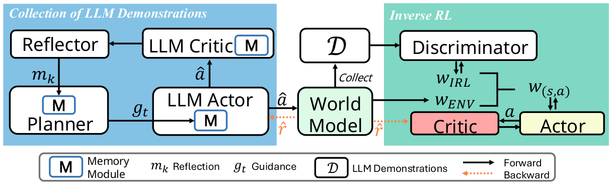
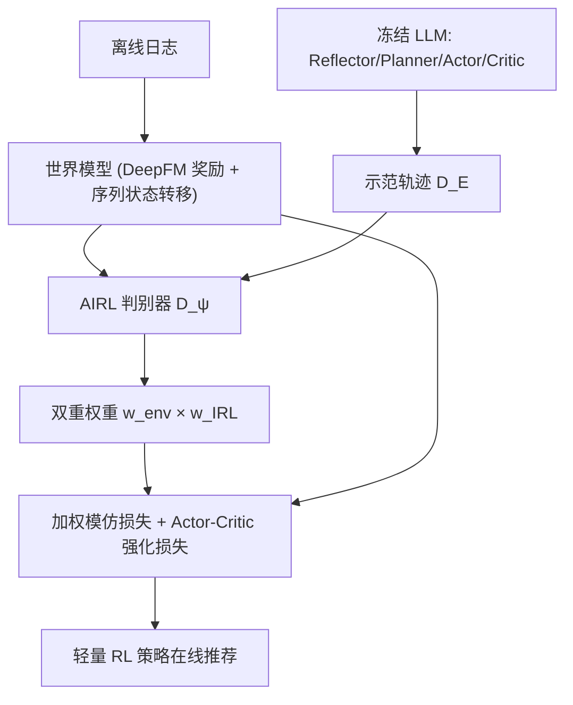

# Beyond Static LLM Policies: Imitation-Enhanced Reinforcement Learning for Recommendation (超越静态 LLM 策略：面向推荐的模仿增强强化学习)

- **会议/期刊**: ICDM 2025
- **作者与机构**: Yi Zhang, Lili Xie, Ruihong Qiu, Jiajun Liu, Sen Wang（昆士兰大学 EECS / CSIRO Data61）
- **推荐链路定位**: 端到端生成式（离线策略学习，在线仅跑轻量 RL Actor）
- **研究方向**: 强化学习与动态探索推荐 / 大语言模型推荐
- **论文原文**: [https://arxiv.org/abs/2510.13229v1](https://arxiv.org/abs/2510.13229v1)
- **开源代码**: [https://github.com/ArronDZhang/IL-Rec](https://github.com/ArronDZhang/IL-Rec)

## TL;DR (1分钟核心速览)

直接把 LLM 当推荐策略存在两大硬伤：在线频繁调 API 延迟高，且幻觉/偏见导致策略静态、多样性差；而纯 RL4RS 又只吃粗粒度反馈、读不懂文本语义。本文提出 IL-Rec：先用冻结 LLM（Reflector/Planner/Actor/Critic 四模块）离线合成示范轨迹，再用对抗逆强化学习（AIRL）从示范中反推奖励函数，并以「环境优势权重 × 判别器置信权重」对示范做加权模仿，与 actor-critic 联合优化。在 Steam/Amazon 两个基准上，累积奖励 $R_{traj}$ 分别达 78.478 / 48.219，较 SOTA BiLLP 相对提升 13.4% / 13.6%，交互长度提升 14.1% / 18.3%。

## Background & Motivation (背景与核心矛盾)

- **主流范式**: 一条线是 model-based 离线 RL4RS（DORL、ROLeR），用世界模型模拟环境优化长期留存；另一条线是把 LLM 直接当策略（BiLLP、ReAct、Reflexion），靠上下文推理与记忆更新做推荐。
- **前人局限**: (1) LLM 直接部署需持续调用 API，在线延迟不可接受，且输出易产生虚假关联、强化同质流行物品，损害多样性与可靠性；(2) 纯 RL4RS 依赖粗粒度反馈信号，无法捕捉用户历史中的细粒度语义依赖（如「教父」系列中反复出现的演员），只能做子串匹配式推荐。
- **核心洞察 (Key Insight)**: LLM 示范虽次优（含幻觉与偏见），但蕴含丰富语义先验；若把示范当作「非完美专家」，用逆强化学习反推奖励、再以置信度加权模仿，RL 策略不仅能摆脱在线 LLM 依赖，还能**超越原始 LLM 示范**。
- **本文切入点**: 以 AIRL 判别器替代人工奖励设计，用双重权重（环境优势 + 判别器置信）筛选高质量示范转移，实现「语义迁移 + 长期优化」的解耦。

<figure class="paper-figure" markdown="span">
  <figcaption>图 2. 左侧部分展示了从 LLM 策略中收集演示的过程。专家演示由 Planner、Reflector、LLM-Actor 和 LLM-Critic 协作合成。随后，如右侧所示，采用对抗逆强化学习（IRL），通过训练判别器区分专家生成的轨迹与当前策略与所学世界模型交互产生的轨迹，从而提取有效的奖励函数。通过与世界模型的迭代交互，策略逐步改进以超越</figcaption>
</figure>

## Method (核心方法设计)

### 1. 整体框架 (Overall Architecture)

整个流程分三阶段闭环：(i) **世界模型学习**——用离线日志以 DeepFM 监督学习即时奖励 $\hat{r}$，状态转移由序列模型（GRU/Transformer）编码历史交互得到$s_{t+1}$；(ii) **LLM 示范采集与加权**——冻结 LLM 四模块协作生成示范轨迹$\mathcal{D}_E$，逐转移计算环境优势权重与 IRL 置信权重并融合入回放池；(iii) **策略优化**——RL Actor-Critic 在混合回放池$\mathcal{B}=\mathcal{B}_{env}\cup\mathcal{B}_{demo}$ 上以加权模仿损失 + 强化损失联合更新，判别器周期性重训。在线推理时仅需轻量 RL 策略，彻底摆脱 LLM API 调用。

### 2. 关键设计拆解 (Key Designs)

1. **LLM 四模块示范合成（Reflector / Planner / Actor / Critic）**：Reflector 对已完成 episode 生成文本反思 $m_k=f_{ref}(E,I_r)$存入 Planner 记忆；Planner 用 FAISS 相似检索历史反思并生成高层指导$g_t=f_{plan}(s_t,M_p,I_P)$；Actor 结合指导与检索记忆生成候选指示$\hat{a}_t$，再以余弦相似度对齐物品嵌入取$\arg\max_{i\in\mathcal{I}}\text{sim}(\hat{a}_t,e_i)$ 作为最终动作；Critic 估计状态价值并构造 A2C 优势。四者协作把「语义理解」蒸馏进示范轨迹，且全程冻结 LLM、无需微调。

2. **对抗逆强化学习与双重示范加权（核心增量）**：判别器 $D_\psi$区分策略轨迹与专家示范，奖励定义为$r_{IRL}(s,a)=-\log D_\psi(s,a)$。由于 LLM 示范次优，作者设计两路权重：环境侧用世界模型回报拟合$V_{demo}$得优势$A_{demo}$，$w_{env}(s,a)=\exp(\frac{1}{\beta}A_{demo}(s,a))$；IRL 侧用判别器置信$w_{IRL}(s,a)=(\frac{1}{D_\psi(s,a)}-1)^{\gamma}$；最终融合$w(s,a)=[w_{env}]^{\alpha}\times[w_{IRL}]^{1-\alpha}$。直觉是：既奖励「在世界模型中真正带来高回报」的转移，又奖励「判别器确信像专家」的转移，从而压制幻觉与偏见带来的低质示范。

3. **训练目标、负采样与推理效率**：总策略损失 $\mathcal{L}_{policy}(\theta)=\lambda_{imit}\mathcal{L}_{imit}(\theta)+\mathcal{L}_{RL}(\theta)$，其中加权模仿项$\mathcal{L}_{imit}=-\mathbb{E}_{(s,a)\sim\mathcal{D}_E}[w(s,a)\log\pi_\theta(a|s)]$，强化项为带熵正则的 actor-critic 目标；Critic 以 TD 损失$\mathcal{L}_{critic}=\mathbb{E}_{\mathcal{B}}[(Q_\phi(s,a)-y)^2]$ 更新。示范样本按权重优先采样，无需额外负采样。单次训练约 12 GPU 小时（A100），其中世界模型 3h、示范生成 3h、AIRL 6h，且前两者为一次性开销；在线推理仅跑轻量策略，延迟远低于 LLM 直调。

## Experimental Setup & Evaluation Protocol (实验设置与评估协议)

- **数据集与预处理**: 沿用 BiLLP 的划分与统计（Steam 游戏时长、Amazon 图书评分均映射为 $[1,5]$ 即时奖励）：

| 数据集 | #Users | #Items | 密度(Train/Test) | 特征/场景说明 |
| :--- | :---: | :---: | :---: | :--- |
| Steam | 6,012 | 190,365 | 0.145% / 0.084% | 游戏平台，游戏时长作奖励 |
| Amazon | 3,109 | 13,864 | 0.788% / 0.320% | 图书评分，书名/类型作文本信息 |

- **数据划分与防穿越 (Splitting Strategy)**: 沿用 BiLLP 的 Train/Test 用户级划分，测试阶段在世界模型上做策略 rollout 评估，不与训练轨迹重叠。
- **排名评测协议 (Ranking Protocol)**: 非传统 Top-N 排序，而是**序列决策式评估**——在模拟环境中跑完整推荐会话，报告累积奖励 $R_{traj}$（主指标）、单步奖励$R_{each}$、平均交互长度$Len$。会话终止条件：最近$N$步内出现$M$个同类别物品（Steam$N=50,M=4$；Amazon$N=15,M=4$）或长度达上限 100。
- **对比基线与超参设置**: 离线 RL 基线 DQN/A2C/SQN/CRR/BCQ/CQL/DORL/ROLeR，LLM 基线 ActOnly/ReAct/Reflexion/BiLLP；所有 model-based 方法共享同一 DeepFM 世界模型以保证公平。LLM 温度 0.5，$\beta\in\{0.1,1,10\}$，$\alpha\in\{0.25,0.5,0.75\}$，$\alpha_{ent}\in\{0.01,0.1,0.2\}$，$\lambda_{imit}\in\{0.1,0.5,2\}$，学习率 0.001，Adam 优化。

## Key Experimental Results (实验关键数据)

### 1. 主实验对比 (Main Results)

| Method | Steam Len | Steam $R_{each}$| Steam$R_{traj}$| Amazon Len | Amazon$R_{each}$| Amazon$R_{traj}$ |
| :--- | :---: | :---: | :---: | :---: | :---: | :---: |
| A2C | 9.647 | 4.367 | 42.180 | 7.873 | 4.497 | 35.437 |
| DORL | 9.467 | 4.033 | 38.300 | 7.507 | 4.510 | 33.887 |
| ROLeR | 10.218 | 4.208 | 42.997 | 8.604 | 4.590 | 39.492 |
| ReAct | 11.630 | 4.559 | 42.990 | 7.733 | 4.603 | 35.063 |
| Reflexion | 12.690 | 4.523 | 57.423 | 8.700 | 4.670 | 40.470 |
| BiLLP | 15.367 | 4.503 | 69.193 | 9.413 | 4.507 | 42.443 |
| **IL-Rec (Ours)** | **17.533** | 4.476 | **78.478** | **11.136** | 4.330 | **48.219** |
| Improv.% (vs BiLLP) | +14.1% | — | **+13.4%** | +18.3% | — | **+13.6%** |

### 2. 消融实验 (Ablation Study)

| 变体 | Steam $R_{traj}$| Steam Len | Amazon$R_{traj}$ | Amazon Len |
| :--- | :---: | :---: | :---: | :---: |
| BiLLP（无 AIRL） | 69.193 | 15.367 | 42.443 | 9.413 |
| w/o $w$（权重置 1） | 67.380 | 14.990 | 39.350 | 8.630 |
| w/o $w_{env}$（仅 IRL 权重） | 63.380 | 13.210 | 40.280 | 8.650 |
| w/o $w_{IRL}$（仅环境权重） | 71.350 | 15.670 | 44.000 | 11.030 |
| **IL-Rec 完整** | **78.478** | **17.533** | **48.219** | **11.136** |

### 3. 关键实验发现 (Key Findings)

1. **双重加权是长期收益的命门**：去掉全部权重后 $R_{traj}$在 Steam/Amazon 分别掉 14.1%/18.4%，而$R_{each}$ 几乎不变——说明加权机制专门作用于长程留存而非单步满意度，印证「次优示范需筛选」的核心假设。
2. **环境权重比 IRL 权重更关键**：去掉 $w_{env}$使$R_{traj}$掉 19.3%/16.5%（降幅最大），但$R_{each}$反升 7.2%/7.6%，揭示环境优势权重在「牺牲短期换长期」上的主导作用；去掉$w_{IRL}$ 仅掉 9.1%/8.7%，二者互补。
3. **LLM 能力上限决定策略天花板**：GPT-4-32k 示范使 $R_{traj}$ 飙至 128.346/64.121（远超 GPT-3.5 的 78.478/48.219），而 Llama2-7b 仅 71.75/40.48 已接近 BiLLP——证明 IL-Rec 能有效榨取中等 LLM 的价值，且随 LLM 进步持续受益。

## Highlights & Limitations (亮点、对比与审稿批判)

- **与代表作对比 (vs. Prior Work)**: 相比 BiLLP（LLM 直接当策略、靠记忆更新），IL-Rec 把 LLM 降级为「离线示范生成器」，在线零 API 调用且策略可超越示范；相比 DORL/ROLeR（纯 RL、无文本语义），IL-Rec 通过 AIRL 把 LLM 语义先验注入奖励函数；相比 DLLM2Rec（蒸馏到轻量模型），本文用模仿 + RL 联合优化而非单向蒸馏，保留长期决策能力。
- **可迁移亮点**: (1) 「次优示范 + 双重置信加权」范式可迁移到任何用 LLM 合成训练数据的推荐场景（如冷启动、跨域）；(2) 用 AIRL 判别器替代人工奖励设计，适合奖励稀疏或难定义的长期留存优化任务。
- **审稿级局限批判**: (1) 训练成本约为 BiLLP 的两倍（12h vs 6h），且依赖世界模型质量，模拟器偏差可能被策略过拟合；(2) 评估完全在模拟环境 rollout，缺乏真实线上 A/B 或公开交互日志验证，$R_{each}$ 在 Amazon 上反低于多个基线，长期/短期权衡的实际业务收益仍待检验。

## Rating (四维评分)

- **方法创新性 (Novelty)**: ⭐⭐⭐⭐ （把 LLM 示范视为非完美专家、用 AIRL + 双重置信加权筛选，思路清晰且区别于单纯蒸馏/微调）
- **评估协议与实验扎实度 (Protocol & Experiments)**: ⭐⭐⭐ （两数据集 + 8 个 RL 基线 + 4 个 LLM 基线较完整，但纯模拟环境评估、无真实线上验证是硬伤）
- **写作与数学规范度 (Clarity & Rigor)**: ⭐⭐⭐⭐ （公式与三阶段流程交代清楚，权重设计与损失推导完整，符号略密但可读）
- **工业落地与复现价值 (Industrial & Practical Value)**: ⭐⭐⭐⭐ （代码开源、在线仅跑轻量策略延迟低，一次性训练开销可接受，落地路径明确）

