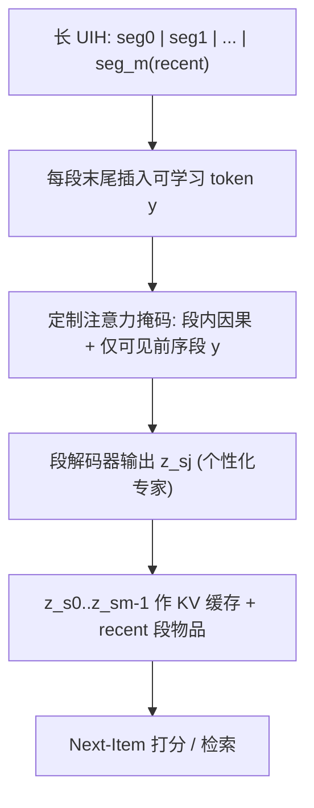
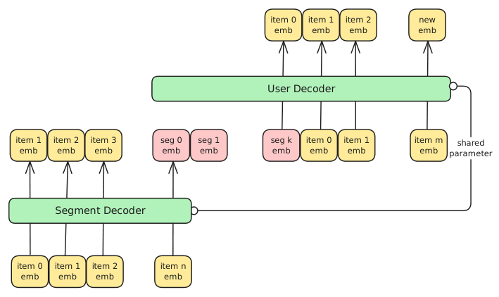

# Efficient Sequential Recommendation for Long Term User Interest Via Personalization (基于个性化专家的长程用户兴趣高效序列推荐)

- **会议/期刊**: ICDM 2025
- **作者与机构**: Qiang Zhang, Hanchao Yu, Ivan Ji 等 (Meta Recommendation Systems, MRS)
- **推荐链路定位**: 召回 (Retrieval / Next-Item Prediction)
- **研究方向**: 序列与会话推荐 / 大语言模型推荐
- **论文原文**: [论文原文链接](https://arxiv.org/abs/2601.03479v1)
- **开源代码**: [开源代码仓库链接](https://github.com/facebookresearch/PerSRec)

## TL;DR (1分钟核心速览)

Transformer 序列推荐（HSTU/HLLM）性能随历史长度稳定提升，但注意力开销随长度二次增长，工业落地受阻。本文提出 PerSRec：将长历史切分为段，在每段末尾插入可学习 token 作为"个性化专家"，通过定制注意力掩码让 token 单向聚合段内信息，推理时仅缓存这些 token 的 KV 激活。在 MerRec 与 EB-NeRD 上，仅用 256 条近期交互 + 4 个专家 token 即追平 1280 条全序列基线（HSTU R@10 51.63% vs 51.39%），推理开销降至约 23.8%。

## Background & Motivation (背景与核心矛盾)

- **主流范式**: SASRec/HSTU/HLLM 将用户交互历史 (UIH) 展平为单条长序列做 next-item 预测，HSTU 已验证推荐领域的"缩放律"。
- **前人局限**: ① 两阶段方案（SIM/TWIN 的采样或聚类）与序列模型训练目标割裂，压缩过程不可微、次优；② 直接展平长序列的注意力复杂度为 $O(L(n^2d+nd^2))$，长度翻倍即成本四倍，产品侧无法承受。
- **核心洞察 (Key Insight)**: 图 1 显示 Recall@5 随序列从 128 增至 2000 单调上升，说明长历史信息确有价值——问题不在"要不要长历史"，而在"如何以亚二次成本保留它"。
- **本文切入点**: 借鉴 LLM 上下文压缩（Gist/AutoCompressor），但把压缩 token 从"通用摘要"改造为"用户个性化专家"，并与推荐模型的因果注意力结构原生对齐，实现单阶段端到端训练。

## Method (核心方法设计)

### 1. 整体框架 (Overall Architecture)

输入 UIH 被切为 $m$段$[s_0,\dots,s_m]$，前$m-1$段（pretrain 段）每段末尾插入可学习 token$y$，最后一段（recent 段）保持原始物品序列不压缩。训练时所有段展平为一条序列，靠定制注意力掩码一次性完成"段内压缩 + 跨段预测"；推理时逐段前向，仅保留各段$y$的 KV 激活作为缓存，与 recent 段物品 embedding 拼接后预测新物品。解码器与段解码器可共享参数（$\theta=\phi$）。

<figure class="paper-figure" markdown="span">
  <figcaption>图 2. 所提方法架构概览。该模型将长序列划分为多个片段，并利用片段解码器将每个片段“压缩”为片段嵌入。这些片段嵌入随后与来自最近片段的物品嵌入结合，以执行序列推荐。该设计可显著提升效率。解码器与片段解码器可共享参数。</figcaption>
</figure>

### 2. 关键设计拆解 (Key Designs)

1. **个性化专家压缩 (Personalized Experts)**：痛点是把 1024 条历史直接喂入解码器成本过高。本文将段 $j$的压缩表征定义为$z_{s_j}\propto p_\phi(z\mid z_{s_0},\dots,z_{s_{j-1}};x_{j0},\dots,x_{jn_j};y)$，最终预测为$x^*\propto p_\theta(x\mid z_{s_0},\dots,z_{s_{m-1}},x_{m0},\dots,x_{mn_m})$。关键约束是$z_{s_j}$ **只**依赖本段物品与前序段专家，迫使 token 成为该段信息的充分统计量，而非偷看未来。

2. **分段注意力掩码 (Segment-Aware Mask)**：普通因果掩码会让段内物品互相跨段注意，压缩失效。本文改造掩码：位置 $i$仅可关注自身、同段前序物品、以及所有前序段的专家 token（图 4 右）。该掩码使"段内信息只能经$y$ 流出"，天然形成信息瓶颈，等价于对每段施加隐式压缩正则；同时保证训练单次前向即可模拟推理时的两阶段流程，消除训练-推理不一致。

3. **训练目标、负采样与推理效率**：损失仍为 next-item 预测（HLLM 用对比损失，正样本为下一位置输出 embedding，负样本取自其他用户序列），但**专家 token 位置的损失被掩蔽**。训练复杂度放大系数约 $1+\alpha$（$\alpha=k/n\ll1$），实测 HLLM 训练仅 +0.22%。推理复杂度降至$O(L(\frac{(n+k)^2}{m}d+(n+k)d^2))$，在$n=1280,m=5,k=4,d=64$时$S\approx0.238$；额外空间仅$O(2Lkd)$/用户。

## Experimental Setup & Evaluation Protocol (实验设置与评估协议)

- **数据集与预处理**:

| 数据集 | #Users | #Items | #Interactions | 稀疏度/密度 | 特征/场景说明 |
| :--- | :---: | :---: | :---: | :---: | :--- |
| MerRec | 119,756 | 1,255,665 | 每用户 ≥2000（取末 2000） | 极稀疏 | C2C 电商，6 类事件；item 描述 = c2 name + brand name |
| EB-NeRD | 44,968 | ~125,000 | 每用户 ≥512（取末 512） | 稀疏 | 丹麦新闻；item 描述 = title + subtitle + category |

- **数据划分与防穿越 (Splitting Strategy)**: 采用**全局时间戳切分**——MerRec 前 1280 事件训练 / 后 720 测试，训练段再切为 pretrain(1024) + recent(256)；EB-NeRD 前 500 训练 / 后 12 测试，训练段切为 400 + 100。目标为序列末位物品。
- **排名评测协议 (Ranking Protocol)**: 采用 **Full-Ranking（全库未交互物品排序）**，指标为 Recall@{10,50,200} 与 NDCG@{10,50,200}；HLLM 分支使用对比损失 + 跨用户负样本。
- **对比基线与超参设置**: SASRec、HSTU（16 层，$d=64$）、HLLM（Llama 3.2 1B，16 层，$d=2048$）。学习率 HLLM$1e^{-4}$/ HSTU·SASRec$1e^{-3}$，weight decay 0.01 / 0.1，batch size 3 / 8；8×H100 单机。

## Key Experimental Results (实验关键数据)

### 1. 主实验对比 (Main Results)

MerRec（$k=4$，R@k / N@k 为百分数）：

| Method | Pretrain | Recent | R@10 | R@50 | R@200 | N@10 | N@200 |
| :--- | :---: | :---: | :---: | :---: | :---: | :---: | :---: |
| SASRec | N.A. | 1280 | 49.77 | 66.05 | 77.18 | 32.86 | 38.21 |
| HSTU | N.A. | 256 | 45.63 | 61.79 | 73.03 | 29.54 | 34.87 |
| HSTU | N.A. | 1280 | 51.39 | 67.05 | 77.79 | 34.02 | 39.18 |
| **Personalized HSTU** | 1024 | 256 | **51.63** | **67.31** | **77.87** | **34.10** | **39.24** |
| HLLM | N.A. | 256 | 47.48 | 64.33 | 75.30 | 31.05 | 36.50 |
| HLLM | N.A. | 1280 | 49.87 | 66.74 | 77.51 | 33.15 | 38.57 |
| **Personalized HLLM** | 1024 | 256 | 49.80 | 66.64 | 77.47 | 33.14 | 38.56 |

EB-NeRD（$k=2$）：Personalized HSTU 达 R@10 **45.00%** / N@10 **30.89%**，超越 HSTU-500（44.79 / 30.58）与 HSTU-100（43.55 / 29.04）；Personalized HLLM 为 48.04 / 33.06，略低于 HLLM-500（50.06 / 36.27）但显著优于 HLLM-100（38.09 / 23.58）。

### 2. 消融实验 (Ablation Study)

| 配置 | R@5 | R@10 | N@10 | 说明 |
| :--- | :---: | :---: | :---: | :--- |
| Setting 1: [4]（单段 1024→4 token） | **43.15** | **51.98** | **34.28** | 最优 |
| Setting 2: [2,2]（512+512） | 43.00 | 51.78 | 34.15 | 略降 |
| Setting 3: [1,1,1,1]（4×256） | 42.78 | 51.64 | 34.01 | 最差但最省 |
| Setting 4: [1,1,2]（类 KuaiFormer） | 42.88 | 51.76 | 34.05 | 居中 |
| $k=1$| 43.15* | 52.01 | 34.22 | 与$k=4$ 相当 |
| $k=16$ | — | 50.65 | 33.08 | 异常低谷 |
| $k=256$ | — | 51.92 | 34.11 | 无增益 |

### 3. 关键实验发现 (Key Findings)

1. **压缩几乎无损、且优于"只用近期"**：HSTU 上 4 个专家 token 使 R@10 从 45.63%（256 序列）跃至 51.63%，甚至微超 1280 全序列的 51.39%，说明 pretrain 段信息被有效保留而非丢弃。
2. **专家不随时间衰减**：图 8 中 recent 窗口滑离固定 pretrain 段达 464 事件，PerSRec 与 HSTU-1280 的性能差距并未扩大，证明"压缩一次、多次复用"在工程上可行，摊销后推理成本进一步下降。
3. **粗粒度压缩优于细粒度切分**：Setting 1 全面优于 Setting 3，说明给模型更大自由度自行决定"压缩什么"比人工指定段边界更有效；而 $k$从 1 到 256 性能几乎不变，表明信息瓶颈由掩码结构而非 token 数量决定，$k=16$ 的异常低谷提示存在尚未解释的优化不稳定。

## Highlights & Limitations (亮点、对比与审稿批判)

- **与代表作对比 (vs. Prior Work)**: 相较 SIM/TWIN 的"先采样/聚类再建模"两阶段范式，本文压缩算子与推荐目标端到端联合优化，无训练-推理割裂；相较 KuaiFormer 的多段独立压缩，本文用统一掩码在单次前向中完成全部压缩，且实验证明单段压缩反而更优；相较 Gist/AutoCompressor 等 LLM 压缩方法，本文首次将压缩 token 与推荐场景的因果 next-item 结构对齐。
- **可迁移亮点**: ① "段内因果 + 仅可见前序段摘要 token"的掩码模板可直接复用于任何长序列 Transformer 推荐的加速；② 用 NMF 将专家 token 输出分解回 pretrain 段物品权重（表 VIII 中 LEGO 目标对应 top-5 全为 LEGO 相关品），是一种低成本的可解释性探针。
- **审稿级局限批判**: ① 效率收益高度依赖 $m$与序列切分方式，论文仅报告$m=5$的单点，缺少$m$扫描与端到端线上延迟数据；② EB-NeRD 上 HLLM 分支明显落后全序列基线（48.04 vs 50.06），说明压缩对强 LLM 主干并非无损，且$k=16$ 的性能塌陷缺乏解释，超参敏感性存疑。

## Rating (四维评分)

- **方法创新性 (Novelty)**: ⭐⭐⭐⭐ （将 LLM 上下文压缩改造为推荐原生的个性化专家 + 定制掩码，思路简洁但理论分析以复杂度为主，缺信息论层面的压缩保证）
- **评估协议与实验扎实度 (Protocol & Experiments)**: ⭐⭐⭐⭐ （MerRec/EB-NeRD 双数据集 + Full-Ranking + 四个 RQ 层层递进，但缺显著性检验与 $m$ 的敏感性分析）
- **写作与数学规范度 (Clarity & Rigor)**: ⭐⭐⭐⭐ （复杂度推导清晰、掩码伪代码完整，但部分表格符号与正文记号不统一，$k=16$ 异常未作讨论）
- **工业落地与复现价值 (Industrial & Practical Value)**: ⭐⭐⭐⭐⭐ （Meta 工业级数据集验证，训练开销 <5%、推理降 11.5%~76%，代码已开源，KV 缓存方案可直接嵌入现有 serving 栈）

