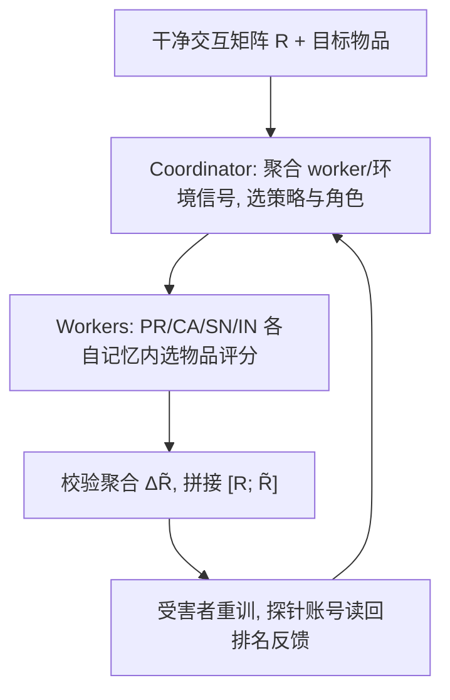
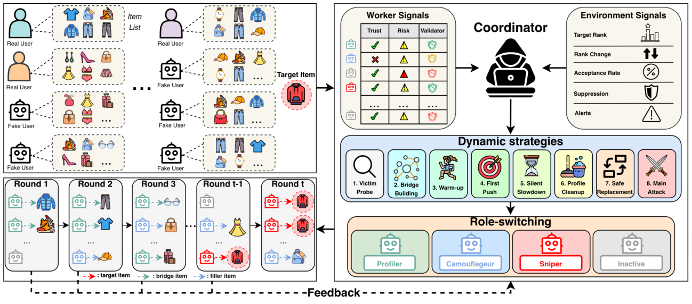

# An Efficient and Effective Agentic Group Shilling Attack on Recommender Systems (面向推荐系统的高效智能体群体托攻击)

- **会议/期刊**: ICDM 2026
- **作者与机构**: Quoc Viet Nguyen, Trinh Pham, Thanh Tam Nguyen 等 (Griffith University / Edith Cowan University / University of Queensland / HUTECH University)
- **推荐链路定位**: 数据投毒（训练期注入，影响召回/排序全链路）
- **研究方向**: 去偏公平、可信隐私与工业架构 / 对话推荐与智能体仿真
- **论文原文**: [https://arxiv.org/abs/2609.09551v1](https://arxiv.org/abs/2609.09551v1)
- **开源代码**: [https://github.com/phkhanhtrinh23/AGAS](https://github.com/phkhanhtrinh23/AGAS)

## TL;DR (1分钟核心速览)

现有托攻击要么依赖目标特定的离线微调（AUSH/GOAT/GSPAttack/CLeaR 需数小时训练），要么用固定模板或独立 LLM 智能体生成假用户（AgentSA/AgentAttack），导致准备成本高、行为指纹稳定、策略无法随受害者反馈调整。本文提出 AGAS：一个隐藏 Coordinator 指挥一组可切换角色（Profiler/Camouflageur/Sniper/Inactive）的 worker 智能体，依据 worker 信号与环境的排名反馈、接受率、抑制信号动态调整攻击策略，全程免训练。在 6 个数据集、11 个 CF 受害者（MF/NeuMF/GMF/NCF/NGCF/LightGCN/SimGCL/XSimGCL/EGCF/LightCCF）上，相同假用户预算下 HR@10 相对最强基线提升 155%–198%，同时检测器 F1 从约 0.87 降至约 0.31，且约 24 分钟、数万 token 即可将目标推入 Top-10。

## Background & Motivation (背景与核心矛盾)

- **主流范式**: 托攻击分四代——启发式模板注入（Random/Bandwagon/Hybrid）、生成式画像学习（AUSH 的 GAN、GOAT 的图卷积 GAN）、代理引导/双层优化（PGA、GSPAttack、CLeaR）、以及近期 LLM 智能体攻击（AgentSA 每账号一智能体、AgentAttack 用 LLM planner 从预生成画像库中采样）。
- **前人局限**: 其一，**准备成本高**——学习型方法每个新目标都要重新拟合生成器或收敛双层优化，AgentAttack 还需代理模型重训与 `O(|U_f|C)` 次画像生成；其二，**模式与策略静态**——每个假用户锁定单一生成算法或模板，且当攻击受挫时没有任何机制重定向群体，假用户反复推送同一序列，留下可检测的分布指纹。
- **核心洞察 (Key Insight)**: 现有攻击本质是"一组独立假用户的集合"，而非"一场被协调的战役"。若把假用户视为有状态、可换岗的 worker，并由一个观察全局反馈的协调者统一调度，就能同时获得更强推力、更好隐蔽性与更低成本。
- **本文切入点**: 将群体托攻击形式化为**自适应多轮战役**，用 Coordinator + 角色切换 worker 的智能体架构替代离线微调与固定模板。

## Method (核心方法设计)

### 1. 整体框架 (Overall Architecture)

AGAS 在 `T` 轮内迭代构建投毒矩阵 $\tilde{R}$，最终拼接为$R'=[R;\tilde{R}]$交给受害者重训。每轮 Coordinator 读取观测$o_t$（排名反馈$\rho^{(t)},\Delta\rho^{(t)}$、各 worker 的信任/风险/校验分、接受率$\eta_t$、抑制信号$\xi_t=(q_t,s_t)$、告警位$a_t$），更新记忆$m_t$，选出一个轮级策略并为每个 worker 分配角色；worker 以 ReAct 式循环在自身记忆上决定评哪个物品，Coordinator 校验并聚合为一批$\Delta\tilde{R}^{(t+1)}$，再更新信号进入下一轮。攻击者只通过自己探针账号拿到的推荐列表获取反馈，从不查询测试用户。

<figure class="paper-figure" markdown="span">
  <figcaption>图 2：AGAS 流程概览。在各攻击轮次中，协调器聚合工作者与环境信号，以调整虚假用户角色和攻击策略，逐步引导攻击活动有效推广目标物品。AGAS 有效利用反馈衍生信号探测受害者，在抑制出现时放缓，并让部分工作者保持不活跃，以避免重复或过度同步的行为。</figcaption>
</figure>

### 2. 关键设计拆解 (Key Designs)

1. **双层信号体系（Worker 信号 + 环境信号）**：痛点是攻击者黑盒下无梯度可用，必须从可观测行为反推攻防态势。Worker 侧维护信任 $\tau_{t,w}$、风险$\gamma_{t,w}$与画像级校验分$\phi_{t,w}$：评分偏离物品偏置$b_i$超过 1 分则信任不增、风险加 0.5，低信任 worker 的极端评分再额外罚 0.5；$\phi_{t,w}=\min(1,0.4e_{t,w}+0.3h_{t,w}+0.3o_{t,w})$融合极端评分频率、目标正评标记与假用户重叠率。环境侧把丢弃率$\hat{d}_t$、折扣幅度$\hat{\delta}_t$、弱目标位移比$\hat{m}_t$、抑制连击$\hat{s}_t$与组内重叠$g_t$等权线性合成怀疑分$q_t=\min(1,0.2\hat{d}_t+0.2\hat{\delta}_t+0.2\hat{m}_t+0.2\hat{s}_t+0.2g_t)$。直觉是：单看排名会误判"平台在静默降权"，必须把"动作是否被接收"与"动作是否有效"分开度量。
2. **四角色切换与八种轮级策略**：Profiler 用热门/相关填充物探测受害者族别（直接推目标若 $\Delta\rho$改善则判为 embedding 型，否则判为 graph 型）并挖掘 bridge item；Camouflageur 被动评填充物以稀释协同痕迹、重建信任；Sniper 只派给高信任低风险 worker，对 graph 型受害者沿 bridge item 构造目标到真实用户邻域的二跳路径；Inactive 让可疑 worker 彻底消失而非继续弱活动。策略层包含 Victim Probe、Bridge Building、Warm-up、First Push、Silent Slowdown（接受率下滑但无告警时降速）、Profile Cleanup（$q_t$升高或$a_t=1$ 时冻结最可疑 Sniper）、Safe Replacement（用休息过的低风险 worker 顶替）与 Main Attack。这套"攻击—减速—暂停—换人"的非短视节奏，正是打破检测器所依赖的稳定同步模式的关键。
3. **训练目标、负采样与推理效率**：AGAS 本身无训练损失，受害者仍按标准 BPR 训练 $\mathcal{L}_{\text{BPR}}=\sum_{(u,i,j)\in D}-\log\sigma(\hat{y}_{ui}-\hat{y}_{uj})+\lambda\|\Theta\|_2^2$，攻击目标为$\max_{\{\tilde{r}_w\}}\frac{1}{|U_{\text{test}}|}\sum_{u}\mathbb{I}[i_{\text{tar}}\in\text{TopK}(u;\mathcal{A}(R'))]$，约束$S(\tilde{R};R)\le\varepsilon$。复杂度为$O\big(T(c_C+|U_f|(c_W+L)+V)\big)$，LLM 开销仅随轮数线性增长，而 AgentAttack 额外付出$O(|U_f|C)$ 生成与代理重训。

## Experimental Setup & Evaluation Protocol (实验设置与评估协议)

- **数据集与预处理**: 6 个公开数据集，覆盖电影、电商、标签多领域：

| 数据集 | 领域 | 规模定位 | 特征/场景说明 |
| :--- | :---: | :---: | :--- |
| ML-100K | 电影 | 小 | 经典托攻击评测基准 |
| ML-1M | 电影 | 中 | 百万级评分 |
| Genome 2021 | 电影+标签 | 中 | 标签基因组版本 |
| Netflix | 电影 | 大 | Netflix Prize 数据 |
| Douban Movie | 电影/社交 | 中 | 中文异构场景 |
| Amazon 2018 | 电商 | 大 | 稀疏、难攻击场景 |

- **数据划分与防穿越 (Splitting Strategy)**: 采用离线迁移协议——攻击生成阶段 Coordinator 仅通过未评过目标的 PR/CA 探针账号读回推荐列表，绝不查询 $U_{\text{test}}$或受害者隐藏指标；受害者随后在干净矩阵与投毒矩阵上**从头重训**，报告使用全部$T$ 轮累积的投毒历史。
- **排名评测协议 (Ranking Protocol)**: 目标物品在留出良性测试用户上的 `Full-Ranking` 式 Top-K 命中，报告 HR@10、NDCG@10；同时用 Rec@K 检验良性推荐质量是否被破坏；隐蔽性用 5 个检测器的 Accuracy/Recall/Precision/F1 衡量（越低越难检测）。
- **对比基线与超参设置**: 基线覆盖启发式（Random/Bandwagon）、生成式（AUSH）、强化学习（PoisonRec）、优化型（PGA/GSPAttack/CLeaR/TargetedAttack）与智能体型（AgentSA/AgentAttack）；所有方法在相同假用户预算与目标集合下评测，智能体方法按注入动作上限对齐；结果取 5 次运行均值 ±95% CI。

## Key Experimental Results (实验关键数据)

### 1. 主实验对比 (Main Results)

非流行目标（Tail 区间）代表性结果（×10³，HR@10 / NDCG@10）：

| 受害者 | 最强基线 (AgentAttack) | AGAS | Improv. (HR@10) |
| :--- | :---: | :---: | :---: |
| ML-100K / MF(BPR) | 13.6 / 5.5 | **40.0 / 16.1** | +187.8% |
| ML-100K / GMF | 8.8 / 3.5 | **22.6 / 9.0** | +162.8% |
| ML-1M / NCF | 5.2 / 2.0 | **15.0 / 5.9** | +172.7% |
| Genome / NeuMF | 4.5 / 1.8 | **11.5 / 4.6** | +161.4% |
| Netflix / MF(BPR) | 6.3 / 2.5 | **18.2 / 7.3** | +198.4% |
| Douban / LightGCN | 14.0 / 5.6 | **40.5 / 16.5** | +189.3% |
| Douban / XSimGCL | 8.0 / 3.1 | **20.7 / 8.2** | +155.6% |
| Douban / LightCCF | 5.5 / 2.2 | **16.9 / 6.7** | +196.5% |

检测器对抗（F1，越低越好，ML-100K）：

| 检测器 | PoisonRec | AgentSA | AgentAttack | AGAS |
| :--- | :---: | :---: | :---: | :---: |
| BaseDetect | 0.917 | 0.900 | 0.886 | **0.352** |
| DHAGCN | 0.906 | 0.888 | 0.874 | **0.340** |
| PCASelectUsers | 0.861 | 0.848 | 0.832 | **0.330** |
| GAGE | 0.720 | 0.922 | 0.818 | **0.333** |
| MD-CBA | 0.707 | 0.927 | 0.802 | **0.325** |

### 2. 消融实验 (Ablation Study)

| 移除组件 | 主要影响 | 说明 |
| :--- | :--- | :--- |
| w/o Silent Slowdown | 降幅最大之一 | 失去静默降权时的降速能力 |
| w/o Profile Cleanup | 降幅最大之一 | 可疑画像无法被清洗 |
| w/o Safe Replacement | 降幅最大之一 | 暴露 worker 被反复复用 |
| w/o Main Attack | 降幅最大之一 | 缺少最终推力 |
| w/o Bridge Building | LightGCN/LightCCF 掉幅 > NeuMF | 图型受害者依赖二跳路径 |
| w/o Coordinator / Memory / Signals | Gemma 2 2B 上掉幅最剧烈 | 小模型更依赖显式协调与记忆 |

骨干规模消融（ML-100K 类，HR@10）：Claude Opus 4.5 下 AGAS 41.5 vs AgentAttack 35.2；GPT-5.1 下 40.6 vs 33.8；Llama 3.3 70B 下 37.0 vs 31.2；Phi-4 14B 下 31.6 vs 27.0；Gemma 2 2B 下 22.4 vs 18.6——AGAS 在所有规模档均最优且随模型变小优雅退化。

### 3. 关键实验发现 (Key Findings)

1. **非短视节奏带来真实增益**：AGAS 并非每轮都猛攻，而是探测—减速—暂停—换人，在 Netflix/MF(BPR) 上把 HR@10 从最强基线的 6.3 推到 18.2（+198.4%），说明"少打但打对时机"比"每轮硬推"更能累积长期目标位移。
2. **协调与角色切换是隐蔽性的直接来源**：五个检测器上 F1 从约 0.87 骤降至约 0.31–0.35，t-SNE 显示 AGAS 是唯一同时保持"目标距离小"与"真实物品距离小"的方法，假用户历史散布在良性嵌入云中而非形成独立簇。
3. **成本随轮数线性、且预算感知**：约 24 分钟、数万 token 即可将目标推入 Top-10，而 AgentAttack 需数百万 token、其他方法需数小时训练；假用户比例从 0.5% 增至 3.0% 时收益稳定上升，Amazon 上增益偏小说明难数据集需要更大攻击压力。

## Highlights & Limitations (亮点、对比与审稿批判)

- **与代表作对比 (vs. Prior Work)**: 相比 AUSH/GOAT/GSPAttack/CLeaR，AGAS 免去每目标的生成器拟合与双层优化；相比 AgentSA 的"每账号一独立智能体 + 共享提示词"，AGAS 引入群体级协调与角色切换，消除重复行为指纹；相比 AgentAttack 的"从预生成画像库采样"，AGAS 不依赖任何画像库，可适配全新受害者设置。
- **可迁移亮点**: 其一，"信任/风险/校验"三信号 + 环境怀疑分的轻量打分体系，可直接迁移到任何需要黑盒反馈驱动的多智能体协同任务；其二，角色池 + 轮级策略的状态机设计，为推荐系统鲁棒性压测提供了可复用的红队基准框架。
- **审稿级局限批判**: 其一，怀疑分 $q_t$的五分量等权线性组合与告警位$a_t$ 的阈值均为人工设定，缺少敏感性分析，换平台可能需重调；其二，评测仅覆盖 CF 家族受害者，未涉及多模态或 LLM 增强推荐器（作者亦列为未来工作），且攻击效果依赖底层 LLM 的推理能力，小模型下退化明显。

## Rating (四维评分)

- **方法创新性 (Novelty)**: ⭐⭐⭐⭐ （首次将群体托攻击形式化为自适应协调战役，角色切换 + 双层信号体系在黑盒设定下确有新意）
- **评估协议与实验扎实度 (Protocol & Experiments)**: ⭐⭐⭐⭐⭐ （6 数据集 × 11 受害者 × 5 检测器，5 次运行带 95% CI，策略/组件/骨干/预算四类消融齐全）
- **写作与数学规范度 (Clarity & Rigor)**: ⭐⭐⭐⭐ （信号定义与算法流程清晰，但怀疑分权重与告警阈值缺乏理论或敏感性支撑）
- **工业落地与复现价值 (Industrial & Practical Value)**: ⭐⭐⭐⭐ （代码开源、免训练、约 24 分钟完成一次压测，可直接作为推荐系统鲁棒性红队基准）
