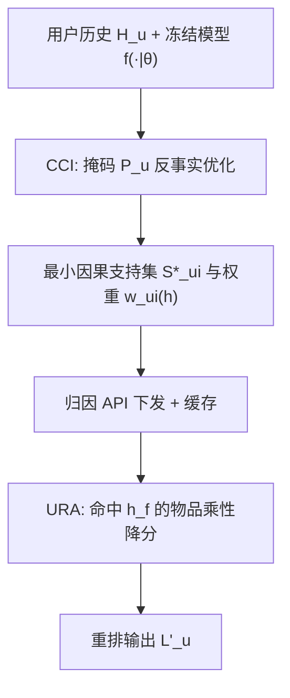
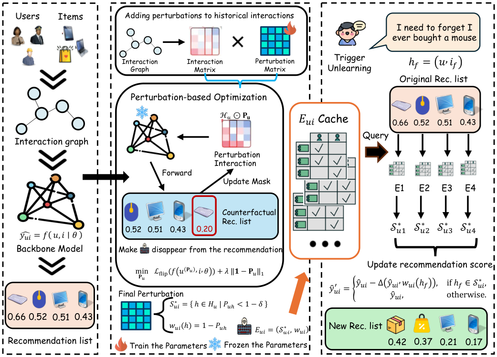

# Explain, Then Forget: Recommendation Unlearning under Asymmetric Access Constraint (先解释，再遗忘：非对称访问约束下的推荐遗忘)

- **会议/期刊**: ICDM 2026
- **作者与机构**: Haichao Zhang, Chong Zhang, Wen Wang, Shi Qiu, Peiyu Hu, Jia Wang (西安利物浦大学 / 利物浦大学)
- **推荐链路定位**: 重排（输出级后处理）
- **研究方向**: 去偏公平与工业架构 / 多任务学习与列表级重排
- **论文原文**: [https://arxiv.org/abs/2610.40658v2](https://arxiv.org/abs/2610.40658v2)
- **开源代码**: [https://github.com/zhang-haichao/Explain-and-Forget](https://github.com/zhang-haichao/Explain-and-Forget)

## TL;DR (1分钟核心速览)

现代 MLaaS 架构下模型由云端 Model Provider 托管、Service Operator 仅能通过 API 访问，形成"非对称访问约束"，使所有依赖参数更新的遗忘方法（重训/微调/影响函数）全部失效。本文提出 CEU：由 MP 侧用连续掩码优化反事实翻转损失，识别推荐的最小因果支持集与贡献权重（CCI），SO 侧仅凭这些归因分数对受影响物品做乘性惩罚重排（URA），完全不触碰模型参数。在 ML-1M/Netflix 上 Full-Ranking 协议下，CEU 的 HR@10 与原始模型差距仅 0.25%，MIA 准确率降至 0.48–0.50（接近随机猜测），单次遗忘延迟 0.34–6.37s，较次优基线加速 9.3–55.6 倍。

## Background & Motivation (背景与核心矛盾)

- **主流范式**: 推荐遗忘现有三条路线——重训式（GraphEraser/RecEraser 分片重训）、微调式（GNNDelete/UnlearnRec 轻量表征更新）、影响函数式（SCIF/IFRU 梯度近似校正），均以"修改模型内部参数"为手段。
- **前人局限**: 其一，三类方法全部要求访问模型内部权重或梯度，在 API-only 的 MLaaS 场景下物理上不可行；其二，连续遗忘请求下反复近似参数更新会累积误差，导致保留集效用持续漂移。
- **核心洞察 (Key Insight)**: 作者用结构因果模型重新刻画遗忘——重训等价于对历史节点做全局干预 $P(Y|do(H:=H_r))$，代价是整张因果图下游全部重算；而若引入解释节点$E=\text{explain}(H,f)$，剪断$f\to Y$并嫁接$E\to Y$，则只需对解释路径做局部干预$P(Y|do(E:=E^*))$，即可在不重算参数的前提下近似遗忘。
- **本文切入点**: 把"遗忘"从参数空间搬到输出空间——先解释"哪些历史交互在因果上支撑了这条推荐"，再按因果强度精准削减对应物品分数。

## Method (核心方法设计)

### 1. 整体框架 (Overall Architecture)

CEU 采用"解释—遗忘"两段式解耦：预训练阶段由 MP 正常训练 BPR/LightGCN 并冻结参数；CCI 阶段 MP 对每个用户 Top-50 候选物品求解带 $\ell_1$稀疏约束的反事实掩码，得到最小因果支持集$\mathcal{S}^*_{ui}$与逐交互贡献权重$w_{ui}(h)$，通过归因 API 下发给 SO 并缓存（约 22 KiB/用户）；URA 阶段 SO 收到遗忘请求$h_f=(u,i_f)$后，仅对支持集包含$h_f$ 的候选物品做乘性降分并重排。全流程无任何参数更新，因而天然支持连续请求且无误差累积。

<figure class="paper-figure" markdown="span">
  <figcaption>图 3. CEU 的框架。预训练流程生成初始排序结果。因果贡献识别器识别最小因果支持集并量化其对推荐的贡献。遗忘驱动的排序调整器执行局部分数调整，以消除被遗忘交互的影响。</figcaption>
</figure>

### 2. 关键设计拆解 (Key Designs)

1. **因果贡献识别器 CCI（解决"调整哪些物品"）**：直接对历史做遮挡搜索是组合爆炸的，CCI 改为学习一个连续保留掩码 $\mathbf{P}_u\in[0,1]^{|H_u|}$，以铰链翻转损失逼迫目标物品$i$的分数跌破原列表第$K+1$名，同时用$\ell_1$ 施加奥卡姆稀疏性：
$$\mathcal{L}_{\text{flip}}=\max\big(0,\; m+f(u(\mathbf{P}_u),i|\theta)-f(u,i_{K+1}|\theta)\big),\quad \min_{\mathbf{P}_u}\ \mathcal{L}_{\text{flip}}+\lambda\|\mathbf{1}-\mathbf{P}_u\|_1$$
收敛后取 $\mathcal{S}^*_{ui}=\{h\in H_u\mid P_{u,h}<1-\delta\}$、$w_{ui}(h)=1-P_{u,h}$。直觉上，掩码值越低说明该交互越"不可替代"地支撑了当前推荐，贡献权重即为反事实必要性度量；由于 MP 持有$\theta$ 但只更新掩码，模型权重严格冻结，不违反托管方的参数保密要求。

2. **遗忘驱动排序调整器 URA（解决"调整多少"）**：全局降权会误伤无关偏好，URA 只在因果路径上做局部干预：
$$\hat{y}'_{ui}=\begin{cases}\hat{y}_{ui}-\alpha\cdot\hat{y}_{ui}\cdot w_{ui}(h_f), & h_f\in\mathcal{S}^*_{ui}\\ \hat{y}_{ui}, & \text{otherwise}\end{cases}$$
即惩罚幅度正比于被遗忘交互的因果贡献——贡献越强降分越多，因果无关物品分数原封不动。这避免了"过度惩罚扭曲正常偏好、惩罚不足残留数据痕迹"的两难，也保证了干预的局部性。

3. **训练目标、负采样与推理效率**：主模型沿用标准 BPR  pairwise 损失与 LightGCN 的 BPR 训练（批大小 2048、学习率 1e-3、300 epoch、早停 patience=10），本文不引入新的推荐训练目标；CCI 为无负采样的掩码优化问题。推理开销分两块：离线 CCI 预计算 3.10–10.10 s/用户（RTX 4090），在线 URA 仅需查缓存 + $O(K)$ 次乘性降分与重排，单次请求 0.34–6.37 s。

## Experimental Setup & Evaluation Protocol (实验设置与评估协议)

- **数据集与预处理**: 二值化隐式反馈，未做 k-core 过滤，统计如下：

| 数据集 | #Users | #Items | #Interactions | 稀疏度 | 场景说明 |
| :--- | :---: | :---: | :---: | :---: | :--- |
| ML-100K | 944 | 1,683 | 100,000 | 93.71% | 小规模电影 |
| ML-1M | 6,041 | 3,707 | 1,000,209 | 95.53% | 中等规模电影 |
| Netflix | 15,060 | 13,352 | 2,545,835 | 91.83% | 大规模电影 |

- **数据划分与防穿越 (Splitting Strategy)**: 按 `70/10/20` 比例划分 train/valid/test；随后从训练集中**随机采样 10% 交互构成遗忘集** $\mathcal{D}_f$，其余为保留集$\mathcal{D}_r$（主表另报 1% 遗忘比例，MIA 表同时报 1% 与 10%）。
- **排名评测协议 (Ranking Protocol)**: 采用无偏 `Full-Ranking` 全库排序，评估批大小 4096，报告 HR@K 与 NDCG@K（$K\in\{10,20\}$）；遗忘完整性用 Membership Inference Attack 准确率衡量（越接近 0.5 越好），且采用**白盒威胁模型**——攻击者同时可见原始分数$\hat{y}_{ui}$与调整后分数$\hat{y}'_{ui}$。
- **对比基线与超参设置**: 骨干为 BPR 与 LightGCN 两类；基线覆盖重训式（Retrain 金标准、GraphEraser、RecEraser）、微调式（GNNDelete、UnlearnRec）、影响函数式（SCIF、IFRU）。CCI 预计算每用户 Top-50 候选、每物品至多保留 5 个因果交互；结果取 3 次运行均值，配对 t 检验 $p<0.05$。

## Key Experimental Results (实验关键数据)

### 1. 主实验对比 (Main Results)

ML-1M 上 1% 遗忘比例（Origin/Retrain 仅作参考，不参与方法排名）：

| 方法 | BPR HR@10 | BPR NDCG@10 | BPR HR@20 | LGCN HR@10 | LGCN NDCG@10 | LGCN HR@20 |
| :--- | :---: | :---: | :---: | :---: | :---: | :---: |
| Origin | 0.7520 | 0.2526 | 0.8444 | 0.7680 | 0.2715 | 0.8637 |
| Retrain | 0.7419 | 0.2417 | 0.8488 | 0.7649 | 0.2672 | 0.8613 |
| GraphEraser | 0.4540 | 0.0902 | 0.6126 | 0.5635 | 0.1295 | 0.6968 |
| RecEraser | 0.4833 | 0.1055 | 0.6260 | 0.6003 | 0.1467 | 0.7379 |
| SCIF | 0.5341 | 0.1332 | 0.6833 | 0.6060 | 0.1723 | 0.7230 |
| IFRU | 0.4227 | 0.2248 | 0.5749 | 0.4350 | 0.2205 | 0.6502 |
| GNNDelete | 0.6088 | 0.1212 | 0.7897 | 0.5139 | 0.1305 | 0.6375 |
| UnlearnRec | 0.5784 | 0.2206 | 0.7396 | 0.4937 | 0.1320 | 0.6219 |
| **CEU** | **0.7373** | **0.2533** | **0.8364** | **0.7584** | **0.2671** | **0.8535** |
| Improv. (vs 次优) | +21.1% | +12.7% | +5.9% | +20.3% | +21.1% | +15.7% |

Netflix 上 CEU 同样逼近 Origin：BPR 下 HR@10 = 0.8527（Origin 0.8550）、LightGCN 下 HR@10 = 0.8627（Origin 0.8647），而 SCIF 在 Netflix 上 HR@10 仅 0.4020、IFRU 仅 0.2037，出现严重效用崩塌。

**遗忘完整性（MIA ACC，越接近 0.5 越好）**：ML-1M + LightGCN 下 CEU 的 ACC@1 = 0.4789、ACC@10 = 0.6429，相较 Origin 的 0.9678/0.9801 分别下降 50.53% 与 34.42%，与 Retrain 的 0.5126/0.5015 同量级；Netflix + LightGCN 下 CEU 的 ACC@10 = 0.5000，几乎等于随机猜测。

**效率（单次遗忘延迟，秒）**：CEU 在 ML-100K/ML-1M/Netflix 上分别为 0.36/4.50/2.81（BPR）与 0.34/6.37/2.89（LightGCN），相对次优基线加速 51.0×/11.5×/37.1×（BPR）与 52.7×/9.3×/40.8×（LightGCN）；全量重训则需 141.92–4209.05 s。

### 2. 消融实验 (Ablation Study)

ML-1M 上对 CCI 因果引导的消融（CEU-Random 随机惩罚、CEU-Reverse 惩罚因果无关物品）：

| 变体 | LGCN NDCG@10 | 相对 Origin 变化 | BPR NDCG@10 | 相对 Origin 变化 | MIA ACC |
| :--- | :---: | :---: | :---: | :---: | :---: |
| Origin | 0.2682 | — | 0.2526 | — | ≈0.96 |
| CEU-Full | 0.2671 | −0.4% | 0.2533 | +0.3% | 0.48–0.50 |
| CEU-Random | ≈0.216 | −19.4% | ≈0.200 | −20.8% | ≈0.48 |
| CEU-Reverse | 显著下降 | 大幅劣化 | 显著下降 | 大幅劣化 | ≈0.48 |

### 3. 关键实验发现 (Key Findings)

1. **因果引导是不可替代的，而非锦上添花**：CEU-Random/Reverse 的 MIA 同样降到 ≈0.48，但这是排序能力整体崩塌造成的"假阳性遗忘"——NDCG@10 分别暴跌 19.4%/20.8%。这说明仅看 MIA 会误判遗忘质量，必须与效用指标联合评估，而 CCI 正是把"真遗忘"与"破坏性遗忘"区分开的关键。
2. **免参数设计带来对遗忘强度的鲁棒性**：在遗忘比例从 2% 增至 10% 的压力测试中（以 2% 处归一化），多数基线保留集 HR@10/Recall@10 保留率持续下滑，而 CEU 始终贴近"无更新"参考线，验证了"不反复改参数即不累积误差"的设计假设。
3. **效用—遗忘权衡落在理想区**：在 HR@10 vs. MIA 的二维平面上，CEU-Full 稳定处于"高效用 + 低 MIA"的右下理想区，而重训式方法（GraphEraser 在 ML-1M LightGCN 上 HR@10 仅 0.5635）因数据分片割裂图结构而落入"低效用"区域，说明分片重训在稀疏图推荐上代价过高。

## Highlights & Limitations (亮点、对比与审稿批判)

- **与代表作对比 (vs. Prior Work)**: 与 GraphEraser/RecEraser 的分片重训相比，CEU 完全不做数据切分与子模型训练，避免了图结构割裂导致的效用塌陷；与 GNNDelete/UnlearnRec 的轻量表征更新相比，CEU 不触碰任何可训练组件，因而在 API-only 约束下唯一可行；与 SCIF/IFRU 的梯度影响近似相比，CEU 用反事实掩码给出的是"逐交互、可解释、可缓存"的归因，而非全局权重扰动，且无连续请求的误差累积。
- **可迁移亮点**: ①"归因 API + 缓存"的解耦范式可迁移到任何黑盒推荐服务（如第三方排序 API）的合规后处理；②用掩码 + 铰链翻转损失求最小因果支持集的思路，可直接复用到推荐解释、点击归因与负反馈溯源。
- **审稿级局限批判**: ①因果识别是"实践近似"而非形式可识别——作者自己承认 $do(E:=E^*)$只是对$f\to Y$ 路径的工程化剪枝，缺乏可识别性证明；②在线延迟虽低，但依赖离线 CCI 预计算（3–10 s/用户、Top-50 候选），冷启动用户或候选集动态变化时缓存会失效，且每物品仅保留 5 个因果交互的截断可能漏掉长尾因果链；③实验仅在两个传统 MF/GCN 骨干与三个电影数据集上验证，未覆盖序列模型、生成式推荐或真实 MLaaS 线上 A/B。

## Rating (四维评分)

- **方法创新性 (Novelty)**: ⭐⭐⭐⭐ （把遗忘从参数空间搬到输出空间，并用 SCM 的 $E\to Y$ 嫁接给出清晰的概念动机，问题建模角度新颖，但因果干预本身是近似而非严格识别）
- **评估协议与实验扎实度 (Protocol & Experiments)**: ⭐⭐⭐⭐ （三数据集 × 两骨干 × 七基线，Full-Ranking + 白盒 MIA + 延迟 + 遗忘比例压力测试齐全，配对 t 检验到位；不足是缺少序列/生成式骨干与线上验证）
- **写作与数学规范度 (Clarity & Rigor)**: ⭐⭐⭐⭐ （CCI/URA 两模块公式简洁、伪代码完整、因果图直观；但 $do(E:=E^*)$的可识别性论证偏弱，部分符号如$u(\mathbf{P}_u)$ 的定义略简）
- **工业落地与复现价值 (Industrial & Practical Value)**: ⭐⭐⭐⭐⭐ （代码已开源，免参数、可缓存、9–55 倍加速且天然支持连续请求，直接对应 MLaaS 合规遗忘的真实工业诉求，落地路径清晰）

