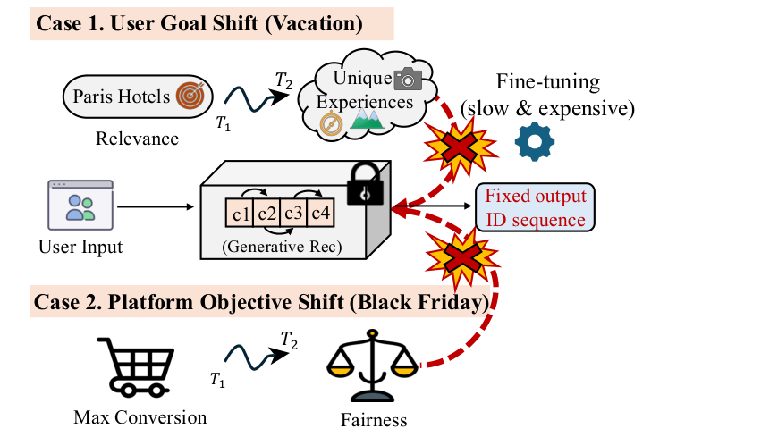
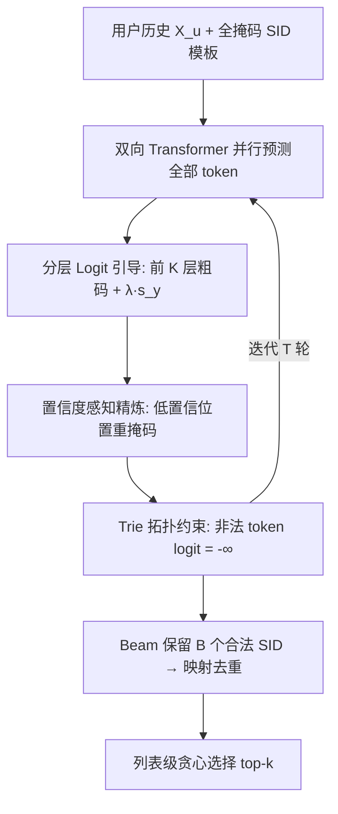

# Controllable Generative Recommendation via Guided Token Refinement (基于引导式 Token 精炼的可控生成式推荐)

- **会议/期刊**: ICDM 2026
- **作者与机构**: Haichao Zhang, Zhixuan Liang, Chong Zhang, Zixi Chen, Wen Wang, Jia Wang (西安利物浦大学 / 利物浦大学 / 香港理工大学)
- **推荐链路定位**: 生成式端到端召回
- **研究方向**: 生成式推荐与离散语义 ID / 去偏公平与可控推荐
- **论文原文**: [论文原文链接](https://arxiv.org/abs/2610.28642v1)
- **开源代码**: [开源代码仓库链接](https://github.com/zhang-haichao/ReGen)

## TL;DR (1分钟核心速览)

现有基于 Semantic ID 的生成式推荐采用严格从左到右的自回归解码，早期 token 一旦确定即"决策锁定"，导致推理时注入多样性等控制信号会破坏语义结构、生成不存在的物品。ReGen 将生成重构为**并行掩码填充**任务，在粗粒度 token 的 logit 上施加免训练的分层引导，并用置信度感知精炼 + 前缀树拓扑约束保证输出合法。在 Amazon 三数据集 Leave-One-Out + Full-Ranking 协议下，同等 Diversity@10≈0.54 时 Recall@10 较 TIGER-MMR 提升约 13%（0.0398 vs 0.0351），生成有效率维持 99.97%。

## Background & Motivation (背景与核心矛盾)

- **主流范式**: TIGER/RPG/LLaDA-Rec 等将物品用 RQ-VAE 量化为 4 层 Semantic ID，用 Transformer 做序列生成式召回，避免全库打分。
- **前人局限**: (i) 自回归解码存在**单向决策锁定**——前缀一旦生成，后续 token 只能被动适配，无法全局规划；(ii) 训练时控制（Paragon 参数生成）需重训/微调，后处理重排（MMR）只能过滤已生成物品，无法"创造"新候选。
- **核心洞察 (Key Insight)**: RQ-VAE 码本天然具有**粗到细的层级语义**——顶层码隐式编码品类等宏观属性，因此控制信号只需作用于前 $K$ 层粗码，细码交由模型在全局上下文下重新填充即可保持语义连贯。
- **本文切入点**: 用双向掩码建模替换自回归，把"控制"降维为对少数粗粒度 logit 的加性扰动，再用迭代精炼修复由此产生的语义错配。

<figure class="paper-figure" markdown="span">
  <figcaption>图 1：动态环境下传统生成式推荐中刚性问题的示意图。面对目标偏移（情形 1 和 2），自回归模型受困于单向决策锁定。微调速度慢且成本高，使得实时可控生成难以实现。</figcaption>
</figure>

## Method (核心方法设计)

### 1. 整体框架 (Overall Architecture)

ReGen 以 BERT 式双向 Transformer 为骨干，输入为用户历史语义序列 $X_u$与一个"部分确定 + 部分 `[MASK]`"的候选 Semantic ID$x=(c_1,\dots,c_L)$，一次前向并行输出全部$L$个位置的 logits。推理时从全掩码模板$x_0$出发，每轮执行三步闭环：Mask Predictor 并行预测被掩位置 → 对前$K$层粗码 logit 叠加多样性引导分数 → 按置信度阈值重新掩码低置信 token，并用前缀树 Trie 将非法 token 的 logit 置为$-\infty$。经$T$轮精炼后保留 beam 内合法 Semantic ID，映射去重为物品候选池，最后按"效用 + 列表级品类覆盖边际增益"贪心选出 top-$k$。

### 2. 关键设计拆解 (Key Designs)

1. **分层 Logit 引导 (Hierarchical Logit Guidance)**：自回归模型无法在生成中途施加控制，本文直接在粗码 logit 上做加性干预。控制分数取历史频次的负对数惩罚 $s_y^{(l)}[v]=-\log(1+\mathrm{Count}_l(v,S_u))$，仅注入前$K$ 层：
$$\tilde{Z}^{(l)}=\begin{cases}Z^{(l)}+\lambda s_y^{(l)}, & l\le K\\ Z^{(l)}, & l>K\end{cases}$$
物理直觉：粗码决定"去哪个语义区域"，细码决定"具体是哪件商品"，因此只推粗码即可获得品类级多样性而不破坏物品细节，且完全免训练。

2. **置信度感知精炼 (Confidence-Aware Refinement)**：引导会制造"粗码已改、细码仍旧"的语义错配。以引导后 softmax 最大概率 $\rho_t^{(l)}=\max\mathrm{Softmax}(\tilde{Z}_t^{(l)})$度量可靠性，低于递增阈值$\tau_t$ 的位置重掩码再预测：
$$x_{t+1}\leftarrow\arg\max_{x\in\mathcal{V}^L}p_\theta\big(x\mid x_t\odot(1-m_t)+[\text{MASK}]\odot m_t,X_u\big)$$
高置信 token 作为锚点保留，低置信 token 被反复修复，从而在保持控制方向的同时恢复相关性。训练时采用**分层优先掩码**（$\alpha_1<\cdots<\alpha_L$），强制模型学会在稳定粗语义下重建细粒度细节。

3. **拓扑约束 Beam 推理与训练目标**：并行预测极易产出码本中不存在的组合。本文将全库 Semantic ID 组织为 Trie $\mathcal{T}$，对不兼容 token 置$\tilde{Z}_t^{(l)}[v]\leftarrow-\infty,\ \forall v\notin\mathcal{A}_\mathcal{T}(x_t,l)$，beam 扩展只在可完成路径上进行。训练目标为标准掩码重建交叉熵$\mathcal{L}=-\sum_{l\in M}\log p_\theta(c_l\mid x_{\bar{M}},X_u)$，**无需负采样**（全库物品通过 Trie 隐式约束）；推理开销为$T$轮 × beam$B=50$的并行前向，$T=4$ 即收敛。

## Experimental Setup & Evaluation Protocol (实验设置与评估协议)

- **数据集与预处理**: Amazon 2023 Review 三个类目，按时间排序交互序列，未额外做 k-core 过滤（原文未声明）：

| 数据集 | #Users | #Items | #Interactions | 稀疏度 | 特征/场景说明 |
| :--- | :---: | :---: | :---: | :---: | :--- |
| Instruments | 57,439 | 24,587 | 511,836 | 99.9638% | 乐器，标题+文本元数据 |
| Scientific | 50,985 | 25,848 | 412,947 | 99.9687% | 工业科学品 |
| Video Games | 94,762 | 25,612 | 814,586 | 99.9664% | 电子游戏 |

- **数据划分与防穿越**: `Leave-One-Out`——最后一件交互作测试、倒数第二件作验证，严格按时间序。
- **排名评测协议**: 生成式范式下在**生成候选池内**排序（beam $B=50$，每步保留 top-$H=100$ 扩展），非全库 Full-Ranking；指标为 Recall@{5,10}、NDCG@{5,10}、Diversity@{5,10}（品类覆盖率）。
- **对比基线与超参设置**: 判别式 Bert4Rec/SASRec/GRU4Rec；生成式 VQ-Rec/RPG/LLaDA-Rec；可控方法 ComiRec/Paragon/TIGER-MMR。RQ-VAE 为 $L=4$层、码本$C=256$、维度$D=32$；骨干 4 层（Scientific/Instruments）或 6 层（Games）编码器，$d=256$、8 头；AdamW，学习率网格$\{10^{-4},5\times10^{-4},10^{-3}\}$。

## Key Experimental Results (实验关键数据)

### 1. 主实验对比 (Main Results)

准确率导向配置（无额外多样性约束）下的标准 top-K 效用：

| 数据集 | 指标 | SASRec | GRU4Rec | VQ-Rec | RPG | LLaDA-Rec | Paragon | TIGER-MMR | **ReGen** |
| :--- | :--- | :---: | :---: | :---: | :---: | :---: | :---: | :---: | :---: |
| Instruments | R@10 | 0.0545 | 0.0496 | 0.0456 | 0.0545 | 0.0535 | **0.0861** | 0.0496 | 0.0646 |
| | N@10 | 0.0245 | 0.0259 | 0.0240 | 0.0300 | 0.0286 | **0.0327** | 0.0264 | 0.0309 |
| Scientific | R@10 | 0.0392 | 0.0311 | 0.0329 | 0.0395 | 0.0407 | **0.0715** | 0.0374 | 0.0491 |
| | N@10 | 0.0180 | 0.0157 | 0.0175 | 0.0218 | 0.0218 | **0.0313** | 0.0195 | 0.0228 |
| Video Games | R@10 | **0.0916** | 0.0776 | 0.0731 | 0.0853 | 0.0895 | 0.0842 | 0.0648 | 0.0726 |
| | N@10 | 0.0432 | 0.0402 | 0.0391 | 0.0485 | **0.0491** | 0.0381 | 0.0345 | 0.0340 |

准确率–多样性权衡（Pareto 前沿，Diversity@10 匹配点）：

| 数据集 | 匹配 Diversity@10 | TIGER-MMR (R@10/N@10) | ComiRec | Paragon | **ReGen** |
| :--- | :---: | :---: | :---: | :---: | :---: |
| Instruments | ≈0.54 | 0.0351 / 0.0163 | 0.0316 / 0.0167 | — | **0.0398 / 0.0190** |
| Scientific | ≈0.56 | 0.0235 / 0.0109 | 0.0272 / 0.0118 | 0.0311 / — | **0.0351 / 0.0173** |

### 2. 消融实验 (Ablation Study)

固定可控导向推理配置，仅替换单一组件：

| 变体 | Instruments R@10 | D@10 | Val@10 | Scientific R@10 | D@10 | Val@10 |
| :--- | :---: | :---: | :---: | :---: | :---: | :---: |
| ReGen (Full) | **0.0339** | 0.5606 | **99.97%** | **0.0414** | 0.5051 | **99.97%** |
| w/o Guidance ($\lambda=0$) | 0.0355 | 0.4851 | 99.97% | 0.0436 | 0.4644 | 99.97% |
| w/o Refinement ($\tau_t=0$) | 0.0130 | 0.7321 | 99.97% | 0.0267 | 0.7307 | 99.97% |
| w/o Topology (No Trie) | 0.0136 | 0.0001 | 27.63% | 0.0315 | 0.0151 | 29.76% |

### 3. 关键实验发现 (Key Findings)

1. **引导是可控性的唯一来源，但必须与精炼耦合**：关闭引导后 D@10 从 0.5606 掉到 0.4851（R@10 仅微升 0.0016），说明多样性增益确实来自 logit 干预；而关闭精炼后 D@10 飙至 0.7321 但 R@10 崩塌至 0.0130，作者称之为"虚假多样性"——强引导破坏了序列语义一致性，产出随机但无关的物品。
2. **拓扑约束是合法性的生命线**：去掉 Trie 后 Val@10 从 99.97% 暴跌至 27.63%/29.76%，说明 Semantic ID 空间极度稀疏，绝大多数并行预测组合不对应真实物品；此时 D@10 也塌陷到 0.0001，因为候选池几乎为空。
3. **引导强度存在宽稳定区间**：$\lambda\in[4,12]$内准确率基本平稳而多样性单调上升，仅$\lambda>20$时过强引导压垮精炼过程；精炼步数$T=4$即收敛（Instruments 评估耗时 72m vs$T=8$ 的 114m），说明分层设计把"控制"与"修复"解耦后对超参不敏感。

## Highlights & Limitations (亮点、对比与审稿批判)

- **与代表作对比 (vs. Prior Work)**: 相较 TIGER 的自回归左到右解码，ReGen 用双向掩码获得全局规划能力，从根本上消除决策锁定；相较 Paragon 的参数生成式控制，ReGen 完全免训练、零参数更新；相较 TIGER-MMR 的后处理重排，ReGen 在生成阶段就"创造"多样候选而非过滤既有候选，因此在同等多样性下保留更高 Recall。
- **可迁移亮点**: (i) "只在粗码 logit 上做加性引导 + 细码自由重建"这一分层干预范式可无缝迁移到公平性、曝光均衡、新鲜度等其他控制目标；(ii) Trie 约束解码可推广到任何离散码本生成式检索（如 RQ-VAE 图像/多模态 ID）以保证输出合法性。
- **审稿级局限批判**: (i) 纯准确率并非最强——Video Games 上 R@10 仅 0.0726，显著落后 SASRec (0.0916) 与 LLaDA-Rec (0.0895)，说明并行骨干的效用基础弱于自回归/扩散方案；(ii) 评测仅在生成候选池内排序而非全库 Full-Ranking，且多样性仅用品类覆盖率这一粗粒度代理，未验证 novelty/serendipity 等更细粒度控制目标；(iii) 方法强依赖 RQ-VAE 码本层级质量，码本噪声会直接削弱粗码引导的有效性。

## Rating (四维评分)

- **方法创新性 (Novelty)**: ⭐⭐⭐⭐ （将可控生成从"重训/重排"转为"粗码 logit 干预 + 并行精炼"，视角新颖且与 RQ-VAE 层级语义天然契合）
- **评估协议与实验扎实度 (Protocol & Experiments)**: ⭐⭐⭐ （三数据集 + 消融 + Pareto 前沿 + 参数敏感性较完整，但候选池内排序与品类覆盖率代理削弱了结论强度）
- **写作与数学规范度 (Clarity & Rigor)**: ⭐⭐⭐⭐ （公式推导清晰、控制分数与 Trie 约束定义严谨，问题形式化 Eq.(1) 的"效用+可控性"分解很干净）
- **工业落地与复现价值 (Industrial & Practical Value)**: ⭐⭐⭐⭐ （免训练实时控制、$T=4$ 收敛、代码开源，对线上动态调权场景价值高，但 beam=50 的推理开销需进一步压测）
