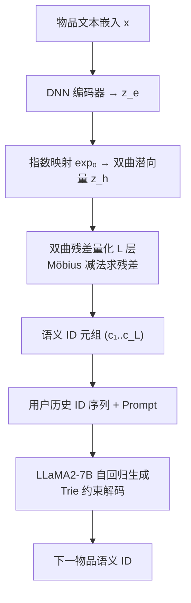

# HypRQ-VAE: Hyperbolic Item Indexing for Long-Tail-Aware Generative Recommender Systems (双曲物品索引：面向长尾感知的生成式推荐)

- **会议/期刊**: ICDM 2026
- **作者与机构**: Longfeng Wu, Tong Zeng, Dawei Zhou 等（Virginia Tech；Amazon；Meta AI；Google；Dartmouth College）
- **推荐链路定位**: 端到端生成式（语义 ID 构建 + LLM 自回归生成）
- **研究方向**: 生成式推荐与离散语义 ID / 冷启动与长尾推荐
- **论文原文**: [https://arxiv.org/abs/2609.03369v1](https://arxiv.org/abs/2609.03369v1)
- **开源代码**: [https://github.com/wulongfeng/HypRQ-VAE](https://github.com/wulongfeng/HypRQ-VAE)

## TL;DR (1分钟核心速览)

生成式推荐把物品压成 RQ-VAE 语义 ID，但欧氏量化对幂律长尾目录"偏心"——头部物品占据大部分码本容量，尾部物品被当成离群点。本文提出 HypRQ-VAE，首个在 Poincaré 双曲球内做残差量化的物品索引框架：用指数映射把物品潜向量投到双曲空间，以 Möbius 减法递归求残差、Möbius 加法聚合码向量，使双曲体积指数膨胀天然容纳层级与稀疏性。在 MovieLens/Instruments/Arts 三数据集、Leave-One-Out + Full-Ranking 协议下，整体 Hit@10 相对 TIGER 提升 4.3%–18.0%，尾部 T80 的 Hit@10 提升高达 17.2%–52.7%。

## Background & Motivation (背景与核心矛盾)

- **主流范式**: TIGER/LC-Rec/LETTER 一类工作用 RQ-VAE 在欧氏空间把物品文本嵌入逐层量化成粗到细的语义 ID 元组，再交给 LLM 自回归生成下一物品 ID。
- **前人局限一（几何失配）**: 真实目录呈幂律长尾（图 1 显示物品流行度与语义 token 频率双重长尾），欧氏空间的体积多项式增长无法同时容纳稠密头部与稀疏尾部，量化时尾部物品被视作离群点、表征保真度差。
- **前人局限二（容量分配失衡）**: 欧氏量化器把码本容量不成比例地倾斜给头部物品；LC-Rec 用 Sinkhorn 均匀约束、LETTER 用多样性正则来"打补丁"，但都是外挂约束而非几何层面的根治。
- **核心洞察 (Key Insight)**: 双曲空间体积随半径指数膨胀，且其树状结构天然匹配"头部靠原点（树干）、尾部靠边界（树枝）"的隐式层级；作者用平均量化误差 AQE 验证——欧氏下头部 AQE 恒低于尾部，双曲下二者差距被抹平甚至反转（MovieLens 尾部 AQE 反低 4.81%）。
- **本文切入点**: 不改 LLM、不改训练目标，只把"物品索引器"从欧氏 RQ-VAE 换成双曲 RQ-VAE，用几何先验换长尾表征容量。

## Method (核心方法设计)

### 1. 整体框架 (Overall Architecture)

两阶段流水线：Stage 1 用 HypRQ-VAE 把每个物品的文本嵌入（标题+描述经编码器）压成 $L$层离散码$(c_1,\dots,c_L)$，拼成 `<a_1><b_3><c_2><d_9>` 形式的语义 ID；Stage 2 把用户历史按时间展平成语义 ID token 流，套入自然语言 prompt，用 LLaMA2-7B + LoRA 做下一物品 ID 的自回归 SFT，推理时用 Trie 约束解码保证只生成合法码路径。

### 2. 关键设计拆解 (Key Designs)

1. **双曲残差量化（HypRQ-VAE 核心算子）**：痛点在于欧氏残差 $r_{i+1}=r_i-e^i_{c_i}$的线性减法无法表达层级距离。本文把初始残差取为$r_0=z_h=\exp_0^\kappa(z_e)$，每层在 Poincaré 球内用 Möbius 减法求残差、以双曲距离选码：
$$c_i=\arg\min_k \|r_i\ominus_\kappa e^i_k\|_2^2,\qquad r_{i+1}=r_i\ominus_\kappa e^i_{c_i}$$
最终量化表征用 Möbius 加法聚合 $\hat{z}_h=e^1_{c_1}\oplus_\kappa\cdots\oplus_\kappa e^L_{c_L}$，再经对数映射$\log_0^\kappa$ 回到切空间送解码器重建。直觉：双曲球半径越大可用"周长"指数增长，尾部物品被推到边界附近仍保有足够分辨空间，而头部物品挤在原点附近共享粗粒度码，天然形成"粗码管头部、细码管尾部"的容量分配。

2. **基于码本邻近度的碰撞重分配**：离散化必然产生碰撞，LC-Rec/LETTER 靠均匀约束或正则缓解但无法根治。本文构造距离张量 $D\in\mathbb{R}^{M\times L\times K}$（碰撞物品残差到各层各码向量的双曲距离），从最后一层开始级联分配：每个物品先取最近可用 token，竞争同一 token 时距离最小者胜出、其余顺延到次近可用码，末层不够则向上层回溯，直至全部唯一。相比外挂正则，这是"事后精确修复"，不引入语义无关的辅助 ID。

3. **训练目标与推理开销**：Stage 1 损失为重建项加量化项
$$\mathcal{L}_{\text{RQ-VAE}}=\|x-\hat{x}\|_2^2+\gamma\sum_{i=1}^{L}\left(\|sg[r_i]-e^i_{c_i}\|_2^2+\beta\|r_i-sg[e^i_{c_i}]\|_2^2\right)$$
其中 $sg[\cdot]$为停梯度。Stage 2 为标准的负对数似然$\mathcal{L}_\theta=-\sum_j\log P_\theta(Y_j|Y_{<j},X)$，无需负采样（生成式范式天然免负采样）。推理用 beam size 20 + Trie 约束，开销与 TIGER 同量级，仅 Stage 1 多出指数/对数映射的逐层常数开销。

## Experimental Setup & Evaluation Protocol (实验设置与评估协议)

- **数据集与预处理**（`5-core` 过滤，序列截断至 20）：

| 数据集 | #Users | #Items | #Interactions | 密度 | 头部/尾部占比 (H20/T80) |
| :--- | :---: | :---: | :---: | :---: | :---: |
| MovieLens | 6,040 | 2,751 | 1,000,000 | 6.018% | 59.97% / 40.03% |
| Instruments | 24,773 | 9,922 | 206,153 | 0.084% | 61.00% / 39.00% |
| Arts | 45,142 | 20,956 | 390,832 | 0.041% | 57.65% / 42.35% |

- **数据划分与防穿越**: `Leave-One-Out`（每用户最后一条作测试、倒数第二条作验证），交互按时间戳排序构造行为序列。
- **排名评测协议**: 无偏 `Full-Ranking`（对全物品集排序），报告 Hit@{5,10} 与 NDCG@{5,10}；生成模型统一 beam size 20 + Trie 约束解码。
- **对比基线与超参**: 传统序列模型 MF / Caser / SASRec，LLM 生成式 P5-TID / P5-CID / TIGER / LC-Rec / LETTER。HypRQ-VAE 取 $L=4$、$K=256$，Stage 1 Adam lr$1e{-3}$，Stage 2 LLaMA2-7B + LoRA（$r=8,\alpha=32$, dropout 0.05），AdamW lr$1e{-4}$ + cosine。

## Key Experimental Results (实验关键数据)

### 1. 主实验对比 (Main Results)

| Method | ML H@5 | ML H@10 | ML N@10 | Instr. H@10 | Instr. N@10 | Arts H@10 | Arts N@10 |
| :--- | :---: | :---: | :---: | :---: | :---: | :---: | :---: |
| SASRec | 0.0518 | 0.0936 | 0.0435 | 0.0717 | 0.0405 | 0.0519 | 0.0269 |
| P5-CID | 0.0612 | 0.0920 | 0.0503 | 0.0626 | 0.0498 | 0.0498 | 0.0355 |
| TIGER | 0.0565 | 0.0856 | 0.0480 | 0.0716 | 0.0563 | 0.0506 | 0.0367 |
| LC-Rec | 0.0553 | 0.0871 | 0.0456 | 0.0780 | 0.0570 | 0.0505 | 0.0369 |
| LETTER | 0.0649 | 0.0964 | 0.0535 | 0.0730 | 0.0550 | 0.0495 | 0.0353 |
| **HypRQ-VAE** | **0.0652** | **0.1010** | **0.0539** | **0.0830** | **0.0650** | **0.0528** | **0.0381** |
| Improv.% | +0.5% | +4.8% | +0.7% | +6.4% | +14.0% | +4.3% | +3.3% |

**头部 vs 尾部拆分（vs TIGER，Hit@10）**：MovieLens H20 +14.09% / T80 **+52.71%**；Instruments H20 +12.34% / T80 **+36.23%**；Arts H20 +4.08% / T80 **+17.24%**。尾部增益系统性数倍于头部。

### 2. 消融实验 (Ablation Study)

| 配置 | ML Hit@10 | ML NDCG@10 | 说明 |
| :--- | :---: | :---: | :--- |
| $L=3$ | 0.095 | 0.053 | 码长不足，细粒度信息缺失 |
| $L=4$（默认） | 0.101 | 0.0539 | 主配置 |
| $L=6$ | 峰值 | 峰值 | 表达力与误差累积的平衡点 |
| $L=8$ | 下降 | 下降 | 自回归误差累积拖累 |
| $K=64$ | 0.085 | 0.044 | 码本多样性不足 |
| $K=512$ | 略降 | 略降 | 对语义噪声敏感、过拟合 |

### 3. 关键实验发现 (Key Findings)

1. **增益主要来自尾部而非头部**：MovieLens 上 T80 的 Hit@10 提升 52.71%，而 H20 仅 14.09%；AQE 分析给出机制解释——欧氏下头部 AQE 恒低于尾部（差 −0.16% 至 −4.50%），双曲下差距被压缩到 ±0.75% 以内，MovieLens 甚至尾部反超头部 4.81%，说明双曲量化把码本容量从头部"匀"给了尾部。
2. **无需正则即实现码本均衡**：图 7 的码路径可视化显示，LC-Rec 靠 Sinkhorn、LETTER 靠多样性正则才让末层 token 分布变均匀，而 HypRQ-VAE 仅靠双曲几何就得到跨层均衡的码分布，说明"几何先验可替代外挂约束"。
3. **推荐列表多样性实质提升**：表 V 显示当 ground truth 为头部物品时，HypRQ-VAE 预测列表中尾部占比从 11.67% 升至 18.09%（Top-5, MovieLens）；GT 为尾部时尾部占比从 20.51% 升至 30.57%，证明模型不是靠"多推热门"刷指标，而是真正激活了长尾候选。

## Highlights & Limitations (亮点、对比与审稿批判)

- **与代表作对比 (vs. Prior Work)**: 与 TIGER 的本质区别是量化流形从欧氏换成 Poincaré 球，算子从线性加减换成 Möbius 加减，其余架构完全对齐，属"最小改动、最大几何收益"的干净设计；与 LC-Rec/LETTER 的区别是它们用均匀约束/多样性正则"治标"，本文用几何容量"治本"，且碰撞处理改为事后精确重分配而非追加辅助 ID。
- **可迁移亮点**: (1) 任何基于 RQ 的离散化模块（多模态量化、语音 codec、图节点 tokenization）都可尝试把残差运算搬到双曲空间；(2) 用 AQE 的头部/尾部差值作为"表征公平性"诊断指标，可低成本迁移到其他长尾评估场景。
- **审稿级局限批判**: (1) 仅在 3 个中等规模数据集、单一 LLaMA2-7B 骨干上验证，缺少工业级千万物品目录与线上 A/B，双曲映射的数值稳定性（$\tanh^{-1}$在边界附近易溢出）在大规模下未讨论；(2) 曲率$\kappa$ 作为固定超参未做敏感性分析，且 Stage 1 与 Stage 2 解耦训练，语义 ID 未针对下游生成任务端到端优化，存在次优风险。

## Rating (四维评分)

- **方法创新性 (Novelty)**: ⭐⭐⭐⭐ （首个把双曲几何引入生成式推荐物品索引，Möbius 残差量化算子设计自然且与层级语义自洽，但本质是 RQ-VAE 的流形替换）
- **评估协议与实验扎实度 (Protocol & Experiments)**: ⭐⭐⭐⭐ （Leave-One-Out + Full-Ranking 协议规范，头部/尾部拆分与 AQE 诊断有说服力，但缺显著性检验与大规模验证）
- **写作与数学规范度 (Clarity & Rigor)**: ⭐⭐⭐⭐ （双曲算子定义完整、图示清晰，但曲率敏感性与数值稳定性分析缺失）
- **工业落地与复现价值 (Industrial & Practical Value)**: ⭐⭐⭐⭐ （代码开源、与 TIGER 架构对齐易替换，推理开销同量级，但双曲运算的工程稳定性待验证）

