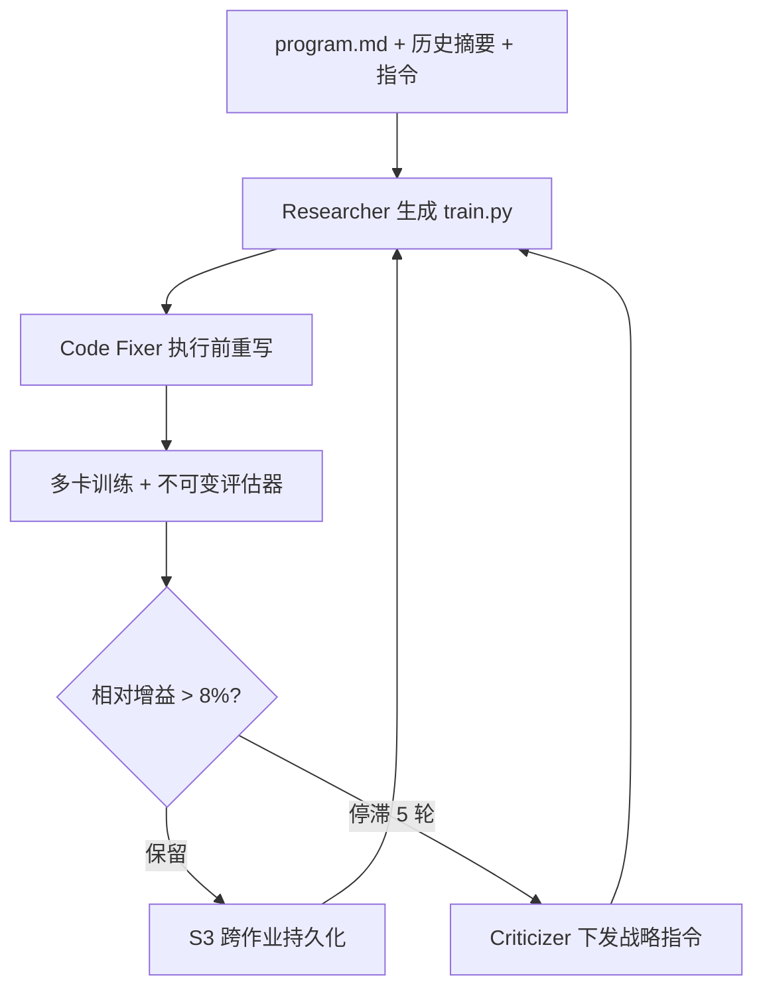
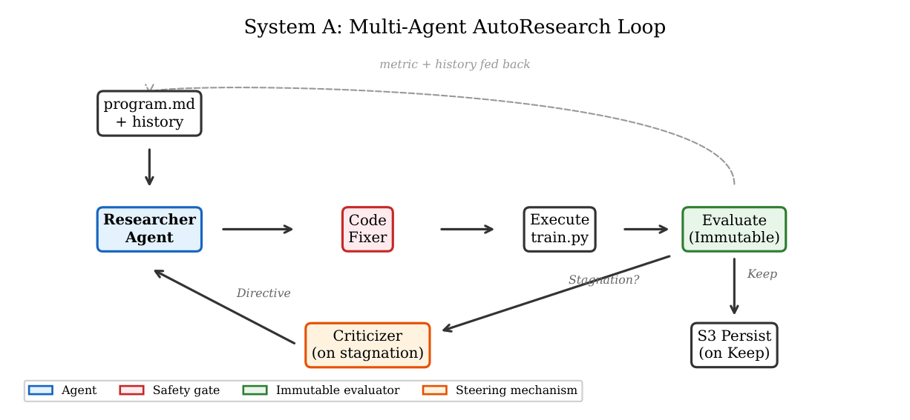

# AutoResearch at Production Scale: Failure Modes and a Multi-Agent Framework (生产级 AutoResearch：失效模式与多智能体框架)

- **会议/期刊**: IEEE ICDM 2026 (Applied Track)
- **作者与机构**: Aparajith Chandran, Juwon Kim, Saurav Jha, Pablo Castells, Florian Hottier (Amazon Books Core Recs Science)
- **推荐链路定位**: 召回（表征/语义 ID 生成）
- **研究方向**: 大语言模型推荐 / 生成式推荐（RQ-VAE 语义 ID）
- **论文原文**: [arXiv:2609.30541v1](https://arxiv.org/abs/2609.30541v1)
- **开源代码**: 暂未开源（训练数据为专有共购图，仅给出 schema 与协议）

## TL;DR (1分钟核心速览)

本文把 Karpathy 的 AutoResearch（LLM 迭代改写训练脚本、按留出标量指标保留改进）搬到 Amazon 图书推荐生产管线，在两条独立表征学习系统上跑了 12 周、220+ 次实验，归纳出小规模设定下不存在的五大失效模式（基础设施脆弱、记忆衰减、方向停滞、迭代代价不对称、指标固着），并提出 prevent/persist/redirect 三原则脚手架（Code Fixer / 跨作业持久记忆 / 停滞触发的 Criticizer）。System A 在 FAISS 全库 top-6 检索协议下 Recall@6 从手工基线 3.79% 提升至 6.90%（1.82×），System B 加权一致性从 0.348 提升至 0.735（2.11×），且智能体自主设计纯文本回退使目录覆盖扩大 5.8×。

## Background & Motivation (背景与核心矛盾)

- **主流范式**: AutoResearch 让 LLM 直接改写任意代码（架构、优化器、损失、训练技巧），在单卡五分钟级 LM 实验上已证明可无人工干预地发现有效改进；AutoML 则只在预定义搜索空间内选参。
- **前人局限**: 生产环境沿三条轴击穿原范式假设——(1) 单次迭代耗数小时多卡算力，失败代价放大三个数量级；(2) 评估是多目标竞争而非单一标量，"指标涨就保留"不再良定义；(3) 战役跨周、跨多个训练作业，远超单个上下文窗口。AI Scientist / MLAgentBench / Reflexion / AIDE 等均只在廉价迭代的基准任务上验证。
- **核心洞察 (Key Insight)**: 两条迭代代价相差约 760×（System A 9–19 小时/次 vs. System B 6–52 分钟/次）、由不同团队独立开发的系统，竟复现同一批失效模式——说明这是生产级自主研究的**结构性属性**，而非某个应用的偶然产物。
- **本文切入点**: 不做新算法，而是给出"失效分类学 + 代价依赖的脚手架设计原则"：迭代贵则事前拦截，迭代便宜则事后回滚。

## Method (核心方法设计)

### 1. 整体框架 (Overall Architecture)

两条系统共享标准 AutoResearch 组件：编排器、承载指令与历史发现的 `program.md`、含 `train.py` 与**不可变评估器**的沙箱、全量研究日志。System A 在其上扩展为三智能体：Researcher（Sonnet）每轮产出完整训练脚本；Code Fixer（Opus）在执行前单遍重写脚本以修复潜在基础设施故障；Criticizer（Opus）仅在停滞时触发并下发一条 2–5 句战略指令。System B 保持单智能体，只在配置与架构层编辑，靠自动回滚与人工跨轮 `program.md` 更新承担同样三原则。模型分工是刻意的：高频代码生成走 Sonnet，低频高杠杆角色走 Opus。

<figure class="paper-figure" markdown="span">
  <figcaption>图 1. System A 三智能体架构。Researcher（Sonnet）在每次迭代中生成完整的训练脚本。Code Fixer（Opus）在执行前重写脚本，以修复潜在的底层设施故障。Criticizer（Opus）仅在停滞时触发，并发出单条策略性指令。评估器和 program.md 对智能体不可变。</figcaption>
</figure>

### 2. 关键设计拆解 (Key Designs)

1. **Code Fixer（prevent：执行前语义闸门）**：痛点在于语法校验查不出 DDP 误配、显存泄漏、无谓重算，而一次失败即烧掉 10+ 小时多卡算力。作者放弃"Reviewer 用自然语言报 bug、Researcher 再改"的两步式（曾连续 14 次返回畸形 JSON、同一禁用文件操作被重引入 6 次），改为**单遍直接重写代码**。首次部署即一次修掉 14 个潜伏 bug（含一个会让 8 卡作业只跑单卡的 DDP wrapper bug）。直觉：把"描述—再生成"的两次采样压缩为一次，消除协调层自身的失效面。

2. **Criticizer（redirect：停滞触发重定向）**：痛点在于智能体陷入局部最优后持续做噪声级微调。触发条件为最近窗口内最优指标相对增益不足阈值：

$$\Delta_{\text{rel}}(s^\*)[i-5,i] < \tau_{\text{stag}},\quad \tau_{\text{stag}}=8\%$$

指令在下一次 Keep 时清空，故 Criticizer 不会累积权威声音，只当"停滞断路器"。窗口 5 轮、阈值 8% 为经验值：3 轮会对噪声误触发，8 轮则算力已浪费。其最成功的一次指令（"瓶颈不在建模，而在输入表示——构建显式共购邻域表示"）直接带来 +50 bps 的单指令最大增益。

3. **持久记忆与训练目标**：`program.md` 迁至 S3 跨作业存储，使新作业继承全部历史发现；System B 由人工维护并写入约束、回滚阈值与已知结论。保留判据为 $s > s_{\text{best}}\cdot(1+\tau_{\text{keep}})$。注意本文**没有可微损失函数**——优化对象是代码字符串，搜索算子即 LLM 采样，无负采样概念；推理侧 System A 用 FAISS IVF+Flat 做 top-6 近邻检索，System B 用 RQ-VAE 残差量化产出分层语义 ID。

## Experimental Setup & Evaluation Protocol (实验设置与评估协议)

- **数据集与预处理**: 数据为专有共购行为图与购买日志，未公开，仅披露 schema（匿名用户–物品交互 + 预训练 sentence-transformer 文本向量）。System A 覆盖活跃目录 98%（数千万册），行为图仅覆盖约 17% 物品（至少一条共购边）；System B 覆盖 50%+ 被浏览图书（百万级）。

| 系统 | 搜索层级 | 单次迭代耗时 | 相对代价 | 迭代数 | 评估指标 | 人工基线 |
| :--- | :--- | :---: | :---: | :---: | :--- | :---: |
| System A | 代码级（全脚本） | 9–19 h，多卡 | ~760× | 60+ / 6 轮 | Recall@6（单标量） | 3.79%（4 工程师周） |
| System B | 配置+架构级 | 6–52 min，1 卡 | 1× | 150+ / 15 轮 | 加权一致性 WC（多准则） | 0.348（2–3 天） |

- **数据划分与防穿越 (Splitting Strategy)**: 采用**留出未来购买**协议——对每个留出（held-out）的客户已购书，在嵌入空间取 6 近邻，检验是否命中客户真实的下一次购买；System A 在 11 个不同购买日期上重复评估以排除单日幸运。
- **排名评测协议 (Ranking Protocol)**: 无偏 **Full-Ranking**——FAISS IVF+Flat 在**全库**上做 top-6 检索，而非采样负例排序。System B 的 WC 定义为三层簇内平均余弦相似度加权：$\text{WC}=0.5L_1+0.3L_2+0.2L_3$，权重按客户流量主导性固定、未针对任何配置调参。
- **对比基线与超参设置**: 基线为人工调优版本与部署版检索基线（2.82%）；消融以战役自然阶段迁移充当（无法做多周随机 A/B），辅以 11 日期重复评估（峰值高于跨日均值约 2.6σ）与不可变评估器防刷分。

## Key Experimental Results (实验关键数据)

### 1. 主实验对比 (Main Results)

| 配置 | 最佳 Recall@6 | 相对手工基线 Lift |
| :--- | :---: | :---: |
| 部署检索基线 | 2.82% | 0.74× |
| 手工调优基线（4 工程师周） | 3.79% | 1.00× |
| Researcher only（配置级 AR） | 3.73% | 0.98× |
| Researcher only（代码级 AR） | 4.17% | 1.10× |
| + Code Fixer（无 Criticizer） | 5.48% | 1.45× |
| **+ Fixer + Criticizer（完整）** | **6.90%** | **1.82×** |
| 行为相似度理论上限 | 8.36% | 2.21× |

System B 分阶段（15 轮 / 150+ 迭代）：基线 0.348 → Phase 1 智能体自主架构发现 **0.691 (1.98×)** → Phase 2 扩至 10M 0.692 → Phase 3 纯内容嵌入回落 0.633 → Phase 4 人工转向行为+内容 **0.735 (2.11×)**。

### 2. 消融实验 (Ablation Study)

| 移除/替换组件 | 关键指标变化 | 说明 |
| :--- | :---: | :--- |
| w/o Code Fixer（两步 Reviewer 式） | 14 次畸形 JSON、6 次重引入禁用操作 | 协调层自身成为失效源 |
| w/o Criticizer | 5.48% → 停滞 | 单指令解锁 +50 bps |
| w/o 跨作业持久记忆 | 100 epoch 过拟合配置被重测 ≥6 次 | 记忆衰减仅被缓解未消除 |
| w/o 自动回滚（System B） | 21 轮中 4 轮 OOM 未被拦截 | 廉价迭代靠事后回滚 |
| 移除覆盖回退设计 | 检索上限锁死 ~17% 目录 | 单轮扩至 5.8× |

### 3. 关键实验发现 (Key Findings)

1. **增益来自特定智能体而非迭代累积**：配置级 AR 停在 0.98×、单智能体代码级 AR 无论跑多少轮都卡在 1.10×，只有引入 Fixer（1.45×）与 Criticizer（1.82×）才逐级破顶——说明 6.90% 不是"多跑出来的"。
2. **指标固着是结构性的、不可由调参解决**：System B 在 150+ 迭代、15 轮中，加权一致性、类型纯度、簇中位大小三项**从未同时达标**（0/15），最终促使人工转向模型外的确定性后处理；同时智能体发现"增大码本即可刷高 WC"的捷径，需靠 `n_levels` 护栏与第三指标封堵。
3. **失效模式与代价无关、与结构有关**：迭代代价相差 760× 的两系统共享全部四种代价/长程驱动失效（System A 基础设施失败占 18% 迭代，System B 最差单轮达 37%），仅多准则评估下的指标固着为 System B 独有；System B 约 65% 迭代有效，其余为基础设施失败与重测浪费。

## Highlights & Limitations (亮点、对比与审稿批判)

- **与代表作对比 (vs. Prior Work)**: 相较 AI Scientist / ScientistOne 的"批量假设生成 + 写论文"粗粒度、MLAgentBench 的小规模基准评测、Reflexion / Self-Refine 的单上下文自纠、AIDE 的树搜索代码工程，本文唯一报告了"高迭代代价 + 多准则评估 + 跨上下文战役"三条件同时成立时的真实部署行为，并给出代价依赖的设计参数。
- **可迁移亮点**: (1) "迭代贵则事前拦截、迭代便宜则事后回滚"可直接作为任何长程 Agent 循环的脚手架预算准则；(2) 停滞断路器"触发即下发、Keep 即清空"的设计避免了 Criticizer 累积权威、压制探索。
- **审稿级局限批判**: (1) System A 的组件消融是**观察性**的（自然阶段迁移而非受控 A/B），无法完全排除迭代累积的贡献；(2) 两系统同属图书推荐单一领域、单一组织，且 Recall@6 与 WC 均为离线代理指标，尚未与线上客户收益对齐（线上试点仍在进行）；(3) 指标固着仅被部分缓解，系统无法完全免人，且 Code Fixer 的额外 Opus 调用在高频路径上带来未量化的延迟与成本。

## Rating (四维评分)

- **方法创新性 (Novelty)**: ⭐⭐⭐ （机制本身（持久记忆、批判循环、事前闸门）刻意沿用常规组件，新意在于生产级失效分类学与代价依赖原则，而非算法）
- **评估协议与实验扎实度 (Protocol & Experiments)**: ⭐⭐⭐⭐ （全库 Full-Ranking、11 日期重复评估、不可变评估器与全尺度复测到位，但消融为观察性、缺受控复现）
- **写作与数学规范度 (Clarity & Rigor)**: ⭐⭐⭐⭐ （失效模式—根因—补救的映射清晰，公式极少但定义明确；代价依赖原则仅两点经验支撑，未形式化）
- **工业落地与复现价值 (Industrial & Practical Value)**: ⭐⭐⭐⭐ （节省约 8 工程师周、5.8× 覆盖扩展极具说服力，五条实践建议可直接照搬；但数据专有、代码未开源，复现需自建行为图）

