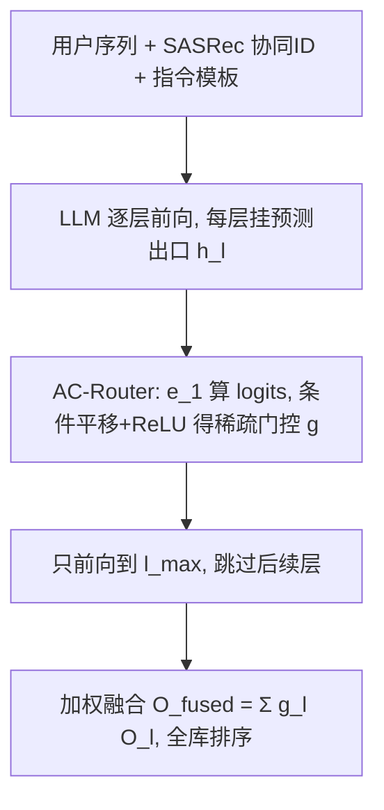
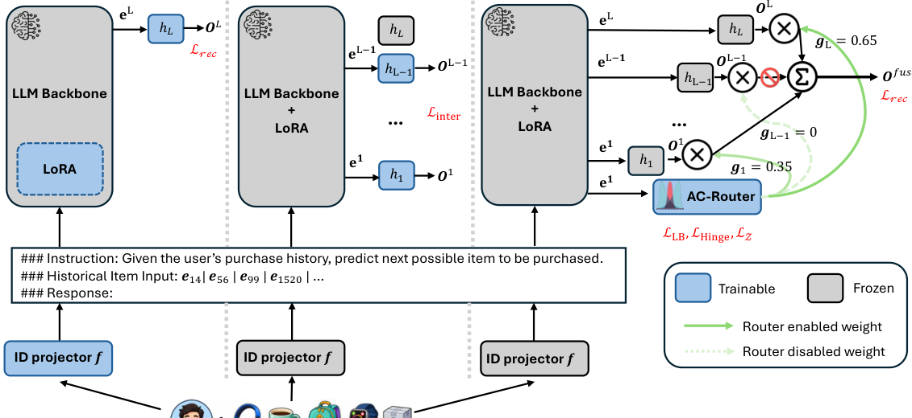

# Empowering Compact LLMs with Fusion of Layer-wise Exits for Recommendation (以层间出口融合赋能紧凑 LLM 推荐)

- **会议/期刊**: ICDM 2026
- **作者与机构**: Xurong Liang, Tong Chen, Hongzhi Yin 等（昆士兰大学、格里菲斯大学、埃迪斯科文大学、圣母大学）
- **推荐链路定位**: 召回（判别式全库排序）
- **研究方向**: 大语言模型推荐 / 序列推荐
- **论文原文**: [https://arxiv.org/abs/2608.17316v2](https://arxiv.org/abs/2608.17316v2)
- **开源代码**: [https://github.com/xurong-liang/FLEXRec](https://github.com/xurong-liang/FLEXRec)

## TL;DR (1分钟核心速览)

紧凑 LLM（≤3B）做判别式推荐时表征能力弱、且所有用户序列走完全相同的固定深度前向通路，缺乏结构自适应性；生成式/蒸馏/推理增强路线又因自回归解码或大教师模型而延迟爆炸。FLEXRec 在 LLM 每一层插入预测出口（exit），用连续 ReLU 路由器按序列动态选择并融合若干层的打分分布，并以 target-k hinge 损失软约束激活出口数落在 $[1,k]$。在 Toys/Beauty/Yelp 三数据集、Qwen3-1.7B 与 Llama3.2-3B 双骨干、Leave-One-Out + Full-Ranking 协议下，NDCG@10 相对 E4SRec 提升约 15%（Toys-Qwen 0.0452→0.0521），推理延迟仅比 E4SRec 多不到 1ms。

## Background & Motivation (背景与核心矛盾)

- **主流范式**: 判别式 LLM-RS（以 E4SRec 为代表）把物品 ID 投影进 LLM 语义空间，仅取**最后一层** response token 表征算内积，从而绕开自回归解码、支持全库实时排序。
- **前人局限一**: 按 scaling law，紧凑骨干的上下文表征质量随参数量下降而退化，单出口打分表达力不足；而推理增强（CoT）与知识蒸馏分别带来额外解码步与大教师模型的托管成本。
- **前人局限二**: 判别式范式对**所有**用户序列执行完全相同的 $1\to L$ 层前向通路，简单偏好模式与复杂模式被同等对待，缺乏生成式方法那种"按需推理"的结构自适应性。
- **核心洞察 (Key Insight)**: LLM 不同深度捕获不同粒度的语义——浅层偏局部短时物品转移、深层偏抽象长时意图，这与序列推荐需同时建模短期转移与长期兴趣天然契合；中间层表征被丢弃是紧凑模型的巨大浪费。
- **本文切入点**: 把每层当作一个"专家出口"，用 MoE 式动态路由按序列选择融合哪些深度的打分分布，以"深度集成"补偿参数宽度不足。

## Method (核心方法设计)

### 1. 整体框架 (Overall Architecture)

输入沿用 E4SRec 的拼接模板 $E_0=[E_{inst};E_{inj};E_{resp}]$，其中物品 ID 由预训练 SASRec 的 64 维协同嵌入经单层 MLP 投影到 LLM 隐空间。与 E4SRec 只取末层不同，FLEXRec 在**每个** transformer block 后挂一个预测头$h_l$，得到$L$个出口分布$O_l=\mathrm{Softmax}(h_l(E_l[-1]))$。AC-Router 仅用第一层 response 表征$e_1$计算路由 logits，经条件平移 + ReLU 得到稀疏门控权重$g$，只前向传播到最深的激活层$l_{\max}$，其余层与出口直接跳过，最终以$g$加权融合激活出口的分布$O_{fused}=\sum_{l\in\mathcal{A}}g_lO_l$做全库排序。训练分三阶段：Stage 1 训 LoRA+投影+末出口；Stage 2 冻结骨干、预热中间出口；Stage 3 仅训路由器矩阵$W_z$。

<figure class="paper-figure" markdown="span">
  <figcaption>图 1：FLEXRec 框架及其三阶段训练概览。阶段 1 通过 Lrec 训练基础组件。阶段 2 通过 Linter 预热中间出口 Hinter。阶段 3 使用 Lrec 以及路由特定损失项（LLB、LHinge、LZ）优化 AC-Router。在给定序列示例中，实线绿色箭头表示 AC-Router 分配的活跃路由权重，而虚线箭头表示未选中的出口，这些出口不贡献于最终融合分布 Ofused。</figcaption>
</figure>

### 2. 关键设计拆解 (Key Designs)

1. **层间多出口集成（Multi-Exit Ensemble）**：痛点是把中间层表征全部丢弃、单出口表达力受限 $\to$在每层后插入轻量 MLP 头，把$L$个深度的打分分布作为候选专家池$\to$ 直觉是不同深度编码不同粒度偏好，集成后提供互补上下文，等效于在不增加参数宽度的前提下扩展"有效容量"。

2. **自适应连续路由器 AC-Router**：痛点是 Top-k 路由强制每条序列恰好融合 $k$个出口，简单序列浪费算力、复杂序列受限，且不可微$\to$用 ReLU 连续路由，组合空间从$\binom{L}{k}$扩张到$2^L-1$；为防止所有 logits 为负导致路由全灭，引入条件平移
$$s=\min(\max(z)-\epsilon,0),\quad \hat{z}=z-\mathrm{sg}(s),\quad w=\mathrm{ReLU}(\hat{z}),\quad g_l=\frac{w_l}{\sum_m w_m+\xi}$$
其中 $\mathrm{sg}(\cdot)$为 stop-gradient，保证最大 logit 至少存活$\epsilon$；推理时只前向到$l_{\max}=\max(\mathcal{A})$，天然获得深度剪枝收益。

3. **Target-k Hinge 损失与三阶段训练**：痛点是用硬基数上限会扼杀融合多样性 $\to$用 Sigmoid 代理估计激活数$C=\sum_l\sigma(\tau\hat{z}_l)$，施加非对称双侧 hinge
$$\mathcal{L}_{Hinge}=\max(0,C-k)+\gamma\max(0,1-C)$$
鼓励 $C$落在$[1,k]$而非严格等于$k$，$\gamma=2$强压零出口退化。路由器总损失$\mathcal{L}_{router}=\alpha\mathcal{L}_{LB}+\lambda\mathcal{L}_{Hinge}+\beta\mathcal{L}_{Z}$，其中$\mathcal{L}_{LB}=L\sum_l\bar{P}_l^2$（Softmax 代理的负载均衡，防路由坍缩）、$\mathcal{L}_Z=\mathrm{mean}(z^2)$（锚定 logits 幅度，防 FP16 溢出并保住 hinge 的 Sigmoid 梯度）。**负采样**：无显式负采样，采用全库 Softmax + 交叉熵（$\mathcal{L}_{rec}$与$\mathcal{L}_{inter}$均为逐出口 CE 平均）。**推理开销**：单次前向 + 轻量路由，实测仅比 E4SRec 多 <1ms；Stage 3 极轻量，可共享同一冻结骨干训练多套不同$k$ 的路由器以适配不同设备算力。

## Experimental Setup & Evaluation Protocol (实验设置与评估协议)

- **数据集与预处理**（`5-core` 物品过滤）：

| 数据集 | #Users | #Items | #Interactions | 稀疏度 | 特征/场景说明 |
| :--- | :---: | :---: | :---: | :---: | :--- |
| Toys | 19,412 | 11,924 | 167,597 | 99.93% | Amazon 玩具评论 |
| Beauty | 22,363 | 12,101 | 198,502 | 99.93% | Amazon 美妆评论 |
| Yelp | 30,431 | 20,033 | 316,354 | 99.95% | Yelp 商户评论（最稀疏） |

- **数据划分与防穿越**: `Leave-One-Out`——每用户最后一项为测试、倒数第二项为验证，其余训练。
- **排名评测协议**: 无偏 `Full-Ranking`（全库未交互物品排序），指标 NDCG@{10,20}、Recall@{10,20}，另记录平均单用户推理时延 T(ms)。
- **对比基线与超参**: 传统 SASRec/BERT4Rec；LLM 类 E4SRec（静态单出口对照）、SPRec、SETRec、LLM-SRec、HUM；以及在同一多层架构上替换路由器的 MoE 变体 SparseToken（离散 Top-k）、DynamicMoE（阈值动态）、LD-MoLE（单纯形投影连续路由）；另设 Skyline（E4SRec + Qwen3-4B / Llama3.1-8B）作上界参考。SASRec 嵌入 $d_{pt}=64$，LoRA 微调 2 epoch、中间出口 5 epoch、路由器 2 epoch，batch 128，lr$3e^{-4}$，$k=3$、$\epsilon=0.1$、$\tau=10$、$\gamma=2$，单卡 H100。

## Key Experimental Results (实验关键数据)

### 1. 主实验对比 (Main Results)

Qwen3-1.7B 骨干（节选 N@10 / N@20 / T(ms)）：

| 方法 | Toys N@10 | Toys N@20 | Beauty N@10 | Beauty N@20 | Yelp N@10 | Yelp N@20 | T(ms) |
| :--- | :---: | :---: | :---: | :---: | :---: | :---: | :---: |
| SASRec | 0.0353 | 0.0421 | 0.0288 | 0.0376 | 0.0173 | 0.0233 | 0.01 |
| Skyline (4B) | 0.0539 | 0.0616 | 0.0435 | 0.0510 | 0.0199 | 0.0260 | 9.51 |
| SETRec | 0.0423 | 0.0510 | 0.0380 | 0.0462 | 0.0177 | 0.0239 | 130.94 |
| E4SRec | 0.0452 | 0.0515 | 0.0391 | 0.0470 | 0.0188 | 0.0248 | 6.89 |
| SparseToken | 0.0499 | 0.0561 | 0.0445 | 0.0526 | 0.0180 | 0.0239 | 7.31 |
| LD-MoLE | 0.0516 | 0.0578 | 0.0438 | 0.0513 | 0.0184 | 0.0242 | 7.60 |
| **FLEXRec** | **0.0521** | **0.0584** | **0.0451** | **0.0530** | **0.0207** | **0.0271** | 7.53 |
| Improv. vs E4SRec | +15.3% | +13.4% | +15.3% | +12.8% | +10.1% | +9.3% | +0.64ms |

Llama3.2-3B 骨干下 FLEXRec 同样全面最优（Toys N@10 0.0524、Beauty 0.0498、Yelp N@20 0.0249），且 Beauty 双骨干、Yelp-Qwen 均**反超更大骨干的 Skyline**（如 Beauty-Qwen N@10 0.0451 vs Skyline 0.0435）。

### 2. 消融实验 (Ablation Study)

| 变体 | Toys N@10 | Toys N@20 | Beauty N@10 | Yelp N@10 | Yelp N@20 |
| :--- | :---: | :---: | :---: | :---: | :---: |
| Default (Qwen) | **0.0521** | **0.0584** | **0.0451** | **0.0207** | **0.0271** |
| w/o $\mathcal{L}_{LB}$ | 0.0476 | 0.0540 | 0.0447 | 0.0177 | 0.0235 |
| w/o $\mathcal{L}_{Hinge}$ | 0.0504 | 0.0564 | 0.0444 | 0.0190 | 0.0249 |
| w/o $\mathcal{L}_{Z}$ | 0.0471 | 0.0536 | 0.0445 | 0.0183 | 0.0241 |
| Default (Llama) | **0.0524** | **0.0603** | **0.0498** | **0.0188** | **0.0249** |
| w/o $\mathcal{L}_{LB}$ | 0.0486 | 0.0554 | 0.0483 | 0.0170 | 0.0229 |
| w/o $\mathcal{L}_{Hinge}$ | 0.0488 | 0.0553 | 0.0485 | 0.0166 | 0.0223 |
| w/o $\mathcal{L}_{Z}$ | 0.0513 | 0.0592 | 0.0495 | 0.0169 | 0.0225 |

### 3. 关键实验发现 (Key Findings)

1. **融合优于最优单出口**：图 2 显示所有独立出口的 NDCG@20 分布中，FLEXRec 的红线在 6 个数据集×骨干组合上**全部高于最佳单出口**（如 Toys-Qwen 最佳单出口约 0.0584 附近而融合达 0.0584 之上、Yelp-Qwen 融合 0.0271 显著高于出口分布上界），证明收益来自互补融合而非"挑一个好出口"。
2. **稀疏数据集上 MoE 变体集体失效、FLEXRec 稳健**：Yelp 上 SparseToken/DynamicMoE 甚至低于 E4SRec（0.0180/0.0191 vs 0.0188 N@10），而 FLEXRec 达 0.0207；说明固定基数或阈值路由在稀疏、模式多样的序列上易失配，连续 ReLU 路由的组合弹性才是关键。
3. **Hinge 损失是路由稳定性的命门**：去掉 $\mathcal{L}_{Hinge}$后 Beauty-Qwen 的最大激活出口数飙至 16（图 3），平均利用率偏离目标；消融中 Yelp-Llama N@10 从 0.0188 跌至 0.0166（-11.7%），$\mathcal{L}_{Z}$缺失则导致 logits 溢出使基数惩罚"失明"（Toys-Qwen N@10 跌至 0.0471）。此外$k=3$ 在所有数据集与骨干上一致最优，Llama 平均激活约 3 个出口、Qwen 约 2 个，路由器能自动校准到骨干自身的表征容量。

## Highlights & Limitations (亮点、对比与审稿批判)

- **与代表作对比 (vs. Prior Work)**: 相较 E4SRec 的"末层单出口静态通路"，本文把被丢弃的中间层变成可路由专家池；相较 SparseToken/DynamicMoE/LD-MoLE 等 MoE 路由，本文不改网络宽度而改**网络深度**，且用 target-k hinge 以零额外参数实现软基数约束，避免 LD-MoLE 的单纯形投影与辅助 MLP。
- **可迁移亮点**: (1) "逐层出口 + 连续路由"可直接移植到任何判别式双塔/LLM 召回器做免费深度集成；(2) Stage 3 仅训路由器、共享冻结骨干，可离线批量产出多档 $k$ 的路由器适配不同算力设备，是很好的部署技巧。
- **审稿级局限批判**: (1) 仅验证 ≤3B 骨干与三个评论类数据集，未涉及工业级千万物品全库、也未给出吞吐/QPS 与显存实测；(2) 三阶段训练流程与 $\alpha,\lambda,\beta,k$四个超参耦合较深，图 4 显示最优$\alpha$随数据集与骨干漂移，调参成本与跨域迁移稳定性存疑；(3) 路由器仅用第一层$e_1$ 决策，浅层表征信息量有限，对超长序列的判别力可能不足。

## Rating (四维评分)

- **方法创新性 (Novelty)**: ⭐⭐⭐⭐ （把 MoE 从"扩宽"翻转为"选深"，target-k hinge 软基数约束简洁且无需额外参数，思路新颖）
- **评估协议与实验扎实度 (Protocol & Experiments)**: ⭐⭐⭐⭐ （三数据集 × 双骨干 × Full-Ranking + 时延 + 三类 MoE 对照 + 完整消融，但缺工业规模与显著性检验）
- **写作与数学规范度 (Clarity & Rigor)**: ⭐⭐⭐⭐ （三阶段训练与各损失动机交代清晰，条件平移与 stop-gradient 的数值稳定性论证到位）
- **工业落地与复现价值 (Industrial & Practical Value)**: ⭐⭐⭐⭐ （代码开源、延迟仅增 <1ms、可共享骨干多档路由器部署，实用性强）
