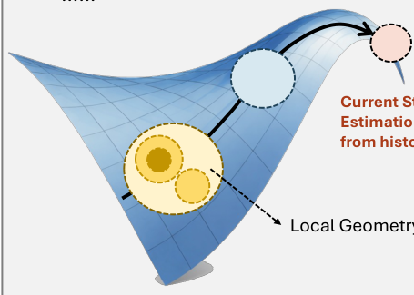
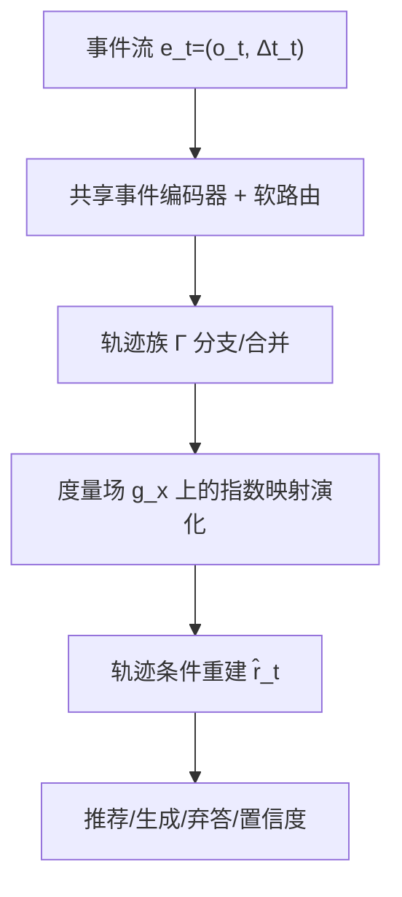

# Memory Has Geometry: Non-Uniform Geometric Memory for Long-Horizon Personalized AI (记忆有几何：面向长程个性化 AI 的非均匀几何记忆)

- **会议/期刊**: IEEE ICDM 2026 (BlueSky Track, 6 页 vision paper)
- **作者与机构**: Jiahong Liu, Wenhao Yu, Zexuan Qiu, Menglin Yang, Irwin King（香港中文大学 / 港科大广州）
- **推荐链路定位**: 端到端生成式（记忆层，服务于个性化 LLM / Agent / 推荐）
- **研究方向**: 大语言模型推荐 / 序列与会话推荐
- **论文原文**: [https://arxiv.org/abs/2609.17969v1](https://arxiv.org/abs/2609.17969v1)
- **开源代码**: 暂未开源

## TL;DR (1分钟核心速览)

长程个性化 AI 的记忆瓶颈不在检索精度，而在抽象本身：现有系统把记忆当作静态隐空间中的离散记录集合，用单一全局相似度做 top-k 检索，与"时序事件流"这一证据本质错配。本文提出**非均匀几何记忆**——把用户记忆建模为用户特定的动力系统状态空间 $(M,\mathcal{G})$，局部度量$g_x$ 随区域与时间变化，记忆访问从"最近邻查找"升级为"轨迹条件状态重建"。作为 BlueSky 愿景论文，本文不提供主实验数字，而是给出形式化框架、分层研究议程与可证伪的验证协议（H1 长程敏感性 / H2 校准 / H3 稀疏证据），并主张以 identity-metric 消融隔离几何增益。

## Background & Motivation (背景与核心矛盾)

- **主流范式**: 文本记忆库（MemoryBank、Generative Agents）、向量检索（REALM/RAG）、结构化记忆（A-Mem 动态链接笔记、Zep 时序知识图谱、HeLa-Mem 联想巩固）——本质都是"可检索记录集"。
- **前人局限**: ① 后到证据会改变早先事件的相关性，而记录集的相关性判定是静态的；② 局部修正（如临时育儿约束）不应泛化到全局偏好，但单一度量下必然泄漏；③ 检索能找对证据，却仍可能估错当前状态（图 1 的核心论点）。
- **核心洞察 (Key Insight)**: 三条隐含假设 A1 离散记录、A2 均匀几何、A3 条目级访问，共同导致"存储条目"而非"演化状态"成为一等公民。用户记忆天然具有稳定区/易变区、变速率漂移、异质邻域与状态不确定性——这些正是几何语言擅长表达的。
- **本文切入点**: 用位置相关度量场 + 轨迹族 $\Gamma$ 替代全局相似度，把记忆访问改写为对轨迹段的后验边缘化。

<figure class="paper-figure" markdown="span">
  <figcaption>图 1. 扁平的记录检索记忆与用户记忆演化的几何视图对比。几何记忆并非在单一相似度概念下检索孤立的过往记录，而是从结构化轨迹、局部几何和较长期演化中推断用户的当前状态。</figcaption>
</figure>

## Method (核心方法设计)

### 1. 整体框架 (Overall Architecture)

模型将个性化记忆定义为一个几何动力系统：状态空间 $\mathcal{M}$上配备正定局部度量场$\mathcal{G}=\{g_x\}_{x\in\mathcal{M}}$，曲率由度量变化导出，不确定性单独建模。事件$e_t=(o_t,\Delta t_t)$驱动状态在流形上演化；交互历史被组织为轨迹族$\Gamma=\{\gamma_k\}$（偏好 regime、项目、例行、episode）。访问时不再检索条目，而是在当前查询$q_t$与状态$x_t$条件下对相关轨迹段$z$ 做后验加权重建。训练上共享事件编码器与转移模型，仅学习小型用户特定度量适配器。

### 2. 关键设计拆解 (Key Designs)

1. **度量感知的状态演化（Riemannian 更新算子）**：欧氏加性更新无法表达"某些方向位移代价高"。本文令 $f_\theta$ 输出切余向量，经逆度量转成位移再做指数映射：
$$x_t=\mathrm{Exp}_{x_{t-1}}\left(g_{x_{t-1}}^{-1}f_\theta(x_{t-1},e_t)\right)$$
直觉：度量即"各向异性代价"，身份度量退化为欧氏加法，因此几何增益可被消融精确隔离。注意作者明确区分：高曲率 $\neq$ 快速漂移，更新速率单独学习（连续时间动力学）。

2. **轨迹条件重建替代 Top-k 检索**：记录式访问为 $R(q_t,\mathcal{D}_t)=\mathrm{TopK}_{m_i\in\mathcal{D}_t}s(q_t,m_i)$；本文改为
$$\hat{r}_t=\int h_\theta(q_t,x_t,z)\,p(z\mid q_t,x_t,\Gamma)\,\mathrm{d}z$$
即"哪条路径段能解释当前上下文"，而非"哪个条目最相似"。$\hat{r}_t$ 可直接驱动推荐、生成、动作、置信度或弃答，使记忆访问成为推断而非查找。

3. **训练目标、路由与推理效率**：总目标由预测损失、校准损失（Brier / selective risk）与编辑局部性损失联合构成，配合证据依赖正则与 identity-metric 收缩稳定冷启动适配。路由采用软分配（上下文兼容度 + 预测似然），分支/合并需对标注 episode 与留出预测做验证，且保留路由不确定性而非强制单路径。效率侧依赖低秩度量适配器、缓存局部坐标图、近似测地搜索与摊销推断。

## Experimental Setup & Evaluation Protocol (实验设置与评估协议)

- **性质说明**: 本文为 BlueSky 愿景论文，**无数据集统计表、无主实验表格**，取而代之的是"验证协议 + 可证伪假设"。
- **数据构造**: 构建带时间戳的受控事件流，显式植入五类结构——复现角色、渐变偏好漂移、临时例外、休眠后复活的项目、真实 regime 切换；先在已知状态、经同意的标注上建立可辨识性，再扩展到自然交互日志。
- **划分与防穿越**: **按时间顺序切分 + 留出用户 (hold-out users)**，并变化时间间隔与证据密度。
- **评测协议**: 对比三方——纯检索、强动态隐状态基线、以及**同编码器/同路由/同转移模型但 identity vs. learned 局部度量**的配对模型，严格控制参数量、数据与记忆预算。
- **指标**: 状态预测误差、陈旧偏好误差、跨角色泄漏、Brier 分数、选择性风险、编辑溢出 (edit spillover)、延迟；报告**用户级置信区间**。参考 LoCoMo / LongMemEval / LifeBench 但指出其在时间粒度、状态演化复杂度、证据隐含性与几何感知指标上的缺口。

## Key Experimental Results (实验关键数据)

### 1. 主实验对比 (Main Results)

本文未提供定量主实验表。作者给出端到端探针示例：用户长期偏好简洁工作邮件 → 一次性索要详细基金申请书 → 回归日常邮件。期望行为是申请书被路由至临时项目路径，且反馈训练的度量使"从该路径偏移到通用邮件偏好区"代价高昂；重建结果应保留简洁邮件风格同时允许详细申请书。动态嵌入作为竞争性参照，identity-metric 消融量化几何的净贡献。

### 2. 消融实验 (Ablation Study)

设计层面的消融即 **identity metric vs. learned local metric**（参数、数据、记忆预算匹配），辅以移除轨迹路由、移除不确定性建模的对照。作者强调这是唯一能干净归因"局部几何"价值的实验设计。

### 3. 关键实验发现 (Key Findings)

- **H1 长程敏感性**：随间隔与 regime 切换增大，几何记忆的陈旧状态误差应下降更快——直接针对记录检索的失效模式。
- **H2 校准**：在同等覆盖率下，位置相关不确定性应带来更优的选择性风险，即"知道何时弃答"。
- **H3 稀疏证据**：达到固定状态预测误差所需事件数更少，说明局部度量提供了归纳偏置而非单纯容量。

## Highlights & Limitations (亮点、对比与审稿批判)

- **与代表作对比 (vs. Prior Work)**: 相较 A-Mem（动态链接笔记）与 Zep（时序知识图谱），本文的差异不在"结构"而在"显式局部度量 + 轨迹条件状态估计"；相较 JODIE / TGN 等动态嵌入与时序图网络，本文额外引入距离与传输结构，规定更新如何跨上下文传播；相较 HRCF / HICF 等双曲协同过滤，本文把几何从"表示增强"提升为"记忆访问原语"。
- **可迁移亮点**: ① identity-metric 配对消融是评估任何几何/流形改进的干净范式；② "编辑局部性 (bounded propagation)" 可作为记忆删除与隐私合规的可测验收标准，直接迁移到工业级用户画像系统。
- **审稿级局限批判**: ① 全文无任何实证数字，H1–H3 均为待验证假设，几何增益是否覆盖指数映射、平行传输、曲率估计与轨迹边缘化的额外开销完全未知；② 度量场、路由与轨迹分支的联合学习在长尾用户上极易过拟合或维度坍缩，作者仅以"群体先验 + 低秩适配"一笔带过，缺乏收敛性与可辨识性的形式化保证。

## Rating (四维评分)

- **方法创新性 (Novelty)**: ⭐⭐⭐⭐ （把记忆访问从检索重构成非均匀几何下的轨迹条件状态估计，视角新颖且有明确的形式化算子）
- **评估协议与实验扎实度 (Protocol & Experiments)**: ⭐⭐ （愿景论文无任何定量实验，仅给出协议与三条可证伪假设，说服力依赖后续工作兑现）
- **写作与数学规范度 (Clarity & Rigor)**: ⭐⭐⭐⭐ （度量场、指数映射、重建积分定义清晰，且诚实区分曲率与漂移速率，但缺复杂度分析）
- **工业落地与复现价值 (Industrial & Practical Value)**: ⭐⭐⭐ （模块化设计与低秩适配、缓存坐标图具备工程可行性，但无开源代码且实时服务延迟未验证）
