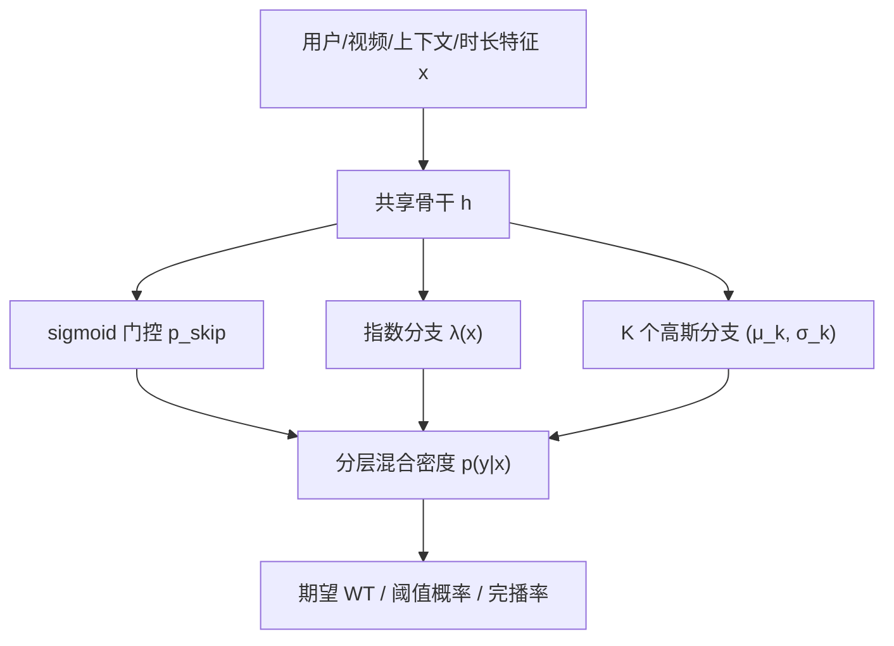

# Hierarchical Exponential-Gaussian Mixtures for Watch-Time Distribution Prediction (面向观看时长分布预测的分层指数-高斯混合模型)

- **会议/期刊**: IEEE ICDM 2026
- **作者与机构**: Sofia Gulevskaia, Mikhail Trapeznikov, Aleksandr Poslavsky, Alexander D'yakonov（AI VK & 罗蒙诺索夫莫斯科国立大学）
- **推荐链路定位**: 精排（多任务排序中的 WT 预测头）
- **研究方向**: 序列与会话推荐 / 去偏公平与工业架构
- **论文原文**: [arXiv:2608.23356v2](https://arxiv.org/abs/2608.23356v2)
- **开源代码**: [rw404/HEGM](https://github.com/rw404/HEGM)

## TL;DR (1分钟核心速览)

短视频全屏自动播放场景下 CTR 失效，观看时长（WT）呈近零膨胀、长尾、多峰分布，EGMN 用"指数+高斯"混合密度建模全条件分布取得 SOTA，但作者大规模复现发现其存在**高斯方差坍缩、组件冗余/失活、初始化敏感**三大病理，工业数据上 XAUC 甚至不如 MSE 点回归（0.6585 vs 0.7070）。HEGM 通过分层 skip-watch 门控分解、结构化初始化、去掉强制高斯平移与熵正则、可选 KL 方差正则来修复。在固定骨干换头协议下，KuaiRec/VK-LSVD/282M 交互工业集上 XAUC 全面最优（工业 0.7188），60s 深度观看 ROC AUC 从 0.8356 升至 0.8903，1.5 个月线上 A/B 会话深度 +9.26%。

## Background & Motivation (背景与核心矛盾)

- **主流范式**: WT 预测从标量回归（MSE/MAE-VR）、序数离散化（TPM/PTPM/CREAD）演进到条件分布估计（EGMN、CQE 分位数、D2Co 时长高斯混合、CWM 反事实截断），分布头可同时支撑期望 WT、阈值概率、完播率与不确定性。
- **前人局限**: ① EGMN 的强制高斯平移 $\mu_k = \lambda^{-1} + \text{softplus}(\cdot)$把 skip 与 watch 两个行为区耦合，skip 梯度会间接拖动参与观看的高斯；② 无约束 MLE 训练混合模型导致$\sigma_k \to 0$的针状尖峰（记忆样本）与多组件合并到$1/\lambda$附近，$K$ 增大而有效容量不增。
- **核心洞察 (Key Insight)**: 熵正则只压权重不分离均值/方差，无法阻止坍缩；而 WT 的物理结构天然是"先决定是否跳过、再决定看多久"的两级行为，扁平 softmax 混合违背该层级性。
- **本文切入点**: 用 sigmoid 门控显式拆出 skip 分支，配合确定性均匀初始化与时长分桶 KL 方差先验，把混合学习从"靠运气初始化"变成"结构约束下的稳定优化"。

## Method (核心方法设计)

### 1. 整体框架 (Overall Architecture)

共享骨干 $h = g_{\text{backbone}}(x)$（公开集用 PLE + DCNv2，工业集为多任务 wide&deep 塔）输出隐表示后，HEGM 头分三支：sigmoid 门控给出跳过概率$p_{\text{skip}}$，指数分支刻画近零快滑，$K$个高斯分支刻画部分观看/完播/重看等参与态；两支按$p_{\text{skip}}$加权混合成完整密度$p_\theta(y|x)$。训练用 NLL + MAE 回归项 + 可选 KL 方差正则；推理时闭式取期望$\mathbb{E}[Y|x]$ 作排序分，或直接由 CDF 算阈值超越概率，无需重训即可服务多目标。

### 2. 关键设计拆解 (Key Designs)

1. **分层 Skip–Watch 分解（Hierarchical Decomposition）**：痛点是把"不感兴趣"和"看多久"混在一个 softmax 里，权重竞争导致高斯被挤到指数均值附近。改为两级门控：
$$p_\theta(y|x)=p_{\text{skip}}(x)f_{\exp}(y|\lambda)+(1-p_{\text{skip}}(x))\sum_{k=1}^{K}w_k(x)f_{\text{gauss}}(y|\mu_k,\sigma_k^2)$$
其中 $p_{\text{skip}}=\sigma(W_{\text{skip}}h+b_{\text{skip}})$，$w_k$在$K$ 个高斯内单独 softmax。直觉：skip 概率与观看形态解耦，指数分支专职近零质量，高斯分支可自由铺开多峰，图 4 显示按时长分桶后两支分离清晰、可解释性直接提升。

2. **结构化初始化 + 去除强制平移与熵正则**：痛点是无约束 MLE 下组件随机初始化极易合并或坍缩。改为确定性均匀铺点 $\mu_k^{(0)}=k/(K+1)$、$\sigma_k^{(0)}=2/(3K)$、$\lambda^{(0)}=1/0.05$（约 9s 短看先验），并令$\mu_k=\text{softplus}(W_{\mu_k}h+b_{\mu_k})$直接参数化，切断$1/\lambda$ 对高斯均值的耦合；同时删掉熵正则（实验证明其只保权重不保分离，反而催生尖峰）。消融显示仅去掉初始化一项 XAUC 就从 0.7188 掉到 0.6841，是全部改动中最敏感的一环。

3. **KL 方差正则（仅过参数化时启用）**：$K$较大时仍会坍缩，故按时长分桶$B_b$统计经验方差$\bar{\sigma}_b^2$，加均值无关的方差锚定：
$$\mathcal{L}_{\text{KL}}=\frac{1}{2nK}\sum_{i=1}^{n}\sum_{k=1}^{K}\left[\frac{\sigma_{k,\theta}^2(x_i)}{\bar{\sigma}_{b(i)}^2}-\log\frac{\sigma_{k,\theta}^2(x_i)}{\bar{\sigma}_{b(i)}^2}-1\right]$$
只惩罚方差、不动均值，既抑制针状尖峰又不牺牲多峰表达。总损失 $\mathcal{L}_{\text{HEGM}}=\mathcal{L}_{\text{NLL}}+\lambda_{\text{reg}}\mathcal{L}_{\text{MAE}}+\lambda_{\text{KL}}\mathcal{L}_{\text{KL}}$，无负采样（全量曝光样本回归），推理仅增加 1.22ms 中位延迟。

## Experimental Setup & Evaluation Protocol (实验设置与评估协议)

- **数据集与预处理**:

| 数据集 | #Users | #Items | #Interactions | 稀疏度/密度 | 特征/场景说明 |
| :--- | :---: | :---: | :---: | :---: | :--- |
| KuaiRec | 7,176 | 10,728 | 12,530,806 | 密度 16.3% | 稠密公开基准，沿用 EGMN 特征，全局缩放 60s |
| VK-LSVD | 100,000 | 171,106 | 38,404,921 | 密度 0.22% | VK 视频公开集 up0.01_ir0.01 子采样，缩放 157s |
| Industrial | 6,390,738 | 2,484,528 | 282,443,525 | 密度 0.0018% | 生产短视频平台，多任务骨干，缩放 180s |

- **数据划分与防穿越 (Splitting Strategy)**: 全部采用**全局时间戳切分**（KuaiRec 80/10/10%，VK-LSVD 与工业集按 5/1/1 周/天），明确规避随机划分的前视偏差；目标做数据集级全局缩放 $y=y^{\text{raw}}/s$（$s$ 取时长 99 分位），刻意不做 per-user/per-duration 归一化以保留绝对排序信息。
- **排名评测协议 (Ranking Protocol)**: 主指标为 **XAUC**（可比交互对上的成对排序正确率，等价于无偏全库成对排序），辅以原始尺度 MAE/MSE、阈值事件 ROC AUC；NLL 因方差坍缩不稳定，明确排除出模型选择。模型选择仅用验证集 XAUC，测试集不参与调参，三随机种子 XAUC 标准差 < 0.0001。
- **对比基线与超参设置**: 固定骨干换头协议，基线为 MSE-VR、MAE-VR、CREAD（EGMN 官方仓库实现）、EGMN；嵌入维度 $d=8$，batch 4096，Adam 30 epoch，$K\in\{3,6,9,12\}$，$\lambda_{\text{KL}}\in\{0.05,0.1,0.5,1.0\}$，$\lambda_{\text{reg}}\in\{0.5,1,2\}$，KL 用$M=18$ 个时长桶。

## Key Experimental Results (实验关键数据)

### 1. 主实验对比 (Main Results)

| 数据集 | 模型 | XAUC↑ (K=3/6/9/12) | MAE↓ | MSE↓ |
| :--- | :--- | :---: | :---: | :---: |
| KuaiRec | MSE-VR | 0.5467 | 4.65 | 59.17 |
| | CREAD | 0.5616 | 4.5458 | **58.84** |
| | EGMN | 0.5504 / 0.5541 / 0.5584 / 0.5587 | 4.54 / 4.52 / 4.43 / 4.43 | 59.38 / 59.31 / 60.44 / 60.29 |
| | **HEGM** | **0.5622** / 0.5598 / 0.5595 / 0.5567 | 4.49 / 4.51 / 4.50 / 4.51 | 59.29 / 59.34 / 59.29 / 59.40 |
| VK-LSVD | MSE-VR | 0.6148 | 15.89 | 484.15 |
| | CREAD | 0.6193 | 15.56 | 480.61 |
| | EGMN | 0.6173 / 0.6163 / 0.6151 / 0.6152 | 16.07 / 16.07 / 15.96 / 16.01 | 480.70 / 481.11 / 483.66 / 484.76 |
| | **HEGM** | 0.6202 / **0.6206** / 0.6197 / 0.6202 | 15.70 / 15.74 / 15.77 / 15.77 | 480.05 / **478.92** / 479.87 / 479.68 |
| Industrial | MSE-VR | 0.7070 | 13.12 | **569.99** |
| | CREAD | 0.7146 | 24.14 | 1380.23 |
| | EGMN | 0.6585 / 0.6501 / 0.6507 / 0.6558 | 13.51 / 13.92 / 13.75 / 14.04 | 730.74 / 726.88 / 744.05 / 731.01 |
| | **HEGM** | **0.7188** / 0.7178 / 0.7176 / 0.7162 | **12.97** / 13.07 / 13.07 / 13.04 | 578.61 / 583.75 / 583.68 / 580.63 |
| | HEGM+KL | 0.7179 / 0.7168 / 0.7168 / 0.7168 | 13.08 / 13.07 / 13.05 / 13.08 | 585.08 / 584.92 / 581.98 / 584.54 |

相对最强基线：工业集 XAUC 较 CREAD 提升 **+0.59%**、较 EGMN 提升 **+9.16%**；KuaiRec 较 CREAD +0.11%；VK-LSVD 较 CREAD +0.21%。阈值事件（工业集 ROC AUC）：60s 深度观看 HEGM 0.8903 vs EGMN 0.8356（+6.5%）、CREAD 0.8483；90% 完播 HEGM+KL 0.7103 vs EGMN 0.6907。

### 2. 消融实验 (Ablation Study)

| 变体 (Industrial, K=3) | XAUC↑ | MAE↓ | MSE↓ |
| :--- | :---: | :---: | :---: |
| HEGM 完整 | **0.7188** | **12.97** | **578.61** |
| w/o 结构化初始化 | 0.6841 | 13.54 | 644.15 |
| w/o sigmoid（退回扁平混合） | 0.7164 | 13.05 | 583.80 |
| 恢复强制均值平移 | 0.7171 | 13.08 | 585.42 |
| 恢复熵正则 | 0.7153 | 13.08 | 586.71 |
| 加 KL 正则 $\lambda_{\text{KL}}=0.1$ | 0.7179 | 13.08 | 585.08 |
| EGMN 原版 | 0.6585 | 13.51 | 730.74 |

坍缩率（$\sigma_k<\epsilon$的组件占比）：EGMN 在$K=3/6/9/12$下为 5.10%/6.10%/7.55%/8.18%（$\epsilon=10^{-4}$）；HEGM 在$K\le6$时为 0%，但$K=12$时升至 22.33%（$\epsilon=10^{-4}$）/47.88%（$\epsilon=10^{-3}$）；HEGM+KL 在所有$K$与$\epsilon$ 下均为 **0%**。

### 3. 关键实验发现 (Key Findings)

1. **分布头不是万能药，参数化才是瓶颈**：EGMN 在工业集 XAUC 仅 0.6585，反而低于 MSE-VR 的 0.7070，说明混合密度表达力被坍缩与组件冗余吃掉；HEGM 同骨干下把 XAUC 拉到 0.7188（+9.16%），证明收益来自"稳定化"而非"更复杂的分布族"。
2. **初始化是最高杠杆的单点改动**：去掉结构化初始化 XAUC 掉 0.0347（0.7188→0.6841），远超去掉 sigmoid 门控（−0.0024）或恢复强制平移（−0.0017），说明混合模型的失败主要发生在训练早期组件定位阶段，而非最终容量不足。
3. **KL 正则的收益是"条件性"的**：$K=3$时它略降 XAUC（0.7188→0.7179），但在$K=12$时把坍缩率从 47.88% 压到 0%，且在 90% 完播阈值上反超无正则版（0.7103 vs 0.7076），因此应作为过参数化配置的开关而非默认项；线上部署也正因$K=3$无坍缩而取$\lambda_{\text{KL}}=0$。

## Highlights & Limitations (亮点、对比与审稿批判)

- **与代表作对比 (vs. Prior Work)**: 与 EGMN 的本质区别在于放弃"扁平 softmax + 强制平移 + 熵正则"三件套，改用行为层级门控与均值无关的方差锚定；与 CREAD 相比，CREAD 靠离散化+恢复优化排序，工业集 XAUC 0.7146 接近但 MAE 高达 24.14（HEGM 12.97），无法同时支撑点估计与阈值概率；与 D2Co/CWM 等去偏工作正交，本文只改预测头，不建模时长因果偏置。
- **可迁移亮点**: ① "确定性均匀铺点 + 尺度匹配初始化"可直接迁移到任何 GMM/混合密度预测头（如停留时长、播放完成度、LTV 分布）；② 按时长分桶统计经验方差做 KL 锚定、且只惩罚方差不动均值，是防止混合模型坍缩的轻量通用技巧。
- **审稿级局限批判**: ① 未显式处理时长偏置与曝光偏置，长视频仍可能被机械性偏好，与 D2Q/CWM 类因果方法缺少对比；② 指数-高斯族仍是参数化近似，对重尾与非负支撑的拟合有限，且缺少系统性概率校准（calibration/sharpness）评估；③ 线上 A/B 仅报告前向阶段与 5% 流量，反向测试细节与长期留存未展开，工业集不可复现也削弱了结论的外部效度。

## Rating (四维评分)

- **方法创新性 (Novelty)**: ⭐⭐⭐ （非新混合学习原理，而是对 EGMN 的针对性病理诊断与参数化重设计，创新度中等但问题定位精准）
- **评估协议与实验扎实度 (Protocol & Experiments)**: ⭐⭐⭐⭐ （时间切分防穿越、固定骨干换头、三种子、消融+坍缩率+阈值事件+线上 A/B 闭环完整，唯工业集不可复现）
- **写作与数学规范度 (Clarity & Rigor)**: ⭐⭐⭐⭐ （失败模式图示直观、公式简洁，但坍缩的理论条件仅停留在经验观察，缺形式化分析）
- **工业落地与复现价值 (Industrial & Practical Value)**: ⭐⭐⭐⭐⭐ （代码与切分全开源，+1.22ms 中位延迟、+0.2M 参数，线上会话深度 +9.26% 且经前后向互换验证，落地价值极高）
