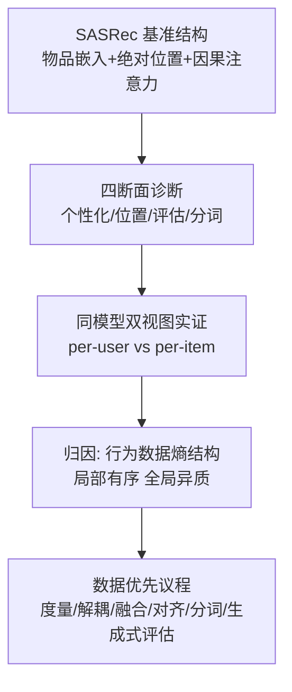

# Revisiting Self-Attentive Sequential Recommendation Beyond the LLM Paradigm (重访自注意力序列推荐：走出 LLM 范式之外)

- **会议/期刊**: ICDM 2026 (BlueSky Track)
- **作者与机构**: Zan Huang (NVIDIA)
- **推荐链路定位**: 召回（Next-Item 序列建模）
- **研究方向**: 序列与会话推荐 / 去偏公平与工业架构
- **论文原文**: [arXiv:2504.09596v2](https://arxiv.org/abs/2504.09596v2)
- **开源代码**: [kang205/SASRec](https://github.com/kang205/SASRec)（本文为立场/诊断论文，无新模型代码）

## TL;DR (1分钟核心速览)

本文是一篇 BlueSky 立场论文，**不提出新模型**。核心论点是：推荐与语言建模虽同为「整数 ID 序列 + 因果自注意力」，但目标熵方向相反——推荐是**增熵**（让更多用户接触更多物品），语言建模是**减熵**（多种问法收敛到同一答案）；行为数据是「局部有序、全局异质」的赌场，语言语料是「局部多样、全局收敛」的图书馆。作者以 SASRec 为解剖对象，指出四条被继承但非本质的假设（隐式个性化、绝对槽位位置、易泄漏单步评估、原子化 token），并给出数据优先的研究议程。唯一实证是表 I：同一 SASRec、同一 ML-1M 交互日志，按用户视图 vs 按物品视图训练，NDCG@10 从 0.592 跳到 0.669、HR@10 从 0.821 跳到 0.952——「什么算一条序列」本身就是建模决策。

## Background & Motivation (背景与核心矛盾)

- **主流范式**: SASRec 将 Transformer 解码器移植到 Next-Item 预测，此后 TiSASRec、BSARec、SSE-PT、TIGER、HSTU、HLLM 等沿同一蓝图持续加料，表面看是「生成式推荐」向语言模型收敛。
- **前人局限一（规模失配）**: 推荐确实在扩展，但主要是 **scale out**（更大嵌入表、更丰富特征、更长历史），而非语言模型式的 **scale up**（沿算力增长）；HSTU 的万亿参数绝大部分落在嵌入表与基础设施而非注意力深度。
- **前人局限二（数据分布失配）**: 图 1 给出动机性证据——在约百万符号的对齐预算下，Wikipedia token 严格服从幂律（词表前 1% 约占 52% 概率质量），而 ML-1M 物品 ID 的尾部平坦破碎（前 1% 不足 10%）。作者明确声明该比较受表示方式与词表规模混淆，仅作动机而非证据。
- **核心洞察 (Key Insight)**: 推荐处在**闭环**中——上一轮推荐策略决定了下一轮训练标签，所谓「下一个物品」不是自由选择而是博弈中的一步，真实兴趣只能通过 bandit 式反馈间接观测。因此「没有复现 LLM 式干净 scaling」更像数据属性而非建模失败。
- **本文切入点**: 不做新模型，而是把 SASRec 当作**比较研究对象**，逐条追问哪些继承假设是偶然的、哪些是推荐任务内在的。

## Method (核心方法设计)

### 1. 整体框架 (Overall Architecture)

论文的组织逻辑是一条「诊断—归因—议程」链：先以 SASRec 的极简结构（物品嵌入表 + 位置嵌入表 + 解码器栈 + 点积打分头）为基准，指出其形式与语言模型同构；再从四个断面（个性化、位置、评估、分词）逐一展示「图书馆形状的架构被搬到赌场形状的数据上」所产生的错配；最后把四条症状归因到同一病根——行为数据的熵结构，并给出六条数据优先的整改方向。全文不含新算子，其「方法」即这套比较分析的透镜本身。

### 2. 关键设计拆解 (Key Designs)

1. **诊断一：个性化从未进入注意力**：SASRec 的打分形式为 $s(j)=\boldsymbol{h}^{\top}\boldsymbol{e}_j$，其中$\boldsymbol{h}=f_\theta(\boldsymbol{E}_{i_1}+\boldsymbol{P}_1,\dots,\boldsymbol{E}_{i_T}+\boldsymbol{P}_T)$，用户 ID 被数据采样器读取却从不进入模型（作者核对 TensorFlow 与 PyTorch 两份参考实现确认）。后果是：无负采样时，物品序列相同的两个用户得分完全一致；有负采样时，区分被下放给随机过程，冷启动用户受害最深。作者进一步指出「用户由物品定义、物品由用户定义」的无穷回退困境，出路是不对称处理——物品可锚定为不动点，用户应被描述为物品空间上的一条**轨迹**，而模型从未显式构造这一对象。TiSASRec 的位置-时间间隔偏置近似于矩阵分解的低秩共现结构，SSE-PT 的用户嵌入也只是加性旁挂而非重塑注意力。

2. **诊断二：位置按槽位而非按目标**：因果掩码只区分「前缀内/外」，不告诉模型每个物品距预测目标多远，这是位置编码的职责。但 SASRec 按绝对槽位索引（图 2a），一次因果前向打包的三个子任务（预测 $i_1,i_2,i_3$）复用同一组$p[-3],p[-2],p[-1]$并叠在同一行，物品编码不反映其与目标的距离。目标对齐方案（图 2b）从目标反向计数，使紧邻前驱恒携带$p[-1]$，代价是每个子任务须拆成独立训练样本。作者还提出一个被语言惯例浪费的自由度：位置通道与物品嵌入共享维度，但轨迹的内在复杂度可能远低于物品几何，**低维解耦的位置通道**值得尝试。

3. **诊断三与四：评估泄漏与无组合的 token**：标准 leave-last-out + 采样负例协议存在多重已知问题（采样指标与精确排序不一致、调优后的神经模型未必胜过简单基线、逐用户划分忽略全局时间线导致未来事件泄漏进训练上下文、部分基准本身序列结构薄弱）。单步命中难以区分「学到偏好」与「逼近边际物品分布」。作者建议的最低限度防护是**先按全局时间排序再划分**。分词方面，物品 ID 是原子的、词表即全目录，模型只能从共现中学习一切关系；TIGER/GPTRec 的语义 ID 与 ActionPiece 的上下文相关合并是起步，作者**猜想而非断言**原子 ID 序列在统计上比 BPE 序列更稀薄（短上下文复现率低），并认为推荐可能同时需要「合并常见模式」与「分解稀有物品」两个方向。

4. **训练目标与实证设计**：本文无新损失函数。唯一的定量实验是控制变量对比：固定同一 SASRec 架构与超参，仅改变数据视图——同一 ML-1M 交互日志既可读作「每用户一条序列」，也可按全局时间重排为「每物品一条序列」，两者精度差异显著（见表 I），说明序列的边界定义本身是建模决策而非数据固有属性。

## Experimental Setup & Evaluation Protocol (实验设置与评估协议)

- **数据集与预处理**: 仅使用 MovieLens-1M 作为演示性实证；图 1 的对照语料为 Wikipedia `20220301.en` 段落，经 GPT-2 BPE 分词后累积到与 ML-1M 匹配的约百万符号预算。

| 数据集 | #Users | #Items | #Interactions | 稀疏度/密度 | 特征/场景说明 |
| :--- | :---: | :---: | :---: | :---: | :--- |
| ML-1M (per-user 视图) | 6,040 | 3,706 | 1,000,209 | 密度 ≈ 4.47% | 每用户一条时间序序列 |
| ML-1M (per-item 视图) | 6,040 | 3,706 | 1,000,209 | 同上（重排） | 按全局时间重排为每物品一条序列 |
| Wikipedia (对照) | — | 35,461 词表 | 1,000,179 tokens | — | GPT-2 BPE，仅用于秩-频对照 |

- **数据划分与防穿越 (Splitting Strategy)**: 表 I 明确采用**全局时间排序后**再构造序列，这正是作者主张的防泄漏做法；论文同时批评了社区惯用的逐用户 leave-last-out 会让晚于测试点的事件泄漏进训练上下文。
- **排名评测协议 (Ranking Protocol)**: 报告 NDCG@10 与 HR@10，未声明采样负例比例，属演示性小规模对比而非严格 Full-Ranking 基准；作者本人亦强调单步指标不足以区分偏好学习与边际分布拟合。
- **对比基线与超参设置**: 无外部基线对比——两组结果来自**同一模型、同一超参**，唯一变量是数据视图，因此差异可归因于数据组织方式而非模型容量。

## Key Experimental Results (实验关键数据)

### 1. 主实验对比 (Main Results)

表 I 是全文唯一的定量表，本质是「同模型、双视图」的受控对照，而非与传统基线的横向比拼：

| 数据视图 | NDCG@10 | HR@10 | 相对提升 |
| :--- | :---: | :---: | :---: |
| ML-1M per-user | 0.592 | 0.821 | — |
| ML-1M per-item | **0.669** | **0.952** | NDCG **+12.99%** / HR **+15.96%** |

### 2. 消融实验 (Ablation Study)

本文为立场论文，**未设消融实验**。其「消融」以概念形式呈现：四条继承假设（隐式个性化、绝对槽位位置、泄漏式单步评估、原子 token）被逐条拆解为「语言形状 vs 赌场数据」的错配，并各自配以替代方向，但均未做定量验证。

### 3. 关键实验发现 (Key Findings)

1. **序列边界即建模决策**：同一份 1,000,209 条交互、同一 SASRec、同一超参，仅把「每用户一条序列」改为「按全局时间重排的每物品一条序列」，NDCG@10 即从 0.592 升至 0.669（+12.99%），HR@10 从 0.821 升至 0.952（+15.96%）。这说明公开基准上的精度差异有相当部分来自数据视图选择，而非架构优劣。
2. **幂律尾部可能是 scaling 的机制本身**：Wikipedia 前 1% 词表承载约 52% 质量、ML-1M 前 1% 物品不足 10%，作者据此提出「好的数据幂律是否是好的模型 scaling 律的前提」这一可检验命题，并援引从数据谱结构推导 scaling 指数的理论工作作为先例。
3. **个性化信号在注意力之外累积**：从 SASRec 到 HSTU，效果增益主要来自嵌入表与检索管线（scale out），注意力深度贡献有限；这解释了为何单纯加深自注意力难以复现语言模型的算力 scaling 曲线。

## Highlights & Limitations (亮点、对比与审稿批判)

- **与代表作对比 (vs. Prior Work)**: 与 TiSASRec（在注意力上加时间间隔偏置）、SSE-PT（加性注入用户嵌入）、BSARec（傅里叶域归纳偏置）相比，本文不新增任何模块，而是指出这些工作都在**注意力图之外**修补症状；与 TIGER/GPTRec（语义 ID 分词）、HSTU（工业级 scale out）相比，本文追问的是这些借用是否触及数据本质。其独特价值在于把分散的批评（采样指标不一致、leave-one-out 泄漏、基准序列性薄弱）统一到「熵结构错配」这一根因下。
- **可迁移亮点**: (1) **全局时间排序后再划分**是零成本、可立即落地的防泄漏措施，适用于任何序列推荐离线评测；(2) **同模型双视图对照**是一种干净的归因实验设计，可用于判断某增益究竟来自模型还是数据组织；(3) 低维解耦位置通道 + 变长免 padding 训练，可同时改善算法对齐与工程效率。
- **审稿级局限批判**: (1) **实证极薄**——全文仅一张两行表、单一数据集、单一模型，四条诊断均无定量支撑，图 1 的幂律对比作者自己也承认受表示与词表规模混淆，作为 ICDM 正会论文证据强度不足；(2) **议程可操作性弱**——「度量数据熵结构」「融合个性化进注意力」「开放分词设计空间」等方向缺少可执行的损失函数、复杂度分析或失败模式界定，且未讨论工业部署中闭环反馈与离线评估的根本鸿沟如何弥合。

## Rating (四维评分)

- **方法创新性 (Novelty)**: ⭐⭐⭐ （无新模型，但「增熵 vs 减熵」的熵结构视角与四断面统一归因具有真正的概念新颖度）
- **评估协议与实验扎实度 (Protocol & Experiments)**: ⭐⭐ （仅一张两行受控表、单数据集单模型，四条诊断全无定量验证，作者自认图 1 仅为动机）
- **写作与数学规范度 (Clarity & Rigor)**: ⭐⭐⭐⭐ （论证线索清晰、类比克制且自我设限，公式虽少但符号一致，对前人工作的定位准确）
- **工业落地与复现价值 (Industrial & Practical Value)**: ⭐⭐⭐ （全局时间切分与双视图对照可即刻复用，但整体为议程设定，缺少可直接部署的组件与开源实现）

