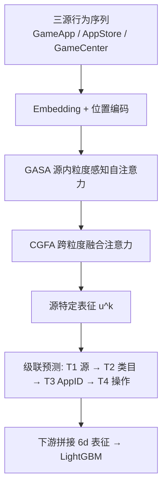
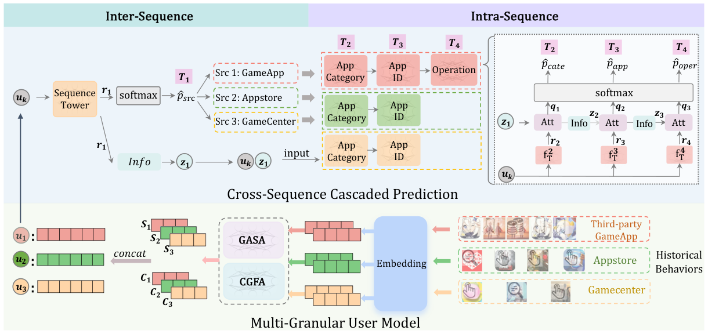

# User Representation via Cross Multi-source Behavior Pre-training for Mobile Games (面向手游的跨多源行为预训练用户表征)

- **会议/期刊**: IEEE ICDM 2026 (Regular Paper)
- **作者与机构**: Chengqi Yang, Yiran Qiao, Jiayuan Xu, Xiang Ao (中科院计算所/国科大) 与 Feng Liu, Xingyu Lou, Zijun Zhou, Xiaoyun Mo, Changwang Zhang, Jun Wang (OPPO 研究院)
- **推荐链路定位**: 召回（用户表征预训练，供下游 LightGBM 排序/触达模型使用）
- **研究方向**: 序列与会话推荐 / 跨域与多场景推荐
- **论文原文**: [https://arxiv.org/abs/2609.01057v1](https://arxiv.org/abs/2609.01057v1)
- **开源代码**: 暂未开源

## TL;DR (1分钟核心速览)

现有用户行为预训练几乎都假设"单 App / 单源、同粒度"序列，而手机设备日志天然是**多源异构 + 粒度严重不对称**的：系统应用（AppStore、游戏中心）可拿到细粒度搜索/点击，第三方游戏 App 只能拿到安装/卸载/启动这类粗粒度事件，且后者行为量远大于前者。CM-PTM 把"预测下一个行为"拆成**源→App 类目→App ID→操作**的级联掩码预测，并用粒度感知自注意力 + 跨粒度融合注意力分别建模源内连续性与源间意图关联。在 OPPO 六个真实手游触达任务上，AUC 相对最优基线提升 1.05%–2.85%，线上 A/B 相对 DeepFM 提升 1.28% AUC。

## Background & Motivation (背景与核心矛盾)

- **主流范式**: 以 PeterRec/PTUM 为代表的生成式（MBP/NBP）与 CLUE/CCL/AdaptSSR 为代表的对比式预训练，均把用户行为序列当作"词序列"处理，输入是单一来源、单一粒度的行为流。
- **前人局限一（粒度不对称）**: 设备级日志中细粒度源（AppStore 搜索/点击）与粗粒度源（第三方 App 的 install/launch/uninstall）行为量相差两个数量级，标准 Transformer 把所有 token 一视同仁，无法区分"一次搜索"与"一次启动"的信息量差异。
- **前人局限二（跨源连续性被破坏）**: 把多源行为按时间戳拼成一条序列（如 MAFN、CLUE 的做法）会打断源内局部连续性，使"强序列依赖"这一预训练核心假设失效；消融显示单序列合并使 G1/G5 的 AUC 分别掉 1.76%/1.52%。
- **核心洞察 (Key Insight)**: 用户意图是**分层决策**的——先决定"去哪个源"（如打开 AppStore），再决定"类目"、"具体 App"、"做什么操作"。图 1 的真实案例中，用户经 TikTok 广告→AppStore→浏览器多步浏览《Zombie Frontier》却未安装，说明跨源多步engagement 与最终安装意图之间存在弱信号，必须显式建模源间转移。
- **本文切入点**: 不做新注意力算子，而是做**系统级架构**：多源独立编码 + 级联代理任务，把 NBP 解耦为源预测与源内细化两阶段。

## Method (核心方法设计)

### 1. 整体框架 (Overall Architecture)

输入为按来源分组的 $n=3$条行为序列（第三方 GameApp、AppStore、GameCenter），各自经 Embedding + 位置编码截断/补齐到长度$l=256$。每条序列先过**粒度感知自注意力 GASA** 捕捉源内同粒度行为关联，再过**跨粒度融合注意力 CGFA** 以本源为 Query、其余两源拼接为 Key/Value 做跨源对齐，二者输出拼接得源特定表征$\boldsymbol{u}^k$。预训练阶段三个源各自独立完成级联任务（源→类目→App→操作），下游阶段把 6 个向量拼接成$d_u=6\times64$ 维用户表征送入 LightGBM。

<figure class="paper-figure" markdown="span">
  <figcaption>图 2. 所提出的 CM-PTM 框架的整体架构。下半部分描绘了多粒度用户编码器，它从不同来源的历史行为中导出用户表示。上半部分展示了跨源级联预测模块，由源间和源内阶段组成。图中粗体 uk 表示式 (6) 中的源特定表示；斜体 u 表示用户实体（第 III 节）。</figcaption>
</figure>

### 2. 关键设计拆解 (Key Designs)

1. **粒度感知自注意力 GASA + 跨粒度融合注意力 CGFA（解决粒度不对称）**：痛点是把细/粗粒度 token 混在一起做注意力会让粗粒度事件淹没细粒度信号。GASA 在**单源内部**做标准多头自注意力后均值池化得 $g^k_u$；CGFA 则让源$k$作 Query、其余源拼接$\boldsymbol{E}^{2,3}_u$ 作 Key/Value：
$\boldsymbol{c}^1_u=\text{MeanPool}\big(\text{Concat}(\text{Attn}^1_1,\dots,\text{Attn}^H_1)W^O_1\big),\ \text{Attn}^h_1=\text{softmax}\big(\tfrac{Q^h_1(K^h_{2,3})^\top}{\sqrt{d_k}}\big)V^h_{2,3}$
直觉是：源内注意力保连续性，跨源注意力只做"意图对齐"而不污染源内分布，从而在不对称数据下同时拿到局部与全局信息。

2. **跨源级联预测（解决跨源意图歧义与标签噪声）**：直接预测下一个 App ID 的动作空间过大且跨源歧义严重。CM-PTM 先做源预测 $T_1$：$\hat{p}^k_{src}=\text{softmax}(f_{src}(\boldsymbol{u}^k))$，再用 Info 网络产出可微任务状态$z^k_1=f^1_{info}(r^k_1)$，后续子任务以注意力融合前序状态：$q^k_i=f^i_{attn}(r^k_i,z^k_{i-1}),\ \hat{p}^k_i=\text{softmax}(W_iq^k_i+b_i)$。关键细节是**传软状态而非硬标签**，避免级联误差累积；且$T_4$ 仅在第三方 GameApp 上启用（install/uninstall/launch 才携带态度信号），AppStore/GameCenter 的 click 与 search 均为正意图，跳过以省算力。

3. **训练目标与效率**：$\mathcal{L}=\lambda\mathcal{L}_{INTER}+(1-\lambda)\mathcal{L}_{INTRA}$，其中$\mathcal{L}_{INTER}=-\sum_{k=1}^{3}\log(\hat{p}^k_{src,s_u})$，$\mathcal{L}_{INTRA}$为各源适用子任务的交叉熵之和，$\lambda=1/2$。预训练仅设训练/验证集（9:1），不设测试集；三个源表征各取$d_u/3$ 维独立预训练，额外开销极小。

## Experimental Setup & Evaluation Protocol (实验设置与评估协议)

- **数据集与预处理**: OPPO 设备级日志，预训练采样窗口 2023/07/13–07/19，与下游数据**无时间重叠**：

| 数据集 | #Users | #Items | #Interactions | 稀疏度/密度 | 特征/场景说明 |
| :--- | :---: | :---: | :---: | :---: | :--- |
| 预训练集 | 1,947,683 | 83,341 | 人均 144.93 次 GameApp 操作 | 极稀疏 | 三源：GameApp 操作 / AppStore 点击 62.21、搜索 22.60 / GameCenter 点击 3.84、搜索 1.12 |
| G1–G3 (老游戏拉新) | 训练 23.7万–76.7万 | — | 正负比 1:2 | 测试正例率 0.003%–0.087% | Mini World / Eggy Party / Sky |
| G4 (老游戏唤回) | 195.0 万 | — | 正负比 1:2 | 0.579% | Honor of Kings |
| G5–G6 (新游戏拉新) | 36.4万–67.5万 | — | 正负比 1:2 | 0.024%–0.219% | Crystal of Atlan / Journey to West |

- **数据划分与防穿越 (Splitting Strategy)**: 下游为**时间窗口切分**——训练集采样于 7/20–7/25 各窗口，测试集取其后一周的百万级随机用户，且与训练/验证集用户不相交；预训练与下游严格无时间重叠。
- **排名评测协议 (Ranking Protocol)**: 非全库排序，而是**触达二分类评估**，指标为 AUC 与 $R@P_{0.95}$（precision ≥ 0.95 约束下的最大召回），更贴近"高精度触达"业务约束。
- **对比基线与超参设置**: 生成式 PeterRec/PTUM/BERT4Rec，对比式 CLUE/CCL/AdaptSSR，混合式 MAFN；不支持多源输入的基线将行为按时间合并为单序列。$d=64$，$d_u=6\times64$，batch 512，lr$1e^{-4}$，$l=256$，$H=2$，$\lambda=1/2$；5 次运行配对 t 检验$p<0.05$。

## Key Experimental Results (实验关键数据)

### 1. 主实验对比 (Main Results)

| 方法 | G1 AUC | G1 R@P | G2 AUC | G3 AUC | G4 AUC | G5 AUC | G6 AUC | G6 R@P |
| :--- | :---: | :---: | :---: | :---: | :---: | :---: | :---: | :---: |
| None (仅画像) | 0.7920 | 0.3164 | 0.7543 | 0.8553 | 0.8008 | 0.8906 | 0.9730 | 0.8546 |
| BERT4Rec | 0.8370 | 0.4579 | 0.8109 | 0.8779 | 0.8546 | 0.8819 | **0.9867** | 0.9034 |
| PeterRec | 0.8258 | 0.4681 | 0.8113 | 0.8697 | 0.8590 | 0.8948 | 0.9829 | 0.9201 |
| PTUM | 0.8235 | 0.4458 | 0.8126 | 0.8676 | 0.8263 | 0.8911 | 0.9822 | 0.8710 |
| CLUE | 0.8198 | 0.4476 | 0.8036 | 0.8689 | 0.8347 | 0.8916 | 0.9803 | 0.8839 |
| AdaptSSR | 0.8247 | 0.3969 | 0.8017 | 0.8871 | 0.8325 | 0.8509 | 0.9793 | 0.9190 |
| MAFN | 0.8366 | 0.4571 | 0.8064 | 0.8679 | 0.8367 | 0.8859 | 0.9856 | 0.9072 |
| **CM-PTM** | **0.8542** | **0.4829** | **0.8411** | **0.8976** | **0.8724** | **0.9056** | 0.9859 | **0.9288** |
| Improv. | +1.72% | +1.48% | +2.85% | +1.05% | +1.34% | +1.08% | -0.08% | +0.87% |

线上 A/B（289 万活跃用户，2025/01/05–01/18）：DeepFM 0.8064/0.3549 → DeepFM+CM-PTM 0.8192/0.3656，**+1.28% AUC / +1.07% R@P**。

### 2. 消融实验 (Ablation Study)

| 组别 | 变体 | G1 AUC | G1 R@P | G5 AUC | G5 R@P |
| :--- | :--- | :---: | :---: | :---: | :---: |
| — | CM-PTM 完整 | **0.8542** | **0.4829** | **0.8956** | **0.5176** |
| 数据 | w/o 细粒度 | 0.8485 | 0.4723 | 0.8728 | 0.4404 |
| 数据 | w/o 粗粒度 | 0.8278 | 0.4388 | 0.8717 | 0.4413 |
| 序列 | w/o 多序列（合并单序列） | 0.8366 | 0.4539 | 0.8804 | 0.4547 |
| 任务 | w/o $T_1$ 源预测 | 0.8490 | 0.4775 | 0.8769 | 0.4440 |
| 任务 | w/o $T_2$ 类目 | 0.8515 | 0.4796 | 0.8934 | 0.4946 |
| 任务 | w/o $T_3$ AppID | 0.8477 | 0.4664 | 0.8919 | 0.4861 |
| 任务 | w/o $T_4$ 操作 | 0.8534 | 0.4818 | 0.8825 | 0.4476 |
| 任务 | w/o 级联（改并行） | 0.8307 | 0.4435 | 0.8726 | 0.4393 |

### 3. 关键实验发现 (Key Findings)

1. **粗粒度源不可替代**：去掉粗粒度行为使 G1 AUC 掉 2.64 个点（比去掉细粒度掉的 0.57 点大 4 倍），说明第三方 App 的海量 install/launch 事件才是意图主信号，细粒度源起的是"意图确认"作用——这直接反驳了"只保留高质量细粒度日志"的直觉。
2. **级联结构本身贡献最大**：把级联换成并行预测，G1/G5 的 AUC 分别掉 2.35/2.30 个点，超过移除任一单个子任务；而 $T_1$ 源预测在新游戏 G5 上移除后掉 1.87 点，为四任务之首，印证"先定源再定动作"的分层决策假设对新品冷启尤为关键。
3. **生成式优于对比式，且增益集中在稀疏场景**：所有生成式基线普遍高于 CLUE/CCL/AdaptSSR，作者归因于对比式的 mask/replace 增广会跨源替换语义（如把 AppStore 搜索换成 GameApp 启动、把安装换成卸载），破坏意图；CM-PTM 在正例率最低的 G3（0.003%）上取得最大 AUC 提升 +1.05%，在正例率最高的 G6 上 AUC 反而 -0.08%，但 $R@P_{0.95}$ 仍 +0.87%，说明其优势主要体现在极稀疏高精度触达场景。

## Highlights & Limitations (亮点、对比与审稿批判)

- **与代表作对比 (vs. Prior Work)**: 相比 PeterRec/PTUM 的单一 MBP/NBP 目标，本文把 NBP 解耦为源级 + 三级源内子任务，显式建模跨源转移；相比 MAFN 的"多类型 App 行为"仍属单源 app-level 建模，本文是设备级多源异构；相比 CLUE/CCL 的对比增广，本文完全避开跨源扰动带来的语义破坏风险。
- **可迁移亮点**: (1) "传软任务状态 $z^k_i$ 而非硬标签"的级联设计可直接迁移到多场景/多业务线的粗精排一致性建模；(2) 按源独立预训练、下游再拼接的策略，在隐私受限（第三方 App 只能拿粗粒度事件）的工业环境下是低成本高收益的通用范式。
- **审稿级局限批判**: (1) 位置编码仅刻画短期窗口内的相对顺序，未建模绝对时间间隔，对"搜索后隔 3 天再安装"这类跨源长延迟意图可能失效，作者亦在结论中承认；(2) 评估局限于 OPPO 手游触达二分类，缺少公开数据集与 Full-Ranking 召回指标，且 $R@P_{0.95}$ 阈值选择缺乏敏感性分析；训练耗时 5.74h 高于多数生成式基线（BERT4Rec 3.86h），虽低于 MAFN 6.53h，但大规模日更场景下成本仍需权衡。

## Rating (四维评分)

- **方法创新性 (Novelty)**: ⭐⭐⭐⭐ （级联"源→类目→App→操作"的软状态传递是清晰且贴合业务的增量设计，但注意力算子本身无新意，作者亦自陈是系统级架构贡献）
- **评估协议与实验扎实度 (Protocol & Experiments)**: ⭐⭐⭐⭐ （六个真实下游任务 + 线上 A/B + 三组消融 + 效率对比相当完整，扣分在于无公开数据集、无全库排序协议、阈值敏感性缺失）
- **写作与数学规范度 (Clarity & Rigor)**: ⭐⭐⭐⭐ （符号体系对 $\boldsymbol{u}^k$与$u$的区分交代清楚，公式简洁；但$T_4$跳过逻辑与$\mathcal{L}_{INTRA}$中$N(T)$ 的表述略绕）
- **工业落地与复现价值 (Industrial & Practical Value)**: ⭐⭐⭐⭐⭐ （线上 289 万用户 A/B 验证 +1.28% AUC，推理仅增 $d_u$ 维特征、开销可忽略，是少见的端到端可落地预训练方案；可惜未开源）

